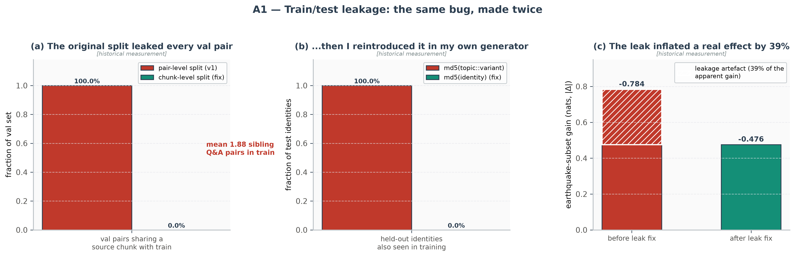
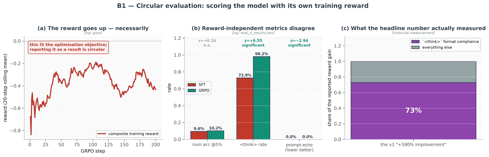
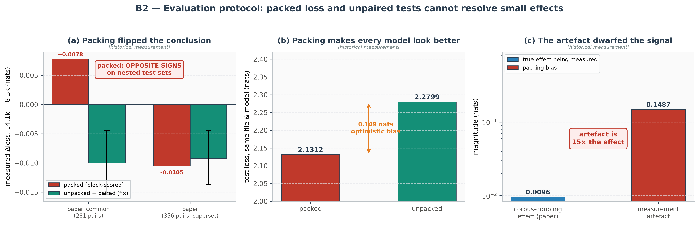
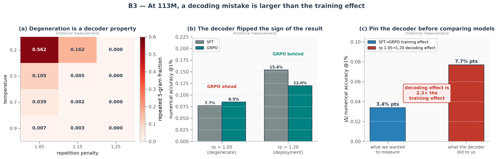
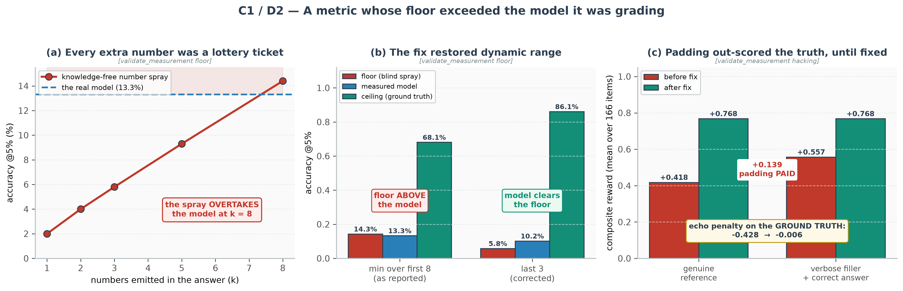
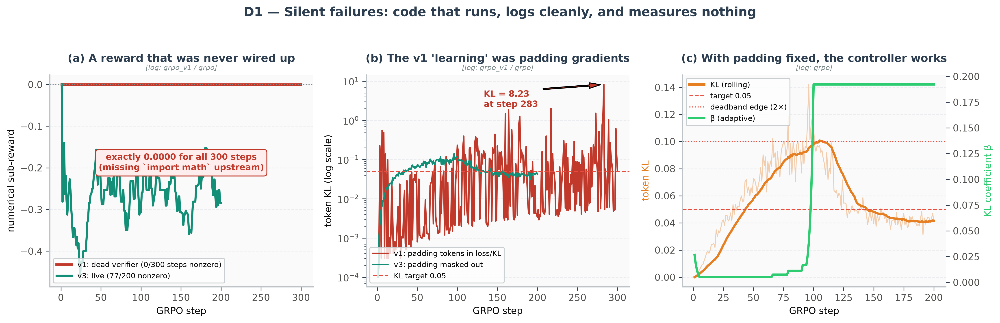
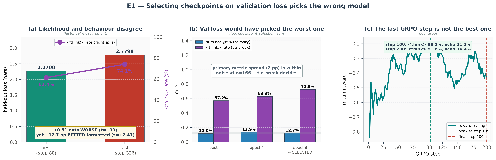
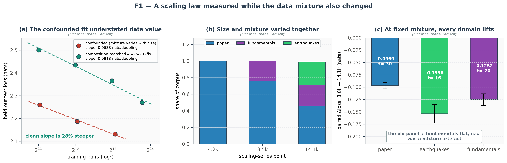

# Failure atlas

[English](PITFALLS.md) | [中文](PITFALLS.zh-CN.md)

How this pipeline silently fails, how each failure was detected, and what test now
prevents it from recurring.

Every entry is a mistake actually made here on the Phase II SFT / Phase III verifier-RL
pipeline for the 113M from-scratch seismology model — caught by measurement, corrected, and
given a permanent regression check. Nothing below is a generic best-practice list.

> Naming. Phase III is group-relative REINFORCE with KL regularization, not
> canonical GRPO. Directory names, config keys, and historical log lines still say `grpo`;
> that label is kept for continuity. See README [§5.3](README.md#54-how-this-implementation-differs-from-canonical-grpo).

**The organising observation: almost every serious problem here was a measurement problem,
not a modelling problem.** Nine of the eleven incidents produced a number that looked
plausible, was reported as a result, and was wrong. Only one (B3) involved the model itself
misbehaving — and even there the damage was to the measurement.

Companion document: [README.md](README.md) explains how the pipeline works and what the
corrected experiment showed.

Figures: `assets/pitfall_1..8_*.{png,pdf}` — regenerate with `python -m src.plots pitfalls`.

---

## Index

| id | incident | category | cost if uncaught | figure |
|---|---|---|---|---|
| A1 | Train/test leakage, made twice | data integrity | every val number meaningless | `pitfall_1_data_leakage` |
| B1 | Circular evaluation | eval protocol | a fabricated "+590%" headline | `pitfall_2_circular_evaluation` |
| B2 | Packed and unpaired evaluation | eval protocol | conclusions flip by test file | `pitfall_3_evaluation_protocol` |
| B3 | Decoding artifacts | eval protocol | sign of the result inverted | `pitfall_4_decoding_artifacts` |
| C1 | Metric floor above the model | metric validity | a "capability" a blind baseline beat | `pitfall_8_metric_validity` |
| C2 | No independent-construct metric | metric validity | generalization sold as capability | — |
| C3 | Half of the numerical labels were wrong | metric validity | reward and benchmark capped by the labels; a tier made of echoed givens | — |
| D1 | Silent failures in the reward path | reward spec | 300 RL steps optimising nothing | `pitfall_5_silent_failures` |
| D2 | A live reward-hacking channel | reward spec | padding outscores the truth | `pitfall_8_metric_validity` |
| D3 | A KL controller that rewrote the objective mid-run | reward spec | learned behaviour undone; a "peak" read as overtraining | `grpo_beta_intervention` |
| E1 | Wrong checkpoint-selection criterion | selection & reporting | ship the worse model | `pitfall_6_checkpoint_selection` |
| E2 | Selection and reporting on one split | selection & reporting | headline inflated ~4× | — |
| F1 | Confounded scaling series | analysis | data value understated 28% | `pitfall_7_confounded_scaling` |
| F2 | Bugs in the analysis code itself | analysis | confident wrong figures | — |
| F3 | A training curve sampled from one prompt per step | analysis | noise and type mix read as dynamics | `grpo_stability_v3_vs_v4` |

Each incident uses the same template: **Symptom → The false story → Root cause → Fix →
Permanent regression test → Invalidated artifacts → Generalisable lesson.** "The false
story" is the plausible narrative the wrong number supported; it is the part worth reading,
because that story is what a reader would have believed.

---

# A · Data integrity

## A1 — Train/test leakage, made twice



**Symptom.** Validation loss suspiciously low (2.1237); later, earthquake perplexity
dropping 10.41 → 4.75 after a single data addition.

**The false story.** "The model generalises well to unseen seismology text, and the
earthquake corpus is unusually high-value — look at that perplexity drop."

**Root cause.** Two independent instances of the same class.

1. The SFT splitter shuffled Q&A pairs. The teacher had generated ~3 pairs per source
   chunk, so pair-level splitting put siblings of nearly every validation question into
   training: 864/864 val pairs shared a source chunk with train, mean 1.88 siblings each
  . Val loss, the data-scaling curve, the LR-sweep ranking, and the early-stopping
   step were all measured through that leak.
2. After fixing the splitter, the fundamentals and earthquake generators set
   `chunk_id = md5(topic::variant)`. Each variant became its own chunk, so the now-correct
   chunk-level splitter cheerfully scattered variants of the same earthquake across train
   and test — 100% of held-out identities also appeared in training.

**Fix.** Split on the source document, and make the chunk key the identity
(`md5(identity)`), keeping `(chunk_id, variant)` only as a resume key. Existing data was
remapped rather than regenerated.

**Permanent regression test.** `assert train_identity_ids.isdisjoint(test_identity_ids)` in
`src/sft/build_corpus.py`, run on every data build — not once.

**Invalidated artifacts.** The pre-fix val loss, the first LR sweep, and the first
data-scaling curve. The earthquake gain was real but inflated: −0.784 nats apparent vs
−0.476 true, so 39% of the headline effect was leakage.

**Generalisable lesson.** A leak is a property of the generative process, not of the
splitting code. Fixing the splitter does not immunise you: any new data source can
reintroduce it through its own ID scheme. Encode the invariant as an assertion that runs
after every build.

---

# B · Evaluation protocol

## B1 — Circular evaluation



**Symptom.** RL reported "+0.05 → +0.295 composite reward — +590%".

**The false story.** "Verifier RL delivered a transformative improvement to this model."

**Root cause.** `eval_rl.py` scored SFT vs RL using the same `CompositeRewardEngine` that
produced the training reward, on the first 20 val prompts, one sample each, no error bars —
and the number was additionally hardcoded into the plotting script. Reward went up
because reward was the objective. About **73% of the gain was `<think>`-tag compliance**
Reporting it as evidence of improvement assumes the conclusion.

**Fix.** Replace the circular composite-reward evaluation with **held-out per-construct
metrics and hygiene checks, reported separately with paired uncertainty**: numerical
accuracy against parsed ground-truth values, `<think>` rate, contamination, prompt-echo —
on a hash-pinned held-out set, with significance printed on every run so null results
cannot quietly become wins. These are held-out measurements of the same constructs the
reward optimizes, not independent evidence; see C2.

**Permanent regression test.** `eval_rl.py` prints significance on every metric
unconditionally; results files carry provenance (checkpoints, split, decoder), and the
plotter warns when provenance does not match the log being plotted.

**Invalidated artifacts.** The "+590%" headline, and every v1 claim resting on it.

**What it changed.** Under the honest benchmark, RL's effect narrows to one thing:
`<think>` compliance. That was also v1's stated conclusion — but v1 asserted it on top of a
fabricated number.

**Generalisable lesson.** A training metric can test held-out *generalization of the
optimized construct*, but it cannot be the sole evidence for a broader capability claim.
Decide the held-out metrics before training, keep the training reward clearly labelled as
a reference row, and make significance testing a non-optional part of the eval output.

---

## B2 — Packed and unpaired evaluation cannot resolve small effects



**Symptom.** Two nested paper-only test sets gave opposite signs for the same two
models. The smaller file was a strict subset of the larger, both cleanly held out, same
type mix, same mean length:

| test file | verdict (packed) |
|---|---|
| `common_test.jsonl` (281 pairs) | 14.1k model worse (+0.0078) |
| `test_paper.jsonl` (356 pairs, superset) | 14.1k model better (−0.0105) |

**The false story.** Whichever file you happened to run — "the bigger corpus helps" or "the
bigger corpus hurts." Both were defensible from the numbers.

**Root cause.** Pairs are concatenated into 4096-token blocks under a plain causal mask, so
each pair is conditioned on whatever unrelated pairs precede it. Change the file → change
the packing → change the number. The loss is also token-weighted over the block, so long
pairs dominate. Packing is optimistically biased by ~0.149 nats (2.1312 packed vs 2.2799
unpacked, same file and model) — roughly 15× the 0.0096-nat effect being measured.

**Fix.** Score each pair in isolation (`src.sft.checkpoints compare --unpacked`) and use a
**paired** test so per-item difficulty cancels. The two files then agree: −0.0100 and
−0.0092, both significant.

**Permanent regression test.** `--unpacked` is the default comparison path; `eval_rl.py`
stores per-item outcomes, which is what makes McNemar and paired bootstrap possible at
all.

**Invalidated artifacts.** All packed cross-file comparisons. The bias is near-constant
across models on a fixed file, which is why the F1 scaling slope survived it (−0.064 vs
−0.063); it is cross-file and small-effect comparisons that break.

**Generalisable lesson.** Packed loss is fine for training-time monitoring and unfit for
model comparison. Before trusting an effect, check that your protocol's noise and bias are
smaller than the effect — and always pair.

---

## B3 — At 113M, a decoding mistake exceeds the training effect



**Symptom.** An early held-out comparison reported `<think>` 8.5% → 55.6% and a small
positive numerical delta for RL.

**The false story.** "RL taught the model to think, and improved its arithmetic a little."
The direction of the arithmetic claim was an artifact of the sampler.

**Root cause.** Those numbers were taken at repetition penalty 1.05, where this model emits
**56% verbatim-repeated 5-grams** and frequently never closes its `<think>` tag.
Repeated 5-grams over 4 prompts × 250 tokens:

| temperature | rp 1.05 | rp 1.15 | rp 1.25 |
|---|---|---|---|
| 0.2 | 0.562 | 0.162 | 0.000 |
| 0.5 | 0.105 | 0.005 | 0.000 |
| 0.7 | 0.039 | 0.002 | 0.000 |
| 0.9 | 0.007 | 0.003 | 0.000 |

Two related traps: v1 papered over the same failure with `no_repeat_ngram=3`, which banned
repeated trigrams and produced `M0_code` / `N·mi` word-salad instead; and "deterministic"
greedy decoding (`top_k=1`) is worse, not safer — it enters loops like
`(Δt / Δt) * (Δt / Δt) * …` and reported a 2.6% `<think>` rate against 8.5% at the
deployment config.

**Fix.** Pin temperature 0.3 / top-k 40 / repetition penalty 1.2 as the default in both
`chat.py` and `eval_rl.py`, so manual inspection and the benchmark see the same model.

**Permanent regression test.** The decoding contract is a shared module-level default, not a
per-script argument; eval results record the decoder they used.

**Invalidated artifacts.** Every rp-1.05 comparison. Raising the penalty roughly doubled
measured accuracy for both models (SFT 7.7% → 15.4% @1%) and flipped the sign of the
SFT→RL delta. The decoding effect (7.7 pts) was 2.3× the training effect (3.4 pts).

**Generalisable lesson.** Fix and pin the decoder before comparing checkpoints. At small
scale the decoder is not a presentation detail — it is a larger lever than the training you
are trying to evaluate.

---

# C · Metric validity

## C1 — A metric whose floor exceeded the model it was grading



**Symptom.** None — and that is the point. Numerical accuracy of 13.3% looked like exactly
what a 113M model should score. It was found only by deliberately testing the metric instead
of the model.

**The false story.** "The model has a low but real numerical capability (~13%), and RL
nudged it upward." Neither half survived.

**Root cause.** `eval_rl` scored numerical accuracy as `min(rel_err)` over the **first 8
numbers** in the answer, so every extra number was another lottery ticket. On the 166
held-out numerical items, a question-blind policy that sprays 8 values drawn from the
empirical target distribution scores 14.3% @5% — above the RL model's 13.3% and the
SFT model's 12.7%. The metric could not demonstrate any numerical capability at all.

Compounding it, the ceiling was 68.1%, not 100%: scoring the reference answers against
their own `final_numerical_value` failed on ~32% of items, so a third of the eval set was
unwinnable by construction.

**Fix.** Score the answer tail (`ANSWER_TAIL_NUMBERS = 3`) instead of the first 8. This
improves both ends, because the stated answer sits near the end and "first 8" often never
reached it:

| rule | ceiling | floor | usable range |
|---|---|---|---|
| min over first 8 (as reported) | 68.1% | 14.3% | 53.8% |
| last 3 (corrected) | 86.1% | 5.9% | 80.2% |
| last 1 | 58.4% | 1.9% | 56.5% |

The old anti-spam cap (`reject if >8 numbers`) then became both redundant and harmful — tail
scoring already bounds an attacker to 3 chances however many numbers they emit, while the cap
fired on 40.4% of genuine reference answers (median 6 numbers, p90 34). Removing it lifted
mean `r_num` on the ground truth from +0.274 to +0.723 with no change to the spray floor.

**Permanent regression test.**
`python -m src.analysis.validate_measurement floor` recomputes the blind-spray floor and the
ground-truth ceiling; verifier unit tests 7 (40-number adaptive spray) and 8 (padding
dilution) run with `python -m src.rl.verifiers`.

**Invalidated artifacts.** Accuracy is lower than previously reported (13.3% → 10.2% on
the pooled held-out set). The model does clear the corrected floor, but only just: 10.2%
against a 5.9% floor and an 86.1% ceiling — 5.5% of the way through the usable range.

**Generalisable lesson.** Before trusting any metric, measure its floor (what a
knowledge-free baseline scores) and its ceiling (what the ground truth scores). A number
is only interpretable between them.

---

## C2 — Calling a same-construct metric "reward-independent"

**Symptom.** The evaluation was described in writing as "reward-independent" — a claim about
the evidence, not about any measured value.

**The false story.** "Two independent instruments agree that the model improved." There was
one instrument, measured on different prompts.

**Root cause.** Eval accuracy uses `final_numerical_value` at tolerances 0.01/0.05, and
`NumericalVerifier` uses the same field at the same thresholds; eval `<think>` rate regexes
the same tags `FormatVerifier` checks. Those are the same constructs on held-out prompts —
a train/test split, not construct independence.

**None of the measured outcomes was construct-independent.** Echo and contamination are
hygiene checks rather than capability outcomes, and both also have reward counterparts
(`EchoPenaltyVerifier`, `CleanLanguageVerifier`) — hygiene is a different classification
from independence, and an earlier revision of this document confused the two.

**Fix.** A four-class metric taxonomy stated up front (training / held-out same-construct /
independent outcome / hygiene), with the independent-outcome row explicitly empty. See
README [§3.2](README.md#32-four-kinds-of-metric).

**Permanent regression test.** Structural, not executable: the taxonomy table is part of the
README's measurement section, and any new metric must be filed into one of the four classes.

**Invalidated artifacts.** The wording, not the numbers. Every "independent confirmation"
phrasing in earlier revisions is downgraded to "generalization check."

**Generalisable lesson.** A metric that shares its construct with the training reward is a
generalisation check, not independent evidence — say which you have.

---

## C3 — Half of the numerical labels were wrong

**Symptom.** Found while auditing why closed-book accuracy never moved: a held-out item whose
derivation computes Mw ≈ 7.5 was labelled 2.5, the model answered 7.5, and the eval marked it
wrong. Only 60% of held-out labels equalled the derivation's own final result.

**The false story.** "Numerical accuracy is ~10% because a 113M model cannot compute," and "RL
helps most when the answer is already in the prompt" (README §7.2: retrievable tier
20.6% → 32.4%).

**Root cause.** `prepare_rl_dataset.extract_final_numerical_value` took the last regex match of
`[=≈~]` / "is …" in the reference's final-answer text. It picked an age ("…the Ganges at ~2.5
ka"), a year ("2015"), values given in the question ("120 encounters", "a 0.1 g coefficient",
"magnitude 7.1"), and 0 or 1 on derive/outline questions with no numeric answer. Every label
fed both the RL reward (`NumericalVerifier`) and the benchmark, so the same error capped the
training signal and the measurement.

The retrievable tier was partly an artefact of this: of the 34 held-out items whose label
appeared in the prompt, 17 were labelled with a given value while the real answer had to be
computed. A model that echoed prompt numbers scored on them.

**How it was measured.** Blind adjudication: for random numerical items, the old and new labels
were shown in random order, and each was judged against the question and reference
derivation alone, never a model output. On 40 items untouched by any rule tuning, the old
labels were right for 50% and the new ones for 80%; where they differ, the new label won 16
to 4 (sign test p = 0.012). An earlier untouched sample gave 60% → 78%.

**Fix.** `src/rl/numerical_target.py`: the label is the last value the reference COMPUTES
(an `=` result whose left side contains arithmetic, so "M = 7" does not count), restated
by the final answer; explicit "the answer is X" wins; no label when the question asks for no
number. `python -m src.rl.prepare_rl_dataset relabel` rewrote `data/rl/*.jsonl` in place:
33% of training labels and 29% of held-out labels changed, and 13% / 8% of items lost a
label they should never have had. Every record keeps its old value as
`final_numerical_value_v1` and records `label_source`.

**Permanent regression test.** `python -m src.rl.numerical_target` runs one case per failure
mode; the legacy rule fails 4 of the 10. `eval_rl` now stores each sample's final-answer
numbers, so a future label fix re-scores offline instead of regenerating every model.

**Invalidated artifacts.** Every numerical-accuracy number measured before 2026-10-15,
including the §7.2 tier table, was scored against v1 labels. Corrected re-scores are in
README §1.2.

**Generalisable lesson.** A label extracted by regex from the answer text is a hypothesis, not
ground truth. Adjudicate a blind sample before believing an accuracy, and when a metric never
moves, check the labels before the model.

---

# D · Reward specification

## D1 — Silent failures: code that runs, logs cleanly, and measures nothing



**Symptom.** A reward component logging exactly `0.0000` for 300 consecutive steps; a KL
curve climbing to a spike of 8.23; a training run with visibly healthy loss and no policy
movement.

**The false story.** Respectively: "the numerical verifier is strict and the model is bad at
arithmetic"; "the policy is drifting from the reference — RL is doing something"; "training
is stable."

**Root cause.** Three independent instances of code that executed without error while doing
nothing.

1. **The numerical reward was never wired up.** `NumericalVerifier` read
   `rl_item["final_numerical_value"]`, a field present in 0 of 16,425 records. The root
   cause was upstream: `prepare_rl_dataset.py` called `math.isnan` without `import math`, so
   the "hack-proof V2 dataset" build crashed and training silently fell back to the stale
   schema. The 33% of prompts labelled "numerical" were scored by keyword overlap.
2. **The v1 KL climb was padding gradients.** Forced-EOS padding tokens were inside the
   policy loss and KL, so short completions received gradient on hundreds of never-sampled
   tokens. Rolling KL climbed 0.05 → 0.34 with a spike of 8.23 at step 283, and the "peak
   reward" coincided with the blow-up. That was drift, not learning.
3. **`lr = 1e-6` left the policy frozen.** A 76-step trial reached per-token KL of ~0.001
   against a 0.05 target with adaptive β pinned at its floor. With padding masked out,
   the v1 learning rate does essentially nothing.

**Fix.** A hard schema assertion at dataset load; mask loss and KL to actually-sampled
tokens; raise lr to 5e-6; log entropy, completion length, and stop rate so degeneration
cannot hide behind a healthy-looking reward curve.

**Permanent regression test.** Schema assertion at load; per-component reward curves in
`assets/grpo_training_dynamics.png` (an aggregate reward hides a dead term completely); and
`python -m src.analysis.validate_measurement group` prints per-component spread, where a dead
verifier shows up immediately as `std 0.000`.

**Invalidated artifacts.** The entire v1 run and every claim from it.

**What it changed.** In v3 the numerical verifier fires on 77/200 steps, KL peaks at 0.142,
and the adaptive controller responds — β rises from its 0.005 floor to 0.192 and pulls KL
back to 0.042. (That response turned out to be its own failure: see D3.)

**Generalisable lesson.** A reward that is exactly zero, a metric that never moves, a loss
that is suspiciously smooth — these are bug signatures, not results.

---

## D2 — A live reward-hacking channel


**Symptom.** None in the training curves. Found by constructing eight deliberately
degenerate completions and scoring them against the real `CompositeRewardEngine`.

**The false story.** "The composite reward is robust — it rejects spray, stuffing, and empty
think blocks." Six of the eight were decisively rejected (number spray −0.56, keyword
stuffing and empty think blocks −0.92), which is exactly what made the seventh dangerous.

**Root cause.** **"Verbose filler + correct answer" scored +0.139 ABOVE the genuine
reference.** The echo penalty divided overlap by the candidate's length, so padding
inflated the denominator and walked the ratio back under threshold. The same
mis-specification penalised genuine answers by −0.428 on average for legitimately restating
the question — the metric was simultaneously exploitable and unfair.

**Fix.** Normalise overlap against the prompt instead — the construct actually of
interest, and immune to padding (a literal echo scores 1.000 whether or not filler is
appended). Thresholds recalibrated on 808 genuine answers (max 0.760): 0.85 penalises 0.00%
of them, 0.70 penalises 0.62%. Echo penalty on the ground truth went −0.428 → −0.006, and
padding no longer pays.

**Permanent regression test.**
`python -m src.analysis.validate_measurement hacking` re-runs all eight degenerate
completions and asserts every one scores below the genuine reference.

**Invalidated artifacts.** The previously significant prompt-echo "win"
(21.2% → 11.1%, z=−2.94) was an artifact of the miscalibrated threshold, which also fired on
11% of genuine answers. Under a correctly calibrated detector, no model echoes and there is
nothing to win.

**Generalisable lesson.** Every reward component is a hypothesis about a construct, and
therefore an attack surface. Write the adversarial completion yourself before the optimizer
finds it — and treat a penalty that fires on genuine references as a bug, not strictness.

---

## D3 — A KL controller that rewrote the objective mid-run


**Symptom.** The v3 reward curve rose, peaked near step 100 and regressed; stop rate fell
0.94 → 0.51; KL climbed to 0.10 and was then pulled back to 0.04. β sat at 0.005 for 60 steps,
then went 0.038 → 0.192 in five consecutive steps and stayed there.

**The false story.** "The adaptive controller demonstrably works — it caught the KL excursion
and pulled it back to target" (this file's D1 and the README said so), and "the run peaks at
step 100 and then overtrains, so select the step-100 checkpoint."

**Root cause.** A bang-bang controller: β ×1.5 per step whenever one batch's KL left a
[0.5, 2]×target deadband, floor 0.005, no smoothing. KL starts at zero, so β was driven to
its floor in five steps and the first 60 steps ran with effectively no KL term. When KL
finally crossed 2×target, five consecutive multiplications raised β 38×, and because KL then
sat inside the deadband the controller never brought it back down. After step 100 the run
was optimising a different objective. The likely mechanism: at β = 0.192 the reference pull
dominates whenever a group's reward spread is small — and once format and termination are
learned, most of it is — so the policy is walked back toward the SFT model (held-out stop
rate 0.41).

The controller did "work" in the narrow sense — KL went back to target. That was the
problem: KL was the controlled variable, and the learned behaviour was what paid for it.

**How it was confirmed.** An intervention rather than a correlation: restart from the shipped
step-100 weights with the v3 algorithm, the same prompts and seed, and change only β.
Both arms start at held-out reward −0.233 and stop rate 0.82. Ten steps later the
β = 0.192 arm is at −0.460 with stop rate 0.56; the β = 0.035 arm is at −0.271 with 0.78.
Over steps +10…+60 the high-β arm averages −0.399 against −0.266 and is worse at all six
evaluations, and its KL falls 0.10 → 0.045 — retracing the original run's 0.10 → 0.042. The
regression is reproduced by β alone. (One seed per arm; the shared fresh-optimizer restart
explains the low-β arm's small initial dip.)

**Fix.** `kl_controller: fixed` (β = 0.04 for the whole run). A smoothed proportional
controller (Ziegler et al. 2019: β *= 1 + 0.1·clip(KL_ema/target − 1, ±0.2), ≤ ±2% per step)
is implemented as `proportional` but was not exercised in these runs; the v3 rule survives
only as `legacy`.

**Permanent regression test.** β is logged every step and plotted on a log axis next to KL
(`assets/grpo_stability_v3_vs_v4.png`, panel c); any run whose β moves by more than ~2×
has changed its objective and must be read as two runs.
`configs/rl_grpo_intervention_beta{0192,0035}.yaml` reproduce the intervention.

**Invalidated artifacts.** The "controller demonstrably working" reading in README §5.8 and
D1, and the interpretation of the step-100 peak as the onset of overtraining. The step-100
checkpoint selection itself stands — it was made on held-out behaviour, not on the curve —
but the reason the later checkpoints were worse is the β jump, not too many RL steps.

**Generalisable lesson.** A KL controller is part of the objective. If β moves by an order of
magnitude, the reward curve after the move belongs to a different optimisation problem, and
a "peak" is the seam between the two.

---

# E · Selection and reporting

## E1 — Selecting checkpoints on validation loss picks the wrong model



**Symptom.** Train loss falling to 0.70 while validation climbed to 2.58 — the textbook
overfitting picture.

**The false story.** "Everything after the validation minimum is worthless; ship the
val-optimal checkpoint." Wrong here, and the val-optimal candidate was the worst on the
behaviour that mattered.

**Root cause.** Cross-entropy scores the probability of one specific reference wording. As
training continues the model sharpens onto its own phrasing, lowering the reference's token
probability without making generations worse. Scoring `best` (step 80) against `last`
(step 336) two different ways:

| | best (step 80) | last (step 336) | verdict |
|---|---|---|---|
| held-out loss | 2.2700 | 2.7798 | +0.51 nats worse, t=+33.5 |
| `<think>` rate | 61.4% | 74.1% | +12.7 pp better, z=+2.47 |
| numerical acc @5% | 10.2% | 13.3% | +3.1 pp, n.s. |

*(The accuracy row predates the C1 scoring fix and is retained as the historical
measurement; the loss and `<think>` rows are unaffected, and the conclusion rests on those.)*

**Fix.** `src.sft.checkpoints select` ranks on measured behaviour with the rule declared in
source before looking at results: primary `numerical_acc_5pct`, tie-break
`numerical_think_rate` within 2 pp, hard gates on contamination / echo / non-empty output.
The full table is printed so a human can override.

**Permanent regression test.** The rule lives in module-level constants (`PRIMARY`,
`TIE_BREAK`, `TIE_EPS`, `GATES`), not runtime arguments — it cannot be tuned after seeing
the table.

**What it changed.** On the SFT run it selected epoch 8; validation loss would have picked
epoch 3, the candidate with the worst `<think>` rate of the three. The same rule applied
to RL selected step 100 over the final step 200 — the run peaked mid-way and the last
100 steps were a measured regression (caused by the β jump, not by too many steps: D3). Under corrected C1 scoring that choice gets stronger:
step 100 wins on the primary metric outright (acc@5% 10.2% vs 9.6%) rather than only on the
tie-break, and still leads on `<think>` rate (98.2% vs 91.6%).

**Honest caveat.** In the SFT case the primary-metric spread (12.0 / 13.9 / 12.7%) is within
noise at n=166, so the tie-break did the deciding — and epoch 4 actually had the highest raw
accuracy. The rule is defensible because it was fixed in advance, not because the margin is
convincing.

> [!NOTE]
> Those three SFT accuracies, and panel (b) of the figure above, come from
> `docs/checkpoint_selection.json`, which predates the C1 scoring fix and so carries the
> inflated min-over-8 values. The selection is unaffected: it turned on `<think>` rate
> (57.2 / 63.3 / 72.9%), which that fix does not touch. Re-running
> `src.sft.checkpoints select` would refresh the accuracy column.

**Generalisable lesson.** "Overfitting" is a statement about a specific metric. Decide what
you actually care about, measure that, and never assume the last step — or the val-optimal
step — is the best one.

---

## E2 — Selecting the checkpoint and reporting the result on the same prompts

**Symptom.** None visible. The pipeline was correct in every respect E1 covers — a
pre-declared rule, a hash-pinned held-out set, significance tests — and still produced an
inflated headline.

**The false story.** "GRPO improved numerical accuracy by +3.0 points on a held-out set,
with a CI excluding zero." Every word of that is true about the number; the number is a
development result.

**Root cause.** checkpoint selection and `eval_rl` both defaulted to the **full 808-prompt
held-out pool**. A held-out set stops being held out the moment it chooses a checkpoint. The
pre-declared rule prevents cherry-picking; it does nothing about the prompts having already
voted.

**Fix.** `src/sft/splits.py` — a four-role split contract keyed by source chunk:

```
train   SFT / RL parameter updates
val     training-time monitoring only
dev     hyperparameters, decoder, thresholds, CHECKPOINT SELECTION, metric calibration
test    reported once — never used to change code, thresholds, checkpoints, or decoding
```

Partitioning the pool after the fact bounds the mistake:

| numerical accuracy Δ (SFT → RL) | n | Δ | 95% CI |
|---|---|---|---|
| dev half | 76 | +3.0% | [+0.0%, +6.2%] |
| test half | 90 | +0.8% | [−3.1%, +4.7%] |

Same models, same metric, same decoder, and the dev half reads nearly 4× larger.

> What this fix does NOT achieve. The partition is retrospective. The original
> 808-prompt pool had already been used for checkpoint selection (step 100 over step 200),
> aggregate evaluation, metric development, threshold calibration, and the choice of which
> analyses to run. Hash-pinning freezes the split from this revision onward; it cannot make
> the test half historically untouched.
>
> So the 3.0-vs-0.8 gap is consistent with selection bias, not a clean measurement of
> it: part of it is ordinary heterogeneity between two 80-odd-item halves, and the selected
> checkpoint had already been exposed to both, indirectly. The correct description is a
> retrospective audit split, frozen from this revision onward — not a prospective final
> test.
>
> A genuinely clean final claim needs: freeze code, parser, decoder, verifier thresholds,
> candidate checkpoints, and selection rule; select on dev only; build a new test set from
> previously unused source identities; run it once.

**Permanent regression test.** `assert dev_chunks.isdisjoint(test_chunks)` in
`splits.describe()`; `python -m src.sft.splits data/rl/test.jsonl` prints the contract and
enforces it.

**Invalidated artifacts.** The pooled +3.0% figure, wherever it appeared as a headline. The
test-half numbers in README [§7.1](README.md#71-headline-results) supersede it, under the
caveat above.

**Generalisable lesson.** Count how many decisions a split has been used for. If the answer
is more than one, it is a development set. And a partition introduced after those
decisions bounds the damage — it does not undo it.

---

# F · Analysis and tooling

## F1 — A scaling series measured while the mixture also changed



**Symptom.** A clean-looking log-linear data-scaling fit at 0.0633 nats/doubling, and a
per-domain panel showing earthquake data "rescuing its own domain."

**The false story.** "Data has a modest, measured return here, and domain gains are
domain-specific." Both were shape artifacts of the corpus snapshots that happened to exist.

**Root cause.** Those snapshots differed in composition as well as size:

| point | paper | fundamentals | earthquakes |
|---|---|---|---|
| 4.2k | 100% | — | — |
| 8.5k | 76% | 24% | — |
| 14.1k | 46% | 25% | 28% |

Size and mixture moved together, so the fit superposed two effects. The per-domain panel was
worse: it compared against an 8.5k corpus containing no earthquake data at all, so its
poor earthquake score measured the absence of a corpus, not a scaling effect.

**Fix.** Stratified chunk-level subsamples of the 14.1k corpus holding the mixture at
46/25/28 (±1%) at every size, all scored unpacked on the same pinned test set.

**Permanent regression test.** The series is built by
`data/eval/scaling_{2k,4k,8k}.jsonl` from a single composition-matched generator, so a new
point cannot silently change the mixture.

**Invalidated artifacts.** The 0.0633 slope and the original per-domain panel. The clean
slope is 0.0813 nats/doubling — 28% steeper: the old curve understated the value of
data, because its small points were pure paper, the easier in-distribution subset for that
test set. Rebuilt at fixed mixture, all three domains improve significantly and fairly
uniformly (paper −0.097, earthquakes −0.154, fundamentals −0.125) — a different and more
useful claim than "one corpus rescues its own domain."

**Generalisable lesson.** Reusing whatever checkpoints or corpora you happen to have is how
confounds enter. If you vary one axis, hold the others fixed by construction, even when
that means rebuilding the series.

---

## F2 — Bugs in the analysis code itself

**Symptom.** Figures that looked right. These produced no wrong scientific claim, but each
would have, and they were found only by reading the plotting path while regenerating figures.

**The false story.** Varies — most dangerously "nothing happened for the first 20 steps,"
drawn by a padding artifact.

**Root cause and fix, four instances:**

- **Stale defaults.** `plot_grpo_results.py` still pointed at the previous run
  (`checkpoints/grpo_v2/`, since renamed away) and `chat.py`'s fallback list at `grpo_v2` /
  `sft_v3`. Both would have silently exercised the previous generation of the model while
  appearing to test the new one. Now repointed and CLI-configurable, and an explicit
  `--ckpt-path` that does not exist raises instead of falling back.
- **No provenance on results files.** `docs/eval_rl_results.json` was v2 output with nothing
  marking it as such — indistinguishable from a fresh run. `eval_rl.py` now records
  checkpoints, split, and decoding params, and the plotter warns loudly when eval provenance
  does not match the training log being plotted.
- **Hardcoded axis limits** tuned to the v2 run would have silently clipped v3 data. Now
  data-driven.
- **A rolling-mean padding artifact.** `compute_rolling_mean` back-filled the leading
  `window-1` points with a constant, drawing a flat line across the opening of every panel
  that read as "nothing happened for 20 steps." Replaced with an expanding-window mean.

**Permanent regression test.** Provenance blocks on results files plus the plotter's
mismatch warning; every figure regenerates from logs on disk via `python -m src.plots`, and
nothing in `assets/` is drawn from numbers pasted into the plotting code.

**Generalisable lesson.** The analysis code deserves the same scrutiny as the training code.
A plotting bug and a training bug produce the same thing: a confident, wrong figure.

---

## F3 — A training curve sampled from one prompt per step


**Symptom.** A jagged GRPO reward curve whose 20-step rolling mean still wandered by
±0.1–0.2, with no recognisable "fast rise, slow rise, plateau" shape.

**The false story.** "RL on a 113M model is just unstable."

**Root cause.** Two measurement artefacts on top of the D3 dynamics problem:

1. **Each logged point was one prompt.** The trainer took one prompt per GPU per step and
   logged rank 0's mean over its 8 rollouts. Prompt difficulty dominates that number:
   step-to-step SD 0.35, lag-1 autocorrelation 0.04 — white noise. After removing type means
   and a smooth trend the residual SD is 0.26, so a 20-step mean still carries ±0.06,
   the size of every feature on the curve.
2. **Batches were single-type.** A step was all-numerical (mean −0.64) or all-conceptual
   (−0.19). The numerical share of a 20-step window ranged 20%–70%, so the type mix alone
   moved the rolling mean by up to 0.22 — as large as the entire learning signal.

Type-adjusting the v3 log shows that the step-100 hump survives
(−0.419 → −0.269 → −0.367 → −0.367 by 50-step block), so the noise was not the whole story
(see D3) — but it made the curve unreadable either way.

**Fix.** 32 prompts × 8 rollouts per update with a fixed type mix per batch; every logged
number is all-reduced over the global batch; and a held-out objective — expected reward
under the sampling policy on the 275 validation prompts, same seed every time — logged every
10 steps to `grpo_v4_eval.csv`. Per-step SD around the trend fell 0.30 → 0.05. The trainer
also logs the reward-opportunity statistics README §5.9 asked for: the share of zero-spread
groups and each component's within-group std.

**Permanent regression test.** `n_rollouts` is a logged column; a training curve whose points
cover fewer than a few hundred rollouts should not be read for shape. The held-out
objective is the curve to read for convergence.

**Generalisable lesson.** Before reading a training curve's shape, compute the standard
error of one point. If the per-point SE is the size of the features, the curve is a
measurement of the sampler, not of the optimiser.

---

# The pattern

Ranked by how much wrongness they produced per line of code:

1. **Anything that makes a number look better is guilty until proven innocent.** Every leak,
   every circular metric, the packing bias, and the selection contamination all pushed in the
   flattering direction. That is not coincidence — favourable errors survive review,
   unfavourable ones get investigated immediately.
2. **Silence is the most expensive failure mode.** A crash costs an hour. A reward term stuck
   at 0.0000 costs 300 GPU-steps and a published claim.
3. **Measure the measurement.** Packing bias 15× the effect; decoding effect 2.3× the
   training effect; a metric floor above the model. Before trusting a comparison, quantify
   the noise, bias, floor, and ceiling of the protocol itself.
4. **Fixing a bug class once does not fix it.** The leak came back through a new generator;
   stale paths came back in three separate files. Encode the invariant as an assertion or a
   default, not as a memory.
5. **State the selection rule before seeing the numbers — and count how many decisions each
   split has made.** The first separates "principled tie-break" from "picked the one I
   liked"; the second is worth a factor of four.
