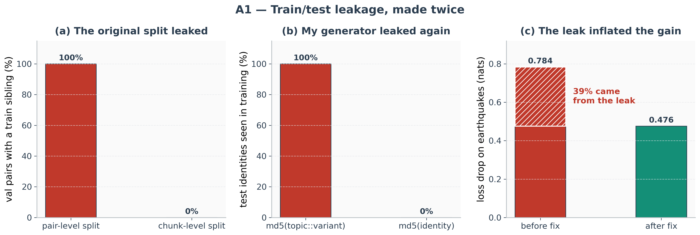
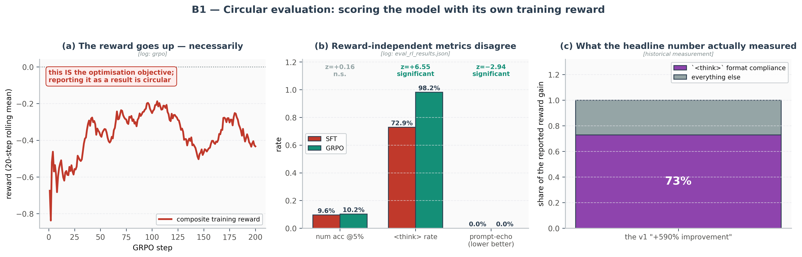
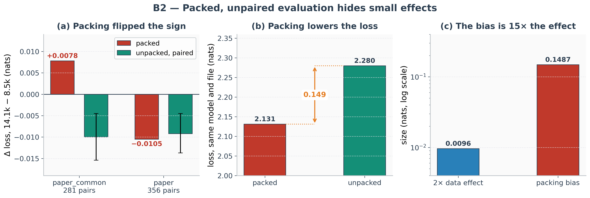
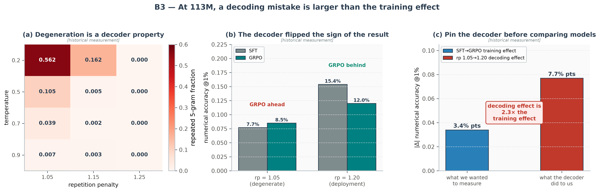
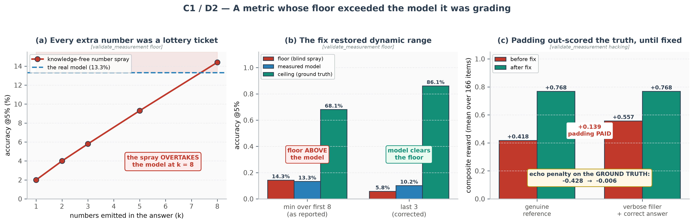
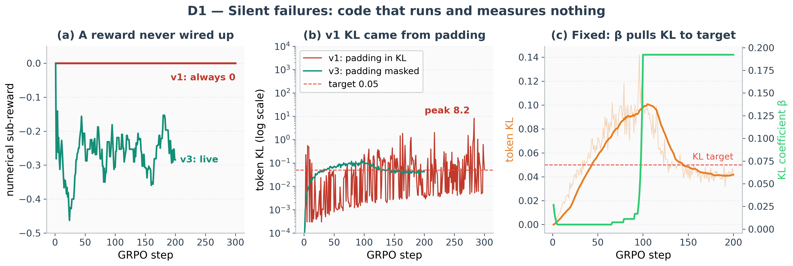
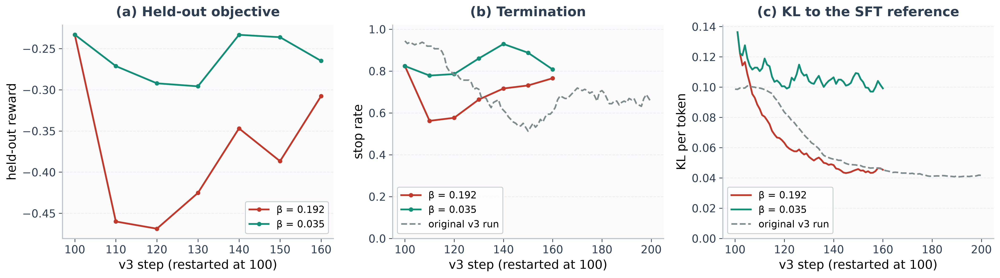
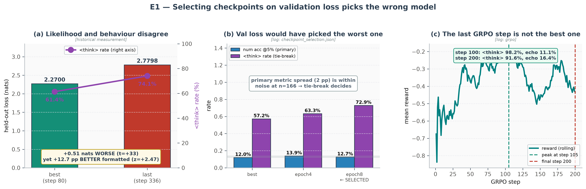
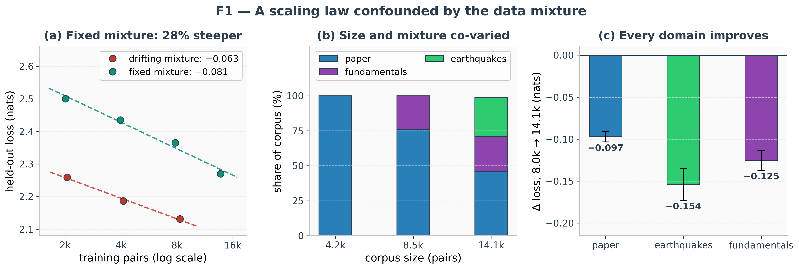
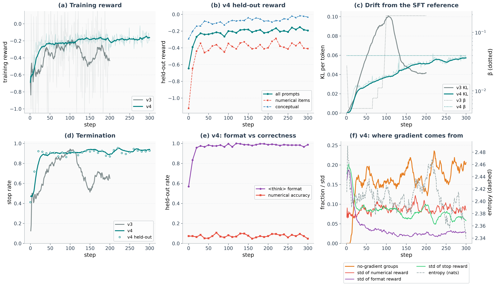

# Failure atlas

[English](PITFALLS.md) | [中文](PITFALLS.zh-CN.md)

This document catalogs how the post-training pipeline silently failed during development, how each failure was diagnosed, and what permanent regression checks now prevent it from recurring.

Every entry below records an actual mistake made while building the Phase II supervised fine-tuning (SFT) and Phase III verifier-RL pipeline for the 113M from-scratch seismology model. Each failure was identified through measurement, corrected in code, and paired with an automated check. Rather than a generic list of best practices, this is an empirical ledger of pipeline bugs and their fixes.

> **Naming convention.** Phase III implements group-relative REINFORCE with KL regularization rather than canonical GRPO. Directory names, config keys, and historical training logs retain the `grpo` label for continuity. See [README §5.4](README.md#54-how-this-implementation-differs-from-canonical-grpo) for the exact algorithmic differences.

**The organising observation: almost every serious problem in this project came from flawed measurement rather than flawed modelling.** In nine of the first eleven incidents, the pipeline produced a plausible-looking number that was reported as a finding and later proved wrong. Only one of those eleven (B3) involved the model itself misbehaving—and even there, the practical harm came from how decoding artifacts distorted the evaluation comparison.

The companion [README.md](README.md) explains the training architecture and what the corrected experiments showed. All diagnostic figures (`assets/pitfall_1..8_*.{png,pdf}`) can be regenerated directly from committed logs with `python -m src.plots pitfalls`.

---

## Index

| ID | Incident | Category | Cost if uncaught | Figure |
|---|---|---|---|---|
| [A1](#a1--traintest-leakage-made-twice) | Train/test leakage happened twice | Data integrity | Validation numbers become meaningless | `pitfall_1_data_leakage` |
| [B1](#b1--circular-evaluation) | Evaluation reused the training reward engine | Eval protocol | A fabricated "+590%" headline improvement | `pitfall_2_circular_evaluation` |
| [B2](#b2--packed-and-unpaired-evaluation-cannot-resolve-small-effects) | Packed and unpaired loss blurred small effects | Eval protocol | Conclusions flip depending on the test subset | `pitfall_3_evaluation_protocol` |
| [B3](#b3--at-113m-a-decoding-mistake-exceeds-the-training-effect) | Decoding settings outweighed the training effect | Eval protocol | The measured SFT-to-RL delta flips sign | `pitfall_4_decoding_artifacts` |
| [C1](#c1--a-metric-whose-floor-exceeded-the-model-it-was-grading) | Metric floor exceeded the model's score | Metric validity | A random-spray baseline beats the trained model | `pitfall_8_metric_validity` |
| [C2](#c2--calling-a-same-construct-metric-reward-independent) | Same-construct check called "reward-independent" | Metric validity | Split generalization presented as independent proof | — |
| [C3](#c3--half-of-the-numerical-labels-were-wrong) | Nearly half of numerical labels were wrong | Metric validity | Reward and benchmark capped; prompt-echo tier inflated | — |
| [D1](#d1--silent-failures-code-that-runs-logs-cleanly-and-measures-nothing) | Training ran cleanly without optimising the target | Reward spec | 300 RL steps spent optimising an inert reward | `pitfall_5_silent_failures` |
| [D2](#d2--a-live-reward-hacking-channel) | Length-normalised echo penalty created a loophole | Reward spec | Verbose padding outscores the genuine reference | `pitfall_8_metric_validity` |
| [D3](#d3--a-kl-controller-that-rewrote-the-objective-mid-run) | Adaptive KL controller rewrote the objective mid-run | Reward spec | Learned format erased; controller seam read as peak | `grpo_beta_intervention` |
| [E1](#e1--selecting-checkpoints-on-validation-loss-picks-the-wrong-model) | Validation cross-entropy picked the wrong checkpoint | Selection & reporting | Ships the candidate with the worst format rate | `pitfall_6_checkpoint_selection` |
| [E2](#e2--selecting-the-checkpoint-and-reporting-the-result-on-the-same-prompts) | Selection and reporting shared the same prompt pool | Selection & reporting | Headline accuracy gain inflated by roughly 4× | — |
| [F1](#f1--a-scaling-series-measured-while-the-mixture-also-changed) | Scaling curve confounded size with corpus mixture | Analysis | Data scaling slope understated by 28% | `pitfall_7_confounded_scaling` |
| [F2](#f2--bugs-in-the-analysis-code-itself) | Analysis and plotting scripts contained silent bugs | Analysis | Confident figures plotted from stale logs or artifacts | — |
| [F3](#f3--a-training-curve-sampled-from-one-prompt-per-step) | Training curve logged only one prompt per step | Analysis | Sampling variance and batch mix look like instability | `grpo_stability_v3_vs_v4` |

Each incident below follows the same structure: **Symptom → The false story → Root cause → Fix → Permanent regression test → Invalidated artifacts → Generalisable lesson.** "The false story" captures the plausible interpretation supported by the flawed metric—it is often the most instructive part to examine, because it explains why the mistake looked convincing at the time.

---

# A · Data integrity

## A1 — Train/test leakage, made twice



**Symptom.** Validation loss looked suspiciously low (`2.1237`); later in development, perplexity on historical earthquakes dropped sharply from `10.41` to `4.75` immediately after a single data addition.

**The false story.** "The 113M model generalises remarkably well to unseen seismology text, and the earthquake corpus carries unusually strong domain signal."

**Root cause.** Two separate bugs produced the same class of train/test contamination:

1. **Question-level shuffling in SFT.** The Phase II SFT splitter originally shuffled individual Q&A pairs. Because the teacher model had generated roughly three questions from each source excerpt, pair-level splitting placed sibling questions from nearly every validation chunk directly into training. Specifically, `864/864` validation pairs shared a source chunk with the training split, with an average of `1.88` training siblings per validation item. Validation loss, the early data-scaling curve, learning-rate sweep rankings, and early-stopping steps were all measured through that leak.
2. **Paraphrase-level IDs in synthetic generators.** After fixing the SFT splitter to split by chunk ID, the fundamentals and historical-earthquake generators set `chunk_id = md5(topic::variant)`. Because every paraphrased variant received a unique hash, the chunk-level splitter faithfully distributed different variants of the same earthquake event across both train and test—causing `100%` of held-out test identities to appear in training.

**Fix.** Split strictly on the underlying source document identity (`md5(identity)`), keeping `(chunk_id, variant)` solely as a resume key for generation pipelines. Existing records were remapped in place rather than regenerated.

**Permanent regression test.** `assert train_identity_ids.isdisjoint(test_identity_ids)` inside `src/sft/build_corpus.py`, executed automatically on every corpus build rather than run as a one-off script.

**Invalidated artifacts.** The pre-fix validation loss measurements, the initial learning-rate sweep, and the first SFT data-scaling curve. The historical-earthquake improvement itself was real, but its magnitude was inflated: `−0.784 nats` apparent gain versus `−0.476 nats` true gain, meaning `39%` of the reported headline improvement came from identity leakage.

**Generalisable lesson.** Data leakage is a property of the data-generation pipeline, not merely the splitting script. Fixing a splitter once does not protect you when a new generator invents a different ID scheme. Encode split disjointness as an invariant assertion that runs on every build.

---

# B · Evaluation protocol

## B1 — Circular evaluation



**Symptom.** Early RL evaluation reported a "+590%" jump (`+0.05 → +0.295` in composite reward).

**The false story.** "Verifier-based RL transformed this 113M model's domain reasoning and calculation ability."

**Root cause.** `eval_rl.py` compared SFT against RL using the exact `CompositeRewardEngine` that drove the RL training objective, evaluated on only the first `20` validation prompts (`1` sample per prompt, with no confidence intervals)—and that figure was additionally hardcoded into the plotting script. Composite reward rose because gradient descent explicitly maximized it. About `73%` of the reported score gain came solely from `<think>`-tag formatting compliance. Presenting the training objective itself as proof of capability improvement assumed the conclusion.

**Fix.** Replaced the circular composite-reward comparison with held-out per-construct metrics and hygiene checks, reported separately alongside paired uncertainty estimates: numerical accuracy against parsed reference values, `<think>` compliance rate, contamination rate, and prompt-echo rate on a hash-pinned held-out set. Every evaluation run prints significance tests unconditionally so null effects cannot pass as wins. Note that these remain held-out checks of the same constructs the reward optimizes rather than independent capability evidence (see C2).

**Permanent regression test.** `eval_rl.py` prints statistical significance for every metric without opt-out flags. All evaluation outputs embed provenance metadata (checkpoint path, split hash, and decoder parameters), and the plotting scripts warn whenever evaluation provenance mismatches the training log being plotted.

**Invalidated artifacts.** The "+590%" headline claim and every v1 conclusion relying on it.

**What it changed.** Under non-circular evaluation, Phase III RL's measurable effect narrowed to one reliable change: `<think>` format compliance (`71% → 98%`). That was also the underlying reality behind v1, but v1 wrapped it in an artificially inflated composite figure.

**Generalisable lesson.** Evaluating a checkpoint with the training reward tests held-out generalization of the optimized proxy, not broader model capability. Define separate per-construct evaluation metrics before training begins, label training reward clearly as a reference line, and make significance reporting mandatory.

---

## B2 — Packed and unpaired evaluation cannot resolve small effects



**Symptom.** Two cleanly held-out, paper-only test files produced opposite verdicts when comparing the same pair of SFT models, even though the smaller file was a strict subset of the larger one with matching task composition and mean length:

| Test file | Verdict (packed loss) |
|---|---|
| `common_test.jsonl` (`281` pairs) | `14.1k` model looks worse (`+0.0078`) |
| `test_paper.jsonl` (`356` pairs, superset) | `14.1k` model looks better (`−0.0105`) |

**The false story.** Depending on which test file was inspected, either "more SFT data helps" or "more SFT data hurts"—and both claims appeared backed by clean numbers.

**Root cause.** Evaluation originally concatenated test examples into `4096`-token packed sequences under a standard causal attention mask. Every example therefore attended to unrelated preceding examples in the same block, so changing the file changed packing boundaries and shifted the loss. Packed loss was also token-weighted per block, letting long responses dominate the score. Sequence packing introduced an optimistic bias of roughly `0.149 nats` (`2.1312` packed vs. `2.2799` unpacked on the exact same model and file)—about `15×` larger than the `0.0096`-nat difference being measured.

**Fix.** Switched model comparison to score each example individually (`src.sft.checkpoints compare --unpacked`) and applied paired statistical tests so item-level difficulty cancels out. Under unpacked paired scoring, both files agreed closely: `−0.0100` and `−0.0092`, both statistically significant.

**Permanent regression test.** `--unpacked` is now the default evaluation mode for checkpoint comparison. For RL, `eval_rl.py` records per-prompt outcomes so McNemar tests and paired bootstrap intervals can always be computed.

**Invalidated artifacts.** All cross-file comparisons measured on packed sequences. Because the `0.149`-nat packing bias stays nearly constant across models on a single fixed file, the SFT scaling slope in F1 survived (`−0.064` packed vs. `−0.063` unpacked); cross-file and small-effect comparisons did not.

**Generalisable lesson.** Packed loss is useful for fast training-time monitoring, but unfit for small-effect model comparison. Before trusting an observed difference, check whether protocol bias and sequence-packing noise dwarf the signal—and always evaluate with paired items.

---

## B3 — At 113M, a decoding mistake exceeds the training effect



**Symptom.** An early held-out comparison reported `<think>` compliance jumping from `8.5%` to `55.6%`, alongside a small positive numerical improvement for RL.

**The false story.** "RL taught the model to format its reasoning and modestly improved its arithmetic." In reality, the apparent numerical advantage came from the sampler rather than from training.

**Root cause.** Those early measurements used repetition penalty `rp = 1.05`, where the 113M model emitted `56%` verbatim-repeated 5-grams and often failed to close its `<think>` block. Repeated 5-gram rates measured across `4` prompts × `250` tokens show how strongly repetition penalty governs output degeneration:

| Temperature | `rp 1.05` | `rp 1.15` | `rp 1.25` |
|---|---|---|---|
| `0.2` | `0.562` | `0.162` | `0.000` |
| `0.5` | `0.105` | `0.005` | `0.000` |
| `0.7` | `0.039` | `0.002` | `0.000` |
| `0.9` | `0.007` | `0.003` | `0.000` |

Two adjacent decoding configurations failed just as badly: v1 tried `no_repeat_ngram=3`, which forbade repeated trigrams and forced token-corrupted strings such as `M0_code` and `N·mi`; meanwhile, "deterministic" greedy decoding (`top_k=1`) fell into loops like `(Δt / Δt) * (Δt / Δt) * …`, cutting `<think>` compliance to `2.6%` compared to `8.5%` under the deployment settings.

**Fix.** Pinned temperature `0.3`, `top_k = 40`, and repetition penalty `1.2` as shared module-level defaults across both `chat.py` and `eval_rl.py` for prose models, ensuring manual inspection and automated benchmarks test the exact same decoding behavior.

**Permanent regression test.** The decoding contract is defined as a shared module constant rather than per-script defaults, and every evaluation artifact stores the exact decoder settings used to produce it.

**Invalidated artifacts.** Every `rp = 1.05` comparison. Raising repetition penalty to `1.2` roughly doubled measured accuracy for both checkpoints (SFT jumped from `7.7%` to `15.4%` at `1%` tolerance) and reversed the sign of the SFT→RL delta. The `7.7`-percentage-point decoding shift was `2.3×` larger than the `3.4`-point training shift.

**Generalisable lesson.** Fix and align decoding settings before comparing checkpoints. At small model scales, the sampler is not a minor presentation detail—it can move accuracy more than the training run being evaluated.

---

# C · Metric validity

## C1 — A metric whose floor exceeded the model it was grading



**Symptom.** Nothing looked wrong in the numbers themselves—which was precisely what made the bug easy to overlook. A `13.3%` numerical accuracy score seemed entirely plausible for a 113M model, and the flaw came to light only when deliberately stress-testing the scorer instead of the model.

**The false story.** "The 113M model shows real albeit modest numerical capability (~`13%`), and RL nudges it higher." Neither claim survived once the metric was calibrated.

**Root cause.** `eval_rl` originally computed numerical accuracy using `min(rel_err)` across the first `8` numbers appearing anywhere in an answer. Every extra number emitted inside the response acted as an extra lottery ticket. On the `166` held-out numerical questions, a question-blind baseline that simply printed `8` values drawn from the empirical target distribution scored `14.3%` at `5%` tolerance—beating both the RL model (`13.3%`) and the SFT model (`12.7%`). As defined, the metric could not detect genuine numerical skill above blind guessing.

Meanwhile, the metric ceiling was only `68.1%` rather than `100%`: running the scorer on the ground-truth reference solutions against their own extracted `final_numerical_value` failed on roughly `32%` of items, leaving nearly a third of the benchmark unwinnable by construction.

**Fix.** Restricted numerical matching to the final tail of the response (`ANSWER_TAIL_NUMBERS = 3`) rather than the first `8` numbers. Moving the window to the tail raised the ceiling and lowered the floor simultaneously, because real solutions present their final answer at the end where a first-8 window often failed to reach:

| Scoring rule | Ceiling | Floor | Usable range |
|---|---|---|---|
| Min error over first `8` numbers (original) | `68.1%` | `14.3%` | `53.8%` |
| Match last `3` numbers (corrected) | `86.1%` | `5.9%` | `80.2%` |
| Match last `1` number | `58.4%` | `1.9%` | `56.5%` |

This change also eliminated an old anti-spam rule (`reject if >8 numbers`), which was now both redundant and harmful: tail scoring caps any spray attempt at `3` guesses regardless of length, whereas the >8 cap wrongly rejected `40.4%` of genuine reference answers (median `6` numbers, 90th percentile `34`). Removing that cap raised mean `r_num` on reference solutions from `+0.274` to `+0.723` with zero increase in the blind-spray floor.

**Permanent regression test.** `python -m src.analysis.validate_measurement floor` recomputes both the blind-spray floor and the reference-answer ceiling. In addition, verifier unit tests `7` (40-number adaptive spray) and `8` (padding dilution) run via `python -m src.rl.verifiers`.

**Invalidated artifacts.** Earlier reported numerical accuracy was inflated (`13.3%` dropped to `10.2%` on the pooled held-out set). The model clears the corrected `5.9%` blind floor, but only modestly (`10.2%` against an `86.1%` ceiling, covering `5.5%` of the usable metric range).

**Generalisable lesson.** Before interpreting any accuracy metric, measure both its floor (what a blind baseline scores) and its ceiling (what genuine reference answers score). A raw percentage is only meaningful relative to that span.

---

## C2 — Calling a same-construct metric "reward-independent"

**Symptom.** Early drafts described the held-out evaluation benchmark as "reward-independent"—a claim about the scientific status of the measurement rather than any specific score.

**The false story.** "Two independent measurement instruments confirm that the model improved." In reality, there was only one underlying instrument evaluated on held-out questions.

**Root cause.** Held-out numerical accuracy compares model outputs against `final_numerical_value` at `0.01` and `0.05` relative tolerances—the same target field and tolerances used by `NumericalVerifier`. Likewise, `<think>` compliance matches the same regex used by `FormatVerifier`. Evaluating those metrics on unseen prompts measures out-of-sample generalization of the trained construct, not construct independence.

None of the tracked outcomes was construct-independent. Echo rate and contamination rate are hygiene guards rather than capability metrics, and both also have direct reward counterparts (`EchoPenaltyVerifier`, `CleanLanguageVerifier`). An earlier revision conflated hygiene monitoring with construct independence.

**Fix.** Documented an explicit four-category metric taxonomy upfront—Training, Held-out same-construct, Independent outcome, and Hygiene—leaving the Independent-outcome row explicitly empty in [README §3.2](README.md#32-four-kinds-of-metric).

**Permanent regression test.** Structural documentation rule: the four-class taxonomy table is part of the core measurement section in the README, and every new metric added to the codebase must declare which category it belongs to.

**Invalidated artifacts.** Descriptive claims rather than numbers. Previous mentions of "independent confirmation" were revised to "held-out generalization checks."

**Generalisable lesson.** A metric built on the same construct as the training reward tests generalization across data splits, not independent validation of broader ability. State clearly which form of evidence you have.

---

## C3 — Half of the numerical labels were wrong

**Symptom.** Diagnosed while investigating why closed-book numerical accuracy stayed flat: one held-out question whose reference derivation computed `Mw ≈ 7.5` carried the label `2.5`, so the model answered `7.5` and was marked wrong. Overall, only `60%` of held-out labels matched the reference derivation's own computed result.

**The false story.** "Numerical accuracy sits near ~`10%` purely because a 113M model cannot calculate," paired with "RL helps primarily when the answer already appears in the prompt" (as reported in an earlier README tier table showing retrievable-tier accuracy rising `20.6% → 32.4%`; the tiering breakdown now lives in README §6.4).

**Root cause.** `prepare_rl_dataset.extract_final_numerical_value` extracted the last regex match of `[=≈~]` or `"is …"` inside the reference final answer text. As a result, it frequently captured geological ages (`"…the Ganges at ~2.5 ka"`), calendar years (`"2015"`), numbers already stated in the question (`"120 encounters"`, `"a 0.1 g coefficient"`, `"magnitude 7.1"`), and `0` or `1` on symbolic derivation questions that had no numerical target at all. Because both the RL reward (`NumericalVerifier`) and the held-out benchmark read `final_numerical_value`, faulty labels constrained training signal and evaluation simultaneously.

The apparent "retrievable" tier effect was largely a consequence of those labels: out of `34` held-out items whose label appeared verbatim in the prompt, `17` were actually mislabelled with an input parameter even though the real problem required calculation. A model that simply echoed prompt numbers scored points on them.

**How it was measured.** Blind adjudication on random numerical questions presented the old and new labels in shuffled order and judged each strictly against the question and reference derivation without seeing any model output. Across `40` questions untouched during rule tuning, old labels were correct `50%` of the time while new labels were right `80%` of the time; on disagreements, the new rule won `16` to `4` (sign test `p = 0.012`). Another untouched sample showed the same pattern (`60% → 78%`).

**Fix.** Replaced the heuristic with `src/rl/numerical_target.py`: extract the final value actually computed by the reference (`=` with arithmetic on the left-hand side, ignoring plain assignments such as `"M = 7"`) and confirmed in the final answer, giving priority to explicit `"the answer is X"` statements and dropping labels on non-numerical derivation questions. Running `python -m src.rl.prepare_rl_dataset relabel` updated `data/rl/*.jsonl` in place: `33%` of training labels and `29%` of held-out labels changed, while `13%` and `8%`, respectively, dropped invalid labels. Every record preserves its original value in `final_numerical_value_v1` alongside `label_source`.

**Permanent regression test.** `python -m src.rl.numerical_target` runs ten regression cases covering every failure pattern (the legacy extractor fails `4` of the `10`). `eval_rl` now saves the extracted tail numbers for every generated response so future label corrections can re-score runs offline without regenerating completions.

**Invalidated artifacts.** Every numerical accuracy measurement collected before `2026-10-15`, including the original tier table. Re-scored figures under corrected labels appear in README §1.2.

**Generalisable lesson.** Labels parsed from free-text answers by regex are hypotheses, not ground truth. Audit a blind sample before trusting an accuracy plateau—and when capability metrics refuse to budge, check the labels before blaming the model.

---

# D · Reward specification

## D1 — Silent failures: code that runs, logs cleanly, and measures nothing



**Symptom.** One reward term logged `0.0000` for `300` consecutive steps; the KL curve climbed steadily and spiked at `8.23`; and a follow-up run showed smooth loss curves with zero behavioral change.

**The false story.** Each symptom supported an optimistic or routine explanation: "the numerical verifier is strict and the model struggles with arithmetic," "the policy is diverging from SFT because RL is adapting it," and "optimization is stable."

**Root cause.** Three separate bugs allowed code to run cleanly to completion while failing to optimize the intended objective:

1. **Disjoint schema left numerical reward dead.** `NumericalVerifier` looked up `rl_item["final_numerical_value"]`, a field present in `0` of `16,425` loaded RL records. Upstream, `prepare_rl_dataset.py` called `math.isnan` without importing `math`, causing the V2 dataset build to fail while training silently fell back to an older schema file. The `33%` of prompts marked numerical were scored solely on keyword overlap.
2. **Padding tokens drove the v1 KL spike.** Forced-EOS padding in lockstep batched decoding remained inside the policy-loss and KL masks, applying gradient to hundreds of un-sampled tokens in short answers. Rolling KL climbed from `0.05` to `0.34` and peaked at `8.23` at step `283`, aligning cleanly with the apparent "reward peak." That spike reflected padding gradients, not learned reasoning.
3. **`lr = 1e-6` froze policy updates.** A `76`-step run recorded per-token KL around `0.001` against a `0.05` target while adaptive β sat pinned at its floor. Once padding was masked out, the v1 learning rate barely moved weights at all.

**Fix.** Added a strict schema assertion on dataset load, masked policy gradient and KL calculations exclusively to sampled completion tokens, raised the learning rate to `5e-6`, and logged entropy, completion length, and stop rate so collapse cannot masquerade as reward gain.

**Permanent regression test.** Load-time schema assertions, per-component reward plots (`assets/grpo_training_dynamics.png`, since aggregate curves conceal dead components), and `python -m src.analysis.validate_measurement group`, which prints within-group reward standard deviation so any inactive verifier immediately shows `std 0.000`.

**Invalidated artifacts.** The entire v1 RL run and every result derived from it.

**What it changed.** Once fixed in v3, the numerical verifier produced non-zero signal on `77/200` steps and KL peaked at `0.142` before the adaptive controller raised β from `0.005` to `0.192` and drove KL back to `0.042`. (As D3 documents, that controller response proved to be a failure of its own.)

**Generalisable lesson.** A reward stuck at `0.0000`, a benchmark metric that never moves, and an unnaturally smooth loss curve are signatures of broken wiring, not empirical findings.

---

## D2 — A live reward-hacking channel


**Symptom.** Invisible in training logs; discovered only by constructing eight deliberately degenerate responses and passing them through the real `CompositeRewardEngine`.

**The false story.** "The composite reward blocks degenerate shortcuts such as number spraying, keyword stuffing, and empty think tags." Six of the eight adversarial probes indeed received sharp negative scores (number spray scored `−0.56`; keyword stuffing and empty `<think>` blocks scored `−0.92`), which hid the exploit sitting in the seventh probe.

**Root cause.** "Verbose filler + correct answer" scored `+0.139` higher than the genuine reference answer. Because the prompt-echo penalty divided overlapping tokens by the candidate response's total length, appending harmless filler inflated the denominator and pulled the echo ratio back under threshold. The same length normalization penalized genuine reference answers by `−0.428` on average simply for restating question terms—making the verifier both exploitable and unfair to valid outputs.

**Fix.** Normalized token overlap against prompt length instead of candidate length. Prompt length directly measures how much of the question was echoed and cannot be diluted by padding (a verbatim copy scores `1.000` regardless of appended filler). Recalibrating thresholds against `808` reference answers (max observed `0.760`) set `0.85` (`0.00%` false-positive rate) and `0.70` (`0.62%` rate). Mean echo penalty on reference answers dropped from `−0.428` to `−0.006`, closing the padding shortcut.

**Permanent regression test.** `python -m src.analysis.validate_measurement hacking` evaluates all eight adversarial completions on every run and asserts that every single probe scores strictly below the genuine reference.

**Invalidated artifacts.** An earlier claimed improvement in prompt-echo rate (`21.2% → 11.1%`, `z = −2.94`) was an artifact of the miscalibrated threshold, which had flagged `11%` of legitimate references. Under the calibrated detector, echo does not occur at meaningful levels in any model.

**Generalisable lesson.** Every reward term defines a hypothesis about desired behavior and creates an optimization surface. Write adversarial cheats yourself before gradient descent finds them, and treat false-positive penalties on reference answers as verifier bugs rather than strict grading.

---

## D3 — A KL controller that rewrote the objective mid-run



**Symptom.** In v3, training reward rose, peaked near step `100`, and then declined; stop rate dropped from `0.94` to `0.51`; and KL rose to `0.10` before retreating to `0.04`. Across the run, β stayed pinned at `0.005` for `60` steps, jumped from `0.038` to `0.192` over five consecutive steps, and remained there until completion.

**The false story.** "The adaptive KL controller reliably caught KL drift and pulled it back to target" (claimed earlier in D1 and the README), alongside "GRPO peaks around step `100` and overtrains afterward, so step `100` is optimal."

**Root cause.** The controller used a pure bang-bang rule without smoothing: whenever a single batch's KL exited `[0.5, 2] × target`, it multiplied or divided β by `1.5`, subject to a `0.005` floor. Because KL starts at zero, five updates drove β straight to `0.005`, leaving the first `60` steps effectively unconstrained. Once KL exceeded `2 × target`, five consecutive multiplications amplified β by `38×` to `0.192`. KL then re-entered the deadband and β stayed frozen there for the rest of training.

After step `100`, the run was optimizing a substantially different objective. Once formatting and termination are learned, within-group reward variance becomes small across most batches, allowing a large `0.192` KL penalty to pull the policy back toward the SFT initialization (whose held-out stop rate was only `0.41`). While the controller kept KL near target, it did so by erasing learned generation habits.

**How it was confirmed.** Tested directly via a controlled restart from the shipped step-`100` checkpoint under identical v3 code, prompt order, and random seed, changing only β. Both arms began at held-out reward `−0.233` and stop rate `0.82`. Within ten steps, the `β = 0.192` arm fell to `−0.460` and stop rate `0.56`, whereas `β = 0.035` remained near `−0.271` and stop rate `0.78`. Averaged across steps `+10…+60`, the high-β arm scored `−0.399` versus `−0.266` and lost at every checkpoint, while its KL retraced the original run's trajectory (`0.10 → 0.045` vs. `0.10 → 0.042`). Changing β alone reproduced the entire regression. (Each arm used a single seed; resetting the Adam optimizer state accounts for the small initial dip in the low-β arm.)

**Fix.** Switched to `kl_controller: fixed` (`β = 0.04` throughout the run). A smoothed proportional controller following Ziegler et al. (2019)—`β *= 1 + 0.1 · clip(KL_ema / target − 1, ±0.2)`, bounded within `±2%` per step—is implemented as `proportional`, while the original rule remains labeled `legacy`.

**Permanent regression test.** β is logged every step and plotted on a log scale alongside KL (`assets/grpo_stability_v3_vs_v4.png`, panel c). Any run where β changes by more than ~`2×` has altered its objective mid-flight and must not be interpreted as a single optimization curve. `configs/rl_grpo_intervention_beta{0192,0035}.yaml` preserve exact reproduction of the intervention test.

**Invalidated artifacts.** Both the "working KL controller" interpretation in README §5.8 / D1 and the interpretation of step `100` as an overtraining peak. Selecting step `100` over step `200` remains valid because it was chosen on held-out behavior rather than training loss—but later checkpoints regressed due to the `38×` β jump, not excess RL updates.

**Generalisable lesson.** An adaptive KL coefficient is part of the optimization objective itself. If β shifts by an order of magnitude mid-run, the curve after the shift belongs to a different problem, and an apparent "peak" is just the seam between two objectives.

---

# E · Selection and reporting

## E1 — Selecting checkpoints on validation loss picks the wrong model



**Symptom.** During SFT, training loss dropped monotonically to `0.70` while validation loss climbed to `2.58`—appearing at first glance like classic overfitting.

**The false story.** "Training past the validation-loss minimum only degrades generalization; deploy the val-optimal checkpoint." Here, the checkpoint with the lowest validation loss performed worst on the downstream behavior we actually cared about.

**Root cause.** Cross-entropy measures token-level likelihood against one specific reference wording. As fine-tuning progresses, the model settles into a consistent response structure of its own, reducing likelihood on alternative reference phrasings without hurting answer quality. Comparing the val-loss-optimal step (`step 80`) against the final checkpoint (`step 336`) highlights the divergence:

| Metric | Val best (`step 80`) | Final (`step 336`) | Verdict |
|---|---|---|---|
| Held-out validation loss | `2.2700` | `2.7798` | `+0.51 nats` worse (`t = +33.5`) |
| `<think>` rate | `61.4%` | `74.1%` | `+12.7 pp` better (`z = +2.47`) |
| Numerical accuracy `@5%` | `10.2%` | `13.3%` | `+3.1 pp` (n.s.) |

*(The accuracy row predates the C1 scoring fix and is retained for historical comparison; validation loss and `<think>` rate are unaffected, and the conclusion rests on those.)*

**Fix.** `src.sft.checkpoints select` ranks candidates directly on measured generation behavior using rules fixed in code prior to evaluation: primary metric `numerical_acc_5pct`, tie-breaker `numerical_think_rate` within `2 pp`, and hard hygiene gates on contamination, echo, and non-empty completions. The full comparison table is printed so reviewers can inspect margins explicitly.

**Permanent regression test.** Selection rules live as module-level constants (`PRIMARY`, `TIE_BREAK`, `TIE_EPS`, `GATES`) rather than CLI arguments, preventing post-hoc adjustment after inspecting candidate tables.

**What it changed.** On SFT, behavior-based selection picked `epoch 8` whereas validation loss favored `epoch 3`, the checkpoint with the lowest `<think>` rate among candidates. Applied to RL, it selected `step 100` over `step 200`, matching the measured regression caused by the mid-run β jump (D3). Under corrected C1 scoring, `step 100` wins outright on the primary accuracy metric (`10.2%` vs. `9.6%`) rather than via tie-break, while maintaining a clear lead in `<think>` compliance (`98.2%` vs. `91.6%`).

**Honest caveat.** Across SFT candidates at `n = 166`, raw numerical accuracies (`12.0% / 13.9% / 12.7%`) sit within sampling noise, so selection ultimately turned on the `<think>` tie-breaker—and `epoch 4` actually had the highest point estimate. What makes the rule sound is that it was frozen before seeing scores, not that accuracy margins alone are decisive.

> [!NOTE]
> Those three SFT accuracy figures and panel (b) of `pitfall_6_checkpoint_selection.png` originate from `docs/checkpoint_selection.json`, which predates the C1 scoring fix and therefore reflects min-over-8 scoring. The chosen checkpoint does not change, because selection depended on `<think>` compliance (`57.2% / 63.3% / 72.9%`), which C1 did not alter. Re-running `src.sft.checkpoints select` refreshes the accuracy column.

**Generalisable lesson.** "Overfitting" is always relative to a chosen metric. Measure the task behavior you care about directly, and never assume the validation-loss minimum—or the final training step—is automatically best.

---

## E2 — Selecting the checkpoint and reporting the result on the same prompts

**Symptom.** No anomaly appeared in plots or logs. Even with a pre-declared selection rule, hash-pinned prompts, and statistical significance testing in place, the reported headline metric was still biased upward.

**The false story.** "GRPO improved held-out numerical accuracy by `+3.0` percentage points, with a confidence interval excluding zero." Every phrase in that statement was numerically accurate, yet the `+3.0`-point number was a development-set outcome.

**Root cause.** Checkpoint selection and `eval_rl` both defaulted to the same full `808`-prompt held-out pool. Once a split participates in choosing a checkpoint, it stops being an independent test set. Pre-registering a selection rule prevents post-hoc cherry-picking across metrics, but does not remove reuse bias when the same prompts vote on candidates and report the winner.

**Fix.** Implemented `src/sft/splits.py` to enforce a four-role split contract keyed strictly by source chunk:

```
train   SFT / RL parameter updates
val     training-time monitoring only
dev     hyperparameters, decoder, thresholds, checkpoint selection, metric calibration
test    reported once — never used to adjust code, thresholds, checkpoints, or decoding
```

Retrospectively splitting the `808`-prompt pool into separate `dev` and `test` halves placed an upper bound on how much prompt reuse inflated the headline delta:

| Numerical accuracy Δ (SFT → RL) | `n` | Δ | 95% CI |
|---|---|---|---|
| Dev half | `76` | `+3.0%` | `[+0.0%, +6.2%]` |
| Test half | `90` | `+0.8%` | `[−3.1%, +4.7%]` |

With identical models, metrics, and decoding settings, the `dev` subset showed nearly `4×` the improvement seen on the `test` subset.

> **Limits of retrospective partitioning.** Splitting the `808`-prompt pool after the fact bounds further drift, but cannot erase history. Before hash-pinning the split, the full `808` prompts had already guided checkpoint selection (`step 100` over `step 200`), aggregate evaluations, metric design, threshold tuning, and follow-up analysis choices.
>
> Accordingly, the `3.0`-vs-`0.8` difference is consistent with selection bias rather than a clean measurement of it: part reflects ordinary sampling variation between two `~80`-item subsets, and the chosen checkpoint had already been indirectly selected on both. The honest label is a retrospective audit split frozen from this revision onward—not a prospective unseen test set.
>
> Achieving a fully uncontaminated final claim requires freezing all code, parsers, decoders, verifier thresholds, candidate checkpoints, and selection rules; selecting solely on `dev`; constructing a fresh `test` split from unused source identities; and evaluating it once.

**Permanent regression test.** `splits.describe()` enforces `assert dev_chunks.isdisjoint(test_chunks)`, and `python -m src.sft.splits data/rl/test.jsonl` prints and checks the split contract.

**Invalidated artifacts.** The pooled `+3.0%` headline figure wherever cited as a pure held-out gain. Under the caveats above, the `test`-half figures in [README §3.1](README.md#31-the-split-contract-and-what-it-cannot-undo) supersede it.

**Generalisable lesson.** Count how many modeling decisions a data split has informed. Once that count exceeds one, treat the split as development data. Splitting afterward bounds future leakage, but cannot retroactively sanitize past choices.

---

# F · Analysis and tooling

## F1 — A scaling series measured while the mixture also changed



**Symptom.** Early scaling fits produced a neat log-linear curve with slope `0.0633 nats/doubling`, accompanied by a per-domain panel showing earthquake data improving its own subset selectively.

**The false story.** "Additional training data gives modest logarithmic gains (~`0.063 nats` per doubling), and improvements remain domain-specific." Both patterns were artifacts of reusing mismatched corpus checkpoints.

**Root cause.** Existing corpus snapshots varied in both total size and domain composition at the same time:

| Snapshot | Paper | Fundamentals | Earthquakes |
|---|---|---|---|
| `4.2k` | `100%` | — | — |
| `8.5k` | `76%` | `24%` | — |
| `14.1k` | `46%` | `25%` | `28%` |

Because scale and composition shifted together, the slope combined two separate effects. The domain breakdown was even more misleading: the `8.5k` reference corpus contained zero earthquake examples, so comparing against it measured corpus absence rather than scaling behavior.

**Fix.** Built stratified chunk-level subsamples of the `14.1k` corpus holding domain composition fixed at `46% / 25% / 28%` (`±1%`) across every point, and scored every run unpacked on the same hash-pinned test split.

**Permanent regression test.** Scaling subsets (`data/eval/scaling_{2k,4k,8k}.jsonl`) are generated by one composition-matched script so adding new size points cannot silently shift mixture ratios.

**Invalidated artifacts.** The original `0.0633` slope and per-domain panel. Under fixed composition, the clean scaling slope steepened to `0.0813 nats/doubling`—`28%` larger than before, because the smallest point had previously consisted entirely of in-distribution paper examples that were easiest on that test set. Across domains, all three subsets improved cleanly and relatively evenly (paper `−0.097`, earthquakes `−0.154`, fundamentals `−0.125`), overturning the earlier narrow domain-only narrative.

**Generalisable lesson.** Confounds usually enter through convenience—reusing whatever checkpoints or intermediate datasets already exist on disk. When studying one experimental variable, construct comparison points so all other axes remain fixed.

---

## F2 — Bugs in the analysis code itself

**Symptom.** Plots looked publication-ready on inspection. None produced a published false result directly, because all four defects were caught while auditing plotting code during figure regeneration.

**The false story.** Depending on the script, plots could have suggested "no learning occurred during the first 20 steps" or silently displayed v2 results under v3 labels.

**Root cause and fix, four instances:**

- **Stale defaults.** `plot_grpo_results.py` still pointed at `checkpoints/grpo_v2/` (already renamed away), while `chat.py` fell back silently to `grpo_v2` / `sft_v3`. Both could test an outdated generation while appearing to run current weights. Updated defaults and made missing `--ckpt-path` paths fail fast with an explicit error instead of falling back.
- **Unmarked evaluation results.** `docs/eval_rl_results.json` stored v2 numbers with no metadata identifying checkpoint or decoder settings, making stale outputs indistinguishable from current runs. `eval_rl.py` now writes checkpoint, split, and decoder provenance into every JSON output, and plotters warn if provenance disagrees with the active training log.
- **Hardcoded axis bounds.** Axis ranges tuned to v2 reward trajectories would have silently clipped v3 points. Replaced hardcoded limits with data-driven bounds.
- **Rolling-mean edge padding.** `compute_rolling_mean` back-filled the leading `window - 1` positions with a constant value, drawing a flat horizontal shelf across the start of every panel that looked like "`20` steps of zero progress." Replaced with an expanding-window mean.

**Permanent regression test.** Embedded provenance metadata plus mismatch warnings in plotters; every figure in `assets/` is regenerated directly from on-disk CSV/JSON logs via `python -m src.plots`, with zero pasted numbers in plotting code.

**Generalisable lesson.** Analysis and plotting scripts warrant the same review discipline as training loops. A plotting bug produces the same practical harm as a training bug: a confident, misleading figure.

---

## F3 — A training curve sampled from one prompt per step



**Symptom.** The v3 GRPO reward curve showed heavy jaggedness whose `20`-step rolling mean still drifted by `±0.1–0.2`, obscuring any clear fast-rise / slow-rise / plateau phase.

**The false story.** "RL optimization at 113M scale is inherently noisy and unstable."

**Root cause.** Beneath the D3 β jump, two logging and batching artifacts masked optimization progress:

1. **Single-prompt logging per step.** The v3 trainer processed one prompt per GPU per step and logged rank 0's mean across `8` rollouts. Prompt difficulty dominated that sample (`step-to-step SD = 0.35`, lag-1 autocorrelation `0.04`—effectively white noise). Even after stripping question-type means and smooth trends, residual standard deviation stayed `0.26`, leaving a `20`-step window with `±0.06` standard error—comparable to the signal size itself.
2. **Single-type batches.** Each step updated on either all-numerical prompts (mean `−0.64`) or all-conceptual prompts (mean `−0.19`). Because numerical prompt share varied from `20%` to `70%` across `20`-step windows, batch composition alone shifted the rolling curve by up to `0.22`—as large as the learning signal.

Even after normalizing v3 logs by prompt type, the step-`100` downturn persists (`−0.419 → −0.269 → −0.367 → −0.367` across 50-step blocks), confirming that D3 caused the real regression while measurement noise obscured it.

**Fix.** Increased batch breadth to `32` prompts × `8` rollouts per global step with stratified type ratios, all-reduced logged metrics globally across ranks, and evaluated a fixed-seed held-out objective across `275` validation prompts every `10` steps (`grpo_v4_eval.csv`). Step-to-step reward standard deviation around its trend fell from `0.30` to `0.05`. The trainer also logs the reward-opportunity metrics requested in README §5.9: fraction of zero-variance groups and within-group standard deviation for every reward component.

**Permanent regression test.** `n_rollouts` is recorded directly in training CSVs so thin single-prompt logs cannot be mistaken for batch statistics, and convergence is read from the fixed-seed held-out objective curve.

**Generalisable lesson.** Before interpreting fluctuations in a training curve, compute the standard error of each plotted point. If single-point error bars rival the size of the features you are analyzing, the plot measures sampler variance rather than optimization dynamics.

---

# Common patterns

Ranked roughly by how much error each mechanism introduced per line of code:

1. **Treat improvements cautiously until verified.** Every data leak, circular verifier check, packing bias, and split reuse pushed numbers upward. Flattering bugs pass visual review quietly, whereas unfavorable bugs trigger immediate debugging.
2. **Silent failures cost more than crashes.** An unhandled exception stops a run in minutes; a reward field stuck at `0.0000` silently consumes `300` GPU-steps and corrupts downstream conclusions.
3. **Measure your measurement instrument.** Packing bias (`15×` the target signal), decoding variance (`2.3×` the training delta), and an uncalibrated floor above model score all came from unmeasured evaluation setups. Quantify noise, bias, floor, and ceiling before interpreting comparisons.
4. **Invariants must be enforced in code.** Leakage re-entered through a new generator, and stale default paths recurred across scripts. Turn lessons into load-time assertions and shared constants rather than manual checklists.
5. **Fix selection rules before viewing scores, and track split reuse.** Declaring `dev` rules up front separates principled tie-breaking from post-hoc picking—and keeping `test` separate from selection prevented a roughly `4×` inflation.
