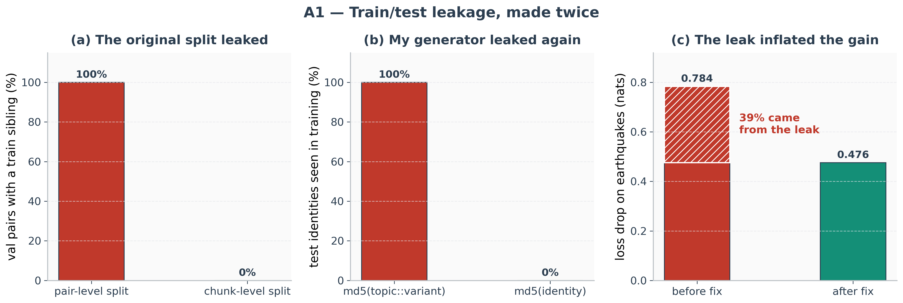
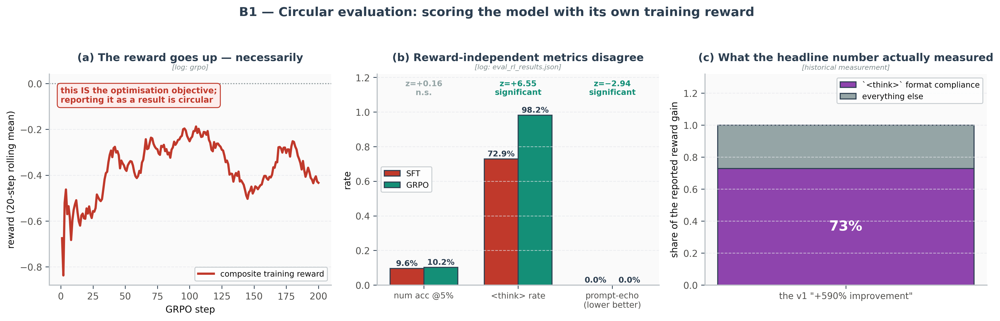
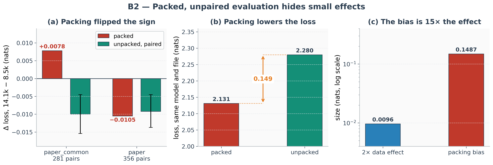
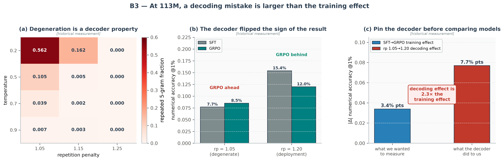
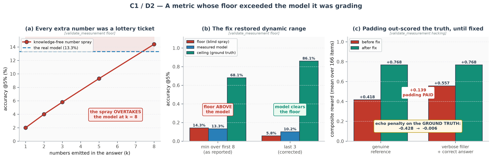
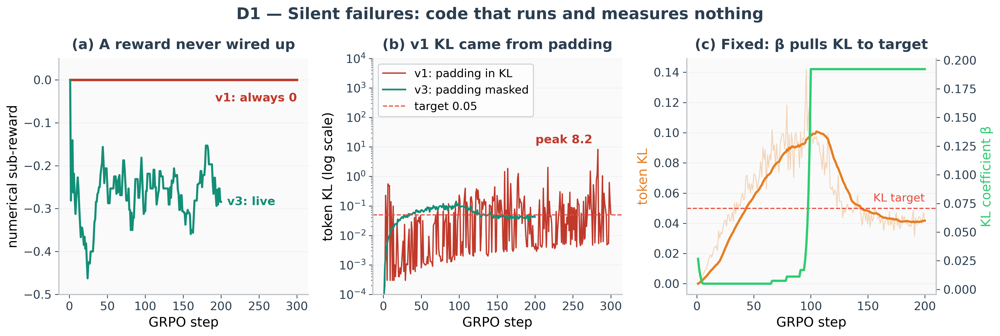
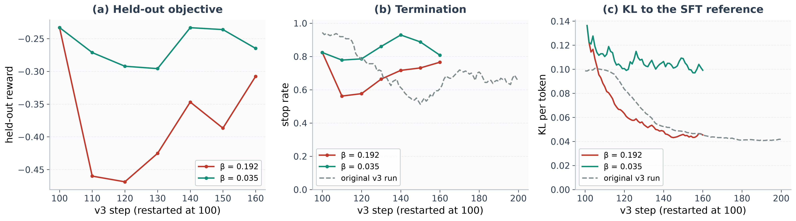
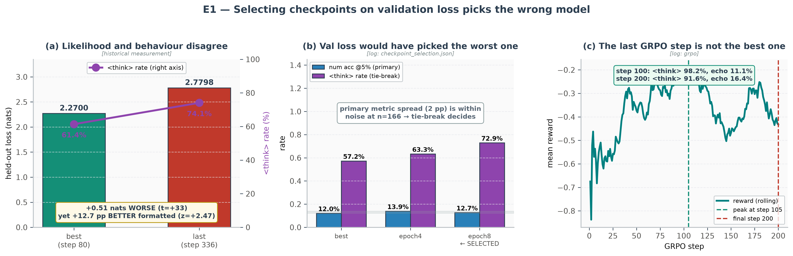
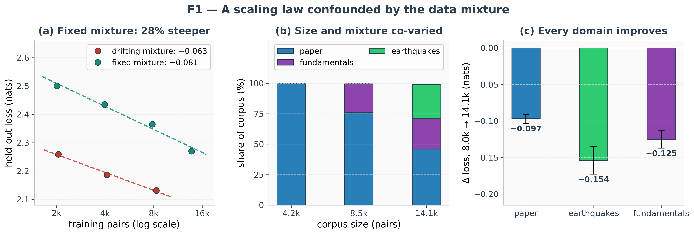
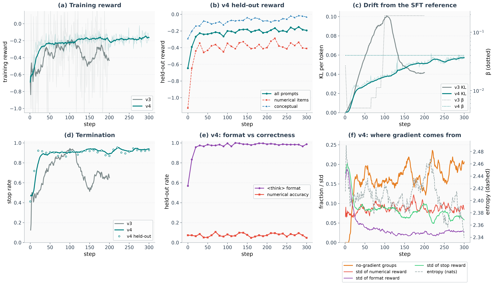

# 失败案例图谱

[English](PITFALLS.md) | [中文](PITFALLS.zh-CN.md)

本文记录了这套后训练流水线在搭建与调试期间出现的各种隐蔽失误，包括它们当时的表象、真实根因、修复做法，以及防止同类问题再次发生的自动化检查。

文中的每一条案例，都来自 113M 地震学模型在第二阶段监督微调（SFT）和第三阶段可验证奖励强化学习（RL）过程中实际遇到的问题，并都已配套回归测试。这里不谈泛泛的经验之谈，只记真实发生过并被测量定位到的工程故障。

> **关于算法命名的说明。** 第三阶段实际实现的是带 KL 正则项的组相对 REINFORCE，而不是标准 GRPO 算法。为了保持代码目录、配置键名和历史日志的连续性，仓库仍沿用 `grpo` 这一标签。具体差异见 [README §5.4](README.zh-CN.md#54-本实现与标准-grpo-算法的区别)。

**贯穿全篇的核心结论：绝大多数严重偏差都源于测量和评估方法本身的问题，而不是模型结构或优化算法出了故障。** 在最早梳理的十一次事故中，有九次都产出过看起来合理、被当成实验结论上报、后来又被证实有误的数字；仅有一次（B3）真正涉及模型生成行为失常，而且那一次主要损害的同样是评测对比的可靠性。

配套主文档 [README.zh-CN.md](README.zh-CN.md) 说明了流水线设计与修正后的实验结果。文中所有插图（`assets/pitfall_1..8_*.{png,pdf}`）都可以直接通过 `python -m src.plots pitfalls` 从提交的日志重新生成。

---

## 索引

| 编号 | 事故概要 | 类别 | 若未发现的后果 | 对应图表 |
|---|---|---|---|---|
| [A1](#a1--训练集与测试集出现两次数据泄露) | 训练集与测试集出现两次数据泄露 | 数据完整性 | 验证集与测试集结果失去参考价值 | `pitfall_1_data_leakage` |
| [B1](#b1--评测直接复用训练奖励形成循环论证) | 评测直接复用训练奖励，形成循环论证 | 评测协议 | 得出“+590%”的失真主结论 | `pitfall_2_circular_evaluation` |
| [B2](#b2--序列打包与非配对评测引入偏差使结论随测试集翻转) | 序列打包与非配对评测引入偏差，使结论随测试集翻转 | 评测协议 | 换用不同测试集子集时模型优劣结论反转 | `pitfall_3_evaluation_protocol` |
| [B3](#b3--在-113m-规模上解码参数的影响超过训练本身) | 在 113M 规模上，解码参数的影响超过训练本身 | 评测协议 | SFT 到 GRPO 差值的正负号发生翻转 | `pitfall_4_decoding_artifacts` |
| [C1](#c1--评测允许前-8-个数字匹配盲猜基线高于被测模型) | 评测允许前 8 个数字匹配，盲猜基线高于被测模型 | 指标有效性 | 把低于随机猜中的结果误判为真实数值能力 | `pitfall_8_metric_validity` |
| [C2](#c2--评测与训练奖励测同一能力却被写成独立验证) | 评测与训练奖励测同一能力，却被写成独立验证 | 指标有效性 | 把同维度泛化检验说成独立的跨维度证据 | — |
| [C3](#c3--近一半数值标签提取有误) | 近一半数值标签提取有误 | 指标有效性 | 训练奖励和评测上限同时被错误标签压低 | — |
| [D1](#d1--代码无报错运行却没有产生有效训练信号) | 代码无报错运行，却没有产生有效训练信号 | 奖励设置 | 300 步 RL 未优化目标能力，KL 尖峰实为填充伪影 | `pitfall_5_silent_failures` |
| [D2](#d2--复读惩罚按回答自身长度归一化让注水文本得分反超标准答案) | 复读惩罚按回答自身长度归一化，让注水文本得分反超标准答案 | 奖励设置 | 模型可通过追加无效文本逃避惩罚并拿更高奖励 | `pitfall_8_metric_validity` |
| [D3](#d3--kl-控制器在中途把惩罚系数放大-38-倍改写了优化目标) | KL 控制器在中途把惩罚系数放大 38 倍，改写了优化目标 | 奖励设置 | 已学会的格式行为退化，两段交界被误读为峰值 | `grpo_beta_intervention` |
| [E1](#e1--按验证集交叉熵损失挑选检查点选出了行为最差的模型) | 按验证集交叉熵损失挑选检查点，选出了行为最差的模型 | 选择与报告 | 交付 `<think>` 合规率最低的候选模型 | `pitfall_6_checkpoint_selection` |
| [E2](#e2--同一数据集既用来选检查点又用来报结果把增益放大近四倍) | 同一数据集既用来选检查点又用来报结果，把增益放大近四倍 | 选择与报告 | 把开发集上的选择偏差当成最终测试提升 | — |
| [F1](#f1--数据缩放曲线混入了语料配比变化) | 数据缩放曲线混入了语料配比变化 | 分析归因 | 数据规模的真实斜率被低估了 28% | `pitfall_7_confounded_scaling` |
| [F2](#f2--分析与绘图脚本存在四个隐蔽缺陷) | 分析与绘图脚本存在四个隐蔽缺陷 | 分析归因 | 绘制出依据过期日志或计算伪影的误导图表 | — |
| [F3](#f3--每步只记录一条提示词训练曲线被采样噪声淹没) | 每步只记录一条提示词，训练曲线被采样噪声淹没 | 分析归因 | 把单步采样方差和题型比例波动当成优化不稳定 | `grpo_stability_v3_vs_v4` |

每条事故都按同一结构展开：**故障症状 → 误导性假象 → 故障根因 → 修复方案 → 永久回归测试 → 已作废产物 → 普适性教训。** 其中“误导性假象”记录了错误数字在当时所支撑的看似合理的解释；看清当时为什么会信以为真，往往最有助于避免重蹈覆辙。

---

# A · 数据完整性

## A1 — 训练集与测试集出现两次数据泄露



**故障症状。** 验证集交叉熵损失低得反常（`2.1237`）；随后在仅补充一批新数据后，历史地震子集上的困惑度就从 `10.41` 骤降到 `4.75`。

**误导性假象。** “模型对未见过的地震学文本泛化很好，而且历史地震语料带来的收益格外高。”

**故障根因。** 同一类数据泄露问题在两个不同环节各自出现了一次：

1. **SFT 划分按单条问答对随机打散。** 教师模型会围绕同一个原始文档块生成大约 3 条问答。按单条问答随机切分后，几乎每一道验证题的同源兄弟题目都落进了训练集：全部 `864/864` 条验证问答都与训练集共享原始文档块，平均每条验证题在训练集中有 `1.88` 个同源兄弟样本。修正前的验证损失、第一版数据缩放曲线、学习率扫描排序和早停步数，全都是在这种泄露状态下测出来的。
2. **数据生成器的 ID 规则重新引入了泄露。** 修复 SFT 划分器改为按文档块切分后，基础概念与历史地震的数据生成器又把 `chunk_id` 设成了 `md5(topic::variant)`。由于同一个地震主题的每个改写变体都被赋予了不同的哈希值，按 `chunk_id` 切分的划分器就把同一历史地震的不同改写版本分散放进了训练集与测试集，最终导致 `100%` 的留出测试身份同时出现在训练集中。

**修复方案。** 改为严格按来源文档身份（`md5(identity)`）进行划分，而把 `(chunk_id, variant)` 仅保留为生成脚本断点续跑时的恢复键。已有数据直接重映射了所属文档身份，无需推倒重来。

**永久回归测试。** 在 `src/sft/build_corpus.py` 中加入断言 `assert train_identity_ids.isdisjoint(test_identity_ids)`，每次构建语料时自动执行检查，而不是只跑一次的临时脚本。

**已作废产物。** 修复泄露之前的验证集损失记录、首次学习率扫描结论以及第一版 SFT 数据缩放曲线。历史地震语料带来的增益本身确实存在，但幅度被明显放大：表面收益为 `−0.784 nats`，实际真实收益为 `−0.476 nats`，原先宣称效果中有 `39%` 来自身份泄露。

**普适性教训。** 数据泄露往往源于数据生成流程，而不只是切分代码。修好一次划分器并不代表一劳永逸，因为任何新增数据源都可能通过自己的 ID 生成方式把同类泄露带回来。应当把“训练与测试身份互不相交”写成每次构库必跑的代码断言。

---

# B · 评测协议

## B1 — 评测直接复用训练奖励，形成循环论证



**故障症状。** RL 训练后的初次评测报告称：复合奖励得分从 `+0.05` 升至 `+0.295`，提升了 `+590%`。

**误导性假象。** “可验证奖励 RL 让这个 113M 模型在推理与计算能力上取得了跨越式提升。”

**故障根因。** `eval_rl.py` 当时直接调用生成训练奖励的同一个 `CompositeRewardEngine` 给 SFT 和 RL 打分，而且只跑了验证集前 `20` 条提示词（每条仅采样一次，不附带置信区间），绘图脚本里甚至还硬编码了这组数字。由于梯度优化的目标正是最大化这个复合奖励，得分上升属于既定结果；事后拆解显示，增益中约有 `73%` 单纯来自 `<think>` 标签格式的规范化。把优化目标本身拿来当作整体能力提升的证据，等于预先假设了结论。

**修复方案。** 废除用训练复合奖励直接对比模型的做法，改为在哈希锁定的留出集上分别报告各具体构念指标与异常防护指标，并计算配对置信区间：包括对照标准答案解析值核对的数值准确率、`<think>` 标签合规率、内容污染率和提示词复读率。每次评测都会无条件打印显著性检验结果，避免将统计波动写成正向提升。需要注意的是，这些依然测的是奖励所优化构念在留出题上的泛化情况，而不是独立于训练奖励的新维度能力（见 C2）。

**永久回归测试。** `eval_rl.py` 对所有指标强制打印 McNemar 检验显著性；所有结果 JSON 文件都写入来源元数据（检查点路径、划分版本、解码参数），绘图脚本检测到结果来源与训练日志不匹配时会自动告警。

**已作废产物。** “+590%”这一主结论，以及所有依赖 v1 复合评分结果得出的判断。

**实质变化。** 改用非循环基准重新评测后，第三阶段 RL 带来的可靠变化缩窄到格式本身：`<think>` 合规率从 `71%` 升至 `98%`。这本是 v1 运行背后真实发生的变化，但此前被一个膨胀的复合指标掩盖了。

**普适性教训。** 训练奖励可以用来检验被优化代理在留出提示词上的泛化程度，但不能独自支撑更广泛的能力结论。在训练开始前就应当确定独立拆分的评测指标，将训练奖励明确标注为参考行，并把显著性检验固定进输出流程。

---

## B2 — 序列打包与非配对评测引入偏差，使结论随测试集翻转



**故障症状。** 两份只包含论文问答的干净留出测试文件，在对比同一对 SFT 检查点时给出了完全相反的优劣判断；更反常的是，较小那份文件还是较大文件的严格子集，题型比例和平均长度也完全一致：

| 测试文件 | 打包评测下的结论 |
|---|---|
| `common_test.jsonl`（`281` 对样本） | `14.1k` 模型更差（`+0.0078`） |
| `test_paper.jsonl`（`356` 对样本，上者的超集） | `14.1k` 模型更好（`−0.0105`） |

**误导性假象。** 研究者恰好运行哪份测试集，结论就会变成“更大语料有用”或者“更大语料有害”，而且从数字上看两种结论似乎都有数据支撑。

**故障根因。** 评测时程序把测试样本拼接进了 `4096` 词元的长序列块，并采用普通因果注意力掩码，使每一条样本的上下文条件都依赖于前面紧挨着的无关样本。换一份文件就改变了拼接边界与前置上下文，进而改变损失值；同时块内按词元数量加权，也会让长回答主导结果。测量表明，序列打包带来了约 `0.149 nats` 的乐观偏差（同一模型在同一文件上，打包损失为 `2.1312`，非打包损失为 `2.2799`）——这一系统偏差大约达到了待测真实差异（`0.0096 nats`）的 `15` 倍。

**修复方案。** 改为逐条样本独立前向计算损失（`src.sft.checkpoints compare --unpacked`），并使用配对统计检验消除逐题难度的方差。取消打包后，两个测试集立刻给出高度一致且显著的结果：`−0.0100` 与 `−0.0092`。

**永久回归测试。** `--unpacked` 成为检查点损失对比的默认路径；在 RL 评测中，`eval_rl.py` 强制保存逐题对错结果，使 McNemar 检验与配对 bootstrap 成为固定分析基础。

**已作废产物。** 所有基于打包序列开展的跨文件模型对比。在单个固定文件内部，打包偏差在不同模型间大致接近常数，因此 F1 中的缩放斜率基本未受影响（`−0.064` 对比 `−0.063`）；真正失效的是跨文件比较和微小差异检验。

**普适性教训。** 序列打包适合训练期提高吞吐并观察趋势，但不适合用来比较相差很小的模型。在相信微弱效应之前，要先确认评测协议自身的偏差与噪声远小于待测效应，并且始终坚持逐题配对评估。

---

## B3 — 在 113M 规模上，解码参数的影响超过训练本身



**故障症状。** 早期一次留出集对比显示，RL 后 `<think>` 合规率从 `8.5%` 升至 `55.6%`，数值准确率也略有领先。

**误导性假象。** “RL 让模型学会了思考，同时略微提高了算术准确率。”事实上，这里数值准确率的领先方向只是采样器参数制造出的偏差。

**故障根因。** 这组对比跑在重复惩罚系数 `rp = 1.05` 下。在该设置下，113M 文字作答模型有 `56%` 的输出处于逐字重复的 5-gram 循环中，并且经常到上限也未能闭合 `<think>` 标签。在 `4` 条提示词 × `250` 词元上的实测重复 5-gram 比例显示了模型对重复惩罚的高度敏感：

| 温度 | `rp 1.05` | `rp 1.15` | `rp 1.25` |
|---|---|---|---|
| `0.2` | `0.562` | `0.162` | `0.000` |
| `0.5` | `0.105` | `0.005` | `0.000` |
| `0.7` | `0.039` | `0.002` | `0.000` |
| `0.9` | `0.007` | `0.003` | `0.000` |

另外两种常见配置也同样失效：v1 曾采用 `no_repeat_ngram=3` 强行禁用重复三元组，结果模型转而拼出 `M0_code`、`N·mi` 一类的词元碎片乱码；看似“确定可靠”的贪心解码（`top_k=1`）反而更差，会卡在 `(Δt / Δt) * (Δt / Δt) * …` 循环里，`<think>` 合规率只有 `2.6%`（部署设置下为 `8.5%`）。

**修复方案。** 将文字作答模型的解码默认参数固定为温度 `0.3`、`top_k = 40`、重复惩罚 `1.2`，由 `chat.py` 和 `eval_rl.py` 共享同一套默认契约，保证人工体验与自动评测测到的是同一种行为。

**永久回归测试。** 解码设置作为共享模块常量统一导出，而非由各脚本各自传参；每份评测结果都把实际使用的解码参数写入记录文件。

**已作废产物。** 所有在 `rp = 1.05` 下做过的模型对比。将重复惩罚提高到 `1.2` 后，两个模型的实测准确率都约翻了一倍（SFT 在 `1%` 容差下从 `7.7%` 升至 `15.4%`），并且使 SFT 到 RL 的差值符号发生反转：解码改动带来的 `7.7` 个百分点变化，是 `3.4` 个百分点训练变化的 `2.3` 倍。

**普适性教训。** 在比较任何检查点之前，先冻结解码策略。在百兆参数级别上，解码器不是展示层的细枝末节，它的杠杆效应往往大过待测训练本身。

---

# C · 指标有效性

## C1 — 评测允许前 8 个数字匹配，盲猜基线高于被测模型



**故障症状。** 从分数表面看不出任何异常——而这恰恰是隐患所在。`13.3%` 的数值准确率对 113M 模型来说显得顺理成章，只有专门针对评测规则本身做测试时，这个问题才暴露出来。

**误导性假象。** “模型已经具备虽弱但真实的数值计算能力（约 `13%`），而 RL 又往上推了一点。”这一结论的前后两半都没能站住脚。

**故障根因。** 初版 `eval_rl` 按回答前 `8` 个数字里与标准答案的最小相对误差 `min(rel_err)` 判定对错。结果回答里每多出现一个数字，就等于多了一次碰中答案的机会。在 `166` 道留出数值题上，一个完全不读题目、只从目标经验分布中抽取 `8` 个常见数字并排输出的盲猜基线，在 `5%` 容差下拿到 `14.3%`——反超了 RL 模型的 `13.3%` 和 SFT 模型的 `12.7%`。这样的指标无法证明模型具备高于随机猜中的能力。

与此同时，该指标的理论上限也远低于 `100%`，只有 `68.1%`：将参考答案文本送入同一规则对照其自身的 `final_numerical_value` 评分时，约 `32%` 的题目竟然无法命中，导致评测集将近三分之一的题目在机制上就难以拿分。

**修复方案。** 把提取窗口从前 `8` 个数字改到回答末尾（`ANSWER_TAIL_NUMBERS = 3`）。最终结论通常落在回答结尾，改动窗口同时显著改善了理论上下限：

| 打分规则 | 理论上限 | 理论下限 | 有效区分空间 |
|---|---|---|---|
| 前 `8` 个数字取最小误差（原规则） | `68.1%` | `14.3%` | `53.8%` |
| 仅匹配末尾最后 `3` 个数字（修正后） | `86.1%` | `5.9%` | `80.2%` |
| 仅匹配末尾最后 `1` 个数字 | `58.4%` | `1.9%` | `56.5%` |

窗口改为末尾 `3` 个数后，旧的“数字总数超过 `8` 个即直接判错”限制也随之废除。末尾规则本身就把任何刷数字行为限制在最多 `3` 次尝试内，而旧上限却错误惩罚了 `40.4%` 的真实参考答案（参考答案数字个数中位数为 `6`，90 分位数为 `34`）。取消该限制后，参考答案的平均数值奖励 `r_num` 从 `+0.274` 升至 `+0.723`，盲猜下限则保持不变。

**永久回归测试。** `python -m src.analysis.validate_measurement floor` 会重新计算盲猜下限与标准答案上限；同时 `python -m src.rl.verifiers` 中的单元测试 `7`（`40` 个数字自适应刷屏探测）与测试 `8`（文本稀释探测）会在每次验证时运行。

**已作废产物。** 先前较高的准确率读数均作废（合并留出集由 `13.3%` 降至 `10.2%`）。修正之后，模型以较窄优势高于 `5.9%` 的盲猜下限，但距离 `86.1%` 的上限仍有很大距离——在有效区分空间中前进了 `5.5%`。

**普适性教训。** 在解读任何百分比得分之前，必须先测出该指标的理论下限（无知识基线的得分）与理论上限（标准答案通过同一解析器的得分）。只有落在这个有效区间内的读数，才具备对比价值。

---

## C2 — 评测与训练奖励测同一能力，却被写成独立验证

**故障症状。** 早期报告把留出集评测写成“与训练奖励无关的独立评估”，问题出在对证据性质的文字定性上，而不是具体数字。

**误导性假象。** “两套相互独立的测量工具一致证明模型变强了。”实际上只有同一套测量规则，只是换到了未见过的提示词上。

**故障根因。** 留出集数值准确率读取 `final_numerical_value` 并按 `0.01` 和 `0.05` 容差判分，这与训练时的 `NumericalVerifier` 完全一致；`<think>` 合规率所用的正则也与 `FormatVerifier` 完全同源。因此它们衡量的并非新维度，而是同一能力构念在划分外的泛化表现。

此外，当时统计的所有指标中并没有任何一项属于独立结果指标：复读率与内容污染率都属于异常防护类卫生检查，而且在训练奖励中也分别有对应项（`EchoPenaltyVerifier`、`CleanLanguageVerifier`）。旧版文档把“异常防护”误当成了“能力维度独立”。

**修复方案。** 在 [README §3.2](README.zh-CN.md#32-四类评估指标的划分) 中明确列出四类指标分类体系——训练优化、留出同维度、独立结果、异常防护——并把“独立结果”那一行显式留空。

**永久回归测试。** 作为文档结构规范固化在 README 的测量章节中：今后任何新增评测指标都必须明确归类并说明它回答哪类问题。

**已作废产物。** 作废的是早期文本表述，不涉及数值改动：文中此前所有“独立能力验证”的说法均已修正为“留出泛化检验”。

**普适性教训。** 与训练奖励共用相同判定规则的评测只能证明泛化性，不能当成独立能力证明。报告结论时必须准确指明自己拥有的是哪一类证据。

---

## C3 — 近一半数值标签提取有误

**故障症状。** 排查闭卷数值准确率长期没有起色时发现：一道留出题的参考推导实际算出 `Mw ≈ 7.5`，标准答案字段却被标成了 `2.5`；模型答出了 `7.5` 反而被判错。核对后发现，留出集中仅有 `60%` 的数值标签等于参考推导自身得出的最终结果。

**误导性假象。** “准确率停在 ~`10%` 是因为 113M 模型算不出来”，以及“当答案已经出现在提示词里时 RL 提升最大”（早期 README 分层表曾写过可提取层从 `20.6%` 升至 `32.4%`；分层分析方法现见 README §6.4）。

**故障根因。** `prepare_rl_dataset.extract_final_numerical_value` 直接取参考最终答案文本中最后一个匹配 `[=≈~]` 或 `"is …"` 的正则结果。结果脚本经常抓走年代（`"…the Ganges at ~2.5 ka"`）、年份（`"2015"`）、题干给定的已知量（`"120 encounters"`、`"0.1 g 系数"`、`"magnitude 7.1"`），甚至在完全没有数值答案的公式推导题上抽取出 `0` 或 `1`。由于训练奖励 `NumericalVerifier` 和留出评测都读取同一个字段，这批错误标签同时封死了训练信号和评测上限。

此前看似存在的“可提取层”优势，有相当一部分正是这种错误标签造成的：在 `34` 道标签出现在题干中的留出题里，实际有 `17` 道本应通过多步计算求解，却被错误标成了题干中的一个已知数。模型只需抄出题面已知量就能在这些题上得分。

**测量方法。** 采取盲评校准：随机抽取数值题，将新旧两个标签以打乱顺序呈现，仅依据题目文本和参考推导判断哪一个标签正确，评审全程不看模型输出。在 `40` 道未参与任何规则调试的题目上，旧标签正确率为 `50%`，新标签为 `80%`；当二者不一致时，新规则以 `16` 比 `4` 胜出（符号检验 `p = 0.012`）。另一组未调参盲评样本也给出了类似差距（`60% → 78%`）。

**修复方案。** 新增 `src/rl/numerical_target.py`：仅提取参考推导过程中真正经运算算出的最后一个结果（等号左侧必须包含算术操作，从而排除 `"M = 7"` 这类单纯赋值），且该数须在最终结论句中复现；显式的 `"the answer is X"` 享有最高优先级；不要求数值结果的推导题则不打数值标签。运行 `python -m src.rl.prepare_rl_dataset relabel` 对 `data/rl/*.jsonl` 原地重标后，`33%` 的训练集标签和 `29%` 的留出集标签被修正，另有 `13%`（训练）和 `8%`（留出）清除了原本不该存在的无效标签。每条记录都在 `final_numerical_value_v1` 中保留旧值，并在 `label_source` 中记录来源。

**永久回归测试。** 运行 `python -m src.rl.numerical_target` 会执行针对十种失效模式的回归测试用例（旧提取器在 `10` 个用例中失败 `4` 个）。同时 `eval_rl` 现在会保留模型回答末尾提取出的候选数字，之后若需再次调整标签规则，可以直接离线重算分数而无需重新推理。

**已作废产物。** `2026-10-15` 之前基于 v1 标签测得的所有数值准确率（包括旧版分层结果表）。使用修正后标签重算的结果已更新在 README §1.2。

**普适性教训。** 用正则从参考答案里抽取出的目标值本身只是一个待验证假设，而不是天然真值。相信一条平坦的准确率曲线前，先对一批题目做盲评复核；指标长期不动时，先查标签再查模型。

---

# D · 奖励设置

## D1 — 代码无报错运行，却没有产生有效训练信号



**故障症状。** 某个奖励分量连续 `300` 个训练步恒定记录为 `0.0000`；KL 曲线一路走高并在后期出现 `8.23` 的尖峰；以及另一次训练中损失曲线显得十分平滑，但策略输出几乎没有发生变化。

**误导性假象。** 这三种表面现象分别指向了看似合理的故事：“数值验证器标准很严格，小模型本来就不擅长算术”；“策略正在远离 SFT 模型，说明 RL 正在积极更新”；“整体优化过程相当平稳”。

**故障根因。** 三处相互独立的故障都表现为程序顺利跑完且日志正常，实则没有把梯度传到目标能力上：

1. **字段不匹配使数值奖励失效。** `NumericalVerifier` 读取 `rl_item["final_numerical_value"]`，而这一字段在加载的 `16,425` 条训练记录中出现次数为 `0`。追溯上游发现：`prepare_rl_dataset.py` 调用了 `math.isnan` 却漏写 `import math`，导致 V2 数据集构建静默报错退出，训练脚本回退加载了旧版格式文件，令那 `33%` 的数值题实际只拿到了关键词重叠分。
2. **v1 的 KL 尖峰来自填充词元梯度。** 同步解码产生的强制 EOS 填充词元当时没有被排除出策略损失与 KL 掩码，使短回答在数百个并未采样的末尾位置上累计梯度。滑动 KL 从 `0.05` 升至 `0.34` 并在第 `283` 步达到 `8.23`，所谓的“奖励峰值”也恰好落在那里——这是填充计算伪影，而不是学到了有效策略。
3. **`lr = 1e-6` 令参数更新停滞。** 在排除填充干扰后做的一次 `76` 步试验显示，逐词元 KL 仅约 `0.001`（目标 `0.05`），自适应 β 一直贴在下限运行。在正确的掩码下，v1 的学习率太小，不足以推动策略变化。

**修复方案。** 在加载数据集时加入严格字段断言；把策略梯度和 KL 计算的掩码严格限定在实际采样生成的词元范围内；将学习率提高到 `5e-6`；同时记录策略熵、输出长度和正常终止率，避免表面奖励掩盖策略退化。

**永久回归测试。** 保留加载时字段断言；要求在 `assets/grpo_training_dynamics.png` 中分项绘制各奖励曲线（只看总奖励会彻底掩盖失效分量）；并运行 `python -m src.analysis.validate_measurement group` 打印组内离散度，任何死掉的验证器都会立刻显示为 `std 0.000`。

**已作废产物。** v1 的整轮运行记录以及由此得出的所有结论。

**实质变化。** 修复后的 v3 在 `200` 步内有 `77` 步实际触发了数值奖励变化，KL 在上升至 `0.142` 后由自适应控制器把 β 从 `0.005` 抬高到 `0.192`，把 KL 压回 `0.042`。（而这一控制器机制本身随后又构成了案例 D3。）

**普适性教训。** 恒等于 `0.0000` 的分量、全无变化的指标和平滑得异常的曲线，在工程上更像是静默缺陷的信号，而不是正常的训练结果。

---

## D2 — 复读惩罚按回答自身长度归一化，让注水文本得分反超标准答案


**故障症状。** 训练日志里没有任何报错或异常；该问题是在人为构造八条退化回答、送入真实的 `CompositeRewardEngine` 进行测试时发现的。

**误导性假象。** “复合奖励设计得很稳健，能有效拦截各种作弊回答。”八条测试样本中的六条确实拿到了很低的负分（例如盲撒数字得 `−0.56`，堆砌关键词与空 `<think>` 块得 `−0.92`），这让人放松了对第七条漏洞的警惕。

**故障根因。** “冗长填充 + 正确答案”的得分竟然比真实标准答案高出 `+0.139` 分。原因在于复读惩罚把“回答与提示词的重叠词数”除以了候选回答自身的总长度，只要往回答后面追加大量无关文字拉大分母，重叠比例就会被稀释到惩罚阈值以下。与此同时，这个错误归一化还会因为真实标准答案正常复述题干术语而给出 `−0.428` 的平均惩罚，令规则既可被绕过又会错罚正常回答。

**修复方案。** 改为用提示词长度作分母来归一化重叠比例。提示词长度才直接衡量原题被复读了多少，并且不受尾部注水影响——无论后面加多少无关文本，逐字照抄提示词都会稳定得到 `1.000`。在 `808` 条标准答案上重新标定阈值（实际最高观测值为 `0.760`）后，`0.85` 阈值的错误触发率降为 `0.00%`，`0.70` 阈值为 `0.62%`。标准答案承受的复读扣分从 `−0.428` 降至 `−0.006`，注水绕过路径被堵死。

**永久回归测试。** `python -m src.analysis.validate_measurement hacking` 会在留出集上重新给这八条退化回答与标准答案打分，并断言每一条退化构造都必须严格低于参考答案。

**已作废产物。** 此前一度上报过“RL 显著降低了提示词复读率（`21.2% → 11.1%`，`z = −2.94`）”。那其实是旧阈值错误惩罚了 `11%` 正常答案造成的统计假象；在准确标定之后，各模型都没有出现明显复读。

**普适性教训。** 每个奖励函数都是对能力假设的编码，同时也会成为优化器寻找漏洞的入口。要在梯度下降找到捷径之前自己先写出作弊样例测试，并把“错误扣分到标准答案身上”当成代码缺陷来修，而不是当成评分严格。

---

## D3 — KL 控制器在中途把惩罚系数放大 38 倍，改写了优化目标



**故障症状。** 在 v3 训练中，奖励曲线上升并在第 `100` 步附近见顶回落，正常终止率从 `0.94` 跌至 `0.51`，KL 冲到 `0.10` 后又退回 `0.04`。与此同时，KL 系数 `β` 前 `60` 步一直停在 `0.005`，随后连续五步从 `0.038` 跳涨到 `0.192` 并维持到结束。

**误导性假象。** “自适应控制器确实有效，把越界的 KL 拉回了目标区”（此前 D1 与 README 都作此判断），并且“训练在第 `100` 步达到峰顶后进入过训练，所以应该取第 `100` 步检查点”。

**故障根因。** 该控制器采用了没有平滑滤波的开关式规则：只要单个批次的 KL 走出 `[0.5, 2] × target` 死区，就把 `β` 乘或除 `1.5`，下限设为 `0.005`。由于训练初 KL 接近 `0`，`5` 步之内 `β` 就跌到下限 `0.005`，使前 `60` 步几乎没有参考模型约束；等到 KL 最终越过 `2 × target`，连续五次乘以 `1.5` 将 `β` 放大了 `38` 倍至 `0.192`；之后 KL 回到死区内，控制器就再也没有把 `β` 调下来。

第 `100` 步前后，优化问题已经不再相同。一旦模型学会格式与终止，大多数样本组的组内方差都会缩小，此时高达 `0.192` 的 KL 锚定惩罚压过了组内奖励差异，把策略逐步拉回初始 SFT 模型（其留出集终止率仅有 `0.41`）。控制器从指标上看确实稳住了 KL，但代价是抹掉了刚刚学到的格式与终止习惯。

**确认实验。** 为排除相关性混淆，直接做了干预对照：从已保存的 v3 第 `100` 步权重重启训练，保持算法、提示词顺序与随机种子全部相同，唯一改动是 `β`。两组起点同为留出奖励 `−0.233`、终止率 `0.82`。仅 `10` 步后，`β = 0.192` 组跌至 `−0.460`、终止率 `0.56`，而 `β = 0.035` 组保持在 `−0.271`、终止率 `0.78`；在 `+10…+60` 步区间内，高 `β` 组平均奖励为 `−0.399` 对 `−0.266`，六次评估全部落后，且其 KL 轨迹（`0.10 → 0.045`）几乎完全复现了原运行（`0.10 → 0.042`）。单独改变 `β` 就足以重现整段退化。（每组一个种子；重启时优化器状态清零解释了低 `β` 组开头的小幅回落，两组之差即纯粹的 `β` 效应。）

**修复方案。** 改为使用固定系数 `kl_controller: fixed`（全程固定 `β = 0.04`）。仓库也按 Ziegler 等（2019）实现了平滑比例控制器 `proportional`（`β *= 1 + 0.1 · clip(KL_ema / target − 1, ±0.2)`，单步变化上限 `±2%`），本次主要实验未启用；原规则保留为 `legacy`。

**永久回归测试。** 每步记录 `β` 并以对数坐标与 KL 并排绘出（`assets/grpo_stability_v3_vs_v4.png` 子图 c）。凡是 `β` 变化超过约 `2` 倍的运行，都等于在中途更换了优化目标，不能按同一条曲线解读。`configs/rl_grpo_intervention_beta{0192,0035}.yaml` 保留了上述干预实验的可复现配置。

**已作废产物。** README §5.8 与 D1 中对“自适应控制器正常工作”的解释，以及把第 `100` 步峰顶归因于“RL 步数过多导致过训练”的判断。挑选第 `100` 步优于第 `200` 步这一决定本身依然有效，因为它看的是留出集实际行为而非训练曲线；只是后续退化源于 `β` 暴增，而非训练太久。

**普适性教训。** KL 控制器直接定义了优化目标的一部分。当惩罚权重在中途改变一个数量级时，前后的奖励曲线属于两个不同的优化问题，曲线上的“峰值”往往只是两段目标交接处的接缝。

---

# E · 选择与报告

## E1 — 按验证集交叉熵损失挑选检查点，选出了行为最差的模型



**故障症状。** SFT 期间训练损失一路降到 `0.70`，而验证损失从第 `80` 步以后逐步攀升到 `2.58`——单看曲线与教材里的典型“过拟合”一模一样。

**误导性假象。** “验证损失见底之后的训练只有害无益，应当交付验证损失最低的检查点。”在这里恰恰相反：验证损失最优的模型，在真正关键的生成规范上表现最差。

**故障根因。** 交叉熵衡量的是模型给某一段固定参考答案赋予的条件概率。随着训练推进，模型会逐步收敛到自己偏好的稳定措辞，这自然降低了另一套参考写法的似然概率，但并不意味着生成质量变差。把验证损失最优点（第 `80` 步）与最终步（第 `336` 步）直接对比即可看出反向变化：

| 评估维度 | 验证损失最低（第 `80` 步） | 最终检查点（第 `336` 步） | 实测结论 |
|---|---|---|---|
| 留出验证损失 | `2.2700` | `2.7798` | 升高 `+0.51 nats`（`t = +33.5`） |
| `<think>` 合规率 | `61.4%` | `74.1%` | 提高 `+12.7 pp`（`z = +2.47`） |
| 数值准确率 `@5%` | `10.2%` | `13.3%` | `+3.1 pp`（不显著） |

*（上表准确率沿用 C1 修复前的历史读数作为对照；验证损失与 `<think>` 合规率不受 C1 影响，结论完全基于这两行成立。）*

**修复方案。** `src.sft.checkpoints select` 改为直接按生成行为排名，挑选逻辑在查看评测表之前就固化进源码常量：以 `numerical_acc_5pct` 为主指标，在 `2` 个百分点误差范围内用 `numerical_think_rate` 决定先后，并对污染率、复读率和非空长度设置硬性门槛。程序会打印完整候选对照表以便人工核查。

**永久回归测试。** 选型逻辑写成模块级常量（`PRIMARY`、`TIE_BREAK`、`TIE_EPS`、`GATES`），而不暴露为运行时命令行开关，防止看到分数后再调整标准。

**实质变化。** 在 SFT 中，这套规则选出第 `8` 轮而不是验证损失最低的第 `3` 轮——后者恰好是三个候选中 `<think>` 合规率最差的一个。同一套规则应用到 v3 RL 时，同样选出了第 `100` 步而非第 `200` 步，捕捉到了由 `β` 跳变造成的后段退化（D3）。在按照 C1 修正打分后，第 `100` 步甚至不再依赖平局决胜规则，在主准确率指标上直接胜出（`10.2%` 对 `9.6%`），同时保持 `<think>` 合规率领先（`98.2%` 对 `91.6%`）。

**如实说明。** 对 SFT 而言，在 `n = 166` 的样本量下，各轮次主准确率（`12.0% / 13.9% / 12.7%`）都落在统计噪声以内，因此当时实际上由 `<think>` 率决出胜负，而且第 `4` 轮的原始点估计略高。这条选择之所以成立，是因为规则在出分前已经固定，而不是因为主指标差值有多显著。

> [!NOTE]
> 上述 SFT 三个轮次的准确率读数与图 `pitfall_6_checkpoint_selection.png` 的 (b) 子图来自 `docs/checkpoint_selection.json`，记录时间早于 C1 评分修复，使用的是前 8 个数字取最小误差的口径。最终选出的检查点不受影响，因为决定权落在了未受 C1 影响的 `<think>` 合规率上（`57.2% / 63.3% / 72.9%`）。重新运行 `src.sft.checkpoints select` 即可更新准确率列。

**普适性教训。** “过拟合”永远是相对某个具体指标而言的。直接测量你关心其行为的指标，不要默认验证交叉熵最小的一步或训练最后一步就一定是最佳检查点。

---

## E2 — 同一数据集既用来选检查点又用来报结果，把增益放大近四倍

**故障症状。** 表面上流程无懈可击：既有写死的筛选规则，又有哈希锁定的留出集和显著性检验，但报出的主提升幅度仍然明显偏高。

**误导性假象。** “GRPO 把留出集数值准确率提高了 `+3.0` 个百分点，且置信区间不含零。”这句话的字面描述全都符合数据记录，但这个数字其实混入了开发集选择偏差。

**故障根因。** 检查点挑选脚本与最终评测 `eval_rl` 当时共用同一份 `808` 条提示词的留出池。一份数据只要参与了挑选模型这一步，就不再是严格意义上的外部测试集。事先写定筛选规则可以防住事后按喜好挑结果，但改变不了这批题目已经投票决定过胜出检查点的事实。

**修复方案。** 在 `src/sft/splits.py` 中明确建立按来源文档块划分的四角色数据集规范：

```
train   用于 SFT 与 RL 参数更新
val     仅用于训练期间观察曲线或早停参考
dev     用于调超参、选解码设置、定阈值、挑检查点与校准指标
test    只报告一次结果——不用于回改代码、阈值、检查点或解码配置
```

把原有的 `808` 题池事后拆分为 `dev` 与 `test` 两半，界定了此前混淆造成的膨胀上界：

| 数值准确率变化 Δ（SFT → RL） | 样本数 `n` | 变化幅度 Δ | 95% 置信区间 |
|---|---|---|---|
| dev 一半 | `76` | `+3.0%` | `[+0.0%, +6.2%]` |
| test 一半 | `90` | `+0.8%` | `[−3.1%, +4.7%]` |

同一对模型、同一指标、同一套解码器，在 `dev` 半边测出的提升几乎是 `test` 半边的 `4` 倍。

> **事后划分的局限。** 由于这次拆分是在多轮分析之后才补加的，原先整个 `808` 题池在此之前已经共同参与过检查点挑选（如选第 `100` 步不选第 `200` 步）、汇总评估、指标设计与阈值标定。哈希锁定能保证此后 `test` 集不再变动，但无法消除它此前曾被间接使用过的历史事实。
>
> 因此，`3.0%` 对 `0.8%` 的差值与选择偏差规律相符，却不是纯粹的选择偏差测量：其中既包含两个各 `~80` 题子集之间的随机样本差异，也受限于历史选择曾同时依赖两边。严谨地说，这是一个从当前版本起冻结的“回溯性审计划分”，而不是从零留出的前瞻测试集。
>
> 要得出完全无污染的最终结论，必须先冻结全部代码、解析器、解码参数、阈值、候选模型和筛选规则；只基于 `dev` 选型；再用从未出现过的来源文档重新建立 `test` 集并仅跑一次。

**永久回归测试。** `splits.describe()` 内置断言 `assert dev_chunks.isdisjoint(test_chunks)`，同时运行 `python -m src.sft.splits data/rl/test.jsonl` 会打印并核验这一划分契约。

**已作废产物。** 此前以合池 `+3.0%` 作为最终泛化幅度上报的表述均作废，由 [README §3.1](README.zh-CN.md#31-数据划分规范及其局限性) 中带有上述保留说明的 `test` 半边读数替代。

**普适性教训。** 清点一下某份数据集支撑过多少次开发判断。一旦超过一次，它就属于开发集；而在判断发生之后再补做分割，只能锁住未来的偏差增长，并不能消去过去已经引入的偏差。

---

# F · 分析归因

## F1 — 数据缩放曲线混入了语料配比变化



**故障症状。** 早期画出的 SFT 数据缩放曲线呈现干净的对数线性趋势，斜率为 `0.0633 nats/每翻倍`，而分领域对比子图显示地震语料似乎只明显改善地震这一块。

**误导性假象。** “这里增加数据的边际回报较为温和（约 `0.063 nats`），且不同子语料的作用高度局限于各自领域。”这两条判断其实都只是随手复用历史语料快照造成的伪像。

**故障根因。** 此前拿来做拟合的三个语料点不仅总样本量不同，领域成分比例也同时在变：

| 数据点 | 论文问答 | 基础概念 | 历史地震 |
|---|---|---|---|
| `4.2k` | `100%` | — | — |
| `8.5k` | `76%` | `24%` | — |
| `14.1k` | `46%` | `25%` | `28%` |

数据量与配比同时移动，拟合线实际上把两种不同效应叠在了一起；而分领域子图拿去对比的 `8.5k` 语料里原本一条历史地震题也没有，在地震子集上显得落后，测出的只是语料缺席，而不是缩放规律。

**修复方案。** 从 `14.1k` 语料出发做按文档块分层的子采样，把每个数据规模点上的论文 / 基础概念 / 地震比例都固定在 `46% / 25% / 28%`（`±1%`），并统一在同一份固定测试集上以非打包模式测损失。

**永久回归测试。** 缩放点集 `data/eval/scaling_{2k,4k,8k}.jsonl` 全部由同一个配比锁定脚本生成，防止后续扩点时再次悄悄改变样本构成。

**已作废产物。** 旧版 `0.0633` 斜率与分领域对比子图均作废。消除配比混杂后，干净斜率达到 `0.0813 nats/每翻倍`——比旧估计陡峭 `28%`，原因在于旧曲线的小规模点全部是论文题，对应该测试集时恰恰属于最容易的同分布部分，从而压低了斜率。固定配比之后，三个领域均获得明显且较为均匀的损失下降（论文 `−0.097`、历史地震 `−0.154`、基础概念 `−0.125`），取代了先前狭窄的“各管各域”推断。

**普适性教训。** 实验混杂往往来自图省事复用现成的中间数据集。要看单一自变量的缩放效应，就必须从构造层面固定其余变量，哪怕这意味着把中间序列重新做一遍。

---

## F2 — 分析与绘图脚本存在四个隐蔽缺陷

**故障症状。** 生成出来的图表面看完全正常；好在这组问题尚未形成错误结论对外发布，都是在重绘图表、逐行检查绘图路径时被查出来的。

**误导性假象。** 按脚本不同，图像可能会画成“前 `20` 步模型完全没有进步”，或者让研究者误以为自己在看 v3 结果，实际上读的是旧代日志文件。

**故障根因与修复方案（共四项）：**

- **过期默认路径。** `plot_grpo_results.py` 默认指向已经更名移走的旧目录 `checkpoints/grpo_v2/`，`chat.py` 的回退列表也指向 `grpo_v2` 和 `sft_v3`。这会导致脚本在看起来测试新版模型时悄悄跑了旧模型。现已全部改指当前目录并支持命令行配置，若显式指定的 `--ckpt-path` 不存在则直接报错，不再静默回退。
- **结果文件缺少来源说明。** `docs/eval_rl_results.json` 存着 v2 结果却没有记录出处字段，混在仓库里与最新运行几乎没有区别。`eval_rl.py` 现已强制写入检查点、划分版本和解码参数，绘图代码检测到评测出处与当前日志不符时会主动打印警告。
- **写死的坐标轴范围。** 针对 v2 数值写死的坐标上限在画 v3 时会悄无声息地把点截在图外，现已改为随数据自动确定。
- **滑动平均前端填充伪影。** `compute_rolling_mean` 曾用常数回填开头的 `window - 1` 个位置，在每幅面板左端都画出一段水平直线，看上去很像“训练前 `20` 步完全没有变化”。已替换为随窗口增长的扩展窗口均值。

**永久回归测试。** 结果文件写入出处块并在绘图时校验一致性；`assets/` 中所有图表都可通过 `python -m src.plots` 直接从磁盘 CSV/JSON 重新绘制，代码里不写死任何实验结果数值。

**普适性教训。** 分析与绘图脚本需要和训练代码接受同等严格的审查。绘图 Bug 与训练 Bug 最终都会带来同一种后果：一张看上去十分笃定、实则画错了依据的图。

---

## F3 — 每步只记录一条提示词，训练曲线被采样噪声淹没



**故障症状。** v3 GRPO 的训练奖励曲线锯齿剧烈，哪怕取了 `20` 步滑动平均也仍在 `±0.1–0.2` 之间摆动，看不出经典的“快升—缓升—平台期”走势。

**误导性假象。** “在 113M 规模上跑 RL 就是会这么剧烈震荡。”

**故障根因。** 除 D3 记录的 `β` 跳变以外，还有两项日志和分批统计问题掩盖了真实的训练走势：

1. **每个记录点只覆盖一条提示词。** 训练器每张卡每步只拿一条提示词，日志只记录 rank 0 对这 `1` 条题 `8` 个样本的平均奖励。结果题目本身的难易度主导了点位波动：相邻步标准差高达 `0.35`，一阶自相关仅为 `0.04`，基本等于白噪声。即使扣去题型均值与平滑趋势，残差标准差仍有 `0.26`，令 `20` 步滑动均值还带着 `±0.06` 的误差——与整条曲线上的特征变化量级相同。
2. **每个批次混不齐多种题型。** 当时单步要么全为数值题（均值 `−0.64`），要么全为概念题（`−0.19`）。各个 `20` 步窗口内数值题占比在 `20%–70%` 之间波动，单凭题型比例起伏就能让滑动均值移动最多 `0.22`，和学到的变化本身一样大。

对 v3 日志按题型做校正之后，第 `100` 步前后的驼峰回落依然存在（按 `50` 步分段分别为 `−0.419 → −0.269 → −0.367 → −0.367`），说明退化确有其因（即 D3 的 `β` 增大），但单点记录噪声确实把曲线变得几乎无法解读。

**修复方案。** 将更新规模扩大到每次全局更新 `32` 条提示词 × `8` 个采样，每个批次严格按池内比例对题型分层，并跨卡全局规约全部日志数值；同时每 `10` 步用固定随机种子在 `275` 条验证提示词上计算留出集目标函数，写入 `grpo_v4_eval.csv`。改进后训练奖励绕趋势线的逐步标准差从 `0.30` 降到 `0.05`，并按 README §5.9 的要求补齐了零方差组比例和各分量的组内标准差记录。

**永久回归测试。** 训练日志新增 `n_rollouts` 列，凡是单点覆盖不足数百个样本的曲线一律不拿来判断整体形状，收敛情况统一通过固定种子的留出目标函数曲线观察。

**普适性教训。** 在对着训练曲线的形状下结论前，先算清楚单个数据点的标准误。当单点误差接近曲线自身的波动幅度时，曲线反映的是采样噪声，而不是优化器的表现。

---

# 常见规律

按“单位代码错误造成的结论偏差”粗略排序，上面十五条案例反映出五条共通规律：

1. **对偏有利的意外结果要加倍核查。** 数据泄露、循环评测、序列打包偏差以及数据集复用，全部都把结果往更好的方向推。这是因为合乎期待的数字更容易直接通过检查，而突然变差的数字会被立刻追查。
2. **静默失效比程序崩溃更昂贵。** 异常报错最多耽误一小时重跑，但一个卡在 `0.0000` 而不报任何错的奖励分量，却会消耗掉 `300` 个 GPU 训练步和一条错误的外部结论。
3. **先把测量工具本身测明白。** 打包偏差达到待测信号的 `15` 倍、解码参数变化是训练效应的 `2.3` 倍、旧规则下盲猜下限反超被测模型——这些都说明，在比较模型之前必须先量化评测协议的噪声、系统偏差以及理论上下限。
4. **修一次 Bug 不代表此类问题不会再犯。** 数据泄露通过新生成器重现，过期默认路径在多个脚本中重复出现。应当把不变性约束固化为加载断言或共享常量，而不是靠人工记忆。
5. **选型规则必须在看分之前确定，且明确限制同一数据集的使用次数。** 前者划分了预设规则与事后挑挑拣拣之间的界线，后者在这里直接关系到结果是被如实汇报，还是被放大将近四倍。
