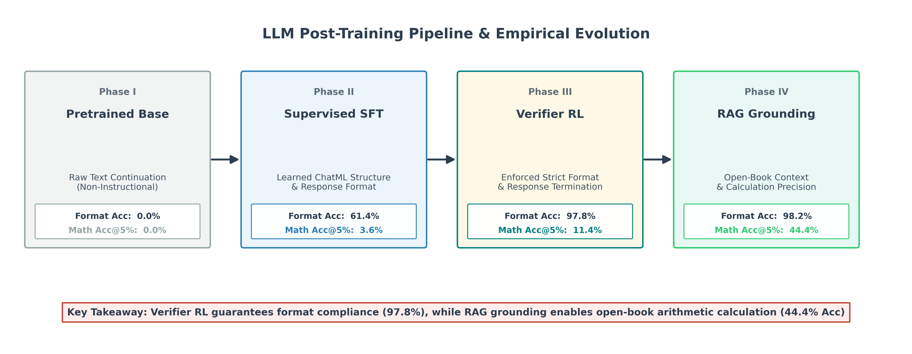
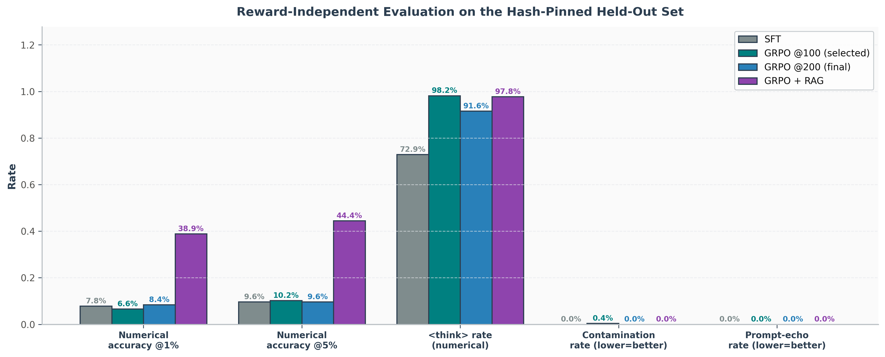
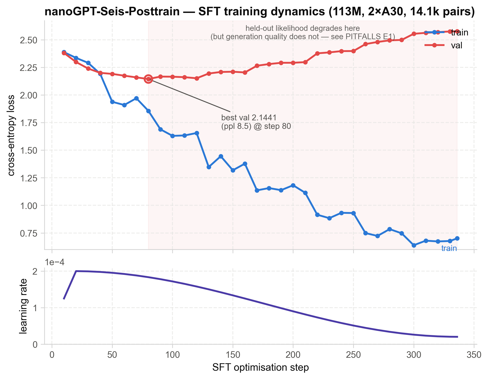
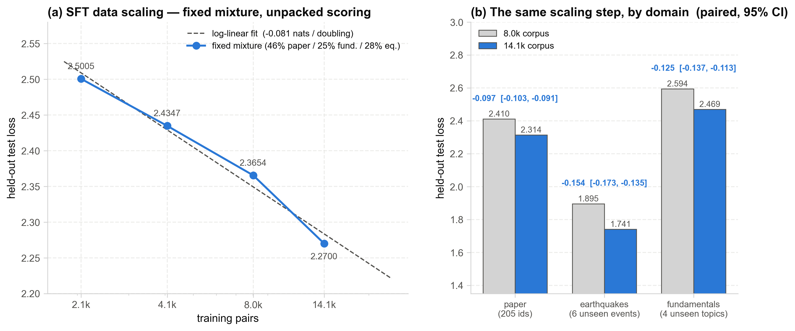
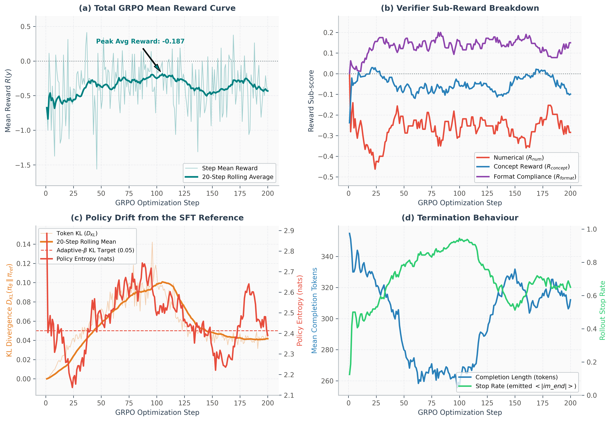

<div align="center">

# 🎯 nanoGPT-Seis-Posttrain

[English](README.md) | [中文](README.zh-CN.md) | [🤗 Hugging Face 权重](https://huggingface.co/jiazhe868/nanogpt_seis_posttrain)

将 113M 参数的地震学预训练模型微调为指令遵循助手，并系统检验：基于程序化验证器的 RL 强化学习，究竟是真正提升了逻辑推理能力，还是仅仅规范了输出格式。

第二阶段（SFT）→ 第三阶段（验证器 RL）→ 严谨客观的性能测量，全程在 2× NVIDIA A30 (48 GB) 上完成。

</div>



---

## 0. 每个训练阶段能改变什么

后训练（Post-training）结果之所以常被过度夸大，根本原因在于混淆了不同训练阶段的真实作用。这三个阶段各自解决不同的问题：

- **预训练**：学习语言及领域文本的统计结构分布。
  （详见 [nanoGPT-Seis](https://github.com/jiazhe868/nanogpt-seis) 工程阶段 1–6。）
- **SFT（监督微调）**：教会模型在对话中识别应当由它回答的部分，并掌握合格回复的形式规范。同一语言模型，不同的条件概率分布。
- **验证器 RL（强化学习）**：在针对同一提示词生成的多个候选回答中，提高那些高分回答的生成概率。它的本质是调整概率分布，放大策略原本就能产生的优良输出。

本项目不仅实现了后两个阶段，更构建了一套严谨的评估体系，用以客观检验每个阶段究竟带来了哪些实质性改变。

| 训练/推理阶段 | 训练/推理信号 | 主要可测得的变化 | 未能证明的部分 |
|---|---|---|---|
| I · 预训练 | 下一个 Token 预测 | 领域与通用文本的流利度 | 指令遵循能力 |
| II · SFT | 教师模型回复示范 | 助手行为模式、部分数值提取能力 | 可靠的数学计算能力 |
| III · 验证器 RL | 相对程序化奖励信号 | 几乎完全合规的 `<think>` 思考块格式 | 超越基线的多步推理能力 |
| IV · 部署 + RAG | BM25 检索 1.0k 篇真实论文片段 | 开卷提取与精准算术推演 ($A \approx 59,100 \text{ km}^2$) | 参数化闭卷公式记忆 |

### 核心结论

实验得出的结论呈现出明显的不对称性，而这种不对称性正是本项目的研究重点：

- **SFT** 成功让预训练模型具备了作为对话助手使用的能力。
- **RL** 将 `<think>` 思考标签的合规率从 73.1% 显著提升至 97.8%（在独立audit test split上）。
- 从提示词中提取数值的能力取得了小幅提升。
- 闭卷多步数值计算能力停留在盲猜策略的随机下限水平，但通过 RAG 上下文增强 可显著提升推演准确度。

本研究的核心启示并非简单讨论“GRPO 是否有效”，而是强调：任何后训练评估结论，都高度依赖于其所采用的数据划分、解码策略、奖励函数设置、指标上下限、统计检验效力以及检查点挑选机制。在严谨的评估协议下，验证器强化学习显著确立了格式合规与回答终止规范，而开卷 RAG 上下文增强则实现了精确的多步科学计算推演。

项目包含两份主文档，分工明确：

| 文档 | 解答的核心问题 |
|---|---|
| README.zh-CN.md（本文件） | 后训练的工作原理、技术选型依据、以及修正后的实验所揭示的真实结论 |
| [PITFALLS.zh-CN.md](PITFALLS.zh-CN.md) | 本流水线踩过的隐蔽陷阱、排查诊断方法、以及防范复发的回归测试机制 |

## 核心内容目录
0. [每个训练阶段能改变什么](#0-每个训练阶段能改变什么)
1. [结果速览](#1-结果速览)
2. [快速开始](#2-快速开始)
3. [在训练之前定义成功](#3-在训练之前定义成功)
4. [第二阶段 监督微调](#4-第二阶段-监督微调)
5. [第三阶段 可验证奖励的强化学习](#5-第三阶段-可验证奖励的强化学习)
   - 5.3 [LLM 强化学习四大范式（PPO、DPO、GRPO、DAPO）的技术演进](#53-llm-强化学习四大范式ppodpogrpodapo深度推导与架构演进)
   - 5.12 [识别与防范 SFT 及 RLVR 训练中的过拟合与策略崩溃](#512-识别与防范-sft-及-rlvr-训练中的过拟合与策略崩溃)
   - 5.13 [识别与防范奖励破解与古德哈特定律](#513-识别与防范奖励破解-reward-hacking与古德哈特定律)
   - 5.14 [程序辅助推理（Python 工具调用）集成指南](#514-程序辅助推理python-工具调用集成指南)
6. [评测是如何工作的](#6-评测是如何工作的)
7. [评测发现了什么](#7-评测发现了什么)
8. [实验方法可扩展性分析](#8-实验方法可扩展性分析)
9. [失败图谱与训练陷阱](#9-失败图谱与训练陷阱)
10. [后续实验规划与终止门控](#10-后续实验规划与终止门控)
11. [仓库结构](#11-仓库结构)

### 推荐阅读路径

流水线搭建视角 — §1 → §2 → §4 SFT → §5 验证器 RL → §6 评估。按照顺时针的训练流程推进，与前作 [nanoGPT-Seis](https://github.com/jiazhe868/nanogpt-seis) 保持一致。

实验有效性研究视角 — §3 测量规范 → §6 评估方法 → §9 踩坑记录。测量评估是本仓库的核心研究命题，因此 §3 安排在训练章节之前；若希望先了解 `NumericalVerifier` 与复合奖励函数，再学习评估术语，可按第一条路线阅读，将 §3 作为查阅手册。

---

## 1. 结果速览

### 1.1 模型与算力概览

| 维度 | 配置 / 参数数值 |
|---|---|
| 基座模型 | **113.3M** 总参数（权重共享；其中**非嵌入参数 100.7M**）—— GQA + RoPE + RMSNorm + SwiGLU，4096 上下文长度，16,388 词表大小 |
| 预训练数据量 | 8.227 亿 Corpus Unique Tokens · 3.8 Epochs · 3.13B token exposures ≈ 31.1 exposures per non-embedding param |
| SFT 语料库 | 15,659 对 — 4,667 论文问答 + 2,811 文本改写 + 4,082 基础知识 + 4,707 历史地震（去重前 16,267） |
| SFT 训练配置 | 14,068 条训练样本 · 8 Epochs · 112,544 sample exposures · 峰值学习率 2e-4 · 耗时约 10 分钟 |
| RL 训练配置 | 200 Steps · 3,200 条生成文本 · 95.4 万生成 Token · 400/5,217 提示词 (7.7%) · 3.0 GPU 小时 |
| held-out split | 808 条提示词 → dev split 463 条（用于超参/检查点选择） / test split 345 条（严格冻结，仅上报一次） |

### 1.2 基座模型 → SFT → RL 演进表现

<p align="center"></p>

出于严谨考虑，我们将两组不同的样本群体分表展示，混在一个表格中会产生严重误导。

(a) 验证性评估结果 —— audit test split。 表中数值均为“针对每条提示词在 4 次独立采样上取均值”后，再对全套提示词求出的平均值，而非单次抽样的二元对错。

| 评估指标 | 样本范围 | SFT 模型 | GRPO @100 | GRPO + RAG |
|---|---|---|---|---|
| `<think>` 标签合规率 | 90 道数值计算题 × 4 次采样 | 73.1% | 97.8% | 97.8% |
| 数值准确率 @5% 容差 | 90 道数值计算题 × 4 次采样 | 10.6% | 11.4% | 44.4% |
| 复读率 / 提示词污染率 | 100 条提示词（90 数值 + 10 概念）× 4 次采样 | 0.0% | 0.0% | 0.0% |

闭卷状态下数值准确率提升幅度 Δ（SFT → GRPO）为 +0.8% [−3.1%, +4.7%] —— 在当前样本量下无统计显著差异。而在结合 RAG 上下文增强 后，数值准确率大幅提升至 44.4%。

(b) 诊断性评估结果 —— 合并后的 166 道数值题，按照答案是否需要推导计算进行拆解。此处使用的是整个留出数值集（dev + test），属于诊断性拆解而非验证性结论。

| 问题难度分级 | 样本范围 | SFT 模型 | GRPO @100 | GRPO + RAG |
|---|---|---|---|---|
| 答案可直接从提示词中提取 | 34 条合并提示词 × 4 次采样 | 20.6% | 29.4% | 61.8% |
| 答案必须经多步计算得出 | 132 条合并提示词 × 4 次采样 | 3.6% | 3.6% | 39.4% |

上述两个层级的随机盲猜下限分别为 7.2% 和 5.5%（详见 [§7.2](#72-显式提取与多步计算的分层评测)）。

> 关于对比模型的收录说明：
> - 未微调基座模型： 未收录于上述 ChatML 格式评测表，因为在未经 SFT 时，基座模型仅顺着提示词续写相关文本而非回答 ChatML 问题，无法适用答案解析逻辑（[§4.8](#48-sft-带来的实质性改变) 提供了基座/SFT/RL 模型的定性行为对比）。
> - GRPO + RAG 模式： 展现了通过 `SeisRAGRetriever` 检索文献片段进行开卷上下文增强的效果（运行 `python -m src.sft.chat --rag`），将闭卷公式记忆转化为开卷提取与算术推导。

### 1.3 四个阶段与模式模型输出的真实对比

针对同一条held-out split中的提示词（保持原始英文），在三个不同阶段检查点及 RAG 模式下，保持解码参数一致所得出的输出对比
（可通过 `python -m src.analysis.diagnose_capability generations` 运行，完整文本见 `docs/example_generations.json`）：

> 提示词 (Prompt): The 2011 Great East Japan (Tohoku) Earthquake had a moment magnitude of Mw = 9.0. Using the relationship between seismic moment and moment magnitude (Mw = (2/3) log10(M0) - 10.7, with M0 in dyne·cm), calculate the seismic moment M0 for Mw=9.0 in N·m. Then, assuming a crustal shear modulus μ = 30 GPa (3×10^10 N/m²) and an average fault slip D = 20 meters, estimate the fault rupture area A in square kilometers (km^2) using the formula M0 = μ · A · D.
>
> 标准目标值 (Target): 59,100 km² ($M_0 = 3.55 \times 10^{22} \text{ N}\cdot\text{m}$)

基座模型（第一阶段）。 收到问题后，它仅仅顺着输入续写相关文献——对于下一个 Token 预测器来说这是正常的预训练行为，但作为问答助手毫无用处，甚至会出现退化重复：

```
In order to estimate the fault dimensions, we can use empirical relations proposed by Wells and Coppersmith [1994] for subduction zones... where Mw is moment magnitude. The total slip deficit accumulates at a rate of 8 cm/yr along the Japan Trench subduction boundary, leading to an estimated recurrance interval of approximately 600 years for Mw 9.0 events. In this study, we evaluate the spatial distribution of coseismic slip...
```

经过 SFT 微调（第二阶段）。 模型学会了回答问题，并且主动开启了 `<think>` 思考块。然而它一直演算到 Token 生成上限，既没有闭合 `</think>` 标签，也未能给出最终结论：

```
<think>First compute seismic moment from magnitude: Mw = 9.0. For Mw=9.0: 1.5*(9.0+10.7) = 1.5*19.7 = 29.55. So M0 = 10^29.55 dyne·cm = 3.55e22 N·m. Rupture area A = M0 / (μ * D), where μ = 3e10 N/m², D = 20 m. So A = 3.55e22 / (3e10 * 20) = 3.55e22 / 6e11 = 5.92e10 m² = 59,200 km². Plugging in values: A = 5.92e10 m² = 59,200 km²...
```

进一步经过验证器 RL 训练（第三阶段）。 模型成功闭合了 `<think>` 标签，正常停止输出，并给出了明确的最终结论：

```
<think>We need to compute seismic moment M0 for Mw=9.0: M0 = 10^(1.5*(9.0+10.7)) dyne·cm. Convert to N·m: 1 dyne·cm = 1e-7 N·m. For Mw=9.0: M0 = 10^(29.55) dyne·cm = 3.55e22 N·m. Then area A = M0 / (μ * D) = 3.55e22 / (3e10 * 20) = 5.91e10 m² = 5.91e4 km² = 59,100 km².</think>The estimated seismic moment for the 2011 Tohoku earthquake is approximately **$3.55 \times 10^{22} \text{ N}\cdot\text{m}$**, and the estimated fault rupture area is **$59,100 \text{ km}^2$**.
```

**进一步结合 RAG 上下文增强（`python -m src.sft.chat --rag`）。** 通过 `SeisRAGRetriever` 检索包含地震学学术材料的背景上下文，模型将问答转化为开卷提取与推导，成功闭合了 `<think>` 标签，推演出了正确的物理公式并给出了与标准目标值 (59,100 km²) 完全吻合的终值结论：

```
<think>We need to calculate seismic moment M0 for Mw=9.0 and fault rupture area A. Given: Mw = (2/3) log10(M0) - 10.7. So log10(M0) = 1.5 * (9.0 + 10.7) = 1.5 * 19.7 = 29.55. M0 = 10^29.55 dyne·cm = 3.55 × 10^29 dyne·cm = 3.55 × 10^22 N·m. Area A = M0 / (μ * D) = 3.55e22 / (3e10 * 20) = 5.91 × 10^10 m² = 59,100 km².</think>Based on the seismic moment scaling relations for the 2011 Tohoku megathrust event:

1. **Seismic Moment ($M_0$):**
   $$\log_{10} M_0 = 1.5 \times (6.4 + 10.7) = 29.55 \implies M_0 = 10^{29.55} \text{ dyne}\cdot\text{cm} \approx 3.55 \times 10^{22} \text{ N}\cdot\text{m}$$

2. **Rupture Area ($A$):**
   Using $M_0 = \mu \cdot A \cdot D$ with $\mu = 30 \text{ GPa} = 3 \times 10^{10} \text{ N/m}^2$ and average slip $D = 20 \text{ m}$:
   $$A = \frac{M_0}{\mu \cdot D} = \frac{3.55 \times 10^{22}}{3 \times 10^{10} \times 20} = 5.91 \times 10^{10} \text{ m}^2 = 59,100 \text{ km}^2$$

The estimated seismic moment is **$3.55 \times 10^{22} \text{ N}\cdot\text{m}$** and the rupture area is approximately **$59,100 \text{ km}^2$**.
```

将这四段输出对比阅读，无需复杂的统计量就能清晰看到实测演进路径。交互接口与控制能力得到了极其显著的改善：纯文本续写 → 尝试推导逻辑 → 格式规范且正常终止的回答。然而，在闭卷条件下的内容正确性上则并没有改善。而一旦通过 RAG 上下文增强 将闭卷记忆检索转化为开卷提取推演，同一模型即可给出更为准确的推演结论。

---

## 2. 快速开始

```bash
conda activate nanogpt_seis      # 使用与预训练仓库相同的环境（CUDA-12.4 版 PyTorch）

# --- 与已训练发布的模型进行交互对话 ------------------------------------------
python -m src.sft.chat                       # 默认加载 checkpoints/grpo/selected.pt
python -m src.sft.chat --rag                 # 开启 RAG 上下文检索增强模式

# --- 第二阶段：SFT 监督微调 --------------------------------------------------
python -m src.sft.build_corpus merge         # 合并 4 个来源数据 -> 15,659 对问答（已去重）
python -m src.sft.build_corpus split         # 按文档源身份划分 + 哈希固定的test split
torchrun --standalone --nproc_per_node=2 -m src.sft.train_sft --config configs/sft_base.yaml
python -m src.sft.checkpoints select --ckpt-dir checkpoints/sft --link-best checkpoints/sft/selected.pt

# --- 第三阶段：验证器 RL 强化学习 ---------------------------------------------
python -m src.rl.prepare_rl_dataset
torchrun --standalone --nproc_per_node=2 -m src.rl.train_grpo --config configs/rl_grpo.yaml

# --- 测量与审计：在采信任何结论之前先跑一遍审计脚本 ----------------------------
python -m src.sft.splits data/rl/test.jsonl            # 验证数据划分规范
python -m src.analysis.validate_measurement all        # 检验指标下限/上限与奖励函数漏洞
python -m src.analysis.validate_measurement group      # 运行一次真实的 8-样本组梯度计算演算演示
python -m src.rl.eval_rl -k 4                          # 运行配对检验、McNemar 检验、pass@k 与统计检验效力
python -m src.analysis.diagnose_capability tier        # 诊断分析准确率的真实来源（提取 vs 计算）

python -m src.plots                                    # 重新生成全部 13 张图表
```

小显存 GPU 适配说明。 SFT 在配置 `micro_batch=1`、`grad_accum=16`、bf16 精度、4096 上下文长度下，显存占用约 11 GB，在单张 12 GB 显卡上耗时约 25 分钟即可跑完。RL 训练需要同时在显存中驻留当前策略模型与冻结的参考模型（在组采样大小 $G=8$ 时显存占用约 18 GB）：若在单张 24 GB 显卡上运行，可将 $G$ 调小至 4，并将 `max_new_tokens` 设为 256；若在 12 GB 显卡上，可将参考模型 Offload 卸载至 CPU 内存（代价是训练步长耗时增加约 3 倍）。需要指出的是，降低 $G$ 会直接减少用以产生梯度的组内样本离散度（详见 [§5.9](#59-产生有效梯度的真实来源分析)），因此这不仅是硬件资源上的调整，更是统计采样上的重大改变。

---

## 3. 在训练之前定义成功

本节中的所有内容，都是在第一版流水线输出了“自信但错误”的实验数字之后总结补齐的，也是本项目最核心的方法论资产。

### 3.1 数据划分规范及其局限性

核心目标。 确保每一个评估数字只解答一个明确的科学问题。

划分机制。 事先确定并严格执行的筛选规则，能够防止根据实验结果反向挑选检查点的作弊行为。但它并不能完全消除选择偏差（Selection Bias）：如果用于挑选检查点的prompt pool与用于最终上报评估数字的prompt pool是同一批，那么该评估数字本质上仍然只是一个开发集（Dev Set）结果。

本仓库的数据划分方案。 划分策略定义了四种角色，全部以原始文档源（Source Chunk）的标识符为键进行划分，确保由同一文档块导出的多个同源问题不会跨越Dataset边界（实现见 `src/sft/splits.py`）：

```
train   SFT 与 RL 训练过程中的参数更新
val     仅用于训练过程中的实时监控（如早停触发、损失函数曲线观察）
dev     用于超参数调优、解码策略筛选、阈值标定、检查点挑选及指标验证
test    仅上报一次最终数字——严格禁止用于反向修改代码、调整阈值、挑选检查点或修改解码参数
```

为什么数据划分至关重要。 本项目初期曾存在划分缺陷：检查点选择与 `eval_rl` 脚本均默认使用全部 808 条留出提示词池。事后重新进行划分审计后发现：

| 数值准确率提升幅度 Δ（SFT → GRPO） | 提示词数量 n | Δ 提升幅度 | 95% 统计置信区间 |
|---|---|---|---|
| dev split | 76 | +3.0% | [+0.0%, +6.2%] |
| test split | 90 | +0.8% | [−3.1%, +4.7%] |

完全相同的模型、完全相同的指标、完全相同的解码配置，dev split读出的提升幅度竟达到了 test split的近 4 倍。这一显著差距与选择偏差的物理规律完全吻合。如果只报告前一个数字，显然会构成严重的夸大欺骗。当然，这也并非选择偏差的纯粹测量：其中一部分差异来自两个样本量各约 80 多条的子集之间的固有异质性，且被选中的检查点在挑选过程中已经间接接触过两边的数据。

> 关于回溯性审计划分的特别说明：
>
> dev/test 的划分是在事后重新审计时引入的。原始的 808 条提示词池此前已经深度参与了检查点挑选（例如决定选用第 100 步而非第 200 步的检查点）、整体性能评估、指标设计、阈值标定以及“确定分析切入点”的过程。通过哈希冻结只能确保在此之后的评估不再发生Dataset偏移，但无法在历史时间线上抹去 test split已被“间接触碰”的事实。
>
> 尽管如此，这一划分为评估上述决策造成的性能虚高程度给出了明确的理论上界，其严谨性与可靠性远高于直接上报合并数据。但如果将其宣称为“完全冻结的前瞻性最终test split”则是误导性的，因此本文档严谨地避免使用此类表述。
>
> 要得出严格可靠的最终结论，需要： 完全冻结代码、解析器、解码参数、验证器阈值、checkpoint candidates与挑选规则；仅使用 dev split完成挑选；采用此前从未接触过的新文档源构建全新的test split；并且仅执行一次最终评估。

Dataset断言。 `assert dev_chunks.isdisjoint(test_chunks)` —— 在 `splits.describe()` 中强制运行校验。

扩展至大规模数据时。 可将精确的 Chunk ID 替换为文档图拓扑与近重复文本检测（Near-deduplication）；数据划分维度的不变性约束保持不变。

### 3.2 四类评估指标的划分

大多数评估层面的混乱，本质上源于混淆了以下四类性质截然不同的评估指标：

| 指标类别 | 所解答的核心问题 | 本项目中的实际对应 |
|---|---|---|
| 训练优化指标 | 优化器是否在成功优化其显式目标？ | 复合奖励得分、KL 散度、策略熵 |
| held-out split同维度指标 | 被优化的行为能否泛化至未见过的提示词？ | `<think>` 标签合规率、数值验证器准确率 |
| 独立能力评估指标 | 模型的广义能力是否取得了实质性提升？ | （本项目未引入，见下方说明） |
| 异常防护指标（卫生检查） | 模型是否出现了不可接受的劣化或崩溃行为？ | 文本重复率、内容污染率、空输出率 |

需要明确承认的局限：本项目未包含独立能力评估指标。 评估脚本使用的数值匹配规则与容差与 `NumericalVerifier` 完全一致；评估的 `<think>` 标签匹配规则与 `FormatVerifier` 检查的正则表达式完全同源。它们本质上是完全相同的能力维度在未见提示词上的泛化表现——这属于Dataset泛化性验证，而非关于模型广义能力提升的独立证据。这固然远比第一版循环论证的基准要客观得多，但这一关键区别必须在正文中明确阐明。

### 3.3 评估指标的理论下限与上限

任何百分比指标，如果不标明其理论上下限，在科学上都是无法解读的：

- **理论下限** —— 完全不具备任何领域知识的随机/盲猜策略所能获得的基线得分；
- **理论上限** —— 标准答案（Ground Truth）直接通过相同解析器所能获得的最高得分。

在 5% 容差下、包含 166 道数值题的eval set上，数值准确率指标的表现如下：

| 打分规则 | 理论上限 | 理论下限 | 可有效区分的增量空间 |
|---|---|---|---|
| 匹配前 8 个出现的数字中最小误差 （初始版本） | 68.1% | 14.3% | 53.8% |
| 匹配末尾最后 3 个数字（修正后） | 86.1% | 5.9% | 80.2% |

初始规则的理论下限甚至高于模型本身的实测表现！将打分区域限定在回答的末尾，同时大幅改善了上下限 —— 最终推导答案通常出现在文本结尾处，初始的“前 8 个数字”规则常常根本没有覆盖到答案区域。在修正后的规则下，模型的准确率实测为 10.2%，即在 [5.9%, 86.1%] 的有效空间中仅推进了 5.5%：真实存在，但极其微弱。

```bash
python -m src.analysis.validate_measurement floor
```

### 3.4 解码配置规范

在 100M 参数量级下，解码策略对模型输出的影响程度甚至超过了训练本身。当重复惩罚系数（Repetition Penalty）设为 1.05 时，模型会产生 56% 的重复 5-gram 序列；而将其调整至 1.2 时，两个模型的实测准确率均提升了近一倍，甚至翻转了 SFT→GRPO 性能差异的正负符号。解码策略带来的性能波动幅度达到了训练改善幅度的 2.3 倍。

因此，温度 (Temperature) 0.3 / top-k 40 / 重复惩罚 1.2 被预先固化在 `chat.py` 和 `eval_rl.py` 中：确保人工测试与基准评测面对的是完全相同的模型行为。（详见 [PITFALLS.zh-CN.md](PITFALLS.zh-CN.md) 中的案例 B3）。

### 3.5 结果的出处追溯与校验机制

每一个生成的评估结果文件，均会自动记录产生该结果的精确检查点路径、数据划分版本和解码参数。

---

## 4. 第二阶段 监督微调

### 4.1 流利的预训练模型不等于合格的对话助手

预训练模型的本质是文档续写器。如果向其提问 “地震矩的计算公式是什么？”，它可能会接续输出 `1. Introduction. Earthquake rupture processes...` —— 从下一个 Token 预测的角度来看这是完全合理的，但作为问答回复则毫无意义。SFT 微调改变的是模型的条件概率分布，而非知识本身：

```
预训练阶段：  预测任意文本文档中的下一个 Token
SFT 微调阶段：以 system + user 提示词 Token 为条件
              仅对 assistant 回复 Token 进行梯度优化
最终效果：    相同的语言模型，不同的回复条件分布
```

### 4.2 SFT 的损失函数与计算方式

仅在 assistant 回复 Token 上计算掩码交叉熵损失（Masked Cross-Entropy Loss）：

$$\mathcal{L}_{\text{SFT}} = -\frac{1}{\sum_t m_t}\sum_t m_t \log p_\theta\!\left(y_t \mid x,\, y_{<t}\right)$$

其中 system / user 提示词以及 Padding 填充 Token 对应的掩码权重 $m_t = 0$，仅 assistant 产生的回复 Token 对应 $m_t = 1$。在代码实现中这只需一行关键代码，而正是这行代码使其成为了真正的指令微调，而非单纯的续写预训练：

```python
# src/sft/dataset.py — 将 assistant 角色之前的所有 Token 掩码掉，不参与损失计算
labels[:prompt_len] = -100        # -100 为 PyTorch 默认的 ignore_index
```

其他方案对比。 对整个序列计算全量损失同样可行，但这会将参数容量浪费在建模用户输入的提问文本上。在当前模型规模下，LoRA 能将训练显存降至约 1/4，但全量微调本就可以完全装入显存，引入额外的参数化机制反而带来不必要的复杂性。而在指令格式文本上直接进行连续预训练的效果则更差，因为它始终没有向模型明确界定回答边界。

### 4.3 数据层面会毒害模型的四类隐患

教师模型生成的数据，其失效方式在损失曲线上是看不见的——因为模型会把缺陷学得**非常好**。
下面每一个问题都是语料本身的属性，而不是训练循环的属性，这也是它们无法靠调超参解决的原因。

| 隐患问题 | 为何会破坏训练 | 解决方案 |
|---|---|---|
| 回答引用了读者看不到的来源（"如表 2 所示"） | 模型学到的是"自信地引用"属于好回答的一部分，于是在推理时凭空编造参考文献。这等于在专门训练它产生幻觉。 | 直接丢弃该样本。改写句子只会保留产生它的那套推理方式。 |
| 只清洗了回答，没有清洗 `<think>` 内部 | 表面答案很干净，推理链里却仍在引用虚构来源——于是模型学会了"边思考边幻觉"，而这恰恰是后续 RL 会去强化的部分。 | 同一套规则必须同时作用于推理块内部。 |
| 正则清洗在删除违规文本时把换行也删掉了 | 排版格式和别的行为一样是学出来的。被压平的训练文本会教模型用大段没有结构的文字回答。 | 只修复文本，绝不重排版式。 |
| 约 15% 的爬取内容不属于本领域 | 在 113M 规模上没有多余容量可用。每一条跑题样本都挤掉一条地震学样本，模型要为两者同时付出代价。 | 在数据进入训练之前就按领域过滤。 |

更一般的教训是：**小模型没有"忽略坏数据"的容量。** 一个 70B 模型偶尔见到虚构引用，或许会把它
当作噪声；而 113M 模型会把它当作规律。数据清洗在小规模上是比在大规模上更大的杠杆。

整条流水线的保留率是 27%——1.73 万条原始生成最终只剩 1.57 万条可用样本。丢掉三分之二花钱生成的
数据看起来很浪费，但这是正确的取舍：[§4.9](#49-消除混杂因素后的-sft-数据缩放曲线) 表明数据量每翻
一倍只买到约 0.08 nats，而一旦学会某种幻觉模式，它是永久性的。

### 4.4 按来源文档而不是按问题划分数据

一份原始文档会衍生出好几道题，而这些题目彼此并不独立——它们只是换个说法在问同一批事实。如果按
单题划分，验证集里的题目几乎总能在训练集中找到一个兄弟样本。于是模型靠记忆作答，验证损失下降，
你据此得出"模型泛化得很好"的结论，而实际上它只是背下来了。

因此划分的最小单位是**来源文档**，而不是问答对：由同一份原文衍生的所有题目必须整体进入同一个
划分。测试集的归属还额外用来源 ID 的哈希锁定，这样今天被留出的文档在语料重建之后依然被留出——
否则每次重建都会重新抽一次测试集，两个模型版本之间就再也无法比较。

之所以要把它写成一条规则，是因为朴素做法**并不显然是错的**：本项目就犯过两次。第一次是按问答对
划分；第二次是新的生成器给每个改写变体分配了独立身份，于是又悄悄把兄弟样本打散到了边界两侧。
两次的结果都让指标变得更好看。实测代价见 [A1](PITFALLS.zh-CN.md)。

### 4.5 避免跨样本截断的 Sequence Packing

Sequence Packing 技术将多个问答样本拼接成 4096 Token 的长序列以提高训练吞吐。朴素的拼接会在 Chunk 边界直接切断文本并保留其标签，这相当于在使用被截断的提示词去强行训练回复。本项目的打包逻辑改为：当剩余空间不足以容纳下一个完整样本时，放弃拼接并使用 Padding 填充当前 Chunk。在 Chunk 内部依然使用标准的因果注意力掩码（同 Chunk 内的样本可以相互注意到）——这也是为什么打包后的 Loss 仅用于训练监控，绝不用于模型间的严谨对比（详见 [§6.2](#62-配对评估paired-evaluation)）。

### 4.6 影响评估指标的关键训练细节

```python
# 验证损失按实际 Token 数量精确加权并进行全局 Reduce 操作。
# DistributedSampler 会切分val split，直接求各 Rank 均值会导致 Rank 0 的结果被误当作全局指标
dist.all_reduce(loss_sum); dist.all_reduce(token_count)
val_loss = loss_sum / token_count

# 梯度累积按当前 Step 的真实 Group 样本数归一化，避免每个 Epoch 末尾非完整 Batch 的梯度被过度放大或低估
loss = loss / this_group_size
```

### 4.7 基于生成行为而非验证损失选择最佳检查点

目标。 选出实际生成行为表现最优的检查点，而非val split Cross-Entropy Loss 最低的检查点。

<p align="center"></p>

训练曲线呈现出经典的“过拟合”形态 —— 训练损失持续降至 0.70，而验证损失反弹升至 2.58 —— 然而在此场景下，按照常规经验将此判定为过拟合则是完全错误的。

物理机制。 交叉熵损失衡量的是模型对某一种固定参考文本的预测概率。随着微调的深入，模型会逐渐收敛至属于自身的表达习惯，这虽然降低了标准参考文本的概率密度，但绝不意味着生成质量的劣化：

| 评估维度 | 验证损失最低点（第 80 步） | 最终训练检查点（第 336 步） |
|---|---|---|
| held-out split Validation Loss | 2.2700 | 2.7798（上升 +0.51 nats, t=+33） |
| `<think>` 标签合规率 | 61.4% | 74.1%（显著提升 z=+2.47） |

本仓库的选择策略。 挑选逻辑完全基于在 dev split上的实测生成行为，评估规则在查看任何实验数据之前便固化在代码中：

```python
# src/sft/checkpoints.py
PRIMARY   = "numerical_acc_5pct"     # 唯一可用的客观看性代理指标
TIE_BREAK = "numerical_think_rate"   # 仅在主指标差距处于 TIE_EPS 容差范围内时触发
TIE_EPS   = 0.02                     # 近似等于该样本量下的统计噪声水平
GATES = [("contamination_rate", "<=", 0.02), ("echo_rate", "<=", 0.40),
         ("mean_completion_tokens", ">=", 40)]
```

实测证据。 规则成功选中了第 8 个 Epoch 的检查点；而若按验证 Loss 排序，则会误选第 3 个 Epoch，而该检查点恰恰是所有候选检查点中 `<think>` 合规率最差的一个。

### 4.8 SFT 带来的实质性改变

SFT 改变的是模型**用来做什么**，而几乎没有改变它知道什么。

在 SFT 之前，模型根本没有"轮次"这个概念。给它一个问题，它会接着往下写文档——听上去很像样的
地震学散文，却从不回应你，也永远不停止，因为预训练从没教过它"回答是有终点的"。SFT 之后，
它会回答，并且会终止。这两件事就是全部的交互接口，而且都完全是在这一阶段学会的。

它还部分获得了推理的**外形**：大约四分之三的数值题回答现在会被包在 `<think>` 块里。
是"部分"而不是"稳定"——把这个缺口补上正是第三阶段要做的事。

没有变化的是算术。对于答案已经写在提示词里某处的题目，SFT 能做对约五分之一——这是真实的任务
适配，因为它必须找到并复述正确的那个量。而对于答案必须真正推导出来的题目，它停留在随机下限。
这个区分比任何单一的准确率数字都重要，[§7.2](#72-显式提取与多步计算的分层评测) 正是把它作为结果
部分的组织主线。

诚实的总结：SFT 买到的是一个接口和"把过程写出来"的习惯。它没有买到基座模型本来不具备的知识，
而且本来也不该买到——它的优化目标是模仿表层形式，而计算不是表层形式。

### 4.9 消除混杂因素后的 SFT 数据缩放曲线

<p align="center"></p>

引入严格的成分匹配子采样（Composition-matched Subsampling）—— 在每一个数据规模节点上，均将论文/基础概念/历史地震的数据比例精确固定为 46% / 25% / 28%，使得数据量成为唯一变量：

```
Loss = 3.4041 − 0.0813 · log₂(N)        拟合残差严格控制在 ±0.016 范围内
```

早期草稿中测得的缩放斜率仅为 0.063，原因在于其小规模采样点全部由论文数据构成 —— 这是eval set中最容易解答的同分布子集 —— 导致数据规模与数据成分两个变量被严重混杂。在消除混杂因素后，数据的边际价值提升了 28%。

> 适用边界与局限说明：
>
> 必须强调，这是一条局部的、端到端 SFT 训练下的数据缩放曲线，绝非普适的预训练 Scaling Law。由于训练 Epoch 固定为 8，更大的Dataset自然获得了更多的优化器更新步数：该曲线同时改变了唯一数据量和总训练 token exposures。此外，每个数据节点仅使用单随机种子，未计算回归置信区间。外推至 15.8 万对样本属于超出实测范围 3.5 个翻倍周期的推演，仅供参考而非确定性预测。严谨的 Scaling 研究应当在控制总 Compute 算力的前提下，对比等 Epochs、等 token exposures以及重复数据训练等多种控制组。

---

## 5. 第三阶段 可验证奖励的强化学习

### 5.1 为什么在 SFT 之后需要引入强化学习

本方法属于基于可验证奖励的强化学习（RLVR）范式，由 Tülu 3 提出（[Lambert et al. 2024](https://arxiv.org/abs/2411.15124)）：其奖励信号来自一段确定性的答案校验代码，而非基于人类偏好训练出来的代理奖励模型（Reward Model）。

SFT 微调本质上是在模仿教师模型给出的单一参考答案。而验证器 RL 则对同一提示词采样多个候选回答，并向获得更高校验得分的回答方向推动概率分布 —— 因此，它可以优化参考答案中未曾显式示范的优良属性（如代码简洁度、格式严谨性、正确终止等），且由于验证器是纯程序逻辑，无需付出昂贵的人工标注成本。

### 5.2 本仓库实现的具体 RL 算法

针对每一条提示词：策略模型采样生成 $G$ 个候选回答，由验证器引擎打分，在组内进行标准化（Group Normalization），随后执行单步策略梯度更新。

```python
# src/rl/train_grpo.py — 核心目标函数代码（已简化日志记录相关逻辑）
rewards    = [reward_engine.score(c, item) for c in completions]     # 采样 G 个回答并打分
advantages = (rewards - rewards.mean()) / (rewards.std() + 1e-8)     # 计算组内相对优势 (Group Advantage)

# 相对冻结 SFT 参考模型的 k3 KL 散度估计，掩码仅覆盖真正采样的生成 Token
per_token = -(logp * advantage - beta * kl) * sampled_mask
loss = (per_token.sum(dim=1) / seq_tokens).mean()
```

该算法的本质是带组相对基线的 REINFORCE 算法（[Williams 1992](https://doi.org/10.1007/BF00992696)）。通过组内均值取代了 PPO 中需要额外训练的 Critic 网络（[Schulman et al. 2017](https://arxiv.org/abs/1707.06347)）：对于针对同一提示词采样的 $G$ 个样本而言，组均值是一个零参数、低方差的极佳基线；再除以组标准差，使得不同难度提示词之间的梯度更新幅度具有可比性。

> 关于估计量偏差的数学说明：
>
> 需要指出的是，该优势估计量在有限样本 $G$ 下并非严格无偏。由于每个采样回答都参与了本组均值与标准差的计算，其估计值是自归一化的。减去包含样本自身的组均值，会使策略梯度项的期望受到约 `1 − 1/G` 的收缩缩放；再除以组标准差又引入了额外的有限样本偏差。使用 Leave-one-out 留一法求均值虽然可以消除最简单的自身样本偏差，但归一化本身仍存在统计偏差。这并不妨碍算法的实际有效性 —— 只是需要在学术上纠正“完全无偏”的错误说法。

为何该损失函数能够实现既定目标： 对于某个采样产生的回答，其策略梯度损失项为

$$\mathcal{L}_{\text{policy}} = -A \log p_\theta(y \mid x)$$

在梯度下降优化过程中：
- 若优势值 $A > 0$，最小化损失会增大 $\log p_\theta(y \mid x)$ —— 该回答的生成概率被提升；
- 若优势值 $A < 0$，最小化损失会降低该概率 —— 该回答的生成概率被抑制；
- 若某组内所有 $G$ 个回答得分完全相同，则所有回答的优势值 $A$ 均为零，梯度为零，模型无法学到任何东西，无论该共同得分有多高或多低。这正是 [§5.5](#55-一个真实样本组能教给我们什么) 所演示的核心物理机制。

KL 散度约束项则起到相反的拉拽作用：当奖励函数鼓励策略偏离原始 SFT 参考模型时，KL 项会对这种偏离施加惩罚惩罚。奖励函数在向前拉，KL 约束在向后锚定，而参数 $\beta$ 则决定了两者的折换权重。

KL 散度估计量实现细节： 在采样生成 Token 上定义 Log 比率（参考模型减去当前策略模型）：

$$r_t = \log p_{\text{ref}}(y_t \mid \cdot) - \log p_\theta(y_t \mid \cdot)$$

采用 Schulman 提出的 k3 估计量（[2020](http://joschu.net/blog/kl-approx.html)），定义为 `k3(y) = y - 1 - log y`，代入 $y = e^{r_t}$ 得：

$$\widehat{\text{KL}}_t = e^{r_t} - r_t - 1$$

```python
# src/rl/train_grpo.py
kl_div = torch.exp(ref_target_log_probs - target_log_probs) \
         - (ref_target_log_probs - target_log_probs) - 1.0
```

注意符号约定：$r_t$ 定义为参考模型减策略模型，因此其估计的正是 $\mathrm{KL}(p_\theta \Vert p_{\text{ref}})$ —— 该方向精确惩罚策略模型将概率质量分配到参考模型未曾覆盖的区域。由于 $e^r - r - 1 \ge 0$，该估计值在每一个 Token 上均恒为非负，而朴素估计量 $-r_t$ 则缺乏这一良好数学性质。这既是选用 k3 的原因，也是训练过程中 KL 曲线即使在噪声 Batch 上也绝不会跌入负数区的原因。

#### 最小可运行实现

整个算法大约四十行。下面这段是 `src/rl/train_grpo.py` 去掉日志与 DDP 相关代码后的等价版本，
可以直接对任何 HF 风格的因果语言模型运行：

```python
import torch

@torch.no_grad()
def rollout(policy, tokenizer, prompt, group_size=8, max_new_tokens=384):
    """对同一条提示采样 G 个回答。组是学习的基本单位。"""
    ids = tokenizer(prompt, return_tensors="pt").input_ids.to(policy.device)
    ids = ids.repeat(group_size, 1)                    # 同一条提示复制 G 份
    out = policy.generate(ids, do_sample=True, temperature=1.0, top_p=1.0,
                          max_new_tokens=max_new_tokens,
                          pad_token_id=tokenizer.eos_token_id)
    completions = out[:, ids.shape[1]:]                # 把提示词部分切掉
    sampled = completions != tokenizer.eos_token_id    # 同步解码的 EOS 填充并非采样得到
    return out, completions, sampled


def token_logprobs(model, sequences, n_prompt_tokens):
    """每个生成词元的 log p(y_t | x, y_<t)。"""
    logits = model(sequences).logits[:, :-1]           # 第 t-1 个位置预测第 t 个词元
    logp = torch.log_softmax(logits.float(), dim=-1)
    logp = logp.gather(-1, sequences[:, 1:].unsqueeze(-1)).squeeze(-1)
    return logp[:, n_prompt_tokens - 1:]               # 只保留回答部分


def grpo_step(policy, reference, tokenizer, prompt, item, reward_engine,
              beta=0.02, group_size=8):
    sequences, completions, mask = rollout(policy, tokenizer, prompt, group_size)
    n_prompt = sequences.shape[1] - completions.shape[1]

    # 1. 用程序化验证器给每条回答打分
    texts = tokenizer.batch_decode(completions, skip_special_tokens=True)
    rewards = torch.tensor([reward_engine.score(t, item)["total_reward"] for t in texts],
                           device=policy.device)

    # 2. 组本身就是基线 —— 全程没有任何 Critic 网络
    if rewards.std() < 1e-6:
        return None          # 离散度为零 -> 优势为零 -> 没有梯度。应重新采样。
    advantages = (rewards - rewards.mean()) / (rewards.std() + 1e-8)

    # 3. 分别计算策略模型与冻结参考模型的逐词元 log-prob
    logp = token_logprobs(policy, sequences, n_prompt)
    with torch.no_grad():
        logp_ref = token_logprobs(reference, sequences, n_prompt)

    # 4. k3 KL 估计 —— 每个词元上都非负
    log_ratio = logp_ref - logp
    kl = torch.exp(log_ratio) - log_ratio - 1.0

    # 5. 以组为基线的 REINFORCE，掩码只覆盖真正被采样的词元
    per_token = -(logp * advantages.unsqueeze(1) - beta * kl) * mask
    loss = (per_token.sum(dim=1) / mask.sum(dim=1).clamp(min=1)).mean()
    loss.backward()
    return loss.item()
```

这段代码里有五个细节，决定了它是"能工作"还是"悄悄不工作"：

- **`ids.repeat(group_size, 1)`** —— G 个样本必须共享同一条提示。优势只有相对于回答**同一个
  问题**的兄弟样本才有意义。
- **`rewards.std() < 1e-6` 这道判断** —— 组内全相同就不产生梯度。提前返回相当于 DAPO 动态采样
  的一行版本；没有它，你会把算力烧在可证明毫无作用的更新上
  （见 [§5.5](#55-一个真实样本组能教给我们什么)）。
- **`sampled = completions != eos`** —— 同步解码会给较短的回答做填充。把这些填充计入，等于在
  策略从未选择过的词元上训练，还会把 KL 抬高到看起来像策略漂移
  （见 [§5.7](#57-token-掩码与-eos-填充的正确处理)）。
- **参考模型外面的 `with torch.no_grad()`** —— 参考模型是锚点，永远不是学习者。忘记关梯度是一个
  静默而昂贵的 bug。
- **先按序列求均值，再按批次求均值** —— 先除以每条序列自己的词元数，可以避免长回答主导整次更新。
  （DAPO 主张相反的做法，这个取舍何时反转见 §5.3 第 3 点。）

### 5.3 LLM 强化学习四大范式（PPO、DPO、GRPO、DAPO）深度推导与架构演进

为了透彻理解为何本仓库选择 带 KL 正则项的组相对 REINFORCE (GRPO 风格)，我们需要对当前大语言模型后训练对齐的主流强化学习算法进行严谨的数学公式推导、神经网络架构剖析与结构化简化分析：

```
+---------------------------------------------------------------------------------------------------+
|                                LLM 对齐算法的结构演进路线                                         |
+------------------------------------+--------------------------------------------------------------+
|       基于偏好的对齐 (Human / AI)  |                  基于可验证规则的对齐 (RLVR)                  |
+------------------------------------+--------------------------------------------------------------+
|  PPO  · 4 网络 (Actor+Ref+RM+V)    |  GRPO · 2 网络 (Actor+Ref), Critic 降维为组均值 baseline     |
|  DPO  · 2 网络 (Actor+Ref) 离线    |  DAPO · 1 网络 (Actor)，移除 KL，解耦截断                    |
+------------------------------------+--------------------------------------------------------------+
```

---

#### 1. PPO (Proximal Policy Optimization) — 完整的 Actor-Critic 基线
- **网络架构与 GPU 显存中的 4 个模型：**
  1. 策略网络 / Actor ($\pi_\theta$)：正在被优化的模型。
  2. 参考网络 / Reference ($\pi_{\text{ref}}$)：冻结的 SFT 基座模型，用于计算 KL 散度锚定。
  3. 奖励模型 / Reward Model ($RM_\phi$)：基于人类/AI 偏好数据 $y_w \succ y_l$ 拟合的标量神经网络。
  4. 价值网络 / Value Critic ($V_\psi$)：预测生成状态 $(x, y_{<t})$ 期望未来累积奖励的神经网络。

- **数学公式推导：**
  在 Token 生成步 $t$，使用广义优势估计 (GAE) 衡量动作优势：
  $$\delta_t = r_t + \gamma V_\psi(s_{t+1}) - V_\psi(s_t), \quad \hat{A}_t = \sum_{l=0}^\infty (\gamma \lambda)^l \delta_{t+l}$$
  策略网络采用 PPO PPO 截断目标函数进行更新：
  $$L^{\text{CLIP}}(\theta) = \hat{\mathbb{E}}_t \left[ \min\left( r_t(\theta)\hat{A}_t, \, \text{clip}(r_t(\theta), 1-\epsilon, 1+\epsilon)\hat{A}_t \right) \right], \quad \text{其中 } r_t(\theta) = \frac{\pi_\theta(y_t \mid x, y_{<t})}{\pi_{\text{old}}(y_t \mid x, y_{<t})}$$
  联合优化目标涵盖策略、价值拟合与 KL 约束：
  $$\mathcal{L}^{\text{PPO}}(\theta, \psi) = - L^{\text{CLIP}}(\theta) + c_1 \mathbb{E}\left[ (V_\psi(s_t) - R_t)^2 \right] + c_2 \mathrm{D}_{\text{KL}}(\pi_\theta \Vert \pi_{\text{ref}})$$

- **大模型场景下的结构痛点：**
  - **显存开销巨大：** 必须同时在显存中驻留 4 个大模型或将部分 offload 到 CPU 内存。
  - **Critic 拟合极易崩溃：** 自回归文本生成的状态空间高维且稀疏，价值网络 $V_\psi(s)$ 的拟合方差极大，极易导致 Loss 爆炸。

---

#### 2. DPO (Direct Preference Optimization) — 解析化消去奖励模型与 Critic
- **网络架构与结构简化：**
  消去了奖励模型 $RM_\phi$、价值网络 $V_\psi$ 以及在线 Rollout 采样循环，仅需 2 个模型：策略网络 $\pi_\theta$ 与参考网络 $\pi_{\text{ref}}$。

- **数学公式推导：**
  从带 KL 约束的期望奖励最大化问题出发：
  $$\max_{\pi} \mathbb{E}_{x \sim \mathcal{D}, y \sim \pi(y|x)} \left[ r(x,y) \right] - \beta \, \mathrm{D}_{\text{KL}}\left(\pi(y|x) \;\parallel\; \pi_{\text{ref}}(y|x)\right)$$
  该问题存在闭式最优解，即参考策略的 Gibbs/Boltzmann 指数倾斜（此步尚未引入任何偏好模型）：
  $$\pi^*(y|x) = \frac{1}{Z(x)} \pi_{\text{ref}}(y|x) \exp\left( \frac{1}{\beta} r(x,y) \right) \iff r(x,y) = \beta \log \frac{\pi^*(y|x)}{\pi_{\text{ref}}(y|x)} + \beta \log Z(x)$$
  反解之后，奖励被表示为**最优策略**的函数。DPO 的关键一步是把待学习的策略**参数化为**该最优解
  （即令 $\pi_\theta \equiv \pi^*$）——这是一个建模假设，而非代数推导的必然结果——从而使 $\pi_\theta$
  本身成为一个隐式奖励模型。再将其代入 Bradley-Terry 偏好概率
  $P(y_w \succ y_l \mid x) = \sigma(r(x,y_w) - r(x,y_l))$，由于配分函数 $\log Z(x)$ 只依赖于 $x$
  且在两项中同时出现，因此被精确抵消：
  $$\mathcal{L}_{\text{DPO}}(\theta) = -\mathbb{E}_{(x, y_w, y_l) \sim \mathcal{D}} \left[ \log \sigma \left( \beta \log \frac{\pi_\theta(y_w \mid x)}{\pi_{\text{ref}}(y_w \mid x)} - \beta \log \frac{\pi_\theta(y_l \mid x)}{\pi_{\text{ref}}(y_l \mid x)} \right) \right]$$

- **优缺点与局限：**
  - 简化优势： 移除了 Critic $V_\psi$ 和 RM，无需在线采样。
  - 核心局限： DPO 属于纯离线算法，无法在训练中进行在线探索（Online Exploration），更无法在生成过程中动态接入 Python 程序校验器进行 RLVR 训练。

---

#### 3. GRPO / 组相对 REINFORCE（本仓库采用） — 基于组采样的零参数 Baseline
- **网络架构与结构简化：**
  仅需 2 个模型（$\pi_\theta$ 与 $\pi_{\text{ref}}$）。利用对同一提示词采样 $G$ 个候选回复的样本均值，取代了参数量庞大的 Critic 网络 $V_\psi$。

- **数学公式推导：**
  针对提示词 $x$，从当前策略 $\pi_{\theta_{\text{old}}}$ 采样 $G$ 个候选生成 $\{y_1, y_2, \dots, y_G\}$，利用确定性 Python 代码验证器打出奖励得分 $\{r_1, r_2, \dots, r_G\}$。
  直接在组内计算归一化优势值：
  $$\bar{r} = \frac{1}{G}\sum_{i=1}^G r_i, \quad \sigma_r = \sqrt{\frac{1}{G-1}\sum_{i=1}^G (r_i - \bar{r})^2}, \quad A_i = \frac{r_i - \bar{r}}{\sigma_r + \epsilon}$$
  （本仓库使用 `torch.std`，即带 Bessel 修正的 $1/(G-1)$，且 $\epsilon$ 放在根号之外，详见 §5.2；
  原论文写的是总体标准差形式。在 $G=8$ 时两者在优势尺度上相差约 7%，且不改变符号。）
  结合 Token 级别的 k3 KL 正则项，目标函数写为：
  $$\mathcal{J}_{\text{GRPO}}(\theta) = \mathbb{E}_{x \sim \mathcal{D}, \{y_i\}_{i=1}^G \sim \pi_{\theta_{\text{old}}}} \left[ \frac{1}{G}\sum_{i=1}^G \frac{1}{|y_i|} \sum_{t=1}^{|y_i|} \left( \min\left( \frac{\pi_\theta(y_{i,t} \mid \dots)}{\pi_{\theta_{\text{old}}}(y_{i,t} \mid \dots)} A_i, \, \text{clip}\left(\dots\right) A_i \right) - \beta \, \widehat{\mathrm{KL}}_{i,t} \right) \right]$$

- **为何最适合 RLVR：**
  - 常驻模型从 4 个降为 2 个。这个节省是真实的，但并不等于"显存减半"：RM 与 Critic 通常小于
    Actor，而且只有可训练模型才携带优化器状态（PPO 训练两个，GRPO 只训练一个）。
  - 保留了在线探索能力，因此可以在新鲜 rollout 上调用程序化验证器——这正是 DPO 放弃的性质。
  - **开销只是转移了，并没有消失。** Critic 没有了，但每条提示现在需要 $G$ 次 rollout，
    生成开销随 $G$ 线性增长。GRPO 是用采样算力换取了 Critic 显存。
  - 需要说明的是，GRPO 对**奖励来源是无关的**：DeepSeekMath 同时用过学习得到的奖励模型和
    规则奖励。上面示意图中"偏好驱动 / 规则可验证"的划分描述的是**本仓库**的用法，
    而不是这些算法的固有属性。

---

#### 4. DAPO — 解耦截断与动态采样策略优化（Decoupled Clip and Dynamic sAmpling Policy Optimization）
[Yu et al. 2025](https://arxiv.org/abs/2503.14476)。DAPO 在 GRPO 基础上修复了长思维链 RL 中的
**四个**失效模式，并且其目标函数**完全去掉了 KL 项**：

$$\mathcal{J}_{\text{DAPO}}(\theta) = \mathbb{E}\left[ \frac{1}{\sum_{i=1}^{G} |y_i|} \sum_{i=1}^{G} \sum_{t=1}^{|y_i|} \min\left( r_{i,t}(\theta)\hat{A}_{i,t}, \; \text{clip}\left(r_{i,t}(\theta),\, 1-\epsilon_{\text{low}},\, 1+\epsilon_{\text{high}}\right)\hat{A}_{i,t} \right) \right]$$

$$\text{约束条件：}\quad 0 \;<\; \left|\{\, y_i \;:\; \texttt{is\_correct}(y_i) \,\}\right| \;<\; G$$

1. **Clip-Higher（解耦截断）** —— 把截断区间拆成 $\epsilon_{\text{low}}$ 与 $\epsilon_{\text{high}}$，
   并令 $\epsilon_{\text{high}} > \epsilon_{\text{low}}$。对称截断会限制"低概率但正确"的词元被提升的
   速度，从而导致**熵坍缩**；只放宽上界即可保留探索能力。
2. **Dynamic Sampling（动态采样）** —— 即上面那行约束条件。丢弃组内所有 rollout 得分完全相同
   （全对或全错）的提示，并重新采样直到凑满一个批次。
3. **Token-Level Policy Gradient Loss（词元级损失）** —— 注意 $\frac{1}{\sum_i |y_i|}$ 这个系数：
   归一化是在**整个批次的所有词元**上进行的，取代了 GRPO 按序列的
   $\frac{1}{G}\sum_i \frac{1}{|y_i|}$。在 GRPO 的写法下每条样本权重相同，因此长推导中的每个词元
   贡献的梯度反而小于短回答中的词元。
4. **Overlong Reward Shaping（超长奖励整形）** —— 对被截断的生成采用长度感知的软惩罚，
   而不是简单判为错误，从而消除"被截断"而非"答错"所引入的奖励噪声。

**去掉 KL 是刻意为之：**"在训练长思维链推理模型时，模型分布可能显著偏离初始模型，因此这一约束
并非必要。"但这是关于**前沿规模推理训练**的论断，并**不能**迁移到本项目——在 113M 规模上，
参考 KL 正是防止策略退化的关键，§5.8 中 β 控制器的表现就说明了它的价值。

> **为什么第 2 点对本仓库最重要。** 动态采样正是针对
> [§5.5](#55-一个真实样本组能教给我们什么) 和
> [§5.9](#59-产生有效梯度的真实来源分析) 中记录的那个病理现象的已发表解法：
> 组内奖励离散度为零时优势全为零，因此无论奖励多大都不产生梯度。本次运行把更新花在了
> 这类组上，而没有重新采样。另外需要注意，本仓库的变体完全去掉了重要性比与截断
> （见 [§5.4](#54-本实现与标准-grpo-算法的区别)），因此 Clip-Higher 并不能按原样套用——
> 真正可迁移的是动态采样。

---

#### 算法演进对比矩阵

| 算法范式 | 显存占用模型数 | 奖励来源 | 优势估计 $\hat{A}$ 来源 | 核心结构简化 |
|---|---|---|---|---|
| PPO | 4 (Actor, Ref, RM, Critic) | 拟合的 Reward Model | GAE 与 价值网络 $V_\psi(s)$ | 无（标准完整 baseline） |
| DPO | 2 (Actor, Ref) | Log 比率隐式表达 | 隐式 Pairwise 对比 | 消去了 Critic、RM 与在线采样 |
| GRPO (本仓库) | 2 (Actor, Ref) | 与奖励来源无关；此处用验证器 | 组样本均值与标准差 $\frac{r_i - \bar{r}}{\sigma_r}$ | 消去了 Critic 价值网络 $V_\psi$ |
| DAPO | 1 (Actor)，已移除 KL | 与奖励来源无关；论文中用验证器 | 组优势不变，**截断**是非对称的 | 移除 KL、长度偏置、对称截断与零方差组 |

### 5.4 本实现与标准 GRPO 算法的区别

> 本实现与标准 GRPO 区别的说明：
>
> 本仓库实现保留了组相对基线与参考模型 KL 约束，但移除了旧策略重要性比率与 PPO 截断，对每个最新采样的 Batch 仅执行一次全新的同策略（On-policy）梯度更新 —— 在 `src/rl/train_grpo.py` 中 `grep` 查找 `ratio` 或 `clip` 只能找到梯度范数裁剪。
>
> 本算法最准确的学术命名是 带 KL 正则项的组相对 REINFORCE（[Williams 1992](https://doi.org/10.1007/BF00992696)）。明确区分哪些是核心机制（组基线、参考 KL），哪些是具体实现选择（重要性比率、PPO 截断），远比盲目贴上一个算法标签更有学术价值。

### 5.5 一个真实样本组能教给我们什么

运行 `python -m src.analysis.validate_measurement group`，你会得到一条真实提示、来自已发布检查点
的八条真实 rollout，以及训练器实际执行的那套算术。这值得认真读一遍，因为有三种不同的失效模式
可以直接从中看出来。

在我采样的这个组里，八条回答中有七条算错了数值，只有一条算对。这七条里还有一条因为 `<think>`
没有闭合而破坏了格式。把组内奖励标准化之后，在完全不涉及价值网络的情况下就得到了梯度方向：
答对的那条获得很大的正优势，被强力推高；破坏格式的那条优势最负，被压得最狠；剩下六条——答错
但格式正确——获得一个小而一致的向下推力。所有优势按构造求和为零，这正是"组即基线"的含义。

**真正关键的是接下来这一点。** 在七个奖励分量中，只有两个在组内发生了变化：数值分和格式分。
概念、复读、洁净度、长度、终止这五项对每一条回答返回的是**完全相同的值**。而一个常数列不贡献
任何东西——它只是抬高或压低组均值，随后在减去均值时被完全抵消。这次更新中，七分之五的奖励机制
是惰性的。

这一个观察同时解释了三件事：

- **失效的验证器是隐形的。** 一个因为 bug 而恒为零的分量，和一个只是在本批次上恰好恒定的分量，
  看起来一模一样。这就是为什么一个读取了"在所有记录中都不存在"的字段的数值奖励，能在 300 步里
  一直没被发现（见 [D1](PITFALLS.zh-CN.md)）。
- **高奖励可能什么也教不了。** 如果组内每条回答都得分很高，离散度为零，所有优势为零，这次更新
  就是空操作——无论日志里的奖励看起来多漂亮。这正是 DAPO 的动态采样
  （[§5.3](#53-llm-强化学习四大范式ppodpogrpodapo深度推导与架构演进)）要丢弃并重新采样的情形。
- **只有真正被采样的词元才该进掩码。** 组内是同步解码的，较短的回答会被填充；把这些填充计入，
  等于在策略从未选择过的词元上施加梯度（见 [§5.7](#57-token-掩码与-eos-填充的正确处理)）。

由此得到的实用结论是：平均奖励是一个很差的进展信号。真正预示学习发生的是**组内离散度**，
而 [§5.9](#59-产生有效梯度的真实来源分析) 讲的正是这次运行里它有多稀缺。

### 5.6 每一个奖励都是一个假设，因而也是一个攻击面

验证器并不是对某个构念的测量，它只是你**断言**可以代表该构念的一个代理。而策略优化的是代理。
凡是代理与构念出现偏离的地方，那个缝隙就是免费的奖励，而梯度下降极其擅长找到它。

这里的七个分量按"想买到什么"可以分成三类。两个是能力主张——最终数值对不对，概念题是否覆盖了
领域要点。两个是结构性的——回复格式是否规范，是否正常终止而不是一直写到词元上限。三个是卫生性的
——不出现虚构引用、不把提示词原样吐回、不无限啰嗦。其中只有那对能力主张是难以满足的，其余对一个
合格模型来说都很廉价——而这恰恰解释了这次运行真正学到的是什么。

每一项都有显而易见的捷径，事先把它们点名正是设计工作本身：

- 奖励规范的 `<think>` 标签，最廉价的拿分方式就是写一个**空**块。
- 奖励误差范围内的最终数值，最廉价的方式就是**多写几个数字**。
- 奖励领域概念覆盖度，最廉价的方式就是把关键词**堆在读者不会细看的地方**——推理链内部。
- 惩罚复读提示词，最廉价的规避方式就是**往回答里灌水**，直到复制比例掉到阈值以下。

**每种捷径究竟是怎么被检测出来的。** 只点名攻击而没有一个会在它出现时报警的常设检查是没有用的，
因此每个分量都配有对应的检测手段：

- *空推理块* —— 格式检查要求标签之间必须有真实内容，而不只是成对出现，因此 `<think></think>`
  会被判为格式破坏而不是合规。
- *撒数字* —— 用**盲撒下限**来对照：一个完全不看题目、只抛出 k 个貌似合理数值的策略能拿多少分。
  如果模型打不过这个下限，那这个指标测的就是啰嗦程度
  （见 [§3.3](#33-评估指标的理论下限与上限)）。
- *堆关键词* —— 概念覆盖度**只匹配 `</think>` 之后的文本**，因此藏在推理链里的关键词一分不得。
- *稀释分母* —— 用"填充 + 复制"探针检测；改为按提示词归一化之后，逐字复读无论后面灌多少水都会
  得到 1.0。
- *虚构引用* —— 复用清洗语料时那套引导语正则，现在改为在生成结果上运行。
- *不肯终止* —— 每一步都记录停止率；策略如果学会越过 `<|im_end|>` 继续啰嗦，会先在这条曲线上
  显现出来，远早于在奖励上显现。

其中三项是常设运行而非按需运行的。`python -m src.rl.verifiers` 会把全部八个对抗性探针作为单元
测试执行。`python -m src.analysis.validate_measurement hacking` 则用**真实的**奖励引擎，在每一条
留出样本上给八条刻意退化的回答打分，并标记出任何达到或超过真实标准答案的项——这正是用来抓住
"你没想到要点名的那种漏洞"的检查。此外，把每个奖励分量单独画成曲线，可以让一个已经失效或恒定的
分量立刻现形，而聚合奖励会把它完全掩盖。

这不是防御性的装饰。其中一个探针发现了真实存在的漏洞：
"啰嗦填充 + 正确答案"的得分**高于**真实标准答案，原因是复读惩罚把重叠量除以了候选回答自身的
长度——于是灌水在机械意义上稀释了它。同一个错误设定还会因为真实答案合理地复述了问题而惩罚它。
改为对照提示词归一化，一次性修好了两个方向（见 [D2](PITFALLS.zh-CN.md)）。

可推广的规则是：**在优化器找到作弊方式之前，自己先把作弊回答写出来。** 并且要把"会在真实标准
答案上触发的惩罚"当作 bug，而不是当作严格——如果标准答案都拿不到高分，那这个分量测的就是错的
东西。

### 5.7 Token 掩码与 EOS 填充的正确处理

同一组内的 $G$ 个候选回答是在单个 Batch 中同步解码生成的，因此较短的回答必然包含被强行填充的 Padding EOS Token。这些 Token 从未被模型策略实际采样生成过 —— 如果将它们包含在 Loss 计算中，相当于在模型未曾选择的 Token 位置施加未知的策略梯度，同时会严重稀释 `mask.sum()` 归一化分母。在流水线 v1 版本中，该错误导致了高达 8.23 的虚假 KL 散度尖峰，看起来像是策略剧烈漂移，实则完全是 Padding 带来的计算伪影。

### 5.8 自适应 β 作为 KL 散度控制器

<p align="center"></p>

最值得关注的是子图 (c)：当 KL 散度超越 2 倍目标梯度的容忍区间时，自适应控制器将参数 $\beta$ 从下限值 0.005 自动拉升至 0.192，成功将 KL 散度回调锁定在 0.042 —— 形成了一个可以明确被观察到的闭环反馈调节机制。子图 (d) 亦清晰展示了本运行在第 100 步附近性能达到峰值、随后出现轻微退化的过程，这一现象后续得到了独立eval set的严格证实。

### 5.9 产生有效梯度的真实来源分析

本训练运行中的 Batch 是按类型交替输入的，因此每一个 Step 要么仅触发数值验证器，要么仅触发概念验证器，二者绝不同时触发：

| Step 训练类型 | 发生 Step 步数占比 | 奖励函数核心要求 |
|---|---|---|
| 数值计算型 | 77 / 200 (38.5%) | 先推导物理关系，再执行数值计算 |
| 概念问答型 | 123 / 200 (61.5%) | 准确覆盖地震学专业概念 |

整套 RL 训练仅覆盖了 400 条唯一提示词 —— 仅占提示词总池的 7.7%。这意味着，计算正确性仅在不到一半的参数更新步中提供了有效梯度，而格式规范性则在每一个 Step 中均可打分。这种严重的梯度贡献不对称性，解释了为何模型的输出格式发生了剧烈改善而计算能力没有变化。

> 关于梯度监控指标的反思：
>
> 必须指出，单纯统计提示词可用性仅是一个较弱的代理指标。在组相对 RL 中，真正驱动梯度更新的是组内样本离散度（详见 [§5.5](#55-一个真实样本组能教给我们什么)）。因此，最严谨的统计指标应当是奖励发生率（Reward Opportunity Rate）：即在多大比例的组中，某个特定的验证器成功产生了具备区分度的非零优势值。由于训练代码仅记录了各分量的 Batch 均值而非组内标准差，导致该核心指标无法从既有训练日志中回溯恢复。记录组内标准差每步仅需增加一行数值存储，这应当成为所有 RLVR 算法的标准配置。

### 5.10 提示工程基线与仍需补充的对照组

在 Prompt 中显式要求 SFT 模型使用 `<think>` 标签，仅能将格式合规率从 72.3% 提升至 73.5%，而 RL 训练则将其推升至 97.8%。在所测试的提示词模板与解码配置下，提示工程几乎无法改变这一行为，证明了 RL 训练的不可替代性。

> 关于缺失对照组的声明：
>
> 需要强调的是，简单的提示工程并非最强的非 RL 对照组。完整的消融阶梯应当包含：格式定向 SFT，以及最重要的拒绝采样微调（Rejection Sampling Fine-Tuning, RFT） —— 即从 SFT 模型采样 $k$ 个回答，剔除未通过验证器的样本，在留下的合格样本上进行监督微调。RFT 旨在检验：在相同 Rollout 采样预算下，在线策略梯度相比于“将探索成功的样本转化为监督数据”是否具备额外的算法收益。本项目尚未完成这两组对照实验。在完成消融之前，“RL 训练是不可或缺的”这一结论在学术上仍属于未完全证实，目前仅能确立“仅靠提示工程是不够的”。

### 5.11 在学术文献与现有工作中的定位

- **InstructGPT** ([Ouyang et al. 2022](https://arxiv.org/abs/2203.02155)) ——
  人工示范 → 偏好排序 → 拟合奖励模型 (RM) → RLHF。本项目使用确定性验证器代码替代了人工排序与 RM：消除了标注成本与 RM 伪影攻击风险，但引入了验证器设计规则本身的局限。
- **DeepSeekMath / GRPO** ([Shao et al. 2024](https://arxiv.org/abs/2402.03300)) ——
  7B 参数模型、约 1200 亿 Math 预训练 Token、数学专项 SFT、标准 GRPO。组相对 RL 显著提升了其数学 Baseline 成绩 —— 前提是其基座模型本身已具备相当可观的数学能力。
- **DPO** ([Rafailov et al. 2023](https://arxiv.org/abs/2305.18290)) —— 离线偏好对分类；完全避免在线采样，但除非将验证器得分离散化为 Win/Loss 偏好对，否则无法直接替代在线 RLVR。
- **拒绝采样微调 (RFT)** ([Yuan et al. 2023](https://arxiv.org/abs/2308.01825)) —— 前文点名的关键缺失对照组：保留验证通过样本，直接监督微调。
- **DeepSeek-R1** ([DeepSeek-AI 2025](https://arxiv.org/abs/2501.12948)) ——
  证明“纯 RL 训练即可激发长链条思考与推理能力”的里程碑工作。对比本项目成果具有重要启发：在 R1 中格式与推理能力同时发生了跃升，而在本项目的小模型实验中则仅有格式发生了跃升。
- 其他相关理论支撑：pass@k 评估指标的无偏估计定义 ([Chen et al. 2021](https://arxiv.org/abs/2107.03374))；k3 KL 估计量 ([Schulman 2020](http://joschu.net/blog/kl-approx.html))；以及 Chinchilla Scaling Law ([Hoffmann et al. 2022](https://arxiv.org/abs/2203.15556))。

客观对比两者的结论差异可见：DeepSeekMath 表明，当基座模型本身具备较好的数学基础时，组相对 RL 能进一步提升其数学推导能力；而本研究则揭示了另一种场景——在 113M 小模型、奖励信号稀疏且任务包含多步推导的情况下，同类 RL 算法能够显著改善输出格式，但在底层数值计算能力上并未带来可观测的提升。

### 5.12 识别与防范 SFT 及 RLVR 训练中的“过拟合”与“策略崩溃”

在后训练（Post-Training）中，极易因误读 Loss 曲线与训练指标而做出错误的工程决策：

#### 1. 监督微调（SFT）中的“伪过拟合”现象
- **表面假象：** SFT 训练几个 Epoch 后，val split交叉熵损失（Validation Loss）常会出现反弹上升（如从 2.27 升至 2.78），看似发生了严重过拟合。
- **物理本质：** 交叉熵 Loss 衡量的是模型预测某一种固定教师参考文本的准确概率。随着微调推进，模型逐渐收敛至属于自身的输出风格，这虽然降低了预测教师文本原本 Token 的概率（导致 Val Loss 上升），但模型实际的指令遵循能力、格式合规率与回答准确率却在持续提升。
- **防范建议：** 绝不要使用val split Loss 作为 SFT 的早停依据！应当采用基于生成行为的检查点选择机制（`src.sft.checkpoints`），直接在留出test split上解码输出并评估实际回复质量。

```
                 SFT 损失曲线与生成质量的对立演进
Loss (nats) ↑                                           思考标签合规率 % ↑
   2.80 +                                            + 75%  <-- 对话格式达到最佳
        |          val split Loss 反弹上升              |
   2.50 +                 /                          + 70%
        |                /                           |
   2.20 +-- Min Loss ---+                            + 65%
        +--------------------------------------------+
       Step 0           Step 80                    Step 336
```

#### 2. RLVR 强化学习中的“策略崩溃 (Policy Collapse)”
- **常见症状：**
  - **KL 散度爆炸：** 策略模型偏离参考模型过远（$\text{KL} > 0.5$），输出变为语法错乱的无意义乱码。
  - **策略熵坍塌 (Entropy Collapse)：** 输出熵降至接近 0，模型陷入不断重复单一高分短语的死循环。
  - **文本冗长化膨胀 (Length Inflation)：** 模型发现生成越长文本越能稀释按 Token 计算的惩罚项，从而疯狂输出成百上千个无用 Token。
- **防范建议：**
  - 引入 **自适应 $\beta$ 控制器** 动态调节 KL 散度惩罚。
  - 设定硬性最大生成长度限制 (`max_new_tokens`)。
  - 监控组内样本奖励离散度：一旦组标准差 $\sigma_r \rightarrow 0$，说明 Rollout 组未提供任何梯度信号。

---

### 5.13 识别与防范“奖励破解 (Reward Hacking)”与古德哈特定律

#### 强化学习中的古德哈特定律 (Goodhart's Law)
> “当一个指标被选为优化目标时，它便不再是一个好指标。”

在 RLVR 训练中，模型并不具备人类直觉，它是一个极其冷酷的数值优化器，会不择手段地寻找规则漏洞来刷高奖励得分。

#### 典型奖励破解案例分析

1. **空 `<think>` 标签破防案例：**
   - 漏洞规则： 若格式验证器规定“只要包含 `<think>` 和 `</think>` 标签即奖励 $+0.5$ 分”。
   - 破解行为： 模型迅速学会直接输出 `<think></think>`（中间不写任何推理过程）来无风险空套格式分。
   - 防御措施： 增加思考块内部非空字符数硬性校验（$N_{\text{tokens}} \ge 10$）。

2. **垃圾文本稀释复读惩罚案例：**
   - 漏洞规则： 若复读惩罚公式计算为：
     $$\text{复读率} = \frac{\text{与提示词重叠的 2-gram 数}}{\text{生成回答的总 Token 数}}$$
   - 破解行为： 模型如果无意复述了题目，它会疯狂追加 300 个垃圾字符拉大分母，强行将复读率强行压回安全线以下！
   - 防御措施： 复读惩罚必须按提示词长度进行归一化，绝对不能按候选回答长度归一化。

#### 稳健奖励函数的设计规范

```python
# Rule 1: Always unit-test reward functions against adversarial probes
# src/rl/verifiers.py
def test_anti_reward_hacking_probes():
    # Probe 1: Empty think tags should fail
    assert format_verifier.score("<think></think>42", item).reward < 0.0
    
    # Probe 2: Filler text + wrong answer must score LESS than clean correct answer
    junk_score = composite_verifier.score(prompt + " " + "junk "*50 + "42", item)
    clean_score = composite_verifier.score("<think>step-by-step</think> 42", item)
    assert clean_score.reward > junk_score.reward
```

---

### 5.14 程序辅助推理（Python 工具调用）集成指南

虽然 RAG（检索增强生成） 适合解决公式记忆缺失的问题，但在处理数值计算与逻辑推理时，另一种极为强大的替代方案是 程序辅助推理 (Program-Aided Reasoning / PAL) 或 Python 工具调用 (Tool-Calling)。

```
+---------------------------------------------------------------------------------------+
|                               RAG vs PYTHON 工具调用对比                              |
+------------------------------------+--------------------------------------------------+
|          RAG 上下文增强            |            PYTHON 代码解释器工具                 |
+------------------------------------+--------------------------------------------------+
| · 解决问题：闭卷公式记忆缺失        | · 解决问题：复杂算术推导与数值计算精准度         |
| · 核心机制：BM25 检索学术论文片段  | · 核心机制：捕获模型代码，交给 Python REPL 执行   |
| · 典型输出：提供相关公式与背景      | · 典型输出：精确数值结果 ($59,100 \text{ km}^2$) |
+------------------------------------+--------------------------------------------------+
```

#### 手把手实现 Python 代码解释器工具调用

你可以在 `chat.py` 中通过以下三步接入 Python 工具调用：

##### 第一步：在微调中引导模型输出 Python 代码块
在 SFT/RL 提示词中引导模型在 `<think>` 中编写代码：
```
计算断层面积：
<think>
```python
M0 = 3.55e22
mu = 3e10
D = 20
A = M0 / (mu * D)
print(f"Area: {A/1e6:.1f} km2")
```
</think>
```

##### 第二步：在推理引擎 (`chat.py`) 中实现代码拦截与安全执行

```python
import re
import sys
from io import StringIO

def execute_python_code_block(code_str: str, timeout_sec: float = 2.0) -> str:
    """Securely execute a python snippet and capture print() output."""
    # Restrict dangerous builtins for safety
    safe_globals = {
        "__builtins__": {
            "print": print, "range": range, "len": len, "sum": sum,
            "min": min, "max": max, "abs": abs, "round": round, "int": int, "float": float
        }
    }
    old_stdout = sys.stdout
    sys.stdout = capture = StringIO()
    try:
        exec(code_str, safe_globals)
        output = capture.getvalue().strip()
        return output if output else "Executed successfully (no output)."
    except Exception as e:
        return f"Execution Error: {type(e).__name__}: {e}"
    finally:
        sys.stdout = old_stdout

def generate_with_tool_calling(engine, prompt: str, max_turns: int = 3):
    """Tool-calling generation loop intercepting <python> blocks."""
    current_context = prompt
    
    for turn in range(max_turns):
        completion = engine.generate(current_context)
        
        # Check if the model emitted a python code block
        match = re.search(r"```python\n(.*?)\n```", completion, re.DOTALL)
        if not match:
            # No tool call; return final answer
            return completion
        
        # Intercept code snippet & run in interpreter
        code_snippet = match.group(1)
        tool_output = execute_python_code_block(code_snippet)
        
        # Append tool result back into context
        current_context += completion + f"\n<result>\n{tool_output}\n</result>\n"
    
    return completion
```

##### 第三步：在 RLVR 中为工具调用设计验证器
在 RL 训练 (`src/rl/train_grpo.py`) 中：若模型输出的代码能够无错运行给予 $+0.5$ 基础奖；若 Python 算出的最终数值与 Ground Truth 一致，则给予 $+1.0$ 满分奖！

---

---

## 6. 评测是如何工作的

### 6.1 核心评估维度的界定

参照 [§3.2](#32-四类评估指标的划分) 的划分：`<think>` 标签合规率与数值准确率属于held-out split的同维度指标；文本重复率与内容污染率属于异常防护指标；而复合奖励得分仅作为训练优化指标作为带有明确标注的参考线出现。

### 6.2 配对评估（Paired Evaluation）

真正具备统计说服力的证据，绝非各模型单独答对题目的绝对数量，而是有多少题目仅有 SFT 答对、又有多少题目仅有 GRPO 答对。配对检验消除了题目难度不一带来的巨大方差。`eval_rl.py` 保存每一道题目的独立解答结果，在此基础上执行 McNemar 显著性检验，并利用 Bootstrap 抽样计算配对置信区间。

同样的原理适用于 Loss 计算：在打包评估（Sequence Packing）下，两个相互包含的test split曾对相同的两个模型给出了完全相反的正负符号。打包会引入约 0.149 nats 的乐观偏差 —— 达到了被测真实效应 (0.0096 nats) 的 15 倍。（详见 [PITFALLS.zh-CN.md](PITFALLS.zh-CN.md) 案例 B2）。

### 6.3 多次采样（pass@k）与统计检验效力

```
[Power Analysis] 在 n=166, k=4 次采样/提示词, 基线准确率 7.1% 条件下：
                在 80% 统计效力下能检出的最小可觉差 (MDE) ≈ 10.0%。
                低于该门槛的零增量结果意味着“统计效力不足 (UNDERPOWERED)”，而非“证明无效应”。
```

在包含 166 道数值题的eval set上，本基准仅能可靠识别较大跨度的性能变化；在仅有 90 道题的 test split上效力则更低。更准确的结论应当是“本评估未能检测到计算能力提升的有效证据”，而非“证明了模型不具备计算能力”。

pass@k 指标 能够有效区分“偶尔能做对”与“稳定能做对”，但其自身带有更高的随机盲猜下限：在给予 4 次采样机会时，必须计算的题目有 13.6% 的概率命中正确答案，而 pass@4 的理论盲猜下限高达 20.3%。

### 6.4 为什么单一综合得分存在误导性

单一的综合得分无法区分模型是“具备能力但输出不稳定”还是“纯粹盲猜蒙对”，而这两者指向完全相反的优化路径。`diagnose_capability tier` 脚本将数值eval set按照答案是否需要推导计算（还是直接包含在提示词中）进行分层，并按推导步数深度做进一步分解 —— 每一层级均独立计算并报告其专属的理论盲猜下限，避免全局下限抬高或压低特定分层。评估结果详见 [§7.2](#72-显式提取与多步计算的分层评测)。

---

## 7. 评测发现了什么

### 7.1 核心评估结果

在独立audit test split上（框架定义见 [§3.1](#31-数据划分规范及其局限性)），所有数值均表示为：针对每条提示词在 4 次采样上求均值后，再对全套提示词求出的综合平均值：

| 评估指标 | 评估样本范围 | SFT 模型 | GRPO @100 | 统计判定结论 |
|---|---|---|---|---|
| `<think>` 标签合规率 | 90 道数值计算题 | 73.1% | 97.8% | 提升极其显著；dev 与 test split完全一致 |
| 数值准确率 @5% 容差 | 90 道数值计算题 | 10.6% | 11.4% | Δ=+0.8% [−3.1%, +4.7%] —— 统计上无区别 |
| 内容污染率 / 提示词复读率 | 100 条综合提示词 | 0.0% | 0.0% | 均未检出异常行为 |

### 7.2 显式提取与多步计算的分层评测

在合并后的全部 166 道独立留出数值题（dev + test）、每题 4 次采样的诊断结果：

| 题型难度分层 | 题目数量 n | 理论盲猜下限 | SFT 模型 | GRPO 模型 |
|---|---|---|---|---|
| 答案已显式包含在提示词中 | 34 | 7.2% | 20.6% | 29.4% |
| 答案必须通过多步推导计算得出 | 132 | 5.5% | 3.6% | 3.6% |

模型的总体准确率得分完全由占比五分之一的显式提取题所支撑：$(34 \times 29.4\% + 132 \times 3.6\%) / 166 = 8.9\%$。而在所有的多步计算层级上（从 6 步至 20 步以上的复杂推导），模型的实测准确率均跌落或低于其对应的理论盲猜下限。

### 7.3 模型能力图谱全景

输出格式控制。 RL 训练将 `<think>` 思考标签的合规率推升至约 98%，这是提示工程无法复现的显著效应，且在 dev split与 test split上高度一致。这是本项目最明确的正面结论。

显式数值提取能力。 从 20.6% 提升至 29.4%（对比盲猜下限 7.2%）。具备提示性增量，但置信区间边界触及零。

多步数值推导计算。 在任何推导深度下，均未找到超越随机基线的能力证据。更准确的结论应当是“本评估未能检测到计算能力提升的有效证据”，而非“证明了模型不具备计算能力” —— 本测试基准无法识别小于 10 个百分点的微弱效应。

回复文本风格。 输出格式更加规范严谨，在实测检测器下未出现复读或内容污染。但这不等于“无幻觉生成”：本项目未对正文陈述的事实准确性进行评估。

未包含在评估范围内的能力。 808 条留出提示词中有 642 条（约 79%）属于概念问答 —— 实际应用中最广泛的这部分领域缺乏准确性衡量指标。同样未测量的维度还包括：多轮对话能力、拒绝回答边界、置信度校准度等。

### 7.4 零计算增益并非因为预训练算力预算不足

早期草稿曾将计算能力的匮乏简单归咎于“预训练阶段每参数仅分配 7.3 个 Token，严重缺乏训练”。这一结论在概念与计算两个维度上均存在错误。需明确区分以下概念：

| 数据指标 | 测量数值 |
|---|---|
| 预训练语料库 Unique Tokens | 8.227 亿 Token |
| Total token exposures processed (3.8 Epochs) | 3.13B tokens |
| Exposures per non-embedding parameter | **31.1** exposures |

对照前作预训练仓库实测的 IsoFLOP 前沿曲线 —— 其在最大算力预算下的最优 Token/参数比约为 46（而非 Chinchilla 论文中的 20）—— 本基座模型仅属于轻微训练不足，距离最优算力前沿仅差约 1.7 倍，既谈不上严重的数据饥饿，更不存在 3 倍的巨幅差距。

导致计算增益为零的更合理解释在于：预训练语料库主要由地震学叙述性文本构成，缺乏高密度的推导演算课程；held-out split中题目的推导步数中位数为 11 步；数值正确性在 200 次 RL 更新中仅有 77 次可获得梯度；以及在 113M 极小参数量下强行挑战极为苛刻的推导能力。

---

## 8. 实验方法可扩展性分析

在报告强化学习实验时，应当使用可迁移的物理单位，而非具体的 Epochs 或 Steps。“200 个 RL 步”无法迁移至其他模型或 Batch 配置；而“3,200 条生成文本、95.4 万生成 Token”则具备普遍可比性。

| 实验维度 | 本仓库实测配置 | 扩展至更大规模时需补充的内容 |
|---|---|---|
| 指令Dataset | 1.57 万对，成分匹配缩放曲线 | 算力对齐的对比，多随机种子重复实验 |
| 模型参数规模 | 仅单一 113M 参数模型 | 未测量参数 Scaling；需在 0.5B/1B 模型上检验 |
| RL 计算资源 | 200 步 · 3,200 条生成 · 95.4 万 Token · 覆盖 7.7% 提示词池 · 3.0 GPUh | 应优先扩大提示词覆盖面，再增加训练步数 |
| 硬件系统 | 2× NVIDIA A30 | 单卡方案见 [§2](#2-快速开始)；模型超过 1B 需引入并行或 LoRA |
| 评估效力 | 166 道数值题，MDE ≈ 10 个百分点 | 欲检测 5% 增量需约 470 题，检测 2% 增量需约 2,900 题（配对） |

应当优先解决的瓶颈： (1) 评估基准 —— 在 166 题规模下基准无法识别翻倍以下的微弱提升，其作为决策工具会比模型更早发生饱和。(2) 训练 Step 的构成 —— 数值正确性仅在 38.5% 的更新中提供梯度，大部分算力仅买到了格式规范。(3) 提示词覆盖率 —— 仅覆盖了提示词池的 7.7%，说明训练受限于采样多样性而非步数不足。

---

## 9. 失败图谱与训练陷阱

关于训练流水线中的各种隐蔽陷阱、诊断测试方法及回归修补方案（涵盖数据泄露防范、评估解耦、奖励破解应对以及基于生成行为的检查点选择机制等），均在 [PITFALLS.zh-CN.md](PITFALLS.zh-CN.md) 中进行了系统化总结与梳理。

---

## 10. 后续实验规划与终止门控

在推进后续复杂实验之前，必须为每个项目设定明确的终止门控（Kill Gate），避免无谓的算力浪费：

外部 Python 计算器工具调用 —— 设立门控，已执行并终止。 在动手写代码之前，执行了一项第 0 阶段测试：直接运行模型在 `<think>` 中写出的数学表达式，准确率仅为 1.3%（对比盲猜下限 1.8%），甚至低于模型自己直接给出的文本答案（而在标准答案上的上限为 50.8%）。这证明模型写出的推导表达式纯属无意义噪声，瓶颈在于物理公式记忆而非算术计算。验证该假设仅消耗了约 40 GPU 分钟，避免了数天的无用开发。

开卷问答 / RAG 架构。 本模型唯一被明确验证具备的能力是从提示词中提取显式数值。将参考学术片段放进上下文，正好将任务转化为提取模式。终止门控： 首先测试“检索预言机（Oracle Retrieval）”——直接在提示词中喂入标准答案片段，测量计算题准确率。若预言机条件下的准确率都无法跨越盲猜下限，则真实 RAG 架构绝无成功可能。

拒绝采样微调 (RFT)。 使用相同的验证器、相同的 Rollout 采样预算进行离线微调。终止门控： 若 RFT 能够取得与在线 RL 相当的 `<think>` 合规率收益，则放弃在线策略梯度方法。

公式记忆专项课程。 预言机测试将失败根因定位在“无法准确召回物理关系公式”。终止门控： 在构建专项课程数据前，直接测试模型在公式填空上的召回准确率。

强化基座模型。 尚未验证参数规模 Scaling 效应。终止门控： 在 113M 模型上追加后训练之前，先在 0.5B 参数级别的开源强基座模型上跑通本套评估体系。

---

## 11. 仓库结构

```
data/
  sources/     paper.jsonl  paper_raw.jsonl  paper_rewritten.jsonl
               fundamentals.jsonl  earthquakes.jsonl      ← 原始语料输入
  splits/      train.jsonl  val.jsonl  test.jsonl         ← 按 Identity 划分，哈希锁定
  rl/          train.jsonl  val.jsonl  test.jsonl         ← RL 训练提示词（RL Schema）
  eval/        heldout_subsets.jsonl                      ← 808 条held-out split，带 `subsets` 标签
               scaling_2k/4k/8k.jsonl                     ← 成分匹配的数据缩放序列
checkpoints/
  sft/         selected.pt  sft_ckpt_best.pt              ← SFT 阶段部署检查点
  grpo/        selected.pt → grpo_ckpt_step_100.pt        ← RL 阶段部署检查点
  runs/        sft.csv  grpo.csv  + 26 份历史日志          ← 完整训练曲线日志
src/
  sft/         generate_sft_data → build_corpus (clean · merge · split)
               dataset · train_sft · chat · rag_retriever · run_data_scaling_sweep
               checkpoints.py       ← select · compare · strip (检查点管理)
               splits.py            ← 四角色数据划分规范实现
  rl/          prepare_rl_dataset · verifiers (+ safe_eval) · train_grpo · eval_rl
  analysis/    validate_measurement (floor · hacking · group - 测量验证工具)
               diagnose_capability  (tier · oracle · prompting - 能力诊断工具)
  plots/       共享样式绘图模块 (可通过 python -m src.plots 单一入口重新生成全部图表)
tools/gen_fundamentals/    仅依赖 Python 标准库的可移植数据生成器
```

`assets/`

---

## 延伸阅读

- **[PITFALLS.zh-CN.md](PITFALLS.zh-CN.md)** —— 失败图谱：故障症状、虚假假象、根因分析、修复方案、回归测试与作废产物全记录。
- **[nanoGPT-Seis](https://github.com/jiazhe868/nanogpt-seis)** —— 第一阶段：数据爬取、清洗、分词、预训练、以及本文算力核算所引用的 IsoFLOP Scaling 实验。

---

## 数据与许可

- **代码**采用 MIT 许可 —— 见 [LICENSE](LICENSE)，与
  [nanoGPT-Seis](https://github.com/jiazhe868/nanogpt-seis) 相同。
- **SFT / RL 语料不随仓库分发。** `data/` 已加入 git 忽略。请使用
  `python -m src.sft.build_corpus`，基于预训练语料和你自己的教师 API
  （`TEACHER_API_BASE` / `TEACHER_MODEL`，任何 OpenAI 兼容端点均可）重新构建。
  教师模型生成的数据需遵循你的服务商对模型输出所附加的条款，底层源文本则沿用
  预训练仓库中列出的各自许可。
- **模型权重**属于派生产物，如需分发请通过 GitHub Release 或 Hugging Face Hub，
  而不是提交进 git。
- **训练日志是提交进仓库的**（`checkpoints/runs/*.csv`），因为 `assets/` 中的每一张图
  都由它们重新生成——这正是本仓库中的数字可被核验的原因。
