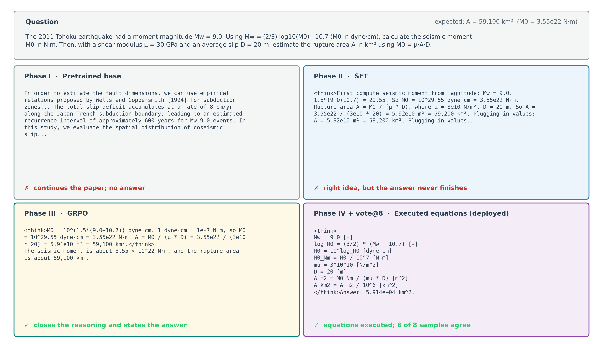
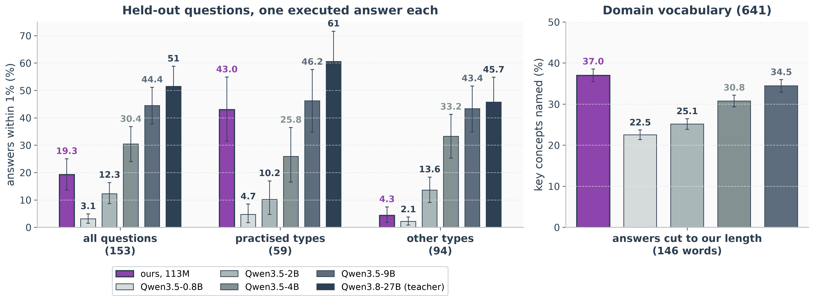
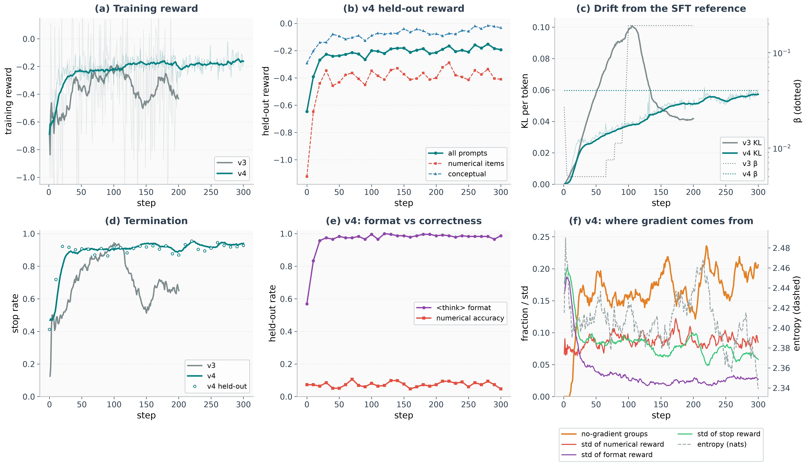
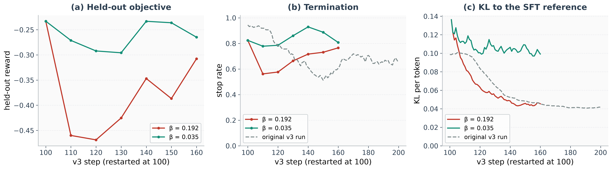
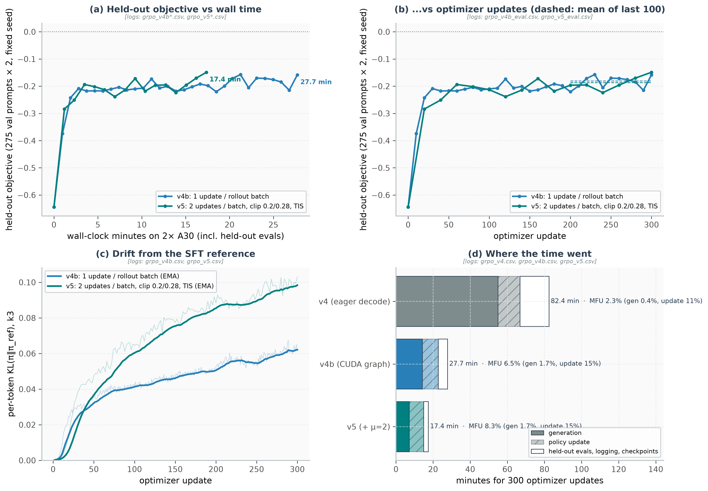
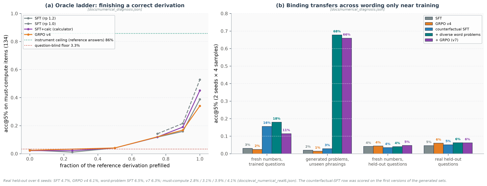
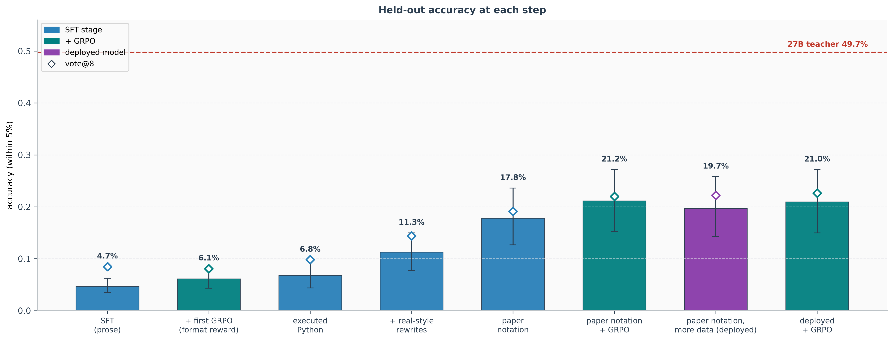
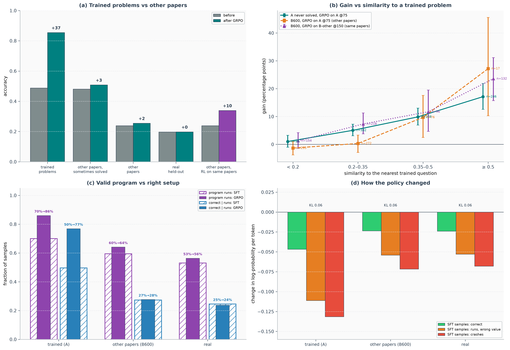
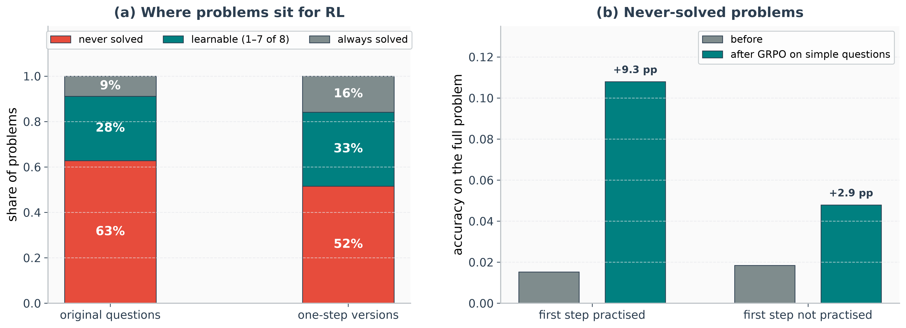

<div align="center">

# nanoGPT-Seis-Posttrain

[English](README.md) | [中文](README.zh-CN.md) | [🤗 Hugging Face 权重](https://huggingface.co/jiazhe868/nanogpt_seis_posttrain)

把一个 1.13 亿参数的地震学语言模型后训练成能回答领域问题（包括数值题）的助手：监督微调、基于可验证奖励的 GRPO，
以及通过执行模型自己写出的方程来计算答案。全部在 2× NVIDIA A30 上完成。

</div>


## 概要

预训练模型会接着往下写文本，而不会回答问题。用 1.41 万条根据地震学论文撰写的问答对做监督微调（SFT），
1.13 亿参数的模型学会了作答（第二阶段）。但它的数值答案很少正确：在 153 道出自从未用于微调的论文的留出题上只有 4.7%。

SFT 的回答常常没有写完：推理块不闭合，也没有最终答案。带验证器奖励的 GRPO 修正了格式（第三阶段）：
格式规范的回答从 71% 升到 98%。准确率变化不大（6.1%），因为正确的数值答案太少，奖励没有可以强化的对象。

小模型做多步算术时常常出错，因为每一位数字都是采样出来的，误差会累积。测试还显示了第二个问题：模型也会选错关系式。
因此，我让模型把推导写成简短的方程，由解释器执行，写法采用它预训练时读过的论文的记法。我用本地 27B 教师写出的
10.5 万份这样的解答训练它（第四阶段）。准确率升到 19.7%，对 8 个执行结果做多数投票后达到 22.2%。

在执行结果上做 GRPO，留出集上最多多 3 个点，而它训练用的题从 49% 升到 85%。一项迁移研究给出了原因：
一道新题能分到多少增益，取决于它与训练题有多相似，而留出题来自模型从未练习过的论文。练习从未答对的题的第一步，
能让这些题被解出的频率提高到 7 倍。在 9,000 道更广的题上各过一遍，最多只多 2.4 个点（§5.19）。这次运行使用来自语料中每篇论文的题，再加 vote@8，就是部署的模型：留出题上 23.3%，关于其微调论文的新题上 38.9%。

当每个模型都必须给出一个经执行的答案（误差 1% 以内）时，113M 模型领先 2B 以内的通用 Qwen3.5 模型。在练习过的题型上，它得 43.0%，大 80 倍的 Qwen3.5-9B 为 46.2%，差异不显著；在等长的回答中，它提到的领域关键概念比所有这些模型都多（§1.4）。

## 目录

1. [结果速览](#1-结果速览)
   - 1.4 [与通用模型对比：同样的评分方式](#14-与通用模型对比同样的评分方式)
2. [快速开始](#2-快速开始)
3. [在训练之前定义成功](#3-在训练之前定义成功)
4. [第二阶段 监督微调](#4-第二阶段-监督微调)
5. [第三阶段 可验证奖励的强化学习](#5-第三阶段-可验证奖励的强化学习)
   - 5.14 [计算器修正算术，修不了建模](#514-计算器修正算术修不了建模)
   - 5.17 [找到瓶颈](#517-找到瓶颈)
   - 5.18 [第四阶段：由本地教师生成可执行方程](#518-第四阶段由本地教师生成可执行方程)
   - 5.19 [GRPO 在哪里起作用：一项迁移研究](#519-grpo-在哪里起作用一项迁移研究)
6. [评测是如何工作的](#6-评测是如何工作的)
7. [评测发现了什么](#7-评测发现了什么)
8. [实验方法可扩展性分析](#8-实验方法可扩展性分析)
9. [失败图谱与训练陷阱](#9-失败图谱与训练陷阱)
10. [仓库结构](#10-仓库结构)

[PITFALLS.zh-CN.md](PITFALLS.zh-CN.md) 收录了搭建这条流程时遇到的失败模式，以及发现它们的检查方法。

---

## 1. 结果速览

### 1.1 模型、数据与算力

| | |
|---|---|
| 基座模型 | 1.133 亿参数（GQA、RoPE、RMSNorm、SwiGLU），4096 token 上下文，在 8.23 亿 token 的地震学论文、维基百科和 FineWeb-Edu 上预训练 |
| 第二阶段数据 | 1.57 万条问答对，来自论文片段、基础概念和历史地震：1.41 万条用于训练，其余留出 |
| 第四阶段数据 | 10.5 万份论文记法解答，经执行检查，由本地 Qwen3.8-27B-FP8 教师撰写；另回放 6k 条第二阶段数据 |
| RL | GRPO，每道题 8 个样本，奖励来自程序化验证器 |
| 硬件 | 2× NVIDIA A30（每张 24 GB） |
| 评测 | 153 道出自从未用于微调的论文的数值题（其中大多数出现在预训练文本中），每道题 6 个种子 × 4 个样本 |

### 1.2 各阶段结果

<p align="center"></p>

| 阶段 | 模型 | 格式规范 | 准确率 | 需要计算（134） | 误差 1% 内 | 关于微调论文的新题（300） | 关键概念（641） |
|---|---|---|---|---|---|---|---|
| I | 预训练基座 | — | — | — | — | — | — |
| II | SFT | 71% | 4.7% | 2.8% | 1.9% | 2.0% | 38.7% |
| III | + GRPO | 98% | 6.1% | 3.1% | 2.2% | 1.8% | 40.0% |
| IV | 可执行方程 | 100% | 19.7% | 20.1% | 16.7% | 35.5% | 36.9% |
| | + 语料上的 GRPO | 100% | 22.0% | 20.7% | 19.3% | 37.6% | 37.0% |
| 部署 | + vote@8 | 100% | 23.3% | 21.6% | 20.5% | 38.9% | 37.0% |

答案与参考值相差 5% 以内记为正确。在需要计算的题上，不看题目的模型能得 3.3%；27B 教师盲解得 48.5%。

新题一列衡量训练分布：27B 教师根据微调论文新写的 300 道题，从未用于训练，每个标签都由第二份独立解答核对
（`docs/eval_indist.json`、`scripts/experiments/indist_chain.sh`）。这些题与第四阶段训练数据风格相同，所有数字都已给出。
方程模型在这上面的准确率约为留出题的两倍；文字作答模型训练时用的是另一种风格，得分反而低于留出题。这一列与准确率一列之间的差距就是
迁移：模型对训练分布的掌握，远好于它把这些能力带到新论文上的程度。

关键概念一列针对 641 道概念类留出题，计算回答提到了每道题关键概念中的多少（`docs/eval_ceilings.json`）。只看题目本身能提到 3.7%，
参考答案为 100%。各阶段都没有让它明显变化：它由 SFT 决定；GRPO v4 的奖励含概念项，多了 1.3 个点；之后的阶段训练的是数值题，
只回放了第二阶段数据（§5.18）。部署的对话程序用文字作答解码回答这些题（§3.4）。

第三阶段大幅改变了格式，数值变化不大（4.7% → 6.1%），因为可以强化的正确答案太少（§5.9）。这一提升大多来自同时出现在其训练提示词中的 61 道留出题；其余 92 道上为 +0.8 个点，不显著（§3.1）。第四阶段把算术交给解释器，从而改变了数值（§5.18）。
在第四阶段之上，用根据语料中每篇论文（但从不是测试题本身）写出的题做 GRPO，多了 2.4 个点，加上 vote@8 就是部署的模型（§5.19）。增益来自答案出现在题干中的题：在需要计算的题上它得 21.6%，而只加 vote@8 的可执行方程模型得 22.4%。RL 的增益留在模型练习过的题附近（§5.19）。与教师之间剩下的差距主要是主题知识，
也就是为模型没练过的论文选对关系式和常数。

### 1.3 同一道题，各阶段的回答

<p align="center"></p>

### 1.4 与通用模型对比：同样的评分方式

<p align="center"></p>

本模型的回答是一个经执行得到的数。若改用自由文本给通用模型评分（最多 4,096 token，最后三个数中任一个算数），奖励的是长度而不是答案。这里每个模型对每道题都只给出一个经执行的答案，误差 1% 以内算对。本模型执行它的论文记法方程；每个通用模型（Qwen3.5 0.8B–9B 以及 27B 教师）写一个 Python 程序，提示词、解码与评分都与教师的盲解运行相同（§1.2）。数据：`docs/eval_general_models.json`；脚本：`scripts/experiments/general_models_compare.py`。

| 模型 | 参数量 | 留出题（153） | 练习过的题型（59） | 等长时的关键概念（641） |
|---|---|---|---|---|
| **本模型** | **113M** | 19.3% | **43.0%** | **37.0%** |
| Qwen3.5-0.8B | 0.8B | 3.1% | 4.7% | 22.5% |
| Qwen3.5-2B | 2B | 12.3% | 10.2% | 25.1% |
| Qwen3.5-4B | 4B | 30.4% | 25.8% | 30.8% |
| Qwen3.5-9B | 9B | 44.4% | 46.2% | 34.5% |
| Qwen3.8-27B（教师） | 27B | 51.5% | 60.6% | — |

113M 模型能跟上大到 80 倍的模型的地方：
- **练习过的题型。** 在与最近的训练题至少共享 40% 词语的 59 道留出题上（已排除根据测试论文写出的题），它得 43.0%，Qwen3.5-9B 为 46.2%：差 −3.2 个点 [−15.5, +8.3]，不显著。它比 Qwen3.5-4B 高 17 个点 [+4.1, +30.2]。这些题对通用模型并不更容易：9B 在这些题上得 46.2%，总体为 44.4%；4B 分别为 25.8% 和 30.4%。
- **领域词汇。** 把每个回答都截到本模型的长度（146 词）后，通用模型提到的领域关键概念更少。9B 提到 34.5%，比本模型少 2.6 个点 [0.9, 4.3]；更小的模型为 22.5–30.8%。
- **2B 以内的通用模型。** 在全部 153 道题上，它领先 Qwen3.5-0.8B（+16.1 个点）和 Qwen3.5-2B（+7.0 [+0.6, +13.5]），位于 2B 和 4B 之间。
- **成本。** 一个回答经过 113M 参数处理 237 个 token，计算量约为 9B 的 1/190（9B 处理 573 个 token）；即便 vote@8 也只有约 1/24。权重在 bf16 下占 0.23 GB，9B 在 FP8 下约 9 GB。

落后的地方：在规范题目上的可靠性。在关于其微调论文的 300 道新题上，9B 得 91.5%，本模型得 36.2%。用自由文本评分时通用模型得分更高（Qwen3.5-0.8B 23.9%，9B 55.9%）：单答案格式和 1% 的容差让它们少了 11–26 个点。

前进的方向是覆盖面。模型每练习一种题型，这种题型就进入它能跟上 9B 的那一列。这需要新的题目类型，而不是更多同类题：在干净的 dev 集上，随着训练题库扩大 16 倍，有练习过的近邻的题目比例只从 36% 升到 38.5%（§3.1）。

注意事项：
- 练习过的子集是事后按与训练数据的相似度划分的；只有 59 道题，置信区间较宽。
- 标签由一条规则从参考答案中提取，其中有错误，这限制了所有模型；参考答案本身只得 85.8%（§5.17）。
- 通用模型写 Python，本模型写论文记法；两者都经执行，并按同一规则评分。通用模型的权重在加载时量化为 FP8。
- 大多数留出题出自本模型预训练文本中的论文（§1.1），通用模型也可能见过其中一些论文。

---

## 2. 快速开始

```bash
conda activate nanogpt_seis      # 使用与预训练仓库相同的环境（CUDA-12.4 版 PyTorch）

# --- 与部署的模型对话 ------------------------------------------------------
hf download jiazhe868/nanogpt_seis_posttrain checkpoints/grpo_v14_corpus/grpo_ckpt_step_75.pt --local-dir .
                                             # 部署模型的权重；完整的环境准备（预训练仓库、分词器）见
                                             # Hugging Face 模型卡
python -m src.sft.chat                       # 已部署模型（configs/deploy.yaml）：语料上的 GRPO，在 </think> 处执行
                                             # 论文记法方程，对执行结果做 vote@8
python -m src.sft.chat --prompt "An Mw 6.9 earthquake ... what is M0 in N m?"
python -m src.sft.chat --ckpt-path checkpoints/grpo/selected.pt   # 早先的文字作答模型（GRPO v4）

# --- 第二阶段：SFT 监督微调 --------------------------------------------------
python -m src.sft.build_corpus merge         # 合并 4 个来源数据 -> 15,659 对问答（已去重）
python -m src.sft.build_corpus split         # 按文档源身份划分 + 哈希固定的test split
torchrun --standalone --nproc_per_node=2 -m src.sft.train_sft --config configs/sft_base.yaml
python -m src.sft.checkpoints select --ckpt-dir checkpoints/sft --link-best checkpoints/sft/selected.pt

# --- 第三阶段：验证器 RL 强化学习 ---------------------------------------------
python -m src.rl.prepare_rl_dataset
torchrun --standalone --nproc_per_node=2 -m src.rl.train_grpo --config configs/rl_grpo.yaml

# --- 第四阶段：可执行方程（教师数据见 §5.18）---------------------------------
torchrun --standalone --nproc_per_node=2 -m src.sft.train_sft --config configs/sft_pot_notation2.yaml --snapshot-epochs
torchrun --standalone --nproc_per_node=2 -m src.rl.train_grpo --config configs/rl_grpo_v14_corpus.yaml
                                             # 部署所用的运行；题库由 scripts/experiments/v1314_chain.sh 构建

# --- 测量与审计：在采信任何结论之前先跑一遍审计脚本 ----------------------------
python -m src.sft.splits data/rl/test.jsonl            # 验证数据划分规范
python -m src.analysis.validate_measurement all        # 检验指标下限/上限与奖励函数漏洞
python -m src.analysis.validate_measurement group      # 运行一次真实的 8-样本组梯度计算演算演示
python scripts/experiments/real6_eval.py real6_deployed.json \
    checkpoints/grpo_v14_corpus/grpo_ckpt_step_75.pt 31,32,33,34,35,36 1.0 1 deployed   # §1.2：6 个种子 × 4
python -m src.rl.eval_rl --grpo-ckpt checkpoints/grpo/selected.pt --val-file data/rl/test.jsonl \
    -k 4 --out-json eval_rl_prose.json                 # 文字作答模型：配对检验、McNemar、pass@k、检验效力
python -m src.analysis.diagnose_capability tier        # 诊断分析准确率的真实来源（提取 vs 计算）

python -m src.plots                                    # 重新生成 assets/ 下的全部图表
```

小显存 GPU 适配说明。 SFT 在配置 `micro_batch=1`、`grad_accum=16`、bf16 精度、4096 上下文长度下，显存占用约 11 GB，在单张 12 GB 显卡上耗时约 25 分钟即可跑完。RL 训练需要同时在显存中驻留当前策略模型与冻结的参考模型（在组采样大小 $`G=8`$ 时显存占用约 18 GB）：若在单张 24 GB 显卡上运行，可将 $`G`$ 调小至 4，并将 `max_new_tokens` 设为 256；若在 12 GB 显卡上，可将参考模型 Offload 卸载至 CPU 内存（代价是训练步长耗时增加约 3 倍）。需要指出的是，降低 $`G`$ 会直接减少用以产生梯度的组内样本离散度（详见 [§5.9](#59-产生有效梯度的真实来源分析)），因此这不仅是硬件资源上的调整，更是统计采样上的重大改变。

---

## 3. 在训练之前定义成功

本节中的所有内容，都是在第一版流水线输出了“自信但错误”的实验数字之后总结补齐的，也是本项目最核心的方法论资产。

### 3.1 数据划分规范及其局限性

核心目标。 确保每一个评估数字只解答一个明确的科学问题。

划分机制。 事先确定并严格执行的筛选规则，能够防止根据实验结果反向挑选检查点的作弊行为。但它并不能完全消除选择偏差（Selection Bias）：如果用于挑选检查点的prompt pool与用于最终上报评估数字的prompt pool是同一批，那么该评估数字本质上仍然只是一个开发集（Dev Set）结果。

本仓库的数据划分方案。 划分策略定义了四种角色，全部以原始文档源（Source Chunk）的标识符为键进行划分，确保由同一文档块导出的多个同源问题不会跨越Dataset边界（实现见 `src/sft/splits.py`）：

```
train   SFT 与 RL 训练过程中的参数更新
val     仅用于训练过程中的实时监控（如早停触发、损失函数曲线观察）
dev     用于超参数调优、解码策略筛选、阈值标定、检查点挑选及指标验证
test    仅上报一次最终数字——严格禁止用于反向修改代码、调整阈值、挑选检查点或修改解码参数
```

为什么数据划分至关重要。 本项目初期曾存在划分缺陷：检查点选择与 `eval_rl` 脚本均默认使用全部 808 条留出提示词池。事后重新进行划分审计后发现：

| 数值准确率提升幅度 Δ（SFT → GRPO） | 提示词数量 n | Δ 提升幅度 | 95% 统计置信区间 |
|---|---|---|---|
| dev split | 76 | +3.0% | [+0.0%, +6.2%] |
| test split | 90 | +0.8% | [−3.1%, +4.7%] |

完全相同的模型、完全相同的指标、完全相同的解码配置，dev split读出的提升幅度竟达到了 test split的近 4 倍。这一差距与选择偏差相符；如果只报告前一个数字，就会夸大结果。当然，这也并非选择偏差的纯粹测量：其中一部分差异来自两个样本量各约 80 多条的子集之间的固有异质性，且被选中的检查点在挑选过程中已经间接接触过两边的数据。

> 关于回溯性审计划分的特别说明：
>
> dev/test 的划分是在事后重新审计时引入的。原始的 808 条提示词池此前已经深度参与了检查点挑选（例如决定选用第 100 步而非第 200 步的检查点）、整体性能评估、指标设计、阈值标定以及“确定分析切入点”的过程。通过哈希冻结只能确保在此之后的评估不再发生Dataset偏移，但无法在历史时间线上抹去 test split已被“间接触碰”的事实。
>
> 这个划分仍然有用：它给出了这些决策把合并结果抬高了多少的上界。它不是完全冻结的最终测试集，所以本文不这样称呼它。
>
> 要得出严格可靠的最终结论，需要： 完全冻结代码、解析器、解码参数、验证器阈值、checkpoint candidates与挑选规则；仅使用 dev split完成挑选；采用此前从未接触过的新文档源构建全新的test split；并且仅执行一次最终评估。

第二处泄漏，后来发现。第三阶段的提示词池（`data/rl/train.jsonl`，GRPO v3–v8 使用）来自按文档块划分之前的旧语料划分，原样包含 204 条留出提示词，其中 61 条属于 153 道计分数值题。GRPO v4 的数值提升主要来自这 61 道题：+2.5 个点 [+0.6, +4.4]，其余 92 道为 +0.8 [−0.5, +2.1]。它在格式上的提升（这 92 道题上 +20 个点）和关键概念上的小幅提升（提示词池之外的 506 道概念题上 +1.4 [+0.3, +2.6]）不受这一重叠影响。从 v9 起，所有 RL 提示词池都不含留出提示词；部署模型的训练数据（两套 SFT 数据和 v14 提示词池）也不含，而且部署模型在这 61 道题上的得分低于其余 92 道（20.8% 对 25.0%）。

RL 的 dev 集也有同样的来源。它的 96 道真实题（`data/rl/val_numerical_dev.jsonl`，也包含在 `data/rl/v13_dev.jsonl` 中）从 v12 起用于挑选 RL 检查点，也用于确定验证器的规则。其中 74 道原样出现在第二阶段训练集中，45 道出现在第四阶段数据中，因此 dev 分数偏高：vote@8 在这些题上为 39.6%，在 test 集上为 24.0%。test 集不受影响。一个干净的 dev 集，即 SFT 验证集中有标签的 144 道数值题（`data/rl/dev_clean.jsonl`、`docs/eval_dev_clean.json`），对 32 个检查点重新排序。最好的是 v13 第 142 步：它在干净 dev 上得 30.7%，部署模型为 28.2%；在留出集上得 21.0%，部署模型为 22.0%，因此部署模型不变。

Dataset断言。 `assert dev_chunks.isdisjoint(test_chunks)` —— 在 `splits.describe()` 中强制运行校验。

扩展至大规模数据时。 可将精确的 Chunk ID 替换为文档图拓扑与近重复文本检测（Near-deduplication）；数据划分维度的不变性约束保持不变。

### 3.2 四类评估指标的划分

大多数评估层面的混乱，本质上源于混淆了以下四类性质截然不同的评估指标：

| 指标类别 | 所解答的核心问题 | 本项目中的实际对应 |
|---|---|---|
| 训练优化指标 | 优化器是否在成功优化其显式目标？ | 复合奖励得分、KL 散度、策略熵 |
| held-out split同维度指标 | 被优化的行为能否泛化至未见过的提示词？ | `<think>` 标签合规率、数值验证器准确率 |
| 独立能力评估指标 | 模型的广义能力是否取得了实质性提升？ | （本项目未引入，见下方说明） |
| 异常防护指标（卫生检查） | 模型是否出现了不可接受的劣化或崩溃行为？ | 文本重复率、内容污染率、空输出率 |

本项目没有独立能力评估指标。评测准确率使用与 `NumericalVerifier` 相同的字段和容差；`<think>` 比例使用 `FormatVerifier` 检查的同一组标签。它们是同一能力在留出提示词上的表现：这是泛化检查，不是更广泛能力提升的证据。§5.13 把训练奖励、优势与评测并列比较，并说明各自如何防范奖励破解。

### 3.3 评估指标的理论下限与上限

任何百分比指标，如果不标明其理论上下限，在科学上都是无法解读的：

- **理论下限** —— 完全不具备任何领域知识的随机/盲猜策略所能获得的基线得分；
- **理论上限** —— 标准答案（Ground Truth）直接通过相同解析器所能获得的最高得分。

在 5% 容差下、最初的 166 道数值题上，数值准确率指标的表现如下：

| 打分规则 | 理论上限 | 理论下限 | 可有效区分的增量空间 |
|---|---|---|---|
| 匹配前 8 个出现的数字中最小误差 （初始版本） | 68.1% | 14.3% | 53.8% |
| 匹配末尾最后 3 个数字（修正后） | 86.1% | 5.9% | 80.2% |

初始规则的理论下限甚至高于模型本身。把打分限定在回答末尾，同时改善了上下限——最终答案通常在结尾，“前 8 个数字”常常覆盖不到它。在重新标注后的 134 道需要计算的题上，量程从 3.3%（不看题目的模型）到 85.8%（参考答案本身），部署模型得 21.6%。

```bash
python -m src.analysis.validate_measurement floor
```

### 3.4 解码配置规范

在这个规模上，解码设置对结果的影响可以和训练一样大。对文字作答模型，重复惩罚 1.05 时会产生 56% 的重复 5-gram；提高到 1.2 后，两个模型的实测准确率都约翻倍，SFT→GRPO 差值的符号也随之翻转，这一影响是训练效果的 2.3 倍。可执行方程模型正好相反：程序会重复使用符号名，所以它不加重复惩罚（§5.18）。

因此解码设置与模型一起固定：`configs/deploy.yaml` 记录部署模型的设置（温度 0.3、top-k 40、重复惩罚 1.0、vote@8），`chat.py` 为文字作答模型使用温度 0.3 / top-k 40 / 重复惩罚 1.2，评测使用与服务时相同的设置。（详见 [PITFALLS.zh-CN.md](PITFALLS.zh-CN.md) 中的案例 B3）

部署模型会对每道题分流（`src/sft/question_router.py`）：要求给出数值的题使用执行方程加 vote@8；其余的题使用文字作答解码，因为不加重复惩罚时它的概念题回答会循环重复。留出集的 153 道数值题仍全部走方程，641 道概念题的关键概念覆盖率从 29.6% 升到 37.0%。

### 3.5 结果的出处追溯与校验机制

评测脚本会把检查点、数据划分和解码参数与分数一起写入结果文件（`src/rl/eval_rl.py`、`scripts/experiments/real6_eval.py`）；绘图代码在评测出处与所画训练日志不一致时会发出警告。这样做是因为曾有一个旧运行留下的结果文件，看上去和当前的毫无区别。

---

## 4. 第二阶段 监督微调

### 4.1 流利的预训练模型不等于合格的对话助手

预训练模型的本质是文档续写器。如果向其提问 “地震矩的计算公式是什么？”，它可能会接续输出 `1. Introduction. Earthquake rupture processes...` —— 从下一个 Token 预测的角度来看这是完全合理的，但作为问答回复则毫无意义。SFT 微调改变的是模型的条件概率分布，而非知识本身：

```
预训练阶段：  预测任意文本文档中的下一个 Token
SFT 微调阶段：以 system + user 提示词 Token 为条件
              仅对 assistant 回复 Token 进行梯度优化
最终效果：    相同的语言模型，不同的回复条件分布
```

### 4.2 SFT 的损失函数与计算方式

仅在 assistant 回复 Token 上计算掩码交叉熵损失（Masked Cross-Entropy Loss）：

```math
\mathcal{L}_{\text{SFT}} = -\frac{1}{\sum_t m_t}\sum_t m_t \log p_\theta\!\left(y_t \mid x,\, y_{\lt t}\right)
```

其中 system / user 提示词以及 Padding 填充 Token 对应的掩码权重 $`m_t = 0`$，仅 assistant 产生的回复 Token 对应 $`m_t = 1`$。在代码里这是几行掩码，正是它们使其成为指令微调，而不是继续预训练：

```python
# src/sft/dataset.py — system、user 与 assistant 头部的 Token 标签设为 -100（不计损失）
system_labels = [ignore_index] * len(system_tokens)
user_labels = [ignore_index] * len(user_tokens)
assistant_header_labels = [ignore_index] * len(assistant_header_tokens)
response_target_labels = list(response_target_tokens)      # the loss is computed only here
```

其他方案对比。 对整个序列计算全量损失同样可行，但这会将参数容量浪费在建模用户输入的提问文本上。在当前模型规模下，LoRA 能将训练显存降至约 1/4，但全量微调本就可以完全装入显存，引入额外的参数化机制反而带来不必要的复杂性。而在指令格式文本上直接进行连续预训练的效果则更差，因为它始终没有向模型明确界定回答边界。

### 4.3 数据层面会毒害模型的四类隐患

教师模型生成的数据，其失效方式在损失曲线上是看不见的——因为模型会把缺陷学得**非常好**。
下面每一个问题都是语料本身的属性，而不是训练循环的属性，这也是它们无法靠调超参解决的原因。

| 隐患问题 | 为何会破坏训练 | 解决方案 |
|---|---|---|
| 回答引用了读者看不到的来源（"如表 2 所示"） | 模型学到的是"自信地引用"属于好回答的一部分，于是在推理时凭空编造参考文献。这等于在专门训练它产生幻觉。 | 直接丢弃该样本。改写句子只会保留产生它的那套推理方式。 |
| 只清洗了回答，没有清洗 `<think>` 内部 | 表面答案很干净，推理链里却仍在引用虚构来源——于是模型学会了"边思考边幻觉"，而这恰恰是后续 RL 会去强化的部分。 | 同一套规则必须同时作用于推理块内部。 |
| 正则清洗在删除违规文本时把换行也删掉了 | 排版格式和别的行为一样是学出来的。被压平的训练文本会教模型用大段没有结构的文字回答。 | 只修复文本，绝不重排版式。 |
| 约 13% 的原始生成内容不属于本领域 | 在 113M 规模上没有多余容量可用。每一条跑题样本都挤掉一条地震学样本，模型要为两者同时付出代价。 | 在数据进入训练之前就按领域过滤。 |

更一般的教训是：**小模型没有"忽略坏数据"的容量。** 一个 70B 模型偶尔见到虚构引用，或许会把它
当作噪声；而 113M 模型会把它当作规律。数据清洗在小规模上是比在大规模上更大的杠杆。

清洗只保留了第一批论文数据的 27%：1.73 万条原始生成只剩 4.7 千条可用样本。再加上可修复样本的改写（2.5 千条）
和两个生成来源——基础概念（4.0 千条）与历史地震（4.4 千条）——语料增至 1.57 万条，其中 1.41 万条用于训练。
丢掉四分之三花钱生成的数据看起来很浪费，但这是正确的取舍：[§4.9](#49-消除混杂因素后的-sft-数据缩放曲线) 表明数据量每翻
一倍只买到约 0.08 nats，而一旦学会某种幻觉模式，它是永久性的。

### 4.4 按来源文档而不是按问题划分数据

一份原始文档会衍生出好几道题，而这些题目彼此并不独立——它们只是换个说法在问同一批事实。如果按
单题划分，验证集里的题目几乎总能在训练集中找到一个兄弟样本。于是模型靠记忆作答，验证损失下降，
你据此得出"模型泛化得很好"的结论，而实际上它只是背下来了。

因此划分的最小单位是**来源文档**，而不是问答对：由同一份原文衍生的所有题目必须整体进入同一个
划分。测试集的归属还额外用来源 ID 的哈希锁定，这样今天被留出的文档在语料重建之后依然被留出——
否则每次重建都会重新抽一次测试集，两个模型版本之间就再也无法比较。

之所以要把它写成一条规则，是因为朴素做法**并不显然是错的**：本项目就犯过两次。第一次是按问答对
划分；第二次是新的生成器给每个改写变体分配了独立身份，于是又悄悄把兄弟样本打散到了边界两侧。
两次的结果都让指标变得更好看。实测代价见 [A1](PITFALLS.zh-CN.md)。

### 4.5 避免跨样本截断的 Sequence Packing

Sequence Packing 技术将多个问答样本拼接成 4096 Token 的长序列以提高训练吞吐。朴素的拼接会在 Chunk 边界直接切断文本并保留其标签，这相当于在使用被截断的提示词去强行训练回复。本项目的打包逻辑改为：当剩余空间不足以容纳下一个完整样本时，放弃拼接并使用 Padding 填充当前 Chunk。在 Chunk 内部依然使用标准的因果注意力掩码（同 Chunk 内的样本可以相互注意到）——这也是为什么打包后的 Loss 仅用于训练监控，绝不用于模型间的严谨对比（详见 [§6.2](#62-配对评估paired-evaluation)）。

### 4.6 影响评估指标的关键训练细节

```python
# 验证损失按实际 Token 数量精确加权并进行全局 Reduce 操作。
# DistributedSampler 会切分val split，直接求各 Rank 均值会导致 Rank 0 的结果被误当作全局指标
dist.all_reduce(loss_sum); dist.all_reduce(token_count)
val_loss = loss_sum / token_count

# 梯度累积按当前 Step 的真实 Group 样本数归一化，避免每个 Epoch 末尾非完整 Batch 的梯度被过度放大或低估
loss = loss / group_size
```

### 4.7 基于生成行为而非验证损失选择最佳检查点

目标。 选出实际生成行为表现最优的检查点，而非val split Cross-Entropy Loss 最低的检查点。

<p align="center"></p>

训练曲线（峰值学习率 2e-4）呈现出经典的“过拟合”形态：到第 200 步训练损失降到 1.18，而验证损失从第 80 步的 2.14 升到 2.29（到最后第 336 步为 2.58）。然而在此场景下，按常规经验判定为过拟合是错误的。

物理机制。 交叉熵损失衡量的是模型对某一种固定参考文本的预测概率。随着微调的深入，模型会逐渐收敛至属于自身的表达习惯，这虽然降低了标准参考文本的概率密度，但绝不意味着生成质量的劣化：

| 评估维度 | 验证损失最低点（第 80 步） | 最终训练检查点（第 336 步） |
|---|---|---|
| held-out split Validation Loss | 2.2700 | 2.7798（上升 +0.51 nats, t=+33） |
| `<think>` 标签合规率（早先的 166 题测试集） | 61.4% | 74.1%（z=+2.47） |

本仓库的选择策略。 挑选逻辑完全基于在 dev split上的实测生成行为，评估规则在查看任何实验数据之前便固化在代码中：

```python
# src/sft/checkpoints.py
PRIMARY   = "numerical_acc_5pct"     # 唯一可打分的正确性代理指标
TIE_BREAK = "numerical_think_rate"   # 仅在主指标差距处于 TIE_EPS 容差范围内时触发
TIE_EPS   = 0.02                     # 近似等于该样本量下的统计噪声水平
GATES = [("contamination_rate", "<=", 0.02), ("echo_rate", "<=", 0.40),
         ("mean_completion_tokens", ">=", 40)]
```

实测证据。在实际发布的第二阶段运行（峰值学习率 1e-4）上，规则选中了第 8 个 Epoch；若按验证损失排序，则会选中第 3 个 Epoch（第 120 步），而它恰恰是三个候选中 `<think>` 合规率最差的一个。

### 4.8 SFT 带来的实质性改变

SFT 改变的是模型**用来做什么**，而几乎没有改变它知道什么。

在 SFT 之前，模型根本没有"轮次"这个概念。给它一个问题，它会接着往下写文档——听上去很像样的
地震学散文，却从不回应你，也永远不停止，因为预训练从没教过它"回答是有终点的"。SFT 之后，
它会回答，并且会终止。这两件事就是全部的交互接口，而且都完全是在这一阶段学会的。

它还部分获得了推理的**外形**：约七成的数值题回答现在会被包在 `<think>` 块里。
是"部分"而不是"稳定"——把这个缺口补上正是第三阶段要做的事。

没有变化的是算术。对于答案已经写在提示词里某处的题目，SFT 能做对约五分之一——这是真实的任务
适配，因为它必须找到并复述正确的那个量。而对于答案必须真正推导出来的题目，它停留在随机下限。
这个区分比任何单一的准确率数字都重要，[§1.2](#12-各阶段结果) 按此拆分报告了结果。

SFT 教会了模型一个接口和"把过程写出来"的习惯。它没有增加基座模型本来不具备的知识：它的优化目标是模仿回答的
表层形式，而计算不是表层形式。

### 4.9 消除混杂因素后的 SFT 数据缩放曲线

<p align="center"></p>

引入严格的成分匹配子采样（Composition-matched Subsampling）—— 在每一个数据规模节点上，均将论文/基础概念/历史地震的数据比例精确固定为 46% / 25% / 28%，使得数据量成为唯一变量：

```
Loss = 3.4041 − 0.0813 · log₂(N)        拟合残差严格控制在 ±0.016 范围内
```

早期草稿中测得的缩放斜率仅为 0.063，原因在于其小规模采样点全部由论文数据构成 —— 这是eval set中最容易解答的同分布子集 —— 导致数据规模与数据成分两个变量被严重混杂。在消除混杂因素后，数据的边际价值提升了 28%。

> 适用边界与局限说明：
>
> 必须强调，这是一条局部的、端到端 SFT 训练下的数据缩放曲线，绝非普适的预训练 Scaling Law。由于训练 Epoch 固定为 8，更大的Dataset自然获得了更多的优化器更新步数：该曲线同时改变了唯一数据量和总训练 token exposures。此外，每个数据节点仅使用单随机种子，未计算回归置信区间。严谨的 Scaling 研究应当在控制总 Compute 算力的前提下，对比等 Epochs、等 token exposures以及重复数据训练等多种控制组。

---

## 5. 第三阶段 可验证奖励的强化学习

### 5.1 为什么在 SFT 之后需要引入强化学习

本方法属于基于可验证奖励的强化学习（RLVR）范式，由 Tülu 3 提出（[Lambert et al. 2024](https://arxiv.org/abs/2411.15124)）：其奖励信号来自一段确定性的答案校验代码，而非基于人类偏好训练出来的代理奖励模型（Reward Model）。

SFT 微调本质上是在模仿教师模型给出的单一参考答案。而验证器 RL 则对同一提示词采样多个候选回答，并向获得更高校验得分的回答方向推动概率分布 —— 因此，它可以优化参考答案中未曾显式示范的优良属性（如简洁度、格式严谨性、正确终止等），且由于验证器是纯程序逻辑，无需付出昂贵的人工标注成本。

### 5.2 本仓库实现的具体 RL 算法

针对每一条提示词：策略模型采样生成 $`G`$ 个候选回答，由验证器引擎打分，在组内进行标准化（Group Normalization），随后执行单步策略梯度更新。下面的代码是 §5.5–§5.9 所分析的 v3 目标函数；从 v4 起，训练器仍减去组内均值，但改用整个批次汇总的一个标准差缩放优势、以 k2 作为 KL 损失、并用常数归一化（§5.8）。

```python
# src/rl/train_grpo.py，v3 设置（adv_norm: group, kl_loss: k3, loss_agg: seq_mean）
rewards    = [reward_engine.score(c, item) for c in completions]     # 采样 G 个回答并打分
advantages = (rewards - rewards.mean()) / (rewards.std(unbiased=False) + 1e-8)     # 计算组内相对优势 (Group Advantage)

# 相对冻结 SFT 参考模型的 k3 KL 散度估计，掩码仅覆盖真正采样的生成 Token
per_token = -(logp * advantage - beta * kl) * sampled_mask
loss = (per_token.sum(dim=1) / seq_tokens).mean()
```

该算法的本质是带组相对基线的 REINFORCE 算法（[Williams 1992](https://doi.org/10.1007/BF00992696)）。通过组内均值取代了 PPO 中需要额外训练的 Critic 网络（[Schulman et al. 2017](https://arxiv.org/abs/1707.06347)）：对于针对同一提示词采样的 $`G`$ 个样本而言，组均值是一个零参数、低方差的基线。v3 再除以每组自己的标准差，使不同难度提示词之间的更新幅度可比；v4 改为除以整个批次汇总的一个标准差，奖励只差 0.01 的组优势仍然很小。

> 关于估计量偏差的数学说明：
>
> 需要指出的是，该优势估计量在有限样本 $`G`$ 下并非严格无偏。由于每个采样回答都参与了本组均值与标准差的计算，其估计值是自归一化的。减去包含样本自身的组均值，会使策略梯度项的期望受到约 `1 − 1/G` 的收缩缩放；再除以组标准差又引入了额外的有限样本偏差。使用 Leave-one-out 留一法求均值虽然可以消除最简单的自身样本偏差，但归一化本身仍存在统计偏差。这并不妨碍算法的实际有效性 —— 只是需要在学术上纠正“完全无偏”的错误说法。

为何该损失函数能够实现既定目标： 对于某个采样产生的回答，其策略梯度损失项为

```math
\mathcal{L}_{\text{policy}} = -A \log p_\theta(y \mid x)
```

在梯度下降优化过程中：
- 若优势值 $`A \gt 0`$，最小化损失会增大 $`\log p_\theta(y \mid x)`$ —— 该回答的生成概率被提升；
- 若优势值 $`A \lt 0`$，最小化损失会降低该概率 —— 该回答的生成概率被抑制；
- 若某组内所有 $`G`$ 个回答得分完全相同，则所有回答的优势值 $`A`$ 均为零，梯度为零，模型无法学到任何东西，无论该共同得分有多高或多低。这正是 [§5.5](#55-一个真实样本组能教给我们什么) 所演示的核心物理机制。

KL 散度约束项则起到相反的拉拽作用：当奖励函数鼓励策略偏离原始 SFT 参考模型时，KL 项会对这种偏离施加惩罚。奖励函数在向前拉，KL 约束在向后锚定，而参数 $`\beta`$ 则决定了两者的折换权重。

KL 散度估计量（日志记录的值，也是 v3 的 KL 损失）：在采样生成 Token 上定义 Log 比率（参考模型减去当前策略模型）：

```math
r_t = \log p_{\text{ref}}(y_t \mid \cdot) - \log p_\theta(y_t \mid \cdot)
```

采用 Schulman 提出的 k3 估计量（[2020](http://joschu.net/blog/kl-approx.html)），定义为 `k3(y) = y - 1 - log y`，代入 $`y = e^{r_t}`$ 得：

```math
\widehat{\text{KL}}_t = e^{r_t} - r_t - 1
```

```python
# src/rl/train_grpo.py
log_ratio = logp - c["ref_logp"]                    # policy minus reference
kl_k3 = torch.exp(-log_ratio) + log_ratio - 1.0     # e^{r_t} - r_t - 1 >= 0, always logged
kl_term = kl_k3 if cfg["kl_loss"] == "k3" else 0.5 * log_ratio.pow(2)   # v3: k3; v4 on: k2
```

注意符号约定：$`r_t`$ 定义为参考模型减策略模型，因此其估计的正是 $`\mathrm{KL}(p_\theta \Vert p_{\text{ref}})`$ —— 该方向精确惩罚策略模型将概率质量分配到参考模型未曾覆盖的区域。由于 $`e^r - r - 1 \ge 0`$，该估计值在每一个 Token 上均恒为非负，而朴素估计量 $`-r_t`$ 则缺乏这一良好数学性质。这既是选用 k3 的原因，也是训练过程中 KL 曲线即使在噪声 Batch 上也绝不会跌入负数区的原因。

#### 最小可运行实现

整个算法大约四十行。下面这段是 `src/rl/train_grpo.py` 的 v3 设置去掉日志与 DDP 相关代码后的等价版本，
可以直接对任何 HF 风格的因果语言模型运行：

```python
import torch

@torch.no_grad()
def rollout(policy, tokenizer, prompt, group_size=8, max_new_tokens=384):
    """对同一条提示采样 G 个回答。组是学习的基本单位。"""
    ids = tokenizer(prompt, return_tensors="pt").input_ids.to(policy.device)
    ids = ids.repeat(group_size, 1)                    # 同一条提示复制 G 份
    out = policy.generate(ids, do_sample=True, temperature=1.0, top_p=1.0,
                          max_new_tokens=max_new_tokens,
                          pad_token_id=tokenizer.eos_token_id)
    completions = out[:, ids.shape[1]:]                # 把提示词部分切掉
    sampled = completions != tokenizer.eos_token_id    # 同步解码的 EOS 填充并非采样得到
    return out, completions, sampled


def token_logprobs(model, sequences, n_prompt_tokens):
    """每个生成词元的 log p(y_t | x, y_<t)。"""
    logits = model(sequences).logits[:, :-1]           # 第 t-1 个位置预测第 t 个词元
    logp = torch.log_softmax(logits.float(), dim=-1)
    logp = logp.gather(-1, sequences[:, 1:].unsqueeze(-1)).squeeze(-1)
    return logp[:, n_prompt_tokens - 1:]               # 只保留回答部分


def grpo_step(policy, reference, tokenizer, prompt, item, reward_engine,
              beta=0.02, group_size=8):
    sequences, completions, mask = rollout(policy, tokenizer, prompt, group_size)
    n_prompt = sequences.shape[1] - completions.shape[1]

    # 1. 用程序化验证器给每条回答打分
    texts = tokenizer.batch_decode(completions, skip_special_tokens=True)
    rewards = torch.tensor([reward_engine.score(t, item)["total_reward"] for t in texts],
                           device=policy.device)

    # 2. 组本身就是基线 —— 全程没有任何 Critic 网络
    if rewards.std() < 1e-6:
        return None          # 离散度为零 -> 优势为零 -> 没有梯度。应重新采样。
    advantages = (rewards - rewards.mean()) / (rewards.std(unbiased=False) + 1e-8)

    # 3. 分别计算策略模型与冻结参考模型的逐词元 log-prob
    logp = token_logprobs(policy, sequences, n_prompt)
    with torch.no_grad():
        logp_ref = token_logprobs(reference, sequences, n_prompt)

    # 4. k3 KL 估计 —— 每个词元上都非负
    log_ratio = logp_ref - logp
    kl = torch.exp(log_ratio) - log_ratio - 1.0

    # 5. 以组为基线的 REINFORCE，掩码只覆盖真正被采样的词元
    per_token = -(logp * advantages.unsqueeze(1) - beta * kl) * mask
    loss = (per_token.sum(dim=1) / mask.sum(dim=1).clamp(min=1)).mean()
    loss.backward()
    return loss.item()
```

这段代码里有五个细节，决定了它是"能工作"还是"悄悄不工作"：

- **`ids.repeat(group_size, 1)`** —— G 个样本必须共享同一条提示。优势只有相对于回答**同一个
  问题**的兄弟样本才有意义。
- **`rewards.std() < 1e-6` 这道判断** —— 组内全相同就不产生梯度。提前返回相当于 DAPO 动态采样
  的一行版本；没有它，你会把算力烧在可证明毫无作用的更新上
  （见 [§5.5](#55-一个真实样本组能教给我们什么)）。
- **`sampled = completions != eos`** —— 同步解码会给较短的回答做填充。把这些填充计入，等于在
  策略从未选择过的词元上训练，还会把 KL 抬高到看起来像策略漂移
  （见 [§5.7](#57-token-掩码与-eos-填充的正确处理)）。
- **参考模型外面的 `with torch.no_grad()`** —— 参考模型是锚点，永远不是学习者。忘记关梯度是一个
  静默而昂贵的 bug。
- **先按序列求均值，再按批次求均值** —— 先除以每条序列自己的词元数，可以避免长回答主导整次更新。
  （DAPO 主张相反的做法，这个取舍何时反转见 §5.3 第 3 点。）v4 改为常数归一化（rollout 数 × `max_new_tokens`），
  每个词元权重相同，即 DAPO 的论点。

### 5.3 LLM 强化学习四大范式（PPO、DPO、GRPO、DAPO）深度推导与架构演进

为了透彻理解为何本仓库选择 带 KL 正则项的组相对 REINFORCE (GRPO 风格)，我们需要对当前大语言模型后训练对齐的主流强化学习算法进行严谨的数学公式推导、神经网络架构剖析与结构化简化分析：

```
+---------------------------------------------------------------------------------------------------+
|                                LLM 对齐算法的结构演进路线                                         |
+------------------------------------+--------------------------------------------------------------+
|       基于偏好的对齐 (Human / AI)  |                  基于可验证规则的对齐 (RLVR)                  |
+------------------------------------+--------------------------------------------------------------+
|  PPO  · 4 网络 (Actor+Ref+RM+V)    |  GRPO · 2 网络 (Actor+Ref), Critic 降维为组均值 baseline     |
|  DPO  · 2 网络 (Actor+Ref) 离线    |  DAPO · 1 网络 (Actor)，移除 KL，解耦截断                    |
+------------------------------------+--------------------------------------------------------------+
```

---

#### 1. PPO (Proximal Policy Optimization) — 完整的 Actor-Critic 基线
- **网络架构与 GPU 显存中的 4 个模型：**
  1. 策略网络 / Actor ($`\pi_\theta`$)：正在被优化的模型。
  2. 参考网络 / Reference ($`\pi_{\text{ref}}`$)：冻结的 SFT 基座模型，用于计算 KL 散度锚定。
  3. 奖励模型 / Reward Model ($`RM_\phi`$)：基于人类/AI 偏好数据 $`y_w \succ y_l`$ 拟合的标量神经网络。
  4. 价值网络 / Value Critic ($`V_\psi`$)：预测生成状态 $`(x, y_{\lt t})`$ 期望未来累积奖励的神经网络。

- **数学公式推导：**
  在 Token 生成步 $`t`$，使用广义优势估计 (GAE) 衡量动作优势：

```math
\delta_t = r_t + \gamma V_\psi(s_{t+1}) - V_\psi(s_t), \quad \hat{A}_t = \sum_{l=0}^\infty (\gamma \lambda)^l \delta_{t+l}
```

  策略网络采用 PPO 截断目标函数进行更新：

```math
L^{\text{CLIP}}(\theta) = \hat{\mathbb{E}}_t \left[ \min\left( r_t(\theta)\hat{A}_t, \, \text{clip}(r_t(\theta), 1-\epsilon, 1+\epsilon)\hat{A}_t \right) \right], \quad \text{其中 } r_t(\theta) = \frac{\pi_\theta(y_t \mid x, y_{\lt t})}{\pi_{\text{old}}(y_t \mid x, y_{\lt t})}
```

  联合优化目标涵盖策略、价值拟合与 KL 约束：

```math
\mathcal{L}^{\text{PPO}}(\theta, \psi) = - L^{\text{CLIP}}(\theta) + c_1 \mathbb{E}\left[ (V_\psi(s_t) - R_t)^2 \right] + c_2 \mathrm{D}_{\text{KL}}(\pi_\theta \Vert \pi_{\text{ref}})
```

- **大模型场景下的结构痛点：**
  - **显存开销巨大：** 必须同时在显存中驻留 4 个大模型或将部分 offload 到 CPU 内存。
  - **Critic 拟合极易崩溃：** 自回归文本生成的状态空间高维且稀疏，价值网络 $`V_\psi(s)`$ 的拟合方差极大，极易导致 Loss 爆炸。

---

#### 2. DPO (Direct Preference Optimization) — 解析化消去奖励模型与 Critic
- **网络架构与结构简化：**
  消去了奖励模型 $`RM_\phi`$、价值网络 $`V_\psi`$ 以及在线 Rollout 采样循环，仅需 2 个模型：策略网络 $`\pi_\theta`$ 与参考网络 $`\pi_{\text{ref}}`$。

- **数学公式推导：**
  从带 KL 约束的期望奖励最大化问题出发：

```math
\max_{\pi} \mathbb{E}_{x \sim \mathcal{D}, y \sim \pi(y|x)} \left[ r(x,y) \right] - \beta \, \mathrm{D}_{\text{KL}}\left(\pi(y|x) \;\parallel\; \pi_{\text{ref}}(y|x)\right)
```

  该问题存在闭式最优解，即参考策略的 Gibbs/Boltzmann 指数倾斜（此步尚未引入任何偏好模型）：

```math
\pi^*(y|x) = \frac{1}{Z(x)} \pi_{\text{ref}}(y|x) \exp\left( \frac{1}{\beta} r(x,y) \right) \iff r(x,y) = \beta \log \frac{\pi^*(y|x)}{\pi_{\text{ref}}(y|x)} + \beta \log Z(x)
```

  反解之后，奖励被表示为**最优策略**的函数。DPO 的关键一步是把待学习的策略**参数化为**该最优解
  （即令 $`\pi_\theta \equiv \pi^*`$）——这是一个建模假设，而非代数推导的必然结果——从而使 $`\pi_\theta`$
  本身成为一个隐式奖励模型。再将其代入 Bradley-Terry 偏好概率
  $`P(y_w \succ y_l \mid x) = \sigma(r(x,y_w) - r(x,y_l))`$，由于配分函数 $`\log Z(x)`$ 只依赖于 $`x`$
  且在两项中同时出现，因此被精确抵消：

```math
\mathcal{L}_{\text{DPO}}(\theta) = -\mathbb{E}_{(x, y_w, y_l) \sim \mathcal{D}} \left[ \log \sigma \left( \beta \log \frac{\pi_\theta(y_w \mid x)}{\pi_{\text{ref}}(y_w \mid x)} - \beta \log \frac{\pi_\theta(y_l \mid x)}{\pi_{\text{ref}}(y_l \mid x)} \right) \right]
```

- **优缺点与局限：**
  - 简化优势： 移除了 Critic $`V_\psi`$ 和 RM，无需在线采样。
  - 核心局限： DPO 属于纯离线算法，无法在训练中进行在线探索（Online Exploration），更无法在生成过程中动态接入 Python 程序校验器进行 RLVR 训练。

---

#### 3. GRPO / 组相对 REINFORCE（本仓库采用） — 基于组采样的零参数 Baseline
- **网络架构与结构简化：**
  仅需 2 个模型（$`\pi_\theta`$ 与 $`\pi_{\text{ref}}`$）。利用对同一提示词采样 $`G`$ 个候选回复的样本均值，取代了参数量庞大的 Critic 网络 $`V_\psi`$。

- **数学公式推导：**
  针对提示词 $`x`$，从当前策略 $`\pi_{\theta_{\text{old}}}`$ 采样 $`G`$ 个候选生成 $`\{y_1, y_2, \dots, y_G\}`$，利用确定性 Python 代码验证器打出奖励得分 $`\{r_1, r_2, \dots, r_G\}`$。
  直接在组内计算归一化优势值：

```math
\bar{r} = \frac{1}{G}\sum_{i=1}^G r_i, \quad \sigma_r = \sqrt{\frac{1}{G-1}\sum_{i=1}^G (r_i - \bar{r})^2}, \quad A_i = \frac{r_i - \bar{r}}{\sigma_r + \epsilon}
```

  （v3 使用总体标准差 `std(unbiased=False)`，且 $`\epsilon`$ 放在根号之外。从 v4 起，每组减去自身均值后，
  统一除以整个批次中有效组汇总的一个标准差（`adv_norm: batch`，见 §5.8）。）
  结合 Token 级别的 k3 KL 正则项，目标函数写为：

```math
\mathcal{J}_{\text{GRPO}}(\theta) = \mathbb{E}_{x \sim \mathcal{D}, \{y_i\}_{i=1}^G \sim \pi_{\theta_{\text{old}}}} \left[ \frac{1}{G}\sum_{i=1}^G \frac{1}{|y_i|} \sum_{t=1}^{|y_i|} \left( \min\left( \frac{\pi_\theta(y_{i,t} \mid \dots)}{\pi_{\theta_{\text{old}}}(y_{i,t} \mid \dots)} A_i, \, \text{clip}\left(\dots\right) A_i \right) - \beta \, \widehat{\mathrm{KL}}_{i,t} \right) \right]
```

- **为何最适合 RLVR：**
  - 常驻模型从 4 个降为 2 个。这个节省是真实的，但并不等于"显存减半"：RM 与 Critic 通常小于
    Actor，而且只有可训练模型才携带优化器状态（PPO 训练两个，GRPO 只训练一个）。
  - 保留了在线探索能力，因此可以在新鲜 rollout 上调用程序化验证器——这正是 DPO 放弃的性质。
  - **开销只是转移了，并没有消失。** Critic 没有了，但每条提示现在需要 $`G`$ 次 rollout，
    生成开销随 $`G`$ 线性增长。GRPO 是用采样算力换取了 Critic 显存。
  - 需要说明的是，GRPO 对**奖励来源是无关的**：DeepSeekMath 同时用过学习得到的奖励模型和
    规则奖励。上面示意图中"偏好驱动 / 规则可验证"的划分描述的是**本仓库**的用法，
    而不是这些算法的固有属性。

---

#### 4. DAPO — 解耦截断与动态采样策略优化（Decoupled Clip and Dynamic sAmpling Policy Optimization）
[Yu et al. 2025](https://arxiv.org/abs/2503.14476)。DAPO 在 GRPO 基础上修复了长思维链 RL 中的
**四个**失效模式，并且其目标函数**完全去掉了 KL 项**：

```math
\mathcal{J}_{\text{DAPO}}(\theta) = \mathbb{E}\left[ \frac{1}{\sum_{i=1}^{G} |y_i|} \sum_{i=1}^{G} \sum_{t=1}^{|y_i|} \min\left( r_{i,t}(\theta)\hat{A}_{i,t}, \; \mathrm{clip}\left(r_{i,t}(\theta),\, 1-\epsilon_{\text{low}},\, 1+\epsilon_{\text{high}}\right)\hat{A}_{i,t} \right) \right]
```

```math
\text{约束条件：}\quad 0 \lt \left| \{ y_i : \text{is-correct}(y_i) \} \right| \lt G
```

1. **Clip-Higher（解耦截断）** —— 把截断区间拆成 $`\epsilon_{\text{low}}`$ 与 $`\epsilon_{\text{high}}`$，
   并令 $`\epsilon_{\text{high}} \gt \epsilon_{\text{low}}`$。对称截断会限制"低概率但正确"的词元被提升的
   速度，从而导致**熵坍缩**；只放宽上界即可保留探索能力。
2. **Dynamic Sampling（动态采样）** —— 即上面那行约束条件。丢弃组内所有 rollout 得分完全相同
   （全对或全错）的提示，并重新采样直到凑满一个批次。
3. **Token-Level Policy Gradient Loss（词元级损失）** —— 注意 $`\frac{1}{\sum_i |y_i|}`$ 这个系数：
   归一化是在**整个批次的所有词元**上进行的，取代了 GRPO 按序列的
   $`\frac{1}{G}\sum_i \frac{1}{|y_i|}`$。在 GRPO 的写法下每条样本权重相同，因此长推导中的每个词元
   贡献的梯度反而小于短回答中的词元。
4. **Overlong Reward Shaping（超长奖励整形）** —— 对被截断的生成采用长度感知的软惩罚，
   而不是简单判为错误，从而消除"被截断"而非"答错"所引入的奖励噪声。

**去掉 KL 是刻意为之：**"在训练长思维链推理模型时，模型分布可能显著偏离初始模型，因此这一约束
并非必要。"但这是关于**前沿规模推理训练**的论断，并**不能**迁移到本项目——在 113M 规模上，
参考 KL 正是防止策略退化的关键。§5.8 则给出了这一教训的另一半：β 如何设定，与是否设置 KL 项同样重要。

> **为什么第 2 点对本仓库最重要。** 动态采样正是针对
> [§5.5](#55-一个真实样本组能教给我们什么) 和
> [§5.9](#59-产生有效梯度的真实来源分析) 中记录的那个病理现象的已发表解法：
> 组内奖励离散度为零时优势全为零，因此无论奖励多大都不产生梯度。v3 运行把更新花在了
> 这类组上，而没有重新采样。执行方程阶段的运行（v9 及 v11 之后）只用可学习的题目构建训练池——
> 起始模型 8 次中做对 1–7 次的题（`tools/filter_learnable_prompts.py`）——相当于离线完成的动态采样。
> Clip-Higher 只在复用批次时起作用；v5–v8 使用了 [0.8, 1.28]（见 [§5.4](#54-本实现与标准-grpo-算法的区别)）。

---

#### 算法演进对比矩阵

| 算法范式 | 显存占用模型数 | 奖励来源 | 优势估计 $`\hat{A}`$ 来源 | 核心结构简化 |
|---|---|---|---|---|
| PPO | 4 (Actor, Ref, RM, Critic) | 拟合的 Reward Model | GAE 与 价值网络 $`V_\psi(s)`$ | 无（标准完整 baseline） |
| DPO | 2 (Actor, Ref) | Log 比率隐式表达 | 隐式 Pairwise 对比 | 消去了 Critic、RM 与在线采样 |
| GRPO (本仓库) | 2 (Actor, Ref) | 与奖励来源无关；此处用验证器 | 组样本均值与标准差 $`\frac{r_i - \bar{r}}{\sigma_r}`$ | 消去了 Critic 价值网络 $`V_\psi`$ |
| DAPO | 1 (Actor)，已移除 KL | 与奖励来源无关；论文中用验证器 | 组优势不变，**截断**是非对称的 | 移除 KL、长度偏置、对称截断与零方差组 |

### 5.4 本实现与标准 GRPO 算法的区别

> 本实现与标准 GRPO 区别的说明：
>
> 本实现保留了组相对基线与参考模型 KL 约束。大多数运行（v4 及 v9 之后）对每个新采样的批次只做一次更新：此时重要性比率恒为 1，截断代理目标退化为 REINFORCE。v5–v8 设置 `num_iterations: 2`，把每个批次再复用一次，相对第一遍策略的比率截断在 [0.8, 1.28]（DAPO 的 Clip-Higher），并用截断重要性权重（`tis_cap`）修正 KV 缓存采样器与训练前向之间的数值差异（§5.16）。
>
> 对只做一次更新的运行，最准确的学术命名是带 KL 正则项的组相对 REINFORCE（[Williams 1992](https://doi.org/10.1007/BF00992696)）。明确区分哪些是核心机制（组基线、参考 KL），哪些是具体实现选择（重要性比率、PPO 截断），远比盲目贴上一个算法标签更有学术价值。

### 5.5 一个真实样本组能教给我们什么

运行 `python -m src.analysis.validate_measurement group`，你会得到一条真实提示、来自第三阶段 GRPO 检查点
（`checkpoints/grpo/selected.pt`）的八条真实 rollout，以及训练器实际执行的那套算术。这值得认真读一遍，因为有三种不同的失效模式
可以直接从中看出来。

在我采样的这个组里，八条回答中有七条算错了数值，只有一条算对。这七条里还有一条因为 `<think>`
没有闭合而破坏了格式。把组内奖励标准化之后，在完全不涉及价值网络的情况下就得到了梯度方向：
答对的那条获得很大的正优势，被强力推高；破坏格式的那条优势最负，被压得最狠；剩下六条——答错
但格式正确——获得一个小而一致的向下推力。所有优势按构造求和为零，这正是"组即基线"的含义。

**真正关键的是接下来这一点。** 在七个奖励分量中，只有两个在组内发生了变化：数值分和格式分。
概念、复读、洁净度、长度、终止这五项对每一条回答返回的是**完全相同的值**。而一个常数列不贡献
任何东西——它只是抬高或压低组均值，随后在减去均值时被完全抵消。这次更新中，七分之五的奖励机制
是惰性的。

这一个观察同时解释了三件事：

- **失效的验证器是隐形的。** 一个因为 bug 而恒为零的分量，和一个只是在本批次上恰好恒定的分量，
  看起来一模一样。这就是为什么一个读取了"在所有记录中都不存在"的字段的数值奖励，能在 300 步里
  一直没被发现（见 [D1](PITFALLS.zh-CN.md)）。
- **高奖励可能什么也教不了。** 如果组内每条回答都得分很高，离散度为零，所有优势为零，这次更新
  就是空操作——无论日志里的奖励看起来多漂亮。这正是 DAPO 的动态采样
  （[§5.3](#53-llm-强化学习四大范式ppodpogrpodapo深度推导与架构演进)）要丢弃并重新采样的情形。
- **只有真正被采样的词元才该进掩码。** 组内是同步解码的，较短的回答会被填充；把这些填充计入，
  等于在策略从未选择过的词元上施加梯度（见 [§5.7](#57-token-掩码与-eos-填充的正确处理)）。

由此得到的实用结论是：平均奖励是一个很差的进展信号。真正预示学习发生的是**组内离散度**，
而 [§5.9](#59-产生有效梯度的真实来源分析) 讲的正是这次运行里它有多稀缺。

### 5.6 每一个奖励都是一个假设，因而也是一个攻击面

验证器并不是对某个构念的测量，它只是你**断言**可以代表该构念的一个代理。而策略优化的是代理。
凡是代理与构念出现偏离的地方，那个缝隙就是免费的奖励，而梯度下降极其擅长找到它。

这里的七个分量按"想买到什么"可以分成三类。两个是能力主张——最终数值对不对，概念题是否覆盖了
领域要点。两个是结构性的——回复格式是否规范，是否正常终止而不是一直写到词元上限。三个是卫生性的
——不出现虚构引用、不把提示词原样吐回、不无限啰嗦。其中只有那对能力主张是难以满足的，其余对一个
合格模型来说都很廉价——而这恰恰解释了这次运行真正学到的是什么。这也是执行方程阶段的运行只保留正确性奖励的
原因（误差 1% 以内得 1 分，5% 以内得 0.5 分，否则或程序无法运行时得 0 分）：SFT 之后其余各项已饱和，
它们方向一致的梯度淹没了逐题的正确性信号。

每一项都有显而易见的捷径，事先把它们点名正是设计工作本身：

- 奖励规范的 `<think>` 标签，最廉价的拿分方式就是写一个**空**块。
- 奖励误差范围内的最终数值，最廉价的方式就是**多写几个数字**。
- 奖励领域概念覆盖度，最廉价的方式就是把关键词**堆在读者不会细看的地方**——推理链内部。
- 惩罚复读提示词，最廉价的规避方式就是**往回答里灌水**，直到复制比例掉到阈值以下。

**每种捷径究竟是怎么被检测出来的。** 只点名攻击而没有一个会在它出现时报警的常设检查是没有用的，
因此每个分量都配有对应的检测手段：

- *空推理块* —— 格式检查要求标签之间必须有真实内容，而不只是成对出现，因此 `<think></think>`
  会被判为格式破坏而不是合规。
- *撒数字* —— 用**盲撒下限**来对照：一个完全不看题目、只抛出 k 个貌似合理数值的策略能拿多少分。
  如果模型打不过这个下限，那这个指标测的就是啰嗦程度
  （见 [§3.3](#33-评估指标的理论下限与上限)）。
- *堆关键词* —— 概念覆盖度**只匹配 `</think>` 之后的文本**，因此藏在推理链里的关键词一分不得。
- *稀释分母* —— 用"填充 + 复制"探针检测；改为按提示词归一化之后，逐字复读无论后面灌多少水都会
  得到 1.0。
- *虚构引用* —— 复用清洗语料时那套引导语正则，现在改为在生成结果上运行。
- *不肯终止* —— 每一步都记录停止率；策略如果学会越过 `<|im_end|>` 继续啰嗦，会先在这条曲线上
  显现出来，远早于在奖励上显现。

其中三项是常设运行而非按需运行的。`python -m src.rl.verifiers` 会把全部八个对抗性探针作为单元
测试执行。`python -m src.analysis.validate_measurement hacking` 则用**真实的**奖励引擎，在每一条
留出样本上给七条刻意退化的回答和真实标准答案打分，并标记出任何达到或超过真实标准答案的项——这正是用来抓住
"你没想到要点名的那种漏洞"的检查。此外，把每个奖励分量单独画成曲线，可以让一个已经失效或恒定的
分量立刻现形，而聚合奖励会把它完全掩盖。

这不是防御性的装饰。其中一个探针发现了真实存在的漏洞：
"啰嗦填充 + 正确答案"的得分**高于**真实标准答案，原因是复读惩罚把重叠量除以了候选回答自身的
长度——于是灌水在机械意义上稀释了它。同一个错误设定还会因为真实答案合理地复述了问题而惩罚它。
改为对照提示词归一化，一次性修好了两个方向（见 [D2](PITFALLS.zh-CN.md)）。

可推广的规则是：**在优化器找到作弊方式之前，自己先把作弊回答写出来。** 并且要把"会在真实标准
答案上触发的惩罚"当作 bug，而不是当作严格——如果标准答案都拿不到高分，那这个分量测的就是错的
东西。

### 5.7 Token 掩码与 EOS 填充的正确处理

同一组内的 $`G`$ 个候选回答是在单个 Batch 中同步解码生成的，因此较短的回答必然包含被强行填充的 Padding EOS Token。这些 Token 从未被模型策略实际采样生成过 —— 如果将它们包含在 Loss 计算中，相当于在模型未曾选择的 Token 位置施加未知的策略梯度，同时会严重稀释 `mask.sum()` 归一化分母。在流水线 v1 版本中，该错误导致了高达 8.23 的虚假 KL 散度尖峰，看起来像是策略剧烈漂移，实则完全是 Padding 带来的计算伪影。

### 5.8 为什么 v3 的奖励与 KL 曲线始终没有收敛 —— 以及 v4 训练器

在固定提示词池上做验证器 RL，训练曲线应当呈现一个可辨认的形状：先快速上升（格式、终止等"便宜"行为被学会），再缓慢上升（较难的奖励分量开始移动），最后进入平台期（组内奖励差异耗尽）；相对参考模型的 KL 先上升、后趋于平稳。已发布的 v3 运行两者都不满足：奖励在第 100 步附近见顶后回落，KL 爬升到 0.10 后又被拉回 0.04（`assets/grpo_training_dynamics_v3.png`，以及下图中的灰色曲线）。仔细读 `checkpoints/runs/grpo.csv` 可以发现四个相互独立的问题：其中两个是让曲线无法解读的测量伪影，另外两个是改变了学习内容的优化缺陷。

<p align="center"></p>

| 原因 | v3 日志中的证据 | v4 的修复（`configs/rl_grpo.yaml`） |
|---|---|---|
| **每个日志点只代表一条提示词** | rank 0 只记录了单条提示词 8 个 rollout 的均值：逐步标准差 0.35，一阶自相关 0.04。去掉题型均值与平滑趋势后残差标准差仍为 0.26，因此即便 20 步滑动均值也带有 ±0.06 的误差 —— 与曲线上每一个"特征"一样大 | `prompts_per_step: 16`（每 GPU）→ 每次更新 32 条提示词 × 8 = 256 个 rollout；所有日志数值都覆盖整个全局 batch；每 10 步测量一次留出集目标函数 |
| **单一题型的 batch** | 数值题步平均 −0.64，概念题步平均 −0.19；20 步窗口中数值题占比在 20%–70% 之间波动，仅题型构成就能让滑动均值移动多达 0.22 | `stratify_types: true` —— 每个 batch 都保持题库的题型比例 |
| **开关式（bang-bang）β 控制器** | 只要单个 batch 的 KL 越出 [0.5, 2]×target 死区，β 就每步 ×1.5 或 ÷1.5。β 在第 6 步触底 0.005 并一直停留到第 65 步（KL 不受约束）；随后连续五步 ×1.5，在第 96–100 步从 0.038 涨到 0.192，并因 KL 再也没有离开死区而在最后 100 步保持不变。目标函数在训练中途改变了 38 倍；终止率从 0.94（第 81–100 步）跌到 0.51（第 131–150 步） | `kl_controller: fixed`，β = 0.04 —— 整个训练只有一个目标函数（另实现了 Ziegler 式 `proportional` 平滑比例控制器，但本次未实际使用） |
| **放大噪声的优势值缩放** | 按组内标准差归一化，会把一个奖励仅因 0.01 长度惩罚而不同的组放大成单位尺度的优势值 | `adv_norm: batch` —— 组内去均值，再除以整个 batch 汇总的同一个标准差 |

同时修复了三个较小的问题：KL **损失**原先使用 k3，其梯度为 $`(1 - p_{\text{ref}}/p)\,\nabla\log p`$，在策略已压低、而参考模型偏好的 token 上无界，且其期望是 $`\mathrm{KL}(p_{\text{ref}}\Vert p)`$ 的梯度，而不是日志里记录的 $`\mathrm{KL}(p\Vert p_{\text{ref}})`$；v4 改用 $`k_2 = \tfrac12(\log p - \log p_{\text{ref}})^2`$，其 on-policy 梯度恰好等于 $`\nabla\mathrm{KL}(p\Vert p_{\text{ref}})`$（日志中记录的仍是 k3）。原先没有学习率预热，Adam 最大的几步更新恰好发生在最开始（`warmup_steps: 10`）。损失原先按 $`1/|y|`$ 给每条序列加权（`loss_agg: constant` 改为把 token 求和后除以 rollout 数 × `max_new_tokens`，即标准 REINFORCE 梯度）。以 v3 的速度，这些改动都负担不起 —— 它的 rollout 每生成一个 token 都要重新编码整个上下文 —— 因此 v4 把全部 P·G 行放进一个左填充、带 KV cache 的批次中一起解码。v3 每步（每 GPU 8 个 rollout）约 27 秒；v4 每步（每 GPU 128 个）约 13 秒，其中生成约 11 秒。缓存解码器在 fp32 下与完整前向计算的差异为 3×10⁻⁵。

**导致 v3 退化的真的是 β 跳变，还是只是恰好同时发生？** 下面两组实验都从已发布的 v3 第 100 步权重重启，使用 v3 算法、相同的提示词顺序与相同的随机种子，唯一的差别是 β。

<p align="center"></p>

| 留出集，从 v3 第 100 步重启 | +10 | +20 | +30 | +40 | +50 | +60 | +10…+60 均值 |
|---|---|---|---|---|---|---|---|
| 奖励，β = 0.192（控制器实际设定值） | −0.460 | −0.469 | −0.425 | −0.347 | −0.387 | −0.308 | **−0.399** |
| 奖励，β = 0.035（第 81–100 步的均值） | −0.271 | −0.292 | −0.296 | −0.233 | −0.236 | −0.265 | **−0.266** |
| 终止率，β = 0.192 | 0.56 | 0.58 | 0.66 | 0.72 | 0.73 | 0.77 | |
| 终止率，β = 0.035 | 0.78 | 0.79 | 0.86 | 0.93 | 0.89 | 0.81 | |

两组的起点都是 −0.233 / 终止率 0.82。仅 10 步之后，β = 0.192 组损失了 0.23 的留出集奖励，终止率跌到 0.56，数值题 `<think>` 率从 0.96 降到 0.84；β = 0.035 组基本停留在起点附近，并且在全部六次评估中都更好。高 β 组的 KL 在 60 步内从 0.10 降到 0.045，几乎完全复现了原始运行中 0.10 → 0.042 的轨迹（子图 c）。因此，第 100 步之后的退化仅靠改变 β 就能复现；是控制器在抹掉这次训练的成果。（每组只有一个种子；两组都经历了优化器状态重置，这也是为什么低 β 组一开始也略有下降。两组之间的差距就是 β 的效应。）

**v4 的表现。** 相同的 SFT 起点、相同的奖励、相同的学习率，训练 300 步。下图是该运行的标准四联图，子图 (a) 中在训练奖励之上叠加了留出集目标函数：

<p align="center"></p>


| 步数 | 训练奖励 | 留出集目标函数 | KL | 终止率 | 零差异组占比 |
|---|---|---|---|---|---|
| 0 | — | −0.646 | 0 | 0.41（留出集） | — |
| 1–25 | −0.393 | −0.391（第 10 步），−0.268（第 20 步） | 0.013 | 0.75 | 0.10 |
| 26–100 | −0.229 | −0.229（第 30–100 步均值） | 0.028 → 0.037 | 0.90 | 0.16 |
| 101–200 | −0.183 | −0.200（第 110–200 步） | 0.040 → 0.051 | 0.92 | 0.17 |
| 201–300 | −0.179 | −0.184（第 210–300 步） | 0.055 → 0.057 | 0.93 | 0.20 |

快速上升、缓慢上升、平台期 —— 训练奖励、留出集目标函数与 KL 三者都呈现这一形状。训练奖励相对趋势的逐步标准差为 0.05（v3：0.30）。平滑后的熵保持在 2.34–2.49 nats（没有熵坍缩）；25 步平均生成长度为 250–285 个 token。

平台期有一个看得见的原因。格式与终止在约第 25 步就已饱和（留出集 `<think>` 率到第 20 步已从 0.57 升至 0.96），它们的组内差异随之坍缩（`r_format` 的组内标准差从约 0.2 降至 0.02）：同组样本之间已无可区分之处。子图 (f) 显示零差异组 —— 即完全不产生梯度的组 —— 的占比从 0 升到约 20%。第 100 步之后的缓慢上升来自概念覆盖分量（留出集概念题奖励从 −0.29 升到 −0.03），而留出集数值准确率始终停留在起点附近（第 0 步 7.3%，全程 4.7–10.7%）。**稳定的优化器能让天花板显露得更清楚，但不会抬高天花板。** 平台的高度由这个奖励在 113M 模型上还能区分出什么决定，而不是由训练器决定。

**解码器检验。** 如果模型变差了，再干净的曲线也毫无价值。（以下数字使用旧的数值标签；用修正后的标签结论相同（审计报告 §15.6、`docs/eval_rl_v2labels_k4.json`），v4 − v3 为 +2.0% [−0.7%, +4.9%]。）在固定解码配置（temp 0.3 / top-k 40 / rp 1.2）下，用 `src.rl.eval_rl` 在与 `docs/eval_rl_paired_k4.json` 相同的 186 条提示词 × 4 个样本上评分，并按提示词配对（`docs/eval_rl_v4_k4.json`）：

| 指标（166 道数值题 / 共 186 条提示词 × 4） | SFT | v3 @100（已发布，人工挑选） | **v4 @300（最后一步，未做挑选）** | v4 − v3@100，95% CI |
|---|---|---|---|---|
| 数值准确率 @1% | 5.4% | 5.4% | 6.8% | +1.4 pp [−0.6, +3.3] 不显著 |
| 数值准确率 @5% | 7.1% | 8.9% | 9.8% | +0.9 pp [−1.4, +3.3] 不显著 |
| `<think>` 率（数值题） | 70.2% | 97.9% | 98.6% | +0.8 pp [−0.8, +2.3] 不显著 |
| pass@4 @5% | 16.9% | 21.1% | 23.5% | — |
| 复读 / 污染 | 0.0% | 0.0% | 0.0% | — |
| 平均生成 token 数 | 315 | 252 | 216 | −36 [−43, −28] 显著 |

v3@100 这一行经过重新评分，与已发布的逐题结果在 186/186 条提示词上完全一致，因此配对是精确的。v4 的最终检查点在所有能力与格式指标上都与 v3 人工挑选出的最佳检查点在统计上无法区分，且回答短 36 个 token。这正是实际收益所在：v3 需要一次留出集挑选，才能把第 100 步的检查点从随后的退化中"救"出来；v4 根本没有可供"救援"的退化，因此最后一个检查点就是安全的。相对 SFT，v4 在合并集上的 acc@5% 提升为 +2.7 pp [+0.3, +5.0]，但这一提升来自 dev 一半（3.0% → 7.9%）；在冻结的 test 一半上为 +0.8% [−2.5%, +4.2%]，与 v3 完全相同（§3.1）。对 v4 重新运行 §6.4 的分层分析，结果与 v3 一致：可提取层 +11.8%，需计算层 +0.4%（不显著）。闭卷计算能力没有变化。（其中 61 道计分题也在 v4 的提示词池中，§3.1。）

```bash
torchrun --standalone --nproc_per_node=2 -m src.rl.train_grpo --config configs/rl_grpo.yaml     # v4，2× A30 约 80 分钟
torchrun --standalone --nproc_per_node=2 -m src.rl.train_grpo --config configs/rl_grpo_v3.yaml  # v3 算法
python -m src.rl.train_grpo --config configs/rl_grpo_intervention_beta0192.yaml               # 仅改变 β 的重启实验，单 GPU
python -m src.plots grpo
```

### 5.9 产生有效梯度的真实来源分析

本训练运行中的 Batch 是按类型交替输入的，因此每一个 Step 要么仅触发数值验证器，要么仅触发概念验证器，二者绝不同时触发：

| Step 训练类型 | 发生 Step 步数占比 | 奖励函数核心要求 |
|---|---|---|
| 数值计算型 | 77 / 200 (38.5%) | 先推导物理关系，再执行数值计算 |
| 概念问答型 | 123 / 200 (61.5%) | 准确覆盖地震学专业概念 |

整套 RL 训练仅覆盖了 400 条唯一提示词 —— 仅占提示词总池的 7.7%。这意味着，计算正确性仅在不到一半的参数更新步中提供了有效梯度，而格式规范性则在每一个 Step 中均可打分。这一差别解释了是哪种行为发生了变化。

> 关于梯度监控指标的反思：
>
> 必须指出，单纯统计提示词可用性仅是一个较弱的代理指标。在组相对 RL 中，真正驱动梯度更新的是组内样本离散度（详见 [§5.5](#55-一个真实样本组能教给我们什么)）。因此，最严谨的统计指标应当是奖励发生率（Reward Opportunity Rate）：即在多大比例的组中，某个特定的验证器成功产生了具备区分度的非零优势值。由于训练代码仅记录了各分量的 Batch 均值而非组内标准差，导致该核心指标无法从既有训练日志中回溯恢复。记录组内标准差每步仅需增加一行数值存储，这应当成为所有 RLVR 算法的标准配置。
>
> **v4 中已记录。** `checkpoints/runs/grpo_v4.csv` 每一步都在整个 batch 上记录 `zero_var_frac`（奖励无差异、因而无梯度的组所占比例），以及 `r_num`、`r_concept`、`r_format`、`r_term` 的组内标准差。在第 26–300 步：16–20% 的组为零差异；`<think>` 合规饱和后 `r_format` 的组内差异坍缩到约 0.02；`r_concept` 保持约 0.15，`r_num` 约 0.09。剩余梯度主要来自概念验证器，这与留出集目标函数仍在移动的部分一致（§5.8）。v4 的 batch 还按题型分层，因此每一步两个验证器都会被触发。

### 5.10 基线：提示工程与拒绝采样

在提示词中显式要求 SFT 模型使用 `<think>` 标签，格式合规率只从 72.3% 升到 73.5%；GRPO 把它提到 98.2%（`docs/prompted_baseline.json`，166 题旧测试集）。提示工程几乎改变不了 RL 几乎完全改变的行为。

拒绝采样微调（RFT）只保留学生自己通过验证的回答并在其上微调，不用策略梯度。在迁移研究中（§5.19），它把 576 道练习题从 48.8% 提到 68.3%；同样的题上 GRPO 达到 85.4%，在教师对这些题的解答上做 SFT 则停在 47.3%。在留出题上，GRPO 与 RFT 基本持平（+0.1、+0.2 个点）（`docs/rl_transfer_diagnosis.json`）。

### 5.11 在学术文献与现有工作中的定位

- **InstructGPT** ([Ouyang et al. 2022](https://arxiv.org/abs/2203.02155)) ——
  人工示范 → 偏好排序 → 拟合奖励模型 (RM) → RLHF。本项目使用确定性验证器代码替代了人工排序与 RM：消除了标注成本与 RM 伪影攻击风险，但引入了验证器设计规则本身的局限。
- **DeepSeekMath / GRPO** ([Shao et al. 2024](https://arxiv.org/abs/2402.03300)) ——
  7B 参数模型、约 1200 亿 Math 预训练 Token、数学专项 SFT、标准 GRPO。组相对 RL 显著提升了其数学 Baseline 成绩 —— 前提是其基座模型本身已具备相当可观的数学能力。§5.4 列出了本实现保留了其中哪些部分。
- **DPO** ([Rafailov et al. 2023](https://arxiv.org/abs/2305.18290)) —— 离线偏好对分类；完全避免在线采样，但除非将验证器得分离散化为 Win/Loss 偏好对，否则无法直接替代在线 RLVR。
- **拒绝采样微调 (RFT)** ([Yuan et al. 2023](https://arxiv.org/abs/2308.01825)) —— 保留通过验证的样本直接监督微调，不用策略梯度。本项目把它作为对照组运行过（§5.10）：练习题上达到 68.3%，GRPO 为 85.4%。
- **DeepSeek-R1** ([DeepSeek-AI 2025](https://arxiv.org/abs/2501.12948)) ——
  证明“纯 RL 训练即可激发长链条思考与推理能力”的里程碑工作。对照本项目：R1 中格式与推理能力在广泛的基准上一起提升；本项目中格式全面提升，准确率则主要在与练习题相近的问题上提升。
- 其他相关理论支撑：pass@k 评估指标的无偏估计定义 ([Chen et al. 2021](https://arxiv.org/abs/2107.03374)，他们把该指标归于 [Kulal et al. 2019](https://arxiv.org/abs/1906.04908))；k3 KL 估计量 ([Schulman 2020](http://joschu.net/blog/kl-approx.html))；以及 Chinchilla Scaling Law ([Hoffmann et al. 2022](https://arxiv.org/abs/2203.15556))。

DeepSeekMath 表明，当基座模型已经会做数学时，组相对 RL 能进一步提升数学成绩。本项目的规模更小：113M 参数，奖励只看答案是否正确。在这里，GRPO 修正了输出格式（71% → 98%），并把练习题上的准确率从 49% 提高到 85%；在来自模型从未练习过的论文的留出问题上最多多 3 个点（+0.1 到 +3.3），因为增益按新问题与练习题的相似度传递（§5.19）。

### 5.12 过度训练：需要盯住什么

- **SFT。** 在教师原文上的验证损失几个 epoch 后就会上升，而行为仍在改进。要按生成行为选检查点，而不是按损失（§4.7）。
- **RL。** 三个警示信号是：
  - KL 远离参考模型；
  - 熵塌缩到一种措辞；
  - 回答变长以稀释每 token 惩罚。

  §5.8 给出了每种情况的曲线。对策是固定 KL 系数、设长度上限，并记录零方差组的比例（这些组不产生梯度）。
- **迁移。** 题库上的准确率上升而留出集持平，说明题库离留出题太远，而不是 RL 坏了（§5.19）。

### 5.13 奖励、优势与评测：为什么要分开

本文中有三个数看起来相似，作用却不同：

```
训练：rollout ── 验证器 ──▶ 奖励 ── 减去组均值 ──▶ 优势 ──▶ 梯度
决策：留出题 ── 部署解码 ──▶ 准确率、格式、卫生指标 ──▶ 选检查点、报告结果
```

| | 奖励 | 优势 | 评测 |
|---|---|---|---|
| 是什么 | 验证器给一条回答的打分（§5.6） | 奖励减去所在组的均值；从 v4 起再除以整个批次的一个标准差（§5.2） | 在训练之外、对留出题测得的准确率与卫生指标 |
| 回答什么问题 | 验证器怎样评价这条回答 | 组内哪些回答比同组其他回答好 | 模型在任务上是否变好了？ |
| 用在哪里 | 转换成优势 | 乘到这条回答每个词元的梯度上 | 选检查点（dev 划分）和报告结果（留出集） |
| 是否进入梯度 | 通过优势进入 | 直接进入 | 从不进入 |

**为什么评测必须独立于奖励。** RL 最大化奖励，所以训练奖励必然上升：它是优化目标，不是进步的证据。奖励还只是任务的
代理（§5.6），代理与任务一旦分离，优化器就能在不变好的情况下拿到奖励，这就是奖励破解。优势对质量说明得更少：
它在每个组里求和为零，只能给同组回答排序。因此，本项目的任何决策都不使用奖励或优势，而是使用优化器从未见过的评测。
这条流水线的第一版用训练奖励引擎给 SFT 和 RL 打分，报告了“+590%”；其中 73% 的增益来自 `<think>` 标签合规，
留出集准确率没有显著变化（[PITFALLS 案例 B1](PITFALLS.zh-CN.md)）。

**奖励如何防范破解。**
- 每个分量最便宜的捷径都被点名，并配有常驻探针（§5.6）：空的 `<think>` 块、撒数字、堆砌关键词、填充文字。
- 训练前用退化回答对奖励做单元测试。`python -m src.rl.verifiers` 运行八个对抗探针；
  `python -m src.analysis.validate_measurement hacking` 在每道留出题上给七条退化回答和真实标准答案打分，
  任何追平或超过标准答案的退化回答都会被标出。它找到过一个真实漏洞：填充文字加正确答案的得分高于真实答案
  （[PITFALLS 案例 D2](PITFALLS.zh-CN.md)）。
- 便宜的分量饱和之后只奖励正确性。执行方程阶段的运行在误差 1% 以内给 1 分，5% 以内给 0.5 分，否则或程序无法运行时
  给 0 分，不再有格式或长度分可刷。
- 最终答案由解释器写出。模型写方程，`src/rl/pot.py` 执行它们，解码器强制写出 `Answer: <value>`；这些强制词元
  被掩码排除在损失之外（§5.7），所以策略只能靠真正算出数值的推导拿到奖励。
- 数值验证器只读回答末尾的三个数，撒候选数字不再得分（§3.3）。
- 指向 SFT 模型的 KL 锚点限制了策略为钻漏洞而漂移的距离。

**评测如何抓住奖励漏掉的问题。**
- 不同的题目：留出题来自从未用于微调的论文，按源片段划分并用哈希固定（§3.1）。奖励只见过训练题库。
- 不同的解码：使用部署设置（温度 0.3、top-k 40，部署模型用 vote@8），而不是训练时的采样器。
- 分开报告各项指标，从不合成一个总分：5% 与 1% 准确率、`<think>` 比例、复述、污染和长度并列报告（§3.2、§6.1）。
  总分上升而准确率不动，正是奖励破解的特征。
- 已知的量程：每个指标都有实测下限（盲撒数字、不看题目的模型）和上限（参考答案经过同一解析器），见 §3.3。
- 挑选与报告分开：检查点按代码中事先固定的规则在 dev 划分上挑选，留出集只用于报告（§3.1、§4.7）。
- 统计：6 个种子 × 4 次采样，配对检验与检验效力（§6）。

评测与奖励共用同一个正确性定义：参考值加容差。评测把它用在不同的题目上，配合不同的解码和统计检验
（[PITFALLS 案例 C2](PITFALLS.zh-CN.md)）。

**这种分离抓到了什么。**

| 案例 | 奖励的说法 | 评测的说法 |
|---|---|---|
| v1 复合奖励 | +590% | 73% 的增益来自格式；准确率没有变化（B1） |
| 填充探针 | 填充文字 + 正确答案 0.56，真实答案 0.42 | 修复后两者都是 0.77（D2） |
| 旧打分规则 | 模型得 13.3% | 盲撒数字得 14.3%（C1） |
| 第三阶段（v4） | 奖励上升；格式规范的回答 71% → 98% | 准确率 4.7% → 6.1%：学会了格式，计算几乎没变（§5.9） |
| 迁移研究 | 练习题 49% → 85% | 留出题 +0.1 到 +3.3：增益停留在练习过的题附近（§5.19） |

---

### 5.14 计算器修正算术，修不了建模

小模型在长推导中常常算错，因为每一位数字都是采样出来的，错一位就毁掉整个结果。计算器能消除这类错误：
模型写出 `<<expr>>`，解码器插入 ` = 数值`（`src/rl/rollout.py`；表达式由 AST 白名单求值，从不使用 `exec`）。
在 RL 中，插入的 token 属于观测，因此不计入损失。

我用 6,000 道计算习题（`tools/numeric_drills.py`）教会模型这个习惯，并把 SFT 语料中能复现参考值的算术改写成
计算器调用（`src/sft/calculator_format.py`）。然后在计算器在环的条件下做 GRPO。

| | 留出习题 | 真实题目 | 调用计算器的回答 | 需要计算 |
|---|---|---|---|---|
| SFT | 3.9% | 4.6% | 0% | 2.8% |
| + 计算习题 | 86.4% | 5.3% | 10% | 3.4% |
| + 计算器格式语料 | 81.0% | 5.1% | 93% | 3.1% |
| + 计算器在环的 GRPO | — | 5.4% | 91% | 2.9% |

习惯迁移过去了：93% 的回答会调用计算器，含有心算错误步骤的回答从 82% 降到 19%。准确率没有变化，因为计算器
执行的是模型写下的建模，而建模是错的（编造的公式，或者把"2.8 / 3"写成 `<<2.8-3.0 * 2.8>>`）。瓶颈已经从算术
转移到了选择关系式和操作数。

自洽投票有一点帮助。采样 8 个回答并返回与多数一致的那个，把 GRPO 模型从 6.4% 提到 9.2%（8 个种子合并，`docs/eval_vote_pooled8.json`），主要来自答案出现在
题干中的题（`src/rl/self_consistency.py`）。部署模型对执行结果使用同样的投票。

### 5.15 速度：RL 的时间花在哪里

<p align="center"></p>

在 1.13 亿参数规模下，RL 的时间主要花在解码上。生成占每一步的 82%，MFU 只有 0.4%，因为每个 token 要启动约
700 个小内核。因此我做了两项改动：
- 把解码步骤捕获为 CUDA graph（`rollout.GraphDecoder`，静态 KV cache），每 GPU 每 128 行的生成时间从 11.0 s
  降到 2.9 s。每个捕获的 graph 都占用自己的 KV cache（128 行 × 768 词元时约 1.6 GB），所以最多保留两个；保留六个时，
  提示长度多样的题库会耗尽显存。
- 像 TRL 的 GRPO 训练器那样，每批 rollout 复用两次优化步：μ = 2，比值裁剪到 [0.8, 1.28]，截断重要性采样（§5.16）。

评测使用同样的批量解码器，每个模型从约 45 分钟降到约 20 秒。

| 2× A30 上 300 次更新 | 墙钟时间 | 每批 rollout | 每步 MFU |
|---|---|---|---|
| 原始训练器 | 82 min | 13.4 s | 2.3% |
| + CUDA graph 解码 | 27.7 min | 4.7 s | 6.5% |
| + 每批 rollout 两次更新 | 17.4 min | 6.1 s | 8.3% |

最终的训练器快 4.7 倍，留出准确率相同（6.4%，8 个种子）。它结束时的 KL 更高（0.10 对 0.06），因此每批两次更新时，
降低学习率可以把 KL 压下来。

### 5.16 Rollout 引擎、训练引擎与二者之间的失配

RL 要把同一个策略计算两遍。**Rollout 引擎**负责采样回答；**训练引擎**计算梯度所用的对数概率。
本项目中两者在同一进程里使用同一份权重，但算术方式不同：

| | Rollout 引擎（`src/rl/rollout.py`） | 训练引擎（`src/rl/train_grpo.py`） |
|---|---|---|
| 任务 | 每道题采样 G 个回答 | 给每个采样出的词元打分并计算梯度 |
| 计算方式 | 逐词元生成，静态 KV 缓存，解码步骤捕获为 CUDA graph | 对整条序列做一次前向 |
| 精度 | bf16 矩阵乘与 KV 缓存，fp32 softmax | bf16 矩阵乘，fp32 log-softmax |
| 采样 | 温度 1.0（第三阶段）或 0.8（执行方程阶段），不用 top-k，不加惩罚 | 按温度 1 打分 |

因此两个引擎对每个词元的概率略有分歧。样本来自采样器的分布 $`\mu`$，而梯度是针对训练器的策略
$`\pi_\theta`$ 计算的。这一差距就是**训练–推理失配**（train–inference mismatch）。

**为什么重要。** 策略梯度方法通常假设样本是同策略（on-policy）的。梯度是对被训练策略的期望：

```math
\nabla_\theta J(\theta) = \mathbb{E}_{y \sim \pi_\theta}\left[A(y)\,\nabla_\theta \log \pi_\theta(y)\right]
```

如果样本来自 $`\mu`$，估计就有偏。词元级的小差距会在序列上累加，因为序列的对数概率是各词元对数概率之和：

```math
\log \frac{\pi_\theta(y)}{\mu(y)} = \sum_t \left[\log \pi_\theta(y_t \mid y_{\lt t}) - \log \mu(y_t \mid y_{\lt t})\right]
```

差距在低概率词元上也最大，而这正是重要性权重会爆炸的地方。大模型的 RL 系统使用独立的推理引擎和训练引擎
（例如 vLLM 与 FSDP），失配会在不知不觉中把同策略训练变成异策略训练（[Yao et al. 2025](https://fengyao.notion.site/off-policy-rl)），
并曾使长时间训练崩溃（[Liu et al. 2025](https://yingru.notion.site/When-Speed-Kills-Stability-271211a558b7808d8b12d403fd15edda)）。

**本项目的测量。** `scripts/experiments/mismatch_check.py` 在 CPU 上从第四阶段模型（notation2）采样 32 个回答（3.1 千个词元），
再用训练器的前向给同样的词元重新打分（`docs/mismatch_check.json`）。训练日志记录了 GPU 上的同一差距：

| 对比 | 每词元平均差距（nats） | 最大值 | 权重超过 2 的词元 | 序列对数比的离散度 |
|---|---|---|---|---|
| 两个引擎都用 fp32 | 1.0e-6 | 5e-5 | 0% | 0.00 |
| 训练器 bf16，采样器 fp32 | 0.0055 | 0.22 | 0% | 0.19 |
| 温度 0.8 采样，温度 1 打分 | 0.033 | 1.57 | 0.6% | 1.06 |
| 温度 0.8 采样并打分 | 9e-7 | 4e-5 | 0% | 0.00 |
| 训练日志，两侧 bf16，温度 1（v5–v8） | 0.014–0.021 | — | 至多 0.002% | — |
| 训练日志，两侧 bf16，温度 0.8（v9 起） | 0.015–0.055 | — | 0.15–0.8% | — |

结果说明三点：
- 精度一致时，两个引擎相差不到百万分之一 nat，可见缓存解码器本身是精确的；
- 仅 bf16 舍入就让一个词元的对数概率平均变化 0.0055，让一条 100 词元回答的概率变化约 ±20%。
  概率低于 0.1 的词元上差距是 0.041，高于 0.9 的词元上只有 0.0004；
- 刻意设置的温度差距是舍入差距的六倍。

**本项目采用的缓解措施。** 因此，训练器组合了三道防线。

*相同的精度与相同的分布。* 两个引擎都用 bf16 矩阵乘和 fp32 softmax；第三阶段直接从原始策略采样（温度 1、
不用 top-k、不加惩罚），所以采样分布就是训练器打分的分布。按采样温度打分可以完全消除温度差距（第四行）。
FP16 有 10 位尾数，BF16 只有 7 位，舍入精细 8 倍；把 RL 的训练与推理都换成 FP16 能消除大部分失配，
代价是需要损失缩放（[Qi et al. 2025](https://arxiv.org/abs/2510.26788)）。

*截断重要性采样（TIS）。* 采样器返回它采出的每个词元的对数概率，训练器用下式给每个词元的梯度加权：

```math
w_t = \min\left(\frac{\pi_\theta(y_t \mid y_{\lt t})}{\mu(y_t \mid y_{\lt t})},\ C\right), \qquad C = 2
```

不截断的权重能让估计对 $`\pi_\theta`$ 无偏，但一个罕见词元就可能主导整个批次；截断用一点偏差换来有界的方差。
权重按词元计算，因为序列级比值的离散度太大（上表最后一列）。TIS 与 PPO 比率是两回事：复用批次时（v5–v8），
$`r_t = \pi_\theta / \pi_{\text{old}}`$ 比较的是策略与训练器自己第一遍的对数概率，处理的是策略陈旧；
$`w_t`$ 处理的是引擎差距。v5 起的每次运行都用 $`C = 2`$。温度 1 时权重平均为 1.000，任何一步中达到上限的词元
最多约十万分之二，所以 TIS 在那里只是保险；温度 0.8 时它把样本重新加权到温度 1 的策略，0.15–0.8% 的词元被截断。

*分数中心化。* 常数奖励之所以无害，是因为 $`\mathbb{E}_{y \sim \pi_\theta}[\nabla_\theta \log \pi_\theta(y)] = 0`$，
而这个恒等式只在 $`\pi_\theta`$ 下成立。在采样器分布下：

```math
\mathbb{E}_{y \sim \mu}\left[b\,\nabla_\theta \log \pi_\theta(y)\right] = -\,b\,\nabla_\theta\,\mathrm{KL}(\mu \,\Vert\, \pi_\theta)
```

所以奖励偏移 $`b`$ 为正时会把策略拉向采样器的分布（相当于在样本上做 SFT），为负时会把策略推离
（v3 的复合奖励大多为负，不中心化就会如此）。组均值基线在每个组里精确减去 $`b`$：优势之和为零，
只有回答之间的差异在训练模型。

策略没有采样的词元——填充、强制 EOS 和工具输出——根本没有采样概率，因此被掩码排除在损失之外（§5.7）。

```bash
python scripts/experiments/mismatch_check.py     # CPU 上约 1 分钟；写出 docs/mismatch_check.json
```

### 5.17 找到瓶颈

<p align="center"></p>

准确率低时，在同样的数据上多训练常常看起来像是解决办法。在增加数据之前，我在 134 道需要计算的题上分别测量了
产出数值答案的每一步。作为参照：参考答案本身在这个指标下得 85.8%，不看题目的模型得 3.3%。

| 步骤 | 测试 | 结果 |
|---|---|---|
| 推导出数值 | 正确数值是否出现在回答中的任何位置？ | 14.7%，接近随机（13.1%） |
| 复述已完成的推导 | 给出完整的参考推理 | 39%（去掉重复惩罚后 53%） |
| 记忆 | 训练过的题目 | 5.1%，与留出题相同 |
| 算术 | 计算器在环（§5.14） | 错误步骤 82% → 19%，准确率不变 |

模型几乎推导不出数值，即使在训练过的题上也是如此。

把数值绑定到关系式上，在贴近训练分布时是可以学会的：
- 训练过的题换上新数值，准确率从 3% 升到 18%（`src/sft/counterfactual.py`）；
- 生成应用题的新问法，准确率从 2% 升到 68%（`tools/word_problems.py`）。

但它迁移不到新的题型。在这一阶段，瓶颈在于不同题型的数量：这个语料约有 1,250 种，而 TinyGSM 为一个 1.25 亿参数的模型用了
约 1,200 万道合成题。因此，我生成了多得多的题目，每道都带可执行解答（§5.18）。

### 5.18 第四阶段：由本地教师生成可执行方程

小模型在用大量带可执行解答的题目训练后，能在数学应用题上表现很好（PAL、TinyGSM）。这里题目和解答都缺，而本地教师
两样都能写。`Qwen/Qwen3.8-27B-FP8`（Apache-2.0）在两张 A30 上通过 vLLM 运行，约 900 tokens/s，盲解留出题得 49.7%。

因此，我让教师做三件事（`tools/gen_pot_problems.py`）：
- 以训练题为种子写新习题；
- 把每道真实数值训练题改写成新场景；
- 把真实题目转成可执行解答。

每份解答都要执行，只有复现标签的才保留。真实风格的题目还会换上新数值，不需要教师（`tools/pot_counterfactuals.py`）。

学生把推导写成一小段程序。`src/rl/pot.py` 在 `</think>` 处执行它，解码器写出 `Answer: <数值>`。

| 数据 | 生成 | 保留 |
|---|---|---|
| 以训练题为种子的习题 | 3.48 万 | 2.44 万 |
| 真实题目的可执行解答 | 2.3k | 1.8k |
| 同上换新数值 | 1.18 万 | 9.1k |
| 真实题目的改写（2 轮 × 6） | 3.88 万 | 2.24 万 |
| 改写题换新数值 | 5.89 万 | 4.72 万 |

<p align="center"></p>

| 里程碑 | 需要计算 | 全部 | vote@8 |
|---|---|---|---|
| SFT，文字作答 | 2.8% | 4.7% | 8.5% |
| 可执行的 Python 解答 | 6.2% | 6.8% | 9.8% |
| + 真实风格改写，去掉重复惩罚 | 11.1% | 11.3% | 14.4% |
| 论文记法解答 | 17.3% | 17.8% | 19.2% |
| + 找回的数据 | 20.1% | 19.7% | 22.2% |
| + 语料上的 GRPO（已部署，§5.19） | 20.7% | 22.0% | 23.3% |
| 27B 教师，盲解 | 48.5% | 49.7% | — |

结果显示了三个效应：
- **能迁移的是真实风格，而不只是数量。** 教师习题能提升同类习题的准确率（3k 时 4%，30k 时 21%），但几乎推不动
  真实题目。按真实题目多问风格写的改写题让必须计算题翻了一倍。
- **程序解码时不能用重复惩罚。** 重复惩罚会惩罚复用变量名，而程序必须复用变量名。去掉它后，能运行的程序从 40%
  升到 57%。
- **记法影响最大。** 基座模型预训练时读的是论文而不是代码，45.5% 的 Python 程序会崩溃，大多是变量名拼错。
  同样的解答写成论文式方程（`M0 = 10^(1.5*Mw + 9.1) [N m]`）后得 17.8%，而不是 11.3%，数据还少 29%。推导更短，
  更常能运行（75% 对 58%），运行时也更常正确（23% 对 19%）。

在执行结果上做 GRPO 最多再多 3 个点：第一个论文记法模型在最佳检查点上 +3.3；notation2 用训练论文的题 +1.3，
用语料中每篇论文的题 +2.4，后者就是部署的模型（检查点都按 dev 集选出）。§5.19 解释了为什么在留出题上的增益很小。完整的数据构建合并了多份论文记法文件和
6 千条回放的第二阶段问答（审计报告 §15.14–15.15）：

```bash
python tools/gen_pot_problems.py generate --model Qwen/Qwen3.8-27B-FP8 --tp 2 --n-seeds 10000 --per-seed 4 \
    --seed-pool all --out data/sources/pot/gen.jsonl            # also: rewrite, convert, solve, audit
python tools/gen_pot_problems.py notation --inp data/sources/pot/notation_inputs.jsonl \
    --out data/sources/pot/notation_all.jsonl                    # 把同样的解答改写成论文记法
python tools/pot_counterfactuals.py data/sources/pot/notation2_convert.jsonl \
    data/sources/pot/notation2_convert_cf.jsonl --variants 6 --notation
python tools/format_pot_sft.py --notation --require-verified --out data/sources/pot/sft_notation.jsonl \
    data/sources/pot/notation_all.jsonl data/sources/pot/notation2_convert_cf.jsonl
torchrun --standalone --nproc_per_node=2 -m src.sft.train_sft --config configs/sft_pot_notation2.yaml --snapshot-epochs
```

### 5.19 GRPO 在哪里起作用：一项迁移研究

小模型在算术或 GSM8K 类题目上常常能从 GRPO 获得很大提升。这里 GRPO 在留出题上最多多 3 个点。本节找出它的增益
去了哪里（细节见[审计报告 §15.17](audit_report_sft_grpo.md)）。

**GRPO 如何学习。**
- 对每道题，GRPO 采样一组 8 个回答，用验证器打分：与标签相差 1% 以内得 1 分，5% 以内得 0.5 分，否则 0 分。
- 它减去组内平均分。高于平均的回答概率提高，低于平均的降低。
- KL 惩罚让策略保持在 SFT 模型附近。

这里有两个重要推论：
- 模型总是答对、或从不答对的题，所有回答得分相同，因此没有梯度。所以 RL 题库只保留 8 次中答对 1–7 次的题。
- RL 主要是把"有时能做到"变成"稳定做到"，也就是把 pass@k 变成 pass@1（[Yue et al. 2025](https://arxiv.org/abs/2504.13837)）。

**测试。** 我在 576 道模型从未见过的教师题（集合 A）上训练 GRPO，然后在与它们距离已知的测试集上测量增益：
- 同一批论文中从未答对的题；
- 其他论文 92 个片段中的 600 道题（B600）；
- 真实留出题。

两道题的相似度是它们共有的实词所占的比例（词 Jaccard）。

<p align="center"></p>

**RL 学会了它的题库。** 在 576 道训练题上，75 步内准确率从 48.8% 升到 85.4%。每一类错误都减少了约四分之三：
- 崩溃：9.3% → 2.3%；
- 单位错误：9.0% → 2.3%；
- 建模错误：19.3% → 5.4%。

**增益按相似度传播。** 在这次训练从未用过的题上（单位：百分点）：

| 与最近训练题的相似度 | 同一批论文，从未答对 | 其他论文 |
|---|---|---|
| 低于 0.2 | +1.0 | −1.3 |
| 0.2–0.35 | +5.0 | +0.3 |
| 0.35–0.5 | +9.9 | +9.7 |
| 0.5 及以上 | +17.1 | +27.2（17 道题） |

同一篇论文内和跨论文的规律相同。在一道题上做一步梯度更新，模型在另一道题上的回答会按两道题在网络看来的相似程度
发生改变（神经正切核的图景；[Jacot et al. 2018](https://arxiv.org/abs/1806.07572)）。词重叠是这种相似度的粗略代理，
而它对增益的预测效果很好。

第二次训练印证了这一点。在 B600 同一批论文的另外 230 道题上做 GRPO，B600 提升 +10.1 个点（23.9% → 33.9%），
而在集合 A 上做 GRPO 只提升 +1.6 个点。

**能迁移的是程序，而不是建模。** 准确率等于程序能运行的概率乘以运行时正确的概率。
- 在训练题上两者都提升：70% → 86%，50% → 77%。
- 在其他论文上只有前者小幅提升（60% → 64%），后者停在 27%。

为一个主题选对关系式和常数，是关于这个主题的知识，RL 只在练习过的地方把它磨尖。标准常数是例外：在其他论文上，
需要题目未给出的常数的题提升了 +4.1 个点。

**为什么留出题动得很少。**
- 小模型 GRPO 的成功案例都在与训练集同一生成器产生的题上测试，所以每道测试题在训练中都有近邻。
- 这里的留出题来自模型从未练习过的论文。它们在 RL 题库中的最近邻都很远：相似度中位数 0.23–0.27，只有 20–29% 高于 0.35。
- 由此预测留出集上的增益只有几个点，这正是实测结果。

小型 Transformer 与事实知识之间也有同样的规律：用关于某些事实的问答做微调，不会迁移到其他事实上，除非预训练时
每个事实都以多种表述出现过（[Allen-Zhu & Li，*Physics of Language Models* 3.1](https://arxiv.org/abs/2309.14316)）。

#### 把简单题当作垫脚石

模型从不答对的题不产生梯度，而接近真实的题目中约 60% 都是这样。因此，我让教师把每道题改写成一道短题，只问其解答中
一个靠前的量（1–2 步；标签取自执行原解答）。然后在其中可学的题上做 GRPO。

<p align="center"></p>

| | 原题 | 一步版本 |
|---|---|---|
| 从未答对 | 63% | 52% |
| RL 之前在其他论文上的准确率 | 23.9% | 34.5% |
| 题库上的 GRPO | 48.8% → 85.4% | 47.0% → 90.3% |
| 在其他论文上的增益 | +1.6 | +3.0 |

简单题更容易，RL 也能掌握它们。但单靠它们并不能提升其他论文的原始多问题目。它们的价值体现在最难的题上：
- 自己的第一步被练习过的从未答对的题：1.5% → 10.8%；
- 其余从未答对的题：1.8% → 4.8%。

第一步的题目把一道不产生梯度的题变成了能产生梯度的题。

#### 阅读替代不了练习

如果建模知识只留在局部，也许模型能通过阅读学到它。教师把 B 和 A 的每个原文片段用 8 种风格重述，不含题目。
然后我在第四阶段模型（notation2）上继续训练，数据是 3,000 条回放，再加上关于 B 的笔记，或者作为对照的关于 A 的笔记。

| | 关于 B 的笔记 | 关于 A 的笔记 |
|---|---|---|
| B 题（起点 14.3%） | 14.5% | 14.6% |
| A 题（起点 18.1%） | 16.8% | 15.5% |

阅读一篇论文没有改变关于它的题目的准确率，练习则有效（在同一批论文上做 RL，+10.1 个点）。在这个规模下，模型是通过
用它答题的格式解关于这篇论文的题，才学会这篇论文的建模方式的。

#### 只有广度、没有重复

相似度规律说：当一道留出题的近邻被练习过时，它就会获益。因此，我构建了两个由可学习题目组成的宽题库，各用 GRPO 过一遍：
- **严格题库（v13）：** 9,031 道题，全部来自微调用过的论文：第三轮教师改写、覆盖每个训练主题的练习题、为从未答对的题
  准备的垫脚石，以及 A 集和简化 A 集；
- **语料题库（v14）：** 在同一题库上再加 952 道根据留出论文原文片段写出的题（650 道练习题和 302 道垫脚石），并按留出题
  过滤（不共享 13-gram，词 Jaccard 低于 0.5）。模型可以练习语料中的每一篇论文，但从不练习测试题本身。

这两个题库对留出题的覆盖比以往任何题库都好（最近邻相似度中位数 0.28–0.30，34–37% 高于 0.35）；如果每个近邻都被学会，
相似度规律预测约 +5.5 个点（`docs/eval_v13_v14.json`）：

| 模型（检查点） | 留出集准确率 | 相对基座，95% CI | 需要计算 | 答案在题干中 | vote@8 |
|---|---|---|---|---|---|
| notation2，第四阶段基座 | 19.7% | — | 20.1% | 16.7% | 22.2% |
| 严格题库，dev 选出（第 25 步） | 20.1% | +0.4 [−2.5, +3.2] | 18.8% | 29.2% | 21.1% |
| 严格题库，一遍结束（第 142 步） | 21.0% | +1.3 [−2.6, +5.4] | 19.7% | 30.0% | 21.6% |
| 语料题库，dev 选出（第 75 步），已部署 | 22.0% | +2.4 [−1.5, +6.3] | 20.7% | 31.1% | 23.3% |
| 语料题库，一遍结束（第 156 步） | 22.0% | +2.4 [−1.6, +6.4] | 21.3% | 27.2% | 23.7% |

结果说明：
- 语料题库比严格题库得分更高（+2.4 对 +0.4 到 +1.3 个点）；在 153 道题上，这些增益都不显著。它在 dev 集上选出的检查点
  配合 vote@8 得 23.3%，现在是部署的模型。一遍结束时的检查点得 23.7%，但按留出集来挑它就等于在测试集上做选择
  （[PITFALLS 案例 E2](PITFALLS.zh-CN.md)）；
- 增益集中在答案出现在题干中的 19 道题上（+10 到 +15 个点，显著）；在需要计算的 134 道题上，准确率变化在 −1.3 到 +1.2 个点之间；
- 实测增益只是预测值的一小部分；
- dev 准确率（主要是 B600 练习题）在这一遍中下降了 2–3 个点，而留出题没有下降，所以 dev 选出的是较早的检查点。

与迁移研究的区别在于重复。迁移研究中 576 道题每道练习了约 8 次，准确率从 49% 升到 85%。这里每道题只练习一次，
即便是来自题库自身分布、与练过的题最接近的新题，在这一遍中也只从 43% 升到 48%。题库本身学到的东西这么少，能传到
留出题上的就更少。

因此，我做了重复练习的版本（v15，`configs/rl_grpo_v15_repeat.yaml`，`docs/eval_v15.json`）：从部署模型出发，练习它 8 次中
做对 1–7 次的 1,073 道语料题，每道约 8 次（135 步）。结果说明：
- 练习过的题从 37% 升到 71%，与迁移研究一致；
- 在干净的 dev 集上（§3.1），准确率从 28.2% 降到 23.7%（−4.4 [−7.7, −1.5]），所以 dev 选择保留了部署模型；
- 在留出题上，第 75 步的检查点得 21.4%（−0.7 [−4.2, +2.8]），在论文被练习过的 98 道题上为 −1.9；
- 在关于微调论文的新题上，运行结束时从 37.6% 降到 32.7%。

语料题是教师风格的题，所有数字都已给出；练习 8 次强化了这种风格，在别处失去了得分。在这个规模下，GRPO 能让模型在练习过
的内容上变得可靠，但无论是对很多题各过一遍，还是对一个窄题库反复练习，都还没有传到真实题目上。

#### 在多个样本中挑选：验证器

8 个样本中含有正确答案的频率远高于 vote@8 选中正确答案的频率：在 T 0.3 下的留出题上分别为 30.7% 和 23.3%。我训练了 113M 模型的第二个副本，让它读完题目和一个样本后回答“这个答案正确吗？”（`src/rl/verifier.py`）。训练数据是 1.05 万道题的 12 万个带标签样本，不含任何 test 或 dev 文档块；分别使用普通损失和题内排序损失。挑选规则在看到任何 dev 结果之前就已写定：在 696 道 dev 题上从 16 种配置中选最好的一种，只有当它相对 vote@8 的提升的 95% 置信区间高于零时才采用（`docs/eval_verifier.json`；其中 96 道是 §3.1 所述受污染的 dev 题）。
- 在同一道题内，它打分最高的样本有 51–63% 是正确的，随机挑选为 50%。
- 选中的配置（排序损失、按分数加权投票、T 0.3）在 dev 上提升 +0.9 个点 [−0.1, +2.0]，因此不采用。它在留出集上提升 +1.5 [+0.0, +3.1]。

给同一道题的几种推导排序，需要的正是生成模型所缺的那些知识，所以同样大小的验证器最多只能多出一个点左右。

#### 更密集的奖励

正确性奖励只为最终答案付分。在 v14 中，31–42% 的组没有方差，因而没有梯度；生成的题目中有 54–68% 在 8 个样本中从未答对，在 RL 之前就被过滤掉了。我加了一个步骤奖励：0.3 × 模型方程算出的数值与教师解答中间值之间的 F1（`reward_mode: step`）。它与正确性一致（正确样本 0.84，错误样本 0.18），并且在 61% 的全错题上，同组样本之间的步骤奖励各不相同。从部署模型出发、在同一个题库（含 2,765 道从未答对的题）上做两次 GRPO，只有奖励不同（`docs/eval_v16.json`；干净 dev 上的挑选与留出分数见 `docs/eval_dev_clean.json`）：

| | 无梯度的组 | 干净 dev，最佳检查点 | 留出题 | vote@8 |
|---|---|---|---|---|
| 部署模型 | — | 28.2% | 22.0% | 23.3% |
| 正确性奖励 | 75% → 72% | 30.0%（第 60 步） | 19.7% | 22.0% |
| + 步骤奖励 | 47% → 47% | 28.1%（第 40 步） | 21.2% | 22.0% |

步骤奖励把无梯度的组减少了一半，并略微领先对照组（留出题上 +1.6 个点，不显著），但两次运行都没有超过部署模型。奖励确实稀疏，但限制留出题的并不是这一点。

---

## 6. 评测是如何工作的

本节是测量工具；[§7](#7-评测发现了什么) 是它的读数。

### 6.1 核心评估维度的界定

参照 [§3.2](#32-四类评估指标的划分) 的划分：`<think>` 标签合规率与数值准确率属于held-out split的同维度指标；文本重复率与内容污染率属于异常防护指标；而复合奖励得分仅作为训练优化指标作为带有明确标注的参考线出现。

### 6.2 配对评估（Paired Evaluation）

真正具备统计说服力的证据，绝非各模型单独答对题目的绝对数量，而是有多少题目仅有 SFT 答对、又有多少题目仅有 GRPO 答对。配对检验消除了题目难度不一带来的巨大方差。`eval_rl.py` 保存每一道题目的独立解答结果，在此基础上执行 McNemar 显著性检验，并利用 Bootstrap 抽样计算配对置信区间。

同样的原理适用于 Loss 计算：在打包评估（Sequence Packing）下，两个相互包含的test split曾对相同的两个模型给出了完全相反的正负符号。打包会引入约 0.149 nats 的乐观偏差 —— 达到了被测真实效应 (0.0096 nats) 的 15 倍。（详见 [PITFALLS.zh-CN.md](PITFALLS.zh-CN.md) 案例 B2）。

### 6.3 多次采样（pass@k）与统计检验效力

```
[Power Analysis] 在 n=153, k=4 次采样/提示词, 基线准确率 4.7% 条件下：
                在 80% 统计效力下能检出的最小可觉差 (MDE) ≈ 9.3%。
                低于该门槛的零增量结果意味着“统计效力不足 (UNDERPOWERED)”，而非“证明无效应”。
```

153 道数值题上，单次对比能可靠检出的变化约为：从 SFT 基线（4.7%）起 9 个点，从第四阶段基线（19.7%）起 14 个点。第四阶段的 +15 个点越过了这道门槛；在它之上 GRPO 最多 3 个点的增益没有，因此 §5.19 在更大的题集上测量 RL。

pass@k 区分“偶尔能做对”和“稳定能做对”：给 4 次机会，第四阶段模型至少答对一次的题占 26.3%，单次为 19.7%；vote@8 把其中一部分差距变成一个答案（22.2%）。

### 6.4 为什么单一综合得分存在误导性

单一的综合得分无法区分模型是“具备能力但输出不稳定”还是“纯粹盲猜蒙对”，而这两者指向完全相反的优化路径。`diagnose_capability tier` 脚本将数值eval set按照答案是否需要推导计算（还是直接包含在提示词中）进行分层，并按推导步数深度做进一步分解 —— 每一层级均独立计算并报告其专属的理论盲猜下限，避免全局下限抬高或压低特定分层。评估结果详见 [§1.2](#12-各阶段结果) 。

---

## 7. 评测发现了什么

- **格式。** GRPO 把格式规范的回答从 71% 提升到 98%（§5.8）。
- **数值准确率。** 模型写出由解释器执行的方程后，留出题准确率从 4.7% 升到 22.2%（§5.18），在语料上做 GRPO 后
  升到 23.3%，即部署的模型（§5.19）；需要计算的题从 2.8% 升到 22.4%（部署模型为 21.6%）。
- **训练分布。** 在关于微调论文的 300 道新题上，部署模型得 38.9%，而在留出题上为 23.3%（§1.2）。
- **RL 的覆盖范围。** 练习过的题上增益很大，并随着与练习题的距离增大而减小（§5.19）。练习第一步能解锁从未答对的题。在 9,000 道新题上各过一遍最多只多 2.4 个点；对 1,000 道语料题练习 8 遍能把它们从 37% 提到 71%，但留出题没有变化。
- **提升空间。** 在 RL 采样温度下，部署模型单个样本答对 20% 的留出题，8 个样本中至少一个答对的达到 37%；有 37% 的题在 64 个样本中从未答对。RL 在这个范围内提高了稳定性，但没有扩大它：pass@64 在 RL 前后都是 62.7%（`docs/eval_ceilings.json`）。
- **概念覆盖率。** 对 641 道概念类留出题，回答提到了 37% 的关键概念（奖励中含概念项的 GRPO v4 为 40%，只看题目本身为 3.7%，参考答案为 100%）。
- **挑选与奖励。** 113M 验证器在 dev 上只多 +0.9 个点，未采用；把无梯度的组减少一半的步骤奖励也没有超过部署模型（§5.19）。
- **与通用模型对比。** 按同样的方式评分（一个经执行的答案，误差 1% 以内），113M 模型领先 Qwen3.5-0.8B 和 2B，在练习过的题型上能跟上 Qwen3.5-9B（43.0% 对 46.2%），在等长回答中提到的关键概念比所有这些模型都多（§1.4）。
- **尚未测量：**
  - 概念题回答的事实准确性（808 条留出提示词中的 641 条）；
  - 多轮对话与校准。

---

## 8. 实验方法可扩展性分析

在报告强化学习实验时，应当使用可迁移的物理单位，而非具体的 Epochs 或 Steps。“300 个 RL 步”无法迁移至其他模型或 Batch 配置；而“7.68 万条生成文本、2074 万生成 Token”则具备普遍可比性。

| 实验维度 | 本仓库实测配置 | 扩展至更大规模时需补充的内容 |
|---|---|---|
| 指令数据 | 第二阶段 1.41 万对（成分匹配曲线，§4.9）；第四阶段 11.1 万行 | 算力对齐的对比，多随机种子重复实验 |
| 模型参数规模 | 仅单一 113M 参数模型 | 未测量参数 Scaling；需在 0.5B/1B 模型上检验 |
| RL 计算资源 | 第三阶段（v4）：300 步 · 7.68 万条生成 · 2074 万 Token · 2.7 GPUh | 先扩大题目覆盖面，再增加步数（§5.19） |
| 硬件系统 | 2× NVIDIA A30 | 单卡方案见 [§2](#2-快速开始)；模型超过 1B 需引入并行或 LoRA |
| 评估效力 | 153 道数值题 × 6 个种子 × 4 次采样；MDE 约 9 个点（基线 4.7%）、14 个点（基线 19.7%） | 在 19.7% 基线下，检测 5 个点约需 1,100 题，2 个点约需 6,400 题（非配对） |

各阶段依次受限于：输出格式（由 GRPO 解决，§5.8）、算术（由执行方程解决，§5.18）、主题覆盖——RL 的增益停留在练习过的题附近（§5.19）。本项目只训练了一种模型规模，模型容量是否构成限制尚未检验。

---

## 9. 失败图谱与训练陷阱

关于训练流水线中的各种隐蔽陷阱、诊断测试方法及回归修补方案（涵盖数据泄露防范、评估解耦、奖励破解应对以及基于生成行为的检查点选择机制等），均在 [PITFALLS.zh-CN.md](PITFALLS.zh-CN.md) 中进行了系统化总结与梳理。

---

## 10. 仓库结构

```
data/
  sources/     paper.jsonl  paper_raw.jsonl  paper_rewritten.jsonl
               fundamentals.jsonl  earthquakes.jsonl      ← 原始语料输入
  splits/      train.jsonl  val.jsonl  test.jsonl         ← 按 Identity 划分，哈希锁定
               train_pot_notation2.jsonl                  ← 第四阶段：10.5 万条执行过的解答 + 6 千条回放问答（git 忽略）
  rl/          train.jsonl  val.jsonl  test.jsonl         ← RL 训练提示词（RL Schema）
  eval/        heldout_subsets.jsonl                      ← 808 条held-out split，带 `subsets` 标签
               scaling_2k/4k/8k.jsonl                     ← 成分匹配的数据缩放序列
configs/deploy.yaml                                       ← 已部署模型及其解码方式：GRPO v14 第 75 步，
                                                            执行论文记法方程，vote@8（§1.2）
configs/     sft_*.yaml · rl_grpo_*.yaml                  ← 每次运行一个配置
checkpoints/
  grpo_v14_corpus/ grpo_ckpt_step_75.pt                   ← 已部署的检查点（由 configs/deploy.yaml 指定）
  sft_pot_notation2/ sft_ckpt_epoch4.pt                    ← 第四阶段：可执行方程学生模型
  sft/         selected.pt  sft_ckpt_best.pt              ← SFT 阶段选择（文字作答）
  grpo/        selected.pt → ../grpo_v4/grpo_ckpt_step_300.pt  ← RL 阶段选择（v4，文字作答；
               由 src.sft.checkpoints 规则在 dev 一半上选出：docs/checkpoint_selection_rl_v4.json）
               grpo_ckpt_step_{100,200}.pt                 ← v3 运行（第 100 步是此前的选择）
  grpo_v4/     grpo_ckpt_step_{50,100,…,300}.pt            ← v4 训练器运行，见 §5.8
  grpo_v4b/ grpo_v5/                                       ← 修正标签；+ μ=2 / TIS（§5.15）
  sft_drills/ sft_calc/ grpo_v6_calc/                      ← 计算器实验（§5.14）
  sft_pot_notation/ grpo_v11_notation/ grpo_v12_notation/  ← 论文记法，+ GRPO（§5.18）
  grpo_transfer_{lo,hi,Bsame}/ grpo_simpleA/ transfer_{sft,rft}A/  ← 迁移研究（§5.19）
  grpo_v13_broad/ grpo_v14_corpus/                         ← 宽题库各过一遍（§5.19）
  runs/        sft.csv  grpo.csv  + 另外 60 份日志          ← 完整训练曲线日志
               grpo_v4.csv  grpo_v4_eval.csv               ← v4 批次曲线 + 留出集曲线
               grpo_v3_intervention_beta{0192,0035}{,_eval}.csv  ← 仅改变 β 的干预实验
               grpo_v4b · grpo_v5 · grpo_v6_calc {,_eval}.csv
src/
  sft/         generate_sft_data → build_corpus (clean · merge · split)
               dataset · train_sft · chat · question_router · run_data_scaling_sweep
               checkpoints.py       ← select · compare · strip (检查点管理)
               splits.py            ← 四角色数据划分规范实现
  rl/          prepare_rl_dataset · numerical_target（标签规则）· verifiers (+ safe_eval)
               rollout（批量 CUDA graph 解码器；计算器与执行方程）· train_grpo · eval_rl
               pot（执行论文记法方程）· self_consistency（vote@k）
               verifier（结果验证器：从 k 个样本中选分数最高者或按分数加权投票）
  sft/calculator_format.py  ← 把经过验证的参考算术改写为 <<expr>> 调用
  sft/counterfactual.py     ← 用新数字重新实例化真实题目（程序抽取）
  analysis/    validate_measurement (floor · hacking · group - 测量验证工具)
               diagnose_capability  (tier · oracle · prompting - 能力诊断工具)
               tier_vote            (按难度分层的 acc@1 / vote@k，基于已存储的答案)
  plots/       共享样式绘图模块 (可通过 python -m src.plots 单一入口重新生成全部图表)
tools/gen_fundamentals/    仅依赖 Python 标准库的可移植数据生成器
tools/numeric_drills.py    计算器格式的计算习题（15 个模板）
tools/word_problems.py     词汇多样的应用题，14 个题型族，留出问法
tools/gen_pot_problems.py  本地教师模型（vLLM）出题并执行程序解答
tools/pot_counterfactuals.py  基于程序重新实例化真实题目
tools/format_pot_sft.py    教师解答 → SFT 样本（论文记法用 `--notation`）
tools/filter_learnable_prompts.py  保留学生有时做对、并非总能做对的题
tools/build_rl_pool.py · gen_stepping_stones.py · gen_chunk_problems.py  ← RL 题库（§5.19）
scripts/experiments/       迁移研究与评测脚本（real6_eval.py：6 个种子的留出集评测；
                           mismatch_check.py：采样器与训练器的对数概率对比，§5.16）
```

`assets/` 中没有任何一张图使用粘贴进绘图代码的数字：每张图都从提交的日志或结果文件重新生成
（`python -m src.plots`），这正是这些数字可复现、可审计的原因。

---

## 延伸阅读

- **[PITFALLS.zh-CN.md](PITFALLS.zh-CN.md)** —— 失败图谱：故障症状、虚假假象、根因分析、修复方案、回归测试与作废产物全记录。
- **[nanoGPT-Seis](https://github.com/jiazhe868/nanogpt-seis)** —— 第一阶段：数据爬取、清洗、分词、预训练、以及本文算力核算所引用的 IsoFLOP Scaling 实验。

---

## 数据与许可

- **代码**采用 MIT 许可 —— 见 [LICENSE](LICENSE)，与
  [nanoGPT-Seis](https://github.com/jiazhe868/nanogpt-seis) 相同。
- **数据。** 第二阶段问答划分（`data/splits/{train,val,test}.jsonl`）、RL 提示词文件
  （`data/rl/{train,val,test}.jsonl`）、评测子集（`data/eval/`）和源文件（`data/sources/*.jsonl`）
  已提交进仓库。其余生成数据被 git 忽略，可用脚本重建：第二阶段语料用 `python -m src.sft.build_corpus`
  加任意 OpenAI 兼容的教师（`TEACHER_API_BASE` / `TEACHER_MODEL`）；第四阶段解答
  （`data/splits/train_pot_notation2.jsonl`）用 `tools/gen_pot_problems.py` 加本地 vLLM 教师（§5.18）。
  教师生成的数据遵循服务商对模型输出附加的条款，源文本沿用预训练仓库中列出的许可。
- **模型权重**属于派生产物，如需分发请通过 GitHub Release 或 Hugging Face Hub，
  而不是提交进 git。
- **训练日志是提交进仓库的**（`checkpoints/runs/*.csv`），因为 `assets/` 中的每一张图
  都由它们重新生成——这正是本仓库中的数字可被核验的原因。
