<div align="center">

# nanoGPT-Seis-Posttrain

[English](README.md) | [中文](README.zh-CN.md) | [🤗 Hugging Face 权重](https://huggingface.co/jiazhe868/nanogpt_seis_posttrain)

从头训练一个 `1.13` 亿（`113M`）参数的地震学专业语言模型并完成指令微调与强化学习后训练，使它能够回答领域概念与数值计算问题：流程包括监督微调、基于可验证奖励的 GRPO、用解释器执行模型自己写出的方程来算出数值答案，以及由本地 `27B` 教师模型根据论文撰写的练习题。全部训练与评测均在 `2× NVIDIA A30` 上完成。

</div>

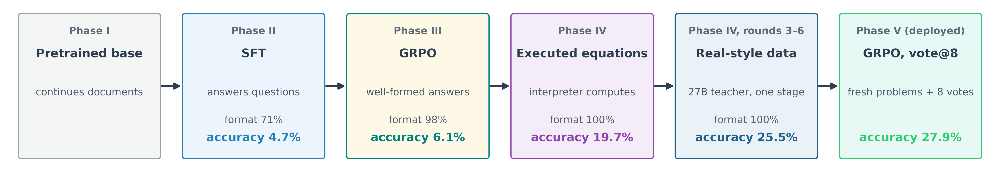

## 概要

预训练语言模型本质上是文本续写器：给它一道专业问题，它会顺着文章结构继续写下去，并不会直接给出回答。使用根据地震学论文编写的 `1.41` 万条问答对进行监督微调（SFT，第二阶段）后，`113M` 模型学会了对话交互与停在回答末尾，但数值计算的准确率仍然很低——在 `153` 道来自未微调论文的留出数值题上只有 `4.7%`。

此外，SFT 阶段生成的回答常常结构不完整，比如 `<think>` 推理块没有闭合，也没有写出最终答案。第三阶段引入带可验证奖励的强化学习（GRPO）后，格式规范率从 `71%` 提高到 `98%`。然而数值准确率只微升到 `6.1%`，因为在抽样回答中本身答对计算的样本太少，策略梯度没有足够的正样本可以强化。

在多步数值推导中，小模型容易在算术阶段失手——只要采样错一个数字，后面的结果就会跟着偏差；诊断实验还进一步发现，模型往往在一开始就选错了物理公式或变量关系。为此，我把模型的解题方式从“逐字心算并吐出自然语言推导”改成“用预训练论文里熟悉的符号记法写出简短方程，再交给确定性解释器执行求值”。用本地 `27B` 教师模型撰写、并经过执行校验的 `10.5` 万份方程解答微调之后（第四阶段），留出集准确率从 `6.1%` 升至 `19.7%`；对 `8` 个执行结果做多数投票（`vote@8`），可进一步达到 `22.2%`。

在可执行答案之上继续做 GRPO，在模型直接练习过的题目上能把准确率从 `49%` 提到 `85%`，但在留出题上最多带来约 `3` 个百分点的提升。随后的迁移实验解释了原因：RL 增益向新题迁移的幅度取决于新题与练习题的相似度，而测试集来自模型此前未练过的论文。把此前完全做不对的题拆成只问第一步的小题练习，能让模型后来解出原题的频率提高到 `7` 倍；在覆盖 `9,000` 道更广泛题目的题库上练一遍，最多增加 `2.4` 个百分点（[§5.19](#519-grpo-在哪里起作用一项迁移研究)），配合 `vote@8` 在留出题上达到 `23.3%`。

迁移实验指明了提升方向：扩大真实题型覆盖面。阶段二当时只用到了全部 `127,889` 段领域摘录中的 `2,794` 段。于是，我让本地 `27B` 教师模型继续从 `4` 万段此前未使用的摘录里写出 `4.9` 万道真实风格的题目，每一道都同时经过代码执行和盲解复核（[§5.20](#520-第四阶段续用语料其余部分生成真实风格的题目)）。利用预训练 IsoFLOP 缩放扫描留下的检查点所做的对照实验表明，基座参数量和预训练词元数并不是主要瓶颈；在此基础上补充 `15.7` 亿词元的数学/STEM 中期训练带来稳定小幅提升，而从中期训练基座直接做一阶段统一微调则替代了此前的两阶段 SFT 流程（[§5.21](#521-基座模型是瓶颈吗)）。最后，第五阶段仅从微调从未见过的预留论文题目中筛选“偶尔能做对”的可学题目，运行三轮 GRPO（[§5.22](#522-第五阶段在新题上做-grpo)）。在 `153` 道测试题的样本量下，单看其中任意一步都难以跨过统计噪声，但全部环节叠加在一起，把单次采样准确率推高到 `26.4%`（相对第四阶段模型提高 `+6.7` 个点 `[+2.6, +11.0]`），配合 `vote@8` 达到 `27.9%`（即最终部署模型）；在出自微调论文的 `300` 道新题上达到 `46.2%`。

在完全相同的规则下公平比较——所有模型每道题只能输出一个经代码执行的最终数值，并在 `1%` 误差内算对——这个 `113M` 模型超过 `2B` 及以下规模的通用 Qwen3.5 模型（领先 Qwen3.5-2B `+10.4` 个百分点）。在它练习过的题型上，模型拿到 `42.7%`，与参数量大 `80` 倍的 Qwen3.5-9B（`44.5%`）处于同一水平，差异没有统计显著性；并且在等长回答条件下，它命中的地震学关键概念数量超过全部受测通用模型（[§1.4](#14-与通用模型对比同样的评分方式)）。

## 目录

1. [结果速览](#1-结果速览)
   - 1.4 [与通用模型对比：同样的评分方式](#14-与通用模型对比同样的评分方式)
2. [快速开始](#2-快速开始)
3. [在训练之前定义成功](#3-在训练之前定义成功)
4. [第二阶段：监督微调](#4-第二阶段监督微调)
5. [第三阶段：可验证奖励的强化学习](#5-第三阶段可验证奖励的强化学习)
   - 5.14 [计算器修正算术，修不了建模](#514-计算器修正算术修不了建模)
   - 5.17 [找到瓶颈](#517-找到瓶颈)
   - 5.18 [第四阶段：由本地教师生成可执行方程](#518-第四阶段由本地教师生成可执行方程)
   - 5.19 [GRPO 在哪里起作用：一项迁移研究](#519-grpo-在哪里起作用一项迁移研究)
   - 5.20 [第四阶段（续）：用语料其余部分生成真实风格的题目](#520-第四阶段续用语料其余部分生成真实风格的题目)
   - 5.21 [基座模型是瓶颈吗？](#521-基座模型是瓶颈吗)
   - 5.22 [第五阶段：在新题上做 GRPO](#522-第五阶段在新题上做-grpo)
6. [评测是如何工作的](#6-评测是如何工作的)
7. [评测发现了什么](#7-评测发现了什么)
8. [方法规模化扩展分析](#8-方法规模化扩展分析)
9. [失败图谱与流水线陷阱](#9-失败图谱与流水线陷阱)
10. [仓库结构](#10-仓库结构)

[PITFALLS.zh-CN.md](PITFALLS.zh-CN.md) 收录了构建与调试这套流程时遇到的各类隐蔽故障，以及用来定位和防止复发的检查。

---

## 1. 结果速览

### 1.1 模型、数据与算力

| | |
|---|---|
| 基座模型 | 1.133 亿参数（GQA、RoPE、RMSNorm、SwiGLU），4096 token 上下文，在 8.23 亿 token 的地震学论文、维基百科和 FineWeb-Edu 上预训练；部署模型另加 15.7 亿 token 的数学/STEM 中期训练（§5.21） |
| 第二阶段数据 | 1.57 万条问答对，来自论文片段、基础概念和历史地震：1.41 万条用于训练，其余留出 |
| 第四阶段数据 | 10.5 万份论文记法解答，经执行检查，由本地 Qwen3.8-27B-FP8 教师撰写；另回放 6k 条第二阶段数据；第 3–6 轮从 4 万段未用过的摘录加入 4.9 万道真实风格的题，共 28 万行（§5.20） |
| RL | GRPO，每道题 8 个样本，奖励来自程序化验证器；第五阶段练习留在微调之外的题（§5.22） |
| 硬件 | 2× NVIDIA A30（每张 24 GB） |
| 评测 | 153 道出自从未用于微调的论文的数值题（其中大多数出现在预训练文本中），每道题 6 个种子 × 4 个样本 |

### 1.2 各阶段结果

<p align="center">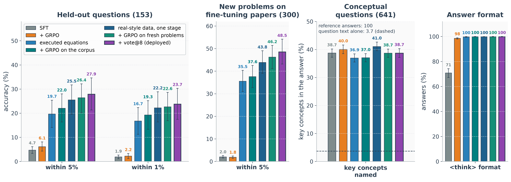</p>

| 阶段 | 模型 | 格式规范 | 准确率 | 需要计算（134） | 误差 1% 内 | 关于微调论文的新题（300） | 关键概念（641） |
|---|---|---|---|---|---|---|---|
| I | 预训练基座 | — | — | — | — | — | — |
| II | SFT | 71% | 4.7% | 2.8% | 1.9% | 2.0% | 38.7% |
| III | + GRPO | 98% | 6.1% | 3.1% | 2.2% | 1.8% | 40.0% |
| IV | 可执行方程 | 100% | 19.7% | 20.1% | 16.7% | 35.5% | 36.9% |
| | + 语料上的 GRPO | 100% | 22.0% | 20.7% | 19.3% | 37.6% | 37.0% |
| | + vote@8（第五阶段之前的部署模型） | 100% | 23.3% | 21.6% | 20.5% | 38.9% | 37.0% |
| IV，第 3–6 轮 | 真实风格数据，一次微调 | 100% | 25.5% | 25.2% | 22.2% | 43.8% | 41.0% |
| V | + 新题上的 GRPO | 100% | 26.4% | 26.0% | 22.6% | 46.2% | 38.7% |
| 部署 | + vote@8 | 100% | 27.9% | 27.6% | 23.7% | 48.5% | 38.7% |

除另有标注外，答案落在参考值 `5%` 相对误差以内记为正确。作为参照，在需要计算的题目上，完全不读题干的基线只能拿到 `3.3%`，而本地 `27B` 教师在无原文辅助的盲解条件下能达到 `48.5%`。

“关于微调论文的新题”这一列衡量的是模型在训练分布上的掌握程度：题目是 `27B` 教师围绕微调论文新写的 `300` 道未训练题目，每一道都经过第二份独立解答校对标签（`docs/eval_indist.json`、`scripts/experiments/indist_chain.sh`）。这些题目沿用第四阶段风格，在题干中给出所需物理量。采用执行方程的模型在这一列上的分数约为留出题的两倍；相比之下，此前用自然语言作答的模型反而略低于留出题，因为它们训练时并未见过这种写法风格。这一列与留出集准确率之间的落差直接反映了迁移难度——模型掌握训练分布风格的程度，明显高于把能力带到新论文上的程度。

“关键概念”一列评测了 `641` 道概念类留出题，统计模型回答里提及标准关键概念的比例（`docs/eval_ceilings.json`）。只读题干本身能提到 `3.7%`，参考答案则为 `100%`。从表可见，各后训练阶段对这一项改动不大：主要框架由第二阶段 SFT 奠定；第三阶段 GRPO v4 因奖励中含概念覆盖项而微升 `1.3` 个百分点；第四阶段主训数值题并仅回放了少量第二阶段样本（§5.18）；第 3–6 轮补充 `3.2` 万条真实风格概念问答后达到最高 `41.0%`，而第五阶段纯数值 GRPO 又略回调 `2.3` 个百分点。部署时，对话程序会将概念问题分流给文字作答解码参数（§3.4）。

纵向对比各阶段，能清楚看出每一环究竟改变了什么。第三阶段主要把输出格式从 `71%` 拉到 `98%`，准确率仅从 `4.7%` 动到 `6.1%`，原因在于 rollout 中算对的样本太少（§5.9），而且这点数值增量大多落在恰好与早期提示词池重合的 `61` 道题上，其余 `92` 道仅变 `+0.8` 个点且不显著（§3.1）。第四阶段通过把算术委托给外部方程解释器，真正打开了数值准确率（§5.18）。在第四阶段上叠加覆盖全语料（排除测试题本身）的 GRPO 后又多出 `2.4` 个百分点（配 `vote@8` 达到 `23.3%`，即第五阶段之前的部署版本），但这部分增益集中在答案本来就在题干里的题目上——在需要真正推导计算的题目上为 `21.6%`，与不加该轮 RL、单靠执行方程加 `vote@8` 的 `22.4%` 基本持平，印证了 RL 改善停留在练习题近邻范围内（§5.19）。随后第 3–6 轮从 `4` 万段未用摘录生成真实风格新题，并改用经数学/STEM 中期训练的基座做一阶段统一微调（§5.20–5.21），再结合第五阶段针对预留新题的 GRPO（§5.22），共同将留出准确率推高至超越第四阶段基线 `+6.7` 个点（需要计算的题 `+5.9`、同分布新题 `+10.7`）。模型与 `27B` 教师之间余下的差距，主要来自未练习论文上的领域公式与物理常数记忆。

### 1.3 同一道题，各阶段的回答

<p align="center">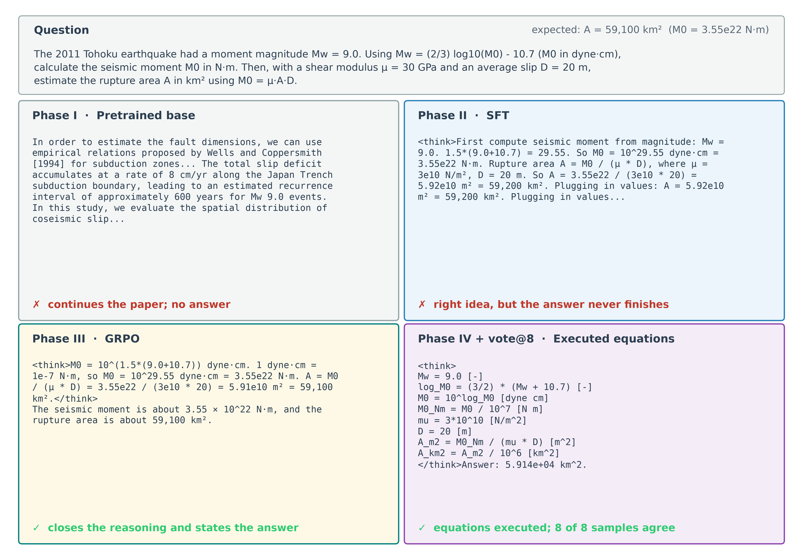</p>

第五阶段部署模型同样写出七行方程并得出精确结果，且 `8` 次采样完全一致。§5.22 还会展示一道将第五阶段模型与第四阶段模型清晰区分开的典型题目。

### 1.4 与通用模型对比：同样的评分方式

<p align="center">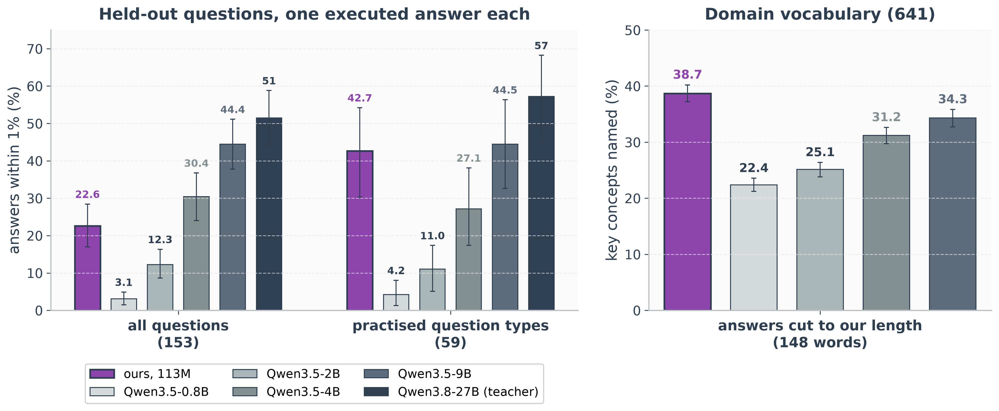</p>

本模型针对数值问题只返回唯一一个经程序执行得到的数。如果在自由文本评测中给通用大模型打分（允许生成最多 `4,096` 词元，且末尾三个数字任中其一即可），长篇大论容易占到额外便宜。为保证公平，本节要求所有模型一律以“写出可执行程序并得出唯一数值答案（误差 `1%` 以内）”的方式作答：本模型输出论文记法方程，所有通用模型（Qwen3.5 `0.8B–9B` 以及 `27B` 教师模型）则生成一段 Python 程序，沿用与教师盲解完全相同的提示词、解码与判定规则（§1.2）。数据见 `docs/eval_general_models.json`，评测脚本见 `scripts/experiments/general_models_compare.py`。

| 模型 | 参数量 | 留出题（153） | 练习过的题型（59） | 等长时的关键概念（641） |
|---|---|---|---|---|
| **本模型** | **113M** | 22.6% | **42.7%** | **38.7%** |
| Qwen3.5-0.8B | 0.8B | 3.1% | 4.2% | 22.4% |
| Qwen3.5-2B | 2B | 12.3% | 11.0% | 25.1% |
| Qwen3.5-4B | 4B | 30.4% | 27.1% | 31.2% |
| Qwen3.5-9B | 9B | 44.4% | 44.5% | 34.3% |
| Qwen3.8-27B（教师） | 27B | 51.5% | 57.2% | — |

在以下方面，这个 `113M` 模型接近甚至超过参数量大得多的通用模型：
- **练习过的题型。** 在 `59` 道与最近训练问题共享至少 `40%` 实词的留出题上（已剔除源于测试论文的题目），本模型得 `42.7%`，与 `80×` 参数量的 Qwen3.5-9B（`44.5%`）仅差 `−1.8` 个百分点 `[−12.6, +8.5]`（无统计显著性），并领先 Qwen3.5-4B `+15.5` 个百分点 `[+3.4, +27.9]`。这些题对通用模型并非简单题：9B 在这部分上的表现与全集几乎相同（`44.5%` 对 `44.4%`），4B 也相近（`27.1%` 对 `30.4%`）。
- **领域术语覆盖。** 将全部通用模型的概念回答截断到与本模型相同的平均词数（`148` 词）后，9B 命名了 `34.3%` 的关键概念，比本模型低 `4.4` 个百分点 `[2.8, 6.0]`，更小参数版本在 `22.4%–31.2%` 之间。
- **`2B` 及以下参数段。** 在全部 `153` 道题上，本模型领先 Qwen3.5-0.8B `+19.5` 个点，领先 Qwen3.5-2B `+10.4` 个点 `[+4.1, +16.7]`，整体位于 `2B` 与 `4B` 之间（较 4B 低 `7.8` 个点 `[−15.4, −0.1]`）。
- **推理成本与存储。** 单次回答仅需让 `113M` 模型前向 `233` 个词元，计算量约为 Qwen3.5-9B（`573` 词元）的 `1/190`；即便启用 `vote@8` 也仅为其约 `1/24`。模型权重在 `bf16` 下占用 `0.23 GB`，对比 `9B` 在 FP8 下约 `9 GB`。

它仍然落后的方面主要是规范已知题目上的整体可靠性。在源自微调论文的 `300` 道新题上，Qwen3.5-9B 拿到 `91.5%`，而本模型为 `44.7%`（上一版部署模型为 `36.2%`）。另外，如果允许通用模型直接以自由文本作答，它们的分数也会显著提高（0.8B 达到 `23.9%`，9B 达到 `55.9%`）：单答案执行与 `1%` 容差规则大约拉低了它们 `11–26` 个百分点。

接下来的改进路线清晰指向题目覆盖广度：模型每学会一种题型，就能把该题型推入与 9B 持平的区间。要做到这一点，靠重复生成同类题收效甚微——当训练池扩大 `16` 倍时，干净开发集中拥有已练近邻的比例只从 `36%` 微升到 `38.5%`（§3.1），真正需要的是拓展此前未见过的题型（§5.20–5.22 的真实风格生成正是围绕这一目标展开的）。

需要留意的限定条件：
- 上述“练习过的题型”子集是事后根据文本相似度划出的，仅包含 `59` 道题，置信区间较宽。
- 数值真值标签由规则从参考答案解析生成，规则本身的错误会给所有模型设置共同上限；参考答案原文在该评测规则下得 `85.8%`（§5.17）。
- 通用模型写出 Python 代码，本模型写出论文记法，两者均交由解释器求值并按完全相同容差判定；通用模型按官方 FP8 权重推理。
- 多数留出题出自预训练语料已收录论文（§1.1），开源通用模型在自身预训练中也同样可能接触过部分原论文。

---

## 2. 快速开始

```bash
conda activate nanogpt_seis      # 使用与预训练仓库相同的环境（CUDA-12.4 版 PyTorch）

# --- 与部署的模型对话 ------------------------------------------------------
hf download jiazhe868/nanogpt_seis_posttrain checkpoints/grpo_v20_plain/grpo_ckpt_step_99.pt --local-dir .
                                             # 部署模型的权重；完整的环境准备（预训练仓库、分词器）见
                                             # Hugging Face 模型卡
python -m src.sft.chat                       # 已部署模型（configs/deploy.yaml）：第五阶段，在 </think> 处执行
                                             # 论文记法方程，对执行结果做 vote@8
python -m src.sft.chat --prompt "An Mw 6.9 earthquake ... what is M0 in N m?"
python -m src.sft.chat --ckpt-path checkpoints/grpo/selected.pt   # 早先的文字作答模型（GRPO v4）

# --- 第二阶段：SFT 监督微调 --------------------------------------------------
python -m src.sft.build_corpus merge         # 合并 4 个来源数据 -> 15,659 对问答（已去重）
python -m src.sft.build_corpus split         # 按文档源身份划分 + 哈希锁定测试集
torchrun --standalone --nproc_per_node=2 -m src.sft.train_sft --config configs/sft_base.yaml
python -m src.sft.checkpoints select --ckpt-dir checkpoints/sft --link-best checkpoints/sft/selected.pt

# --- 第三阶段：验证器 RL 强化学习 ---------------------------------------------
python -m src.rl.prepare_rl_dataset
torchrun --standalone --nproc_per_node=2 -m src.rl.train_grpo --config configs/rl_grpo.yaml

# --- 第四阶段：可执行方程（教师数据见 §5.18）---------------------------------
torchrun --standalone --nproc_per_node=2 -m src.sft.train_sft --config configs/sft_pot_notation2.yaml --snapshot-epochs
torchrun --standalone --nproc_per_node=2 -m src.rl.train_grpo --config configs/rl_grpo_v14_corpus.yaml
                                             # 语料上的 GRPO；题库由 scripts/experiments/v1314_chain.sh 构建

# --- 第四阶段第 3–6 轮与第五阶段：真实风格数据、新题 RL（§5.20–5.22）--------
START=30700 COUNT=10000 TAG=wD VPY=<vLLM python> \
    bash scripts/experiments/real_style_chain.sh   # 一个教师窗口：生成、验证、改写为论文记法
bash scripts/midtrain/test_chain.sh          # 15.7 亿 token 的数学/STEM 中期训练
bash scripts/experiments/round6_chain.sh     # 一次微调、预留题库、GRPO v20（部署）

# --- 测量与审计：在采信任何结论之前先跑一遍审计脚本 ----------------------------
python -m src.sft.splits data/rl/test.jsonl            # 验证数据划分规范
python -m src.analysis.validate_measurement all        # 检验指标下限/上限与奖励函数漏洞
python -m src.analysis.validate_measurement group      # 运行一次真实的 8-样本组梯度计算演算演示
python scripts/experiments/real6_eval.py real6_deployed.json \
    checkpoints/grpo_v20_plain/grpo_ckpt_step_99.pt 31,32,33,34,35,36 1.0 1 deployed    # §1.2：6 个种子 × 4
python -m src.rl.eval_rl --grpo-ckpt checkpoints/grpo/selected.pt --val-file data/rl/test.jsonl \
    -k 4 --out-json eval_rl_prose.json                 # 文字作答模型：配对检验、McNemar、pass@k、检验效力
python -m src.analysis.diagnose_capability tier        # 诊断分析准确率的真实来源（提取 vs 计算）

python -m src.plots                                    # 重新生成 assets/ 下的全部图表
```

**在较小显存的 GPU 上运行。** SFT 在 `micro_batch=1`、`grad_accum=16`、`bf16` 精度和 `4096` 上下文长度下的显存占用约 `11 GB`，单张 `12 GB` 显卡大约 `25` 分钟即可完成。RL 需要同时常驻活动策略模型与冻结的参考模型（在组采样规模 `G=8` 时约占 `18 GB`）：在单张 `24 GB` 显卡上，可将组大小降至 `G=4` 并将 `max_new_tokens` 设为 `256`；在 `12 GB` 显卡上则可将参考模型卸载至 CPU 内存，代价是每步训练耗时增至约 `3` 倍。需要注意的是，缩小 `G` 不只是显存权衡，还会直接减少用于提供梯度的组内样本离散度（见 [§5.9](#59-有效梯度真正来自哪里)），因而属于统计采样条件本身的变化。

---

## 3. 在训练之前定义成功

本节列出的所有保护机制，都是在早期流水线产出了看似合理却有误的指标之后逐步补齐的；在方法论上，这也是整个项目里最值得复用的一套规范。

### 3.1 数据划分规范及其局限性

设计这套划分规范的核心目标，是让每一个评测数字都只清晰地回答一个问题。事先写进代码并严格执行的筛选规则，可以避免研究者在看到分数后再手动挑选检查点；但如果用来挑检查点的提示词池与最终汇报结果的是同一批题，挑选偏差就依然存在——此时汇报的数字实际上属于开发集表现，而不是外部测试成绩。

为了切断这种混淆，`src/sft/splits.py` 定义了四种职责互不重叠的数据角色，全部以原始文档块标识符为划分键，确保出自同一文档片段的多个同源问题不会落到边界两侧：

```
train   仅用于 SFT 与 RL 参数更新
val     仅用于训练期间监控进度（如早停参考与损失曲线观察）
dev     用于调整超参数、选解码策略、标定阈值、挑选检查点与验证指标
test    仅最终报告一次——不用于修改代码、阈值、检查点或解码设置
```

项目早期曾在这个环节上犯过错：当时检查点筛选与 `eval_rl` 都默认跑在全部 `808` 条留出提示词池上。事后将该池拆为开发半边与测试半边重新核对，立刻看出明显差异：

| 数值准确率提升 Δ（SFT → GRPO） | 提示词数 `n` | Δ 提升 | 95% 置信区间 |
|---|---|---|---|
| 开发集半边（`dev`） | 76 | +3.0% | [+0.0%, +6.2%] |
| 测试集半边（`test`） | 90 | +0.8% | [−3.1%, +4.7%] |

相同的模型、相同的打分规则、相同的解码设置，在开发半边测出的提升几乎是测试半边的 `4` 倍。这一落差与选择偏差相符——如果只报道前者就会把收益明显说高；不过这并不是对选择偏差的纯粹测量，因为两个 `~80` 题子集本身存在抽样差异，且候选检查点在划分之前已经间接接触过两边。

> **关于事后审计划分的特别说明。** 这组 `dev/test` 切分是在事后审计时引入的。在此之前，整套 `808` 题池已经共同参与了检查点筛选（第 `100` 步胜过第 `200` 步）、汇总评估、指标设计与阈值标定。通过哈希锁定，能够保证从该版本起测试半边不再变动，但无法在时间上抹去它曾经参与过筛选决策的历史。
>
> 尽管如此，这一划分仍然很有意义：它为此前合池造成的夸大程度划出了上界，而本文也明确将其记为“回溯性审计划分”，避免误称为零接触测试集。要取得完全无污染的最终测量，需要先冻结全部代码、解析器、解码参数、验证器阈值、候选检查点与选择规则；仅在 `dev` 上完成选择；再使用从未入池的新文档身份构建全新测试集并只跑一次。

之后又查出第二处重合。第三阶段的 RL 提示词池（`data/rl/train.jsonl`，用于 GRPO v3–v8）沿用了按文档块切分之前的旧语料版本，原样带入了 `204` 条留出提示词，其中 `61` 条落在 `153` 道计分数值题以内。GRPO v4 的数值增益正主要落在这 `61` 道题上（`+2.5` 个点 `[+0.6, +4.4]`，对比其余 `92` 道的 `+0.8` `[−0.5, +2.1]`）。不过，它在格式规范上的提升（其余 `92` 道上 `+20` 个点）与概念覆盖的微增（题池外的 `506` 道概念题上 `+1.4` `[+0.3, +2.6]`）则不依赖这段重叠。从 `v9` 起，所有 RL 题池都不再包含任何留出提示词，后来部署模型的训练数据也不含：无论上一代部署模型（两套 SFT 数据与 `v14` 池，在重合的 `61` 题上 `vote@8` 得 `20.8%`，其余 `92` 题得 `25.0%`）还是本代部署模型（`20.8%` 对 `32.6%`）都在那 `61` 题上略低于其余部分，而且 §5.20 的真实风格窗口也已整篇排除了全部验证与测试文档。

RL 的早期开发集同样有此历史来源。其中 `96` 道真实题（`data/rl/val_numerical_dev.jsonl`，也包含在 `data/rl/v13_dev.jsonl` 中）从 `v12` 起负责筛选检查点与调整规则，但里面有 `74` 道原样存在于第二阶段训练集、`45` 道存在于第四阶段训练集中，拉高了该开发集的得分（`vote@8` 达到 `39.6%`，而测试集为 `24.0%`；测试集自身并未受影响）。于是我们在 SFT 验证集中取全部 `144` 道有标签的干净数值题作为干净开发集（`data/rl/dev_clean.jsonl`、`docs/eval_dev_clean.json`）重排 `32` 个检查点：`v13` 第 `142` 步在干净开发集上高于当时部署的 GRPO v14（`30.7%` 对 `28.2%`），但在留出测试集上反而略低（`21.0%` 对 `22.0%`），所以当时继续保留了 GRPO v14。到了第 `4–6` 轮（§5.21–5.22），干净开发集只用来观察训练动态，最终交付检查点一律在评分前固定取最后一轮 SFT 和最后一步 RL。

**强制不变式与扩展方式。** `splits.describe()` 内置断言 `assert dev_chunks.isdisjoint(test_chunks)` 并随数据检查运行。扩展到更大语料时，应把精确的文档块键匹配升级为文档身份图配合近重复文本过滤，同时保留互斥划分约束。

### 3.2 四类评估指标的划分

评测中的多数混淆，都来自把下面四类回答不同问题的指标混为一谈：

| 指标类别 | 它回答的问题 | 本项目对应的实例 |
|---|---|---|
| 训练优化指标 | 优化器是否推高了自己的目标函数？ | 复合奖励得分、KL 散度、策略熵 |
| 留出集同维度指标 | 优化过的行为能否泛化到未见提示词？ | `<think>` 合规率、数值验证器准确率 |
| 独立结果指标 | 更广泛的领域能力是否随之改善？ | （本项目未包含，见下说明） |
| 异常防护指标 | 模型是否出现了不可接受的退化行为？ | 提示词复读率、污染率、空输出率 |

需要诚实说明的是，本项目没有真正独立于训练目标的结果指标：评测准确率读取与 `NumericalVerifier` 完全相同的数值字段和容差，`<think>` 合规率采用与 `FormatVerifier` 同源的正则表达式。因此它们测的是相同构念在未见题目上的泛化表现，而不是另一个独立测量的能力维度。§5.13 会将训练奖励、组内优势与独立评测并列对比，说明三者各自的作用及防破解设计。

### 3.3 评估指标的理论下限与上限

任何百分比数字如果脱离了自身的理论下限和上限，就很难作出准确解读：

- **理论下限**——没有任何题干知识、纯按经验分布随机输出答案的基线得分；
- **理论上限**——标准参考答案文本经过同一套数值解析与判定规则时的得分。

在 `5%` 相对误差容限和最初 `166` 道数值题上，旧规则与修正规则的量程对比如下：

| 打分规则 | 理论上限 | 理论下限 | 有效区分空间 |
|---|---|---|---|
| 取最前 `8` 个数字的最小误差（最初版本） | 68.1% | 14.3% | 53.8% |
| 只匹配末尾最后 `3` 个数字（当前版本） | 86.1% | 5.9% | 80.2% |

旧规则允许前 `8` 个数字任中其一，结果盲猜基线反而超过模型本身。把打分窗口挪到回答末尾 `3` 个数字后，两头指标同时改善：标准答案往往把结论写在结尾，前 `8` 个数反而经常在抵达答案前截断。在重新标注后的 `134` 道需要计算题目上，现在的量程从 `3.3%`（不看题目的盲基线）延伸到 `85.8%`（参考答案本身），本代部署模型达到 `27.6%`（上一代部署模型为 `21.6%`）。

```bash
python -m src.analysis.validate_measurement floor
```

### 3.4 解码配置规范

在 `113M` 参数量下，解码参数改动对成绩的影响往往不亚于训练算法本身。对早期自然语言作答模型来说，将重复惩罚设为 `1.05` 会引发 `56%` 的 5-gram 逐字循环重复；把重复惩罚调至 `1.2` 后，SFT 与 RL 模型的实测准确率均大约翻倍，甚至连 SFT 到 GRPO 的增减方向都反转过来——解码策略带来的变化是训练差异的 `2.3` 倍。相反，执行方程模型在程序里必须复用变量与符号名，因此不能施加重复惩罚（§5.18）。

出于这一原因，解码配置与检查点一同固化在配置里：`configs/deploy.yaml` 规定部署参数为温度 `0.3`、`top-k 40`、重复惩罚 `1.0` 配合 `vote@8`；`chat.py` 为文字作答模型固定温度 `0.3`、`top-k 40`、重复惩罚 `1.2`；所有离线评测脚本统一调用完全相同的推理设定（详见 [PITFALLS B3](PITFALLS.zh-CN.md#b3--在-113m-规模上解码参数的影响超过训练本身)）。

部署入口会根据问题类型自动分流（`src/sft/question_router.py`）：凡是需要得出数值的问题一律交由执行方程路径配合 `vote@8` 作答，其余概念题则路由给带重复惩罚的文字作答解码，避免不加惩罚时概念文本陷入循环重复。经过分流后，全部 `153` 道留出数值题仍走方程求解，而 `641` 道概念题的关键概念覆盖率则从 `28.6%` 提高到 `38.7%`（上一代部署模型从 `29.6%` 提到 `37.0%`）。

### 3.5 结果的出处追溯与校验机制

评测脚本（`src/rl/eval_rl.py`、`scripts/experiments/real6_eval.py`）会把检查点路径、数据划分信息与解码设置一并写入结果 JSON 文件，绘图程序发现评测来源与当前所绘训练日志不一致时会主动输出告警。这项约束的起因，是早期一次过期结果文件在缺乏标识的情况下混用了当前指标。

---

## 4. 第二阶段：监督微调

### 4.1 流利的预训练模型不等于合格的对话助手

预训练基座的目标只是根据上文预测下一个词元。如果直接问它“地震矩的计算公式是什么？”，它很可能会接着续写一句 `1. Introduction. Earthquake rupture processes...`——从续写文档来看语法自然，却没有回应问题。SFT 改变的是模型的回复条件分布，而不是向权重注入全新的领域事实：

```
预训练阶段：  预测任意连续文档中的下一个词元
SFT 微调阶段：以 system + user 提示词元作为条件
              仅对 assistant 回复词元计算梯度损失
最终变化：    同一个基座模型，转变为按对话轮次停下的回答分布
```

### 4.2 SFT 的损失函数与计算方式

训练仅针对 assistant 回复部分的词元计算带掩码的交叉熵损失：

```math
\mathcal{L}_{\text{SFT}} = -\frac{1}{\sum_t m_t}\sum_t m_t \log p_\theta\!\left(y_t \mid x,\, y_{\lt t}\right)
```

其中提示词头部、用户输入与填充位置的掩码为 $`m_t = 0`$，只有模型需要学会输出的回复位置取 $`m_t = 1`$。在源码中，正是这几行标签设置把普通自回归续写变成了指令微调：

```python
# src/sft/dataset.py — system、user 与 assistant 前导词元均设为 ignore_index（不计损失）
system_labels = [ignore_index] * len(system_tokens)
user_labels = [ignore_index] * len(user_tokens)
assistant_header_labels = [ignore_index] * len(assistant_header_tokens)
response_target_labels = list(response_target_tokens)      # 仅此处计入训练损失
```

也可以对完整序列全部位置计算损失，但那会把宝贵的容量花在记忆推理时已经白送在输入里的提问文本上。在这个模型体量下，采用 LoRA 虽然可把显存降至约四分之一，但全量微调本身只需 ~`11 GB` 即可稳定装下，省去低秩适配反而更直接；而在拼平的问答文本上继续做无掩码预训练效果较差，因为模型学不到明确的话轮边界。

### 4.3 数据层面会毒害模型的四类隐患

教师模型生成的数据里常潜伏着一些在交叉熵曲线上完全看不见的缺陷——恰恰因为学生模型把这些毛病学得太好，训练损失才会一路降得很顺。下面四个问题全部源于语料内容，靠调整学习率或优化器参数都修不好：

| 语料隐患 | 对小模型训练的破坏机制 | 处理方式 |
|---|---|---|
| 回答引用了读者看不到的上下文（例如“如表 2 所示”） | 模型会把“自信地带出图表出处”学成好回答的一部分，并在推理阶段凭空编造引用文献。 | 直接剔除这类问答，或在不丢失推导逻辑的前提下改写去除悬空引用。 |
| 只清洗正文答案，漏掉了 `<think>` 块内部 | 对外呈现的答案看似干净，但推理链内部仍在捏造文献来源——而后续 RL 恰恰容易把隐藏思维惯性固化下来。 | 对 `<think>` 块内部文本执行完全相同的正则与清洗过滤规则。 |
| 清洗正则误删换行符，导致分段消失 | 格式风格同样由样本习得；被压成整段纯文本的语料会教会模型用没有排版结构的大块文字作答。 | 只修正问题文本，保持原本段落结构与换行不变。 |
| 约 `13%` 的原始生成样本跑出地震学领域 | `113M` 模型几乎没有冗余容量可浪费，每一条跑题样本都在挤占真正领域知识的参数空间。 | 在构建训练集之前先按主题与领域相关性严格过滤。 |

由此总结出一项经验：**小模型没有足够的容量去忽略混入的噪声样本。** 参数达 `70B` 的大模型偶尔看到虚构引用或许只当成偶发噪声，而 `113M` 模型则会把高频表象当作稳定规律来模仿，因此小规模模型的语料洁净度比大参数阶段更关键。

经过严格筛洗后，首批论文问答仅保留了 `27%`（`1.73` 万条原始生成里留下 `4.7` 千条可用对）。再补充经改写修复的 `2.5` 千条样本，以及基础概念（`4.0` 千条）和历史地震（`4.4` 千条）两个合成子集，语料总量达到 `1.57` 万条（其中 `1.41` 万条入训练集）。丢掉将近四分之三耗费成本生成的语料初看似乎很可惜，实则是正确的取舍：[§4.9](#49-消除混杂因素后的-sft-数据缩放曲线) 表明数据量每翻一倍只带来约 `0.08 nats` 改善，而一条学会的幻觉引用模式一旦进入权重就会持续在输出中出现。

### 4.4 按来源文档而不是按问题划分数据

一段原始论文摘录通常会衍生成多道问答，这些题只是从不同角度重复询问同一批事实。若按单个问答对随机切分，验证集中的题目几乎必定在训练集里有同源兄弟样本：模型只要背下事实即可答对，使验证损失下降，误导出“模型泛化良好”的结论。

因此，数据划分的最小原子单位必须是**来源文档块**——由同一段原文生成的所有题目全部归入同一个集合；同时依据来源 ID 的哈希锁定测试集分配，确保今后重跑语料构建时测试边界保持不变，避免不同代模型失去可比性。

把这一点单列成规则，是因为不这么做的朴素写法从代码表面看不出明显错误。本项目实际上在此犯过两次同样的错：一次是最初按问答对打散切分，第二次则是新生成器为每条改写变体生成独立 ID，又悄悄把同源变体拆散到了训练与测试边界两边；两次都曾让曲线显得更好看（具体误差见 [PITFALLS A1](PITFALLS.zh-CN.md#a1--训练集与测试集出现两次数据泄露)）。

### 4.5 避免跨样本截断的序列打包

训练阶段使用序列打包（sequence packing），把多条样本拼装到 `4096` 词元的固定窗口中以保持吞吐效率。简陋的打包实现会在窗口末尾直接腰斩样本并保留后半段标签，相当于用被砍掉前提的残缺提示词去监督答案生成。这里的打包器在遇到剩余空间放不下一整条完整样本时，会主动冲刷当前窗口并用填充词元补齐。不过为了保持吞吐，单条 `4096` 窗口内部仍然采用普通因果注意力掩码，使同窗前后样本彼此可见——这也正是为什么打包损失只用来看训练走势，而模型对比一律改用非打包单条计算（见 [§6.2](#62-配对评估paired-evaluation)）。

### 4.6 影响评估指标的关键训练细节

```python
# 验证损失按实际词元数量精确加权并跨进程规约。
# DistributedSampler 会把验证集切分到各卡，直接求 rank 平均会导致 rank 0 的子集被当成全集
dist.all_reduce(loss_sum); dist.all_reduce(token_count)
val_loss = loss_sum / token_count

# 梯度累积按当前微批组真实的样本数归一化，防止每个轮次末尾较小的残余组放大或缩小有效步长
loss = loss / group_size
```

### 4.7 基于生成行为而非验证损失选择最佳检查点

SFT 阶段筛选检查点的目标，是交付在下游任务上表现最好的权重，而不是挑选对某一套参考措辞给出最低交叉熵损失的权重。

<p align="center">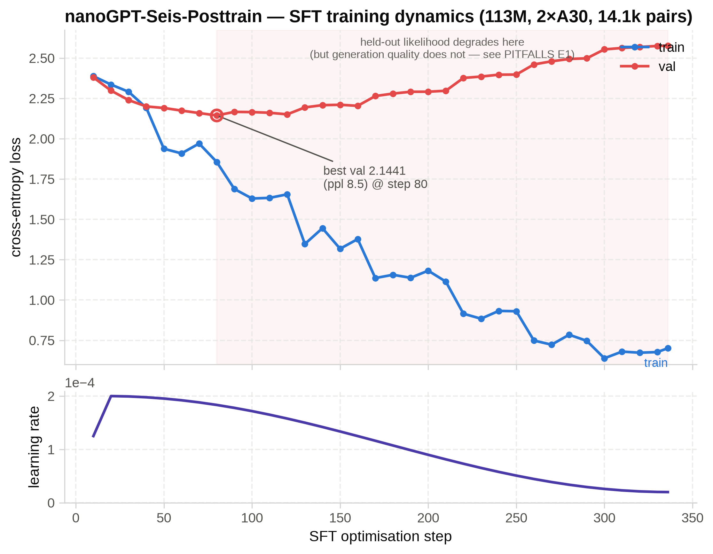</p>

当峰值学习率设为 `2e-4` 时，训练曲线呈现教科书式的“过拟合”外形：到第 `200` 步训练损失降至 `1.18`，验证损失却从第 `80` 步的 `2.14` 一路爬升至 `2.29`（到最后第 `336` 步达到 `2.58`）。按照常见经验，很多人会在这里选择提前早停；但对照实测行为后，这一直观判断在这里并不成立。

背后的原因在于：交叉熵评估的是模型给某一篇特定参考文本赋予的概率。随着训练继续，模型逐步稳定到自己一贯采用的组织与句式习惯，虽然压低了另一种参考措辞的条件概率，实际回答质量并没有变差，反而更完整了：

| 评估维度 | 验证损失最低（第 80 步） | 最终检查点（第 336 步） |
|---|---|---|
| 留出验证损失 | 2.2700 | 2.7798（+0.51 nats, t=+33） |
| `<think>` 标签合规率（早期 166 题测试集） | 61.4% | 74.1%（z=+2.47） |

为此，`src/sft/checkpoints.py` 直接以生成行为指标在开发集上排序，并将评选规则在运行前写死为源码常量，避免事后按分数反推标准：

```python
# src/sft/checkpoints.py
PRIMARY   = "numerical_acc_5pct"     # 唯一可打分的正确性代理指标
TIE_BREAK = "numerical_think_rate"   # 仅在主指标差距处于 TIE_EPS 容差范围内时触发
TIE_EPS   = 0.02                     # 近似等于该样本量下的统计噪声水平
GATES = [("contamination_rate", "<=", 0.02), ("echo_rate", "<=", 0.40),
         ("mean_completion_tokens", ">=", 40)]
```

在最终发布的第二阶段运行（峰值学习率 `1e-4`）上，这套规则选中了第 `8` 轮检查点；若按验证损失最低选型，则会落在第 `3` 轮（第 `120` 步），而那恰恰是三个候选中 `<think>` 合规率最低的一个。

### 4.8 SFT 带来的实质性改变

概括来说，SFT 改变的是模型“怎么作答”，而几乎没有改变它“知道什么”。

SFT 之前，基座模型对对话轮次没有概念：收到问题后会顺势接出听起来像地震学论文导言的散文，却既不直面提问，也不会在合适的地方收尾——因为预训练文本里从未教过它回答应当结束在句号之后。完成 SFT 后，模型学会了识别用户边界并在给出结论后正常终止；仅此两项就构成了完整对话接口，也全部是在这一阶段获得的。

同时，模型初步掌握了展现推理过程的习惯：大约七成的数值解答开始被包裹在 `<think>` 块里。只是“初步掌握”而非稳固遵守——剩下三成未闭合或缺失的缺口，正是下一阶段强化学习要补齐的部分。

真正没有显著推进的是算术推导本身。对于答案本来就写在题面某个角落的题型，SFT 已能做到约五分之一正确——这属于真实的任务适配，因为模型必须在原文条件中找出对应数值再复述出来；然而对于必须真正动笔计算推导的题目，它的成绩仍停在随机下限。这个划分比一个笼统的平均准确率关键得多，[§1.2](#12-各阶段结果) 即按此分成两列汇报。SFT 的目标函数本质上是模仿回答的表面形式，而推演与计算无法仅靠表层格式获得。

### 4.9 消除混杂因素后的 SFT 数据缩放曲线

<p align="center">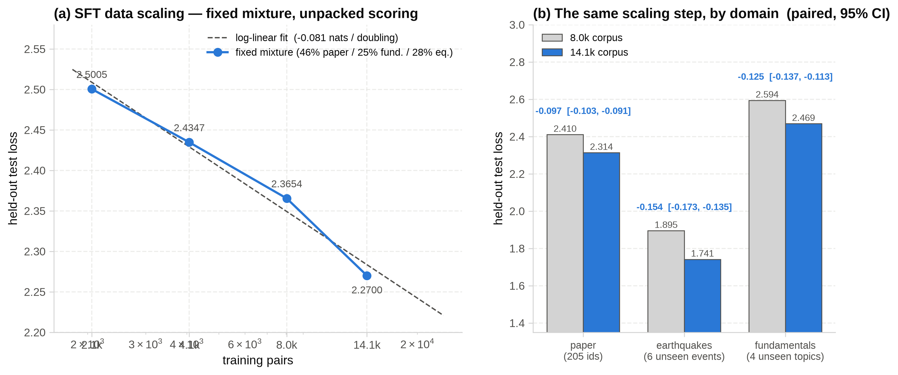</p>

为了消除语料构成变化造成的混淆，我按文档块做了成分匹配子采样——在 `2k`、`4k`、`8k` 和 `14.1k` 每一档数据量下，都将论文 / 基础概念 / 历史地震的比例固定在 `46% / 25% / 28%`（±1%），让数据规模成为唯一改变的变量：

```
Loss = 3.4041 − 0.0813 · log₂(N)        拟合残差在 ±0.016 以内
```

早先旧草稿中测到的斜率只有 `0.063`，因为当时规模最小的数据点全由论文问答组成——对应该评测集时恰恰属于同分布、最容易的一批题——令数据量与成分比例混在一起。把配比固定之后，数据规模的实际边际收益反而显现出比先前高 `28%` 的斜率。

> **测量范围与解释边界。** 这条曲线测量的是特定 SFT 配置下的局部端到端表现，并非普适预训练缩放律。由于训练固定跑满 `8` 轮，数据量更大同时意味着优化器步数按比例增加，因此曲线把新增独立样本与总训练词元暴露量绑在了一起；此外，每个数据节点只跑了单一随机种子，未附带回归置信区间。如果要把这两种因素拆开，后续对照应当比较等轮次、等词元更新总量与等计算预算下的小数据集重复训练。

---

## 5. 第三阶段：可验证奖励的强化学习

### 5.1 为什么在 SFT 之后需要引入强化学习

这一步采用的是“基于可验证奖励的强化学习”（RLVR），该名称出自 Tülu 3（[Lambert et al. 2024](https://arxiv.org/abs/2411.15124)）：训练奖励由确定性的检验代码计算得出，而不是用人类偏好训练出来的奖励模型。

监督微调只能让模型模仿每道题对应的单一参考回答；而验证器 RL 会在同一提示词下采样多条候选回答，并按验证分数高低调整概率分布。因此，它可以强化那些参考答案里未曾单独示范过的行为——比如按格式闭合 `<think>` 块、控制长度和正常结束回答——并且由于验证规则直接写成代码，训练本身无需额外的人工偏好标注。

### 5.2 本仓库实现的具体 RL 算法

对于每一条提示词，策略模型先采样生成 $`G`$ 个候选回答，再由验证器打分并在组内完成标准化，随后执行一步策略梯度更新。下方清单对应 §5.5–§5.9 所分析的 v3 目标设置；从 v4 开始，训练器仍按每组减去自身均值，但改用全批次汇总的一个标准差缩放优势，同时改用 $`k_2`$ 作为 KL 损失并采用常数归一化（§5.8）。

```python
# src/rl/train_grpo.py，v3 设置（adv_norm: group, kl_loss: k3, loss_agg: seq_mean）
rewards    = [reward_engine.score(c, item) for c in completions]     # 采样 G 个回答并打分
advantages = (rewards - rewards.mean()) / (rewards.std(unbiased=False) + 1e-8)     # 计算组内相对优势 (Group Advantage)

# 相对冻结 SFT 参考模型的 k3 KL 散度估计，掩码仅覆盖真正采样的生成 Token
per_token = -(logp * advantage - beta * kl) * sampled_mask
loss = (per_token.sum(dim=1) / seq_tokens).mean()
```

这一目标实质上是带组内相对基线的 REINFORCE（[Williams 1992](https://doi.org/10.1007/BF00992696)）。用同一提示词下 $`G`$ 个采样回答的均值来替代 PPO（[Schulman et al. 2017](https://arxiv.org/abs/1707.06347)）里需要单独训练的价值网络，相当于一个零参数、低方差的局部基线。v3 会再用组内各自的标准差做缩放，使难易程度不同题目的梯度量级大致接近；v4 则改为除以全批次统一汇总的标准差，以免奖励差异只有 `0.01` 的样本组被放大出过大的梯度。

> **关于有限样本偏差的说明。** 当每组采样数 $`G`$ 有限时，这一优势估计量并不是严格无偏的：每条回答本身也参与了本组均值和标准差的计算，因此估计量带有自归一化偏差。减去包含自身在内的组均值，大致会把策略梯度项的期望缩放到 `1 − 1/G`，再除以样本标准差也会引入额外有限样本偏差。改用留一法均值可消除自身均值项，但归一化项仍有偏差。工程上这不影响优化有效性，只是严谨地说不宜称其为无偏估计。

这个损失函数如何推动策略更新可以从单条回答看出来：其策略梯度项写作

```math
\mathcal{L}_{\text{policy}} = -A \log p_\theta(y \mid x)
```

在梯度下降过程中：
- 若优势值 $`A \gt 0`$，减小损失会增大 $`\log p_\theta(y \mid x)`$，使该回答被采样到的概率上升；
- 若优势值 $`A \lt 0`$，减小损失会压低该对数概率，减少同类回答的出现概率；
- 若同一组内全部 $`G`$ 个回答拿到的奖励完全相同，那么每条样本的优势 $`A`$ 都是零，梯度也随之归零——不管这个共同奖励有多高或多低，模型都无法从该组学到任何更新，这正是 [§5.5](#55-一个真实样本组能教给我们什么) 演示的核心问题。

KL 正则项的作用则恰好相反：即使奖励倾向于鼓励某种输出改变，只要策略分布过度偏离冻结的 SFT 参考模型，KL 项就会施加拉回惩罚。于是训练过程可以理解为奖励拉着策略往前走、KL 约束在后面锚定范围，而权重 $`\beta`$ 决定两者的平衡点。

日志中和 v3 损失里使用的 KL 估计量同样定义在真实采样词元上。令对数概率差（参考模型减去当前策略）为：

```math
r_t = \log p_{\text{ref}}(y_t \mid \cdot) - \log p_\theta(y_t \mid \cdot)
```

Schulman 提出的 `k3` 估计量（[2020](http://joschu.net/blog/kl-approx.html)）定义为 `k3(y) = y - 1 - log y`，代入 $`y = e^{r_t}`$ 即得：

```math
\widehat{\text{KL}}_t = e^{r_t} - r_t - 1
```

```python
# src/rl/train_grpo.py
log_ratio = logp - c["ref_logp"]                    # 策略模型减去参考模型
kl_k3 = torch.exp(-log_ratio) + log_ratio - 1.0     # e^{r_t} - r_t - 1 >= 0，始终写入日志
kl_term = kl_k3 if cfg["kl_loss"] == "k3" else 0.5 * log_ratio.pow(2)   # v3 用 k3；v4 起用 k2
```

注意方向约定：当 $`r_t`$ 定义为参考减策略时，它估计的是 $`\mathrm{KL}(p_\theta \Vert p_{\text{ref}})`$——专门惩罚策略把概率放到参考模型本来几乎不选的词元上。由于不等式 $`e^r - r - 1 \ge 0`$ 恒成立，这一估计在每个词元位置都非负，而朴素估计量 $`-r_t`$ 可能会在单批采样中出现负值。这正是训练曲线即便遇到高噪声批次也不会跌入负区的原因。

#### 最小可运行实现

整个算法的核心不到五十行。下面这段代码是从 `src/rl/train_grpo.py` 的 v3 配置中抽离了日志和分布式训练部分后的精简等价实现，可直接运行于任何 Hugging Face 因果语言模型：

```python
import torch

@torch.no_grad()
def rollout(policy, tokenizer, prompt, group_size=8, max_new_tokens=384):
    """对同一条提示采样 G 个回答。组是学习的基本单位。"""
    ids = tokenizer(prompt, return_tensors="pt").input_ids.to(policy.device)
    ids = ids.repeat(group_size, 1)                    # 同一条提示复制 G 份
    out = policy.generate(ids, do_sample=True, temperature=1.0, top_p=1.0,
                          max_new_tokens=max_new_tokens,
                          pad_token_id=tokenizer.eos_token_id)
    completions = out[:, ids.shape[1]:]                # 把提示词部分切掉
    sampled = completions != tokenizer.eos_token_id    # 同步解码的 EOS 填充并非采样得到
    return out, completions, sampled


def token_logprobs(model, sequences, n_prompt_tokens):
    """每个生成词元的 log p(y_t | x, y_<t)。"""
    logits = model(sequences).logits[:, :-1]           # 第 t-1 个位置预测第 t 个词元
    logp = torch.log_softmax(logits.float(), dim=-1)
    logp = logp.gather(-1, sequences[:, 1:].unsqueeze(-1)).squeeze(-1)
    return logp[:, n_prompt_tokens - 1:]               # 只保留回答部分


def grpo_step(policy, reference, tokenizer, prompt, item, reward_engine,
              beta=0.02, group_size=8):
    sequences, completions, mask = rollout(policy, tokenizer, prompt, group_size)
    n_prompt = sequences.shape[1] - completions.shape[1]

    # 1. 用程序化验证器给每条回答打分
    texts = tokenizer.batch_decode(completions, skip_special_tokens=True)
    rewards = torch.tensor([reward_engine.score(t, item)["total_reward"] for t in texts],
                           device=policy.device)

    # 2. 组本身就是基线 —— 全程没有任何 Critic 网络
    if rewards.std() < 1e-6:
        return None          # 离散度为零 -> 优势为零 -> 没有梯度。应重新采样。
    advantages = (rewards - rewards.mean()) / (rewards.std(unbiased=False) + 1e-8)

    # 3. 分别计算策略模型与冻结参考模型的逐词元 log-prob
    logp = token_logprobs(policy, sequences, n_prompt)
    with torch.no_grad():
        logp_ref = token_logprobs(reference, sequences, n_prompt)

    # 4. k3 KL 估计 —— 每个词元上都非负
    log_ratio = logp_ref - logp
    kl = torch.exp(log_ratio) - log_ratio - 1.0

    # 5. 以组为基线的 REINFORCE，掩码只覆盖真正被采样的词元
    per_token = -(logp * advantages.unsqueeze(1) - beta * kl) * mask
    loss = (per_token.sum(dim=1) / mask.sum(dim=1).clamp(min=1)).mean()
    loss.backward()
    return loss.item()
```

这段精简代码里有五个关键细节，决定训练能否真正有效推进：

- **`ids.repeat(group_size, 1)`**：同一组内的 `G` 个样本必须对应完全同一条输入提示词，因为相对优势只在同一问题的兄弟样本之间比较才有意义。
- **`rewards.std() < 1e-6` 的早退检查**：全组同分就不产生任何梯度；直接跳过等价于 DAPO 动态采样的单行版本，避免把算力浪费在无更新的批次上（[§5.5](#55-一个真实样本组能教给我们什么)）。
- **`sampled = completions != eos`**：同步解码会给先结束的短回答补上 EOS 填充；不剔除填充词元会把梯度作用在策略未选择的字符上，使 KL 虚假抬升（[§5.7](#57-词元掩码强制-eos-填充与-kl-计算)）。
- **参考模型外层的 `with torch.no_grad()`**：参考模型仅作为固定锚点而不应参与反传，漏掉上下文开关会静默多占显存并带来多余开销。
- **先按序列求均值再跨批求均值**：先除以各回答自己的有效词元数，可避免超长输出主导整步梯度（关于 DAPO 在此处持相反选择的讨论见 §5.3 第 3 点）；v4 改用固定常数归一化（`rollout 数 × max_new_tokens`），使每个词元权重一致。

### 5.3 主流强化学习范式对比：PPO、DPO、GRPO 与 DAPO

要看清为什么本项目选用带 KL 约束的组相对 REINFORCE（GRPO 风格），可以先横向比较大语言模型后训练中常见的四种对齐范式在网络结构、数学目标与资源取舍上的区别：

```
+---------------------------------------------------------------------------------------------------+
|                                LLM 后训练对齐算法的结构演进                                       |
+------------------------------------+--------------------------------------------------------------+
|       基于偏好对比 (人类 / AI)     |                 基于可验证规则 (RLVR)                        |
+------------------------------------+--------------------------------------------------------------+
|  PPO  · 4 个网络 (Actor+Ref+RM+V)  |  GRPO · 2 个网络 (Actor+Ref), 用组内均值替代 Critic          |
|  DPO  · 2 个网络 (Actor+Ref) 离线  |  DAPO · 1 个网络 (Actor), 去掉 KL 并解耦截断边界             |
+------------------------------------+--------------------------------------------------------------+
```

---

#### 1. PPO（近端策略优化）— 完整的 Actor-Critic 框架
- **显存中需同时驻留的 4 个模型：**
  1. 策略网络 Actor（$`\pi_\theta`$）：待优化的语言模型。
  2. 参考网络 Reference（$`\pi_{\text{ref}}`$）：冻结的 SFT 模型，用于施加 KL 约束。
  3. 奖励模型 Reward Model（$`RM_\phi`$）：根据成对偏好 $`y_w \succ y_l`$ 训练的标量打分网络。
  4. 价值网络 Critic（$`V_\psi`$）：在生成状态 $`(x, y_{\lt t})`$ 上预测后续期望回报的辅助网络。

- **数学目标：** 在词元生成步 $`t`$，一般先用广义优势估计（GAE）计算优势：

```math
\delta_t = r_t + \gamma V_\psi(s_{t+1}) - V_\psi(s_t), \quad \hat{A}_t = \sum_{l=0}^\infty (\gamma \lambda)^l \delta_{t+l}
```

  再用带比例截断的代理目标更新策略：

```math
L^{\text{CLIP}}(\theta) = \hat{\mathbb{E}}_t \left[ \min\left( r_t(\theta)\hat{A}_t, \, \text{clip}(r_t(\theta), 1-\epsilon, 1+\epsilon)\hat{A}_t \right) \right], \quad \text{其中 } r_t(\theta) = \frac{\pi_\theta(y_t \mid x, y_{\lt t})}{\pi_{\text{old}}(y_t \mid x, y_{\lt t})}
```

  联合优化目标同时涵盖策略、价值回归与 KL 惩罚：

```math
\mathcal{L}^{\text{PPO}}(\theta, \psi) = - L^{\text{CLIP}}(\theta) + c_1 \mathbb{E}\left[ (V_\psi(s_t) - R_t)^2 \right] + c_2 \mathrm{D}_{\text{KL}}(\pi_\theta \Vert \pi_{\text{ref}})
```

- **主要工程难点：**
  - **显存开销大：** 同时载入四个大模型会占用较多显存，常常需要把参考模型或价值网络卸载到 CPU。
  - **Critic 估计方差高：** 自回归生成的状态空间维数高、奖励又常常稀疏在句末，价值网络 $`V_\psi(s)`$ 容易因高方差而影响训练稳定。

---

#### 2. DPO（直接偏好优化）— 解析消去奖励模型与价值网络
- **结构简化：** 不再需要奖励模型 $`RM_\phi`$、价值网络 $`V_\psi`$ 以及在线采样循环，训练中只保留策略 $`\pi_\theta`$ 和参考 $`\pi_{\text{ref}}`$ 两个模型。

- **数学推导：** 从带 KL 约束的最大奖励问题出发：

```math
\max_{\pi} \mathbb{E}_{x \sim \mathcal{D}, y \sim \pi(y|x)} \left[ r(x,y) \right] - \beta \, \mathrm{D}_{\text{KL}}\left(\pi(y|x) \;\parallel\; \pi_{\text{ref}}(y|x)\right)
```

  其解析最优解是指数倾斜后的参考策略：

```math
\pi^*(y|x) = \frac{1}{Z(x)} \pi_{\text{ref}}(y|x) \exp\left( \frac{1}{\beta} r(x,y) \right) \iff r(x,y) = \beta \log \frac{\pi^*(y|x)}{\pi_{\text{ref}}(y|x)} + \beta \log Z(x)
```

  反解后可将奖励写作最优策略的函数。DPO 进一步假设待优化的 $`\pi_\theta`$ 直接参数化该最优策略（即 $`\pi_\theta \equiv \pi^*`$），使其充当隐式奖励模型，并代入 Bradley-Terry 偏好模型 $`P(y_w \succ y_l \mid x) = \sigma(r(x,y_w) - r(x,y_l))`$，从而抵消只依赖输入 $`x`$ 的配分函数 $`\log Z(x)`$：

```math
\mathcal{L}_{\text{DPO}}(\theta) = -\mathbb{E}_{(x, y_w, y_l) \sim \mathcal{D}} \left[ \log \sigma \left( \beta \log \frac{\pi_\theta(y_w \mid x)}{\pi_{\text{ref}}(y_w \mid x)} - \beta \log \frac{\pi_\theta(y_l \mid x)}{\pi_{\text{ref}}(y_l \mid x)} \right) \right]
```

- **优缺点：** 省去了在线生成与 Critic 训练；但因为属于纯离线对比学习，训练期间无法主动采样新轨迹并用 Python 验证器即时打分。

---

#### 3. GRPO / 组相对 REINFORCE（本项目选用）— 用组均值取代 Critic
- **结构简化：** 只需保留策略 $`\pi_\theta`$ 与参考 $`\pi_{\text{ref}}`$ 两个模型，用同一提示词下 $`G`$ 个候选回答的组内平均奖励充当零参数基线，完全省去 Critic 网络 $`V_\psi`$。

- **数学目标：** 对每条提示 $`x`$ 从旧策略采样 $`G`$ 条完成文本 $`\{y_1, \dots, y_G\}`$，用规则验证器算出奖励 $`\{r_1, \dots, r_G\}`$，并直接在组内标准化优势：

```math
\bar{r} = \frac{1}{G}\sum_{i=1}^G r_i, \quad \sigma_r = \sqrt{\frac{1}{G-1}\sum_{i=1}^G (r_i - \bar{r})^2}, \quad A_i = \frac{r_i - \bar{r}}{\sigma_r + \epsilon}
```

  （v3 使用总体标准差 `std(unbiased=False)` 且把 $`\epsilon`$ 放在根号外；从 v4 起每组各自减去均值后，统一除以全局批次有效组汇总的同一个标准差 `adv_norm: batch`，见 §5.8。）结合逐词元 k3 KL 正则项，目标写为：

```math
\mathcal{J}_{\text{GRPO}}(\theta) = \mathbb{E}_{x \sim \mathcal{D}, \{y_i\}_{i=1}^G \sim \pi_{\theta_{\text{old}}}} \left[ \frac{1}{G}\sum_{i=1}^G \frac{1}{|y_i|} \sum_{t=1}^{|y_i|} \left( \min\left( \frac{\pi_\theta(y_{i,t} \mid \dots)}{\pi_{\theta_{\text{old}}}(y_{i,t} \mid \dots)} A_i, \, \text{clip}\left(\dots\right) A_i \right) - \beta \, \widehat{\mathrm{KL}}_{i,t} \right) \right]
```

- **为何适合可验证奖励任务：**
  - 驻留模型从 `4` 个减为 `2` 个，需要维护优化器状态的可训练模型从 `2` 个减为 `1` 个。
  - 保留了在线采样探索能力，可以在最新生成轨迹上即时执行程序化验证器，弥补 DPO 的离线局限。
  - 需要注意，计算开销只是从 Critic 显存转移到采样耗时：取消价值网络的同时，每条提示词需要解码 `G` 份回复，生成算力随 `G` 线性增加。
  - 此外，GRPO 本身与奖励来源无关（DeepSeekMath 既搭配过学习的奖励模型，也用过规则验证器）；前文结构图里的“偏好 vs. 规则”划分反映的是本仓库的使用方式，并非算法本身局限。

---

#### 4. DAPO — 解耦截断与动态采样策略优化
[Yu et al. 2025](https://arxiv.org/abs/2503.14476) 提出的 DAPO 在 GRPO 之上针对长思维链训练中的四项退化机制做了改进，并在其目标函数中移除了参考 KL 约束：

```math
\mathcal{J}_{\text{DAPO}}(\theta) = \mathbb{E}\left[ \frac{1}{\sum_{i=1}^{G} |y_i|} \sum_{i=1}^{G} \sum_{t=1}^{|y_i|} \min\left( r_{i,t}(\theta)\hat{A}_{i,t}, \; \mathrm{clip}\left(r_{i,t}(\theta),\, 1-\epsilon_{\text{low}},\, 1+\epsilon_{\text{high}}\right)\hat{A}_{i,t} \right) \right]
```

```math
\text{约束条件：}\quad 0 \lt \left| \{ y_i : \text{is-correct}(y_i) \} \right| \lt G
```

1. **Clip-Higher（解耦上下截断边界）**：将对称截断区间拆成不相等的 $`\epsilon_{\text{low}}`$ 与 $`\epsilon_{\text{high}}`$（$`\epsilon_{\text{high}} \gt \epsilon_{\text{low}}`$），避免低概率正确词元的概率上升过快被锁死，缓解熵坍缩并保留探索余地。
2. **Dynamic Sampling（动态重采样）**：对应上式约束，舍弃组内全部样本同分（全对或全错）的无差异小组，并补采新的提示词直到凑满有效训练批次。
3. **Token-Level Policy Gradient Loss（词元级平均）**：采用全批词元总数 $`\frac{1}{\sum_i |y_i|}`$ 归一化，取代按序列均分 $`\frac{1}{G}\sum_i \frac{1}{|y_i|}`$，防止长推导里每个词元的相对梯度权重被长度稀释。
4. **Overlong Reward Shaping（超长平滑惩罚）**：对因达到长度上限被截断的输出施加渐进长度惩罚，而非简单记作零分，减少截断噪声。

原论文省略 KL 约束的前提是前沿规模长推理模型需要较大分布偏移；这一前提并不适用于 `113M` 小模型——在这里参考 KL 正是防止模型迅速偏离语言分布的关键约束，而 §5.8 进一步说明 KL 系数 `β` 保持稳定与设置本身同等重要。

> **为什么动态采样与本项目最为相关。** 动态采样直接针对 [§5.5](#55-一个真实样本组能教给我们什么) 与 [§5.9](#59-有效梯度真正来自哪里) 记录的零方差退化现象：当同一组内所有样本拿分一致时，组内优势归零，参数不会获得任何有效更新。早期的 v3 运行没有过滤这些组；自 v9 起的执行方程 RL 阶段，仓库通过 `tools/filter_learnable_prompts.py` 提前只筛选“起始模型 `8` 次中能答对 `1–7` 次”的题目构建题库，相当于把动态采样前置到了离线准备阶段。另外，Clip-Higher 主要在同批样本被多次更新时生效，本项目的 v5–v8 实验对其采用了 `[0.8, 1.28]` 区间（[§5.4](#54-本实现与标准-grpo-算法的区别)）。

---

#### 四种范式结构对比表

| 算法范式 | 显存驻留模型数 | 奖励来源 | 优势估计 $`\hat{A}`$ | 主要结构简化 |
|---|---|---|---|---|
| PPO | 4 (Actor, Ref, RM, Critic) | 训练好的奖励模型 | GAE 配合价值网络 $`V_\psi(s)`$ | 完整基准框架 |
| DPO | 2 (Actor, Ref) | 隐含于对数概率比 | 成对输出隐式差值 | 省去 Critic、奖励模型与在线采样 |
| GRPO (本仓库) | 2 (Actor, Ref) | 与来源无关；这里用规则验证器 | 组样本均值 $`\frac{r_i - \bar{r}}{\sigma_r}`$ | 省去 Critic 网络 $`V_\psi`$ |
| DAPO | 1 (Actor)，移除 KL | 与来源无关；原论文用规则验证器 | 组优势不变，非对称截断 | 去掉 KL、长度偏置、对称截断与零方差组 |

### 5.4 本实现与标准 GRPO 算法的区别

> **术语准确性说明。** 本仓库保留了组相对基线和参考模型 KL 惩罚，但大多数运行（v4 以及 v9 以后）对每个新采样的批次只执行一次优化更新：当更新次数为 `1` 时，新旧策略的重要性比率恒为 `1`，PPO 截断目标在代数上直接退化为 REINFORCE。只有在 v5–v8 中配置了 `num_iterations: 2` 复用批次时，程序才真正启用相对第一遍前向比率的 `[0.8, 1.28]` 非对称截断（Clip-Higher）以及用来补偿推理与训练引擎数值差距的截断重要性加权 `tis_cap`（§5.16）。
>
> 因此，单步更新运行更准确的说法是**带 KL 正则的组相对 REINFORCE**（[Williams 1992](https://doi.org/10.1007/BF00992696)）。将真正保留的核心设计（组基线、参考 KL）与按配置启用的机制（重要性比率、PPO 截断）分清楚，比笼统沿用“标准 GRPO”更有帮助。

### 5.5 一个真实样本组能教给我们什么

运行 `python -m src.analysis.validate_measurement group` 可以查看一个真实的诊断样本组：一条提示词、第三阶段 GRPO 检查点（`checkpoints/grpo/selected.pt`）采样出的 `8` 条真实回复，以及训练器据此算出的奖励与优势数值。仔细看这一组算术，就能立刻发现 RLVR 中三个常见故障源。

在我抽取的这一组样本里，八条回答中只有一条算出了正确的最终数字，其余七条全错，而且这七条里还有一条没有闭合 `<think>` 块导致格式破损。在没有任何价值网络介入的情况下，对组内奖励做标准化后立刻产生了清晰的梯度方向：算对的那一条得到较大的正优势，概率被抬高；破坏格式的那一条拿到最低的负优势，被压低幅度最大；剩下六条“算错了但格式完整”的回复获得幅度接近的小幅负优势。按数学构造，八条样本的优势之和恒为零，这正是“以同组兄弟样本充当基线”的实际含义。

然而真正说明问题的是七个分项的分解结果：只有“数值准确度”和“格式合规度”两项在这个组内发生了分化，其余五项——领域概念、提示词复读、语言洁净度、长度以及正常终止——对这八条回答竟然给出了相同的分数。当某个奖励分项在组内完全一致时，减去组均值后它的贡献正好相互抵消，也就是七分之五的奖励代码在这一步没有传递任何训练梯度。

这一现象同时解释了三件工程事实：

- **失灵的验证器会隐身。** 一个因为路径或字段名错误而恒定输出零分的验证器，在日志表现上与“本批次恰好达标持平”的分量别无二致；这也正是 v1 中读取不存在字段的数值奖励能连续跑 `300` 步而不被察觉的原因（[PITFALLS D1](PITFALLS.zh-CN.md#d1--代码无报错运行却没有产生有效训练信号)）。
- **平均奖励走高不等于仍在学习。** 只要同组样本得分整齐（无论全对还是全错），组内离散度归零，整组优势就全部归零，参数不会产生更新。DAPO 提出的动态采样（[§5.3](#53-主流强化学习范式对比ppodpogrpo-与-dapo)）正是为了过滤并重采这类无效样本组。
- **填充词元不能进入梯度掩码。** 组内多条回答按同一最大长度同步解码，先结束的回答后面会跟一串强制 EOS 填充。若不加剔除，优化器就会去更新模型并未采样生成的词元位置（[§5.7](#57-词元掩码强制-eos-填充与-kl-计算)）。

实践上，这意味着单看平均奖励很难判断训练是否在学新东西；真正推动权重更新的是**组内奖励离散度**，而 [§5.9](#59-有效梯度真正来自哪里) 记录了该指标在这轮训练里有多稀缺。

### 5.6 每一个奖励都是一个假设，因而也是一个攻击面

代码验证器并不是对“真正推理能力”的直接度量，而只是研究者用来代指能力的启发式代理规则。因为梯度下降总是严格最大化它能拿到的 proxy 分数，只要代理指标与真实目标之间出现缝隙，优化器就会沿着这条缝隙钻过去。

文字作答 RL 中的七项奖励可以归成三类：能力项两项（最终数值是否在容差内、概念回答是否点出领域术语）、结构项两项（标签是否成对闭合、回答是否自然结束而非撞到长度上限），以及卫生项三项（无虚构引用、不照搬提示词、不写无意义冗长内容）。其中只有两项能力打分较难拿稳，另外五项对 SFT 模型而言比较容易满足，因此初期训练主要由这几项廉价信号主导。这也是后期执行方程 RL 阶段（v9 起）仅保留单一数值正确性奖励的原因（误差 `1%` 内给 `1` 分、`5%` 内给 `0.5` 分、出错或未运行给 `0` 分）：既然格式已接近饱和，再保留外围加分项只会淹没真正需要区分对错的题目信号。

下面列出每条代理规则最容易触发的捷径：

- 奖励成对的 `<think>` 标签：成本最低的拿分做法就是输出空的 `<think></think>`。
- 奖励回答里命中容差范围的数值：模型可以一次并列抛出多个看似合理的备选数字。
- 奖励概念关键词命中：模型可以把领域关键词塞进推理块里，而不写入最终答案。
- 用候选回答自身长度做分母来惩罚提示词重叠：往回答后面不断追加无关填充文字，就能把重叠比例压到阈值以下。

**代码如何主动检出这些捷径。** 仅在文档里写明风险不够，必须给每一种已知绕过方式配上自动触发的探针测试：

- *空推理块*：格式检查核对 `<think>` 与 `</think>` 之间确实包含有效文字，从而直接判 `<think></think>` 不合规。
- *多数字撒网*：将得分置于盲撒基线之下对照，量化一个完全不读题目只连续列举若干常见数值的策略能拿多少分（[§3.3](#33-评估指标的理论下限与上限)）。
- *推理块堆词*：概念覆盖度只扫描 `</think>` 之后的正文段落，推理块内重复词汇不计分。
- *分母稀释*：搭配填充+抄题对抗探针，改为按提示词长度归一化后，复读原文无论尾部填多少文字都会得到 `1.0` 判定。
- *虚构出处*：把数据清洗阶段筛除幻觉引导语的正则表达式直接搬到生成输出检查中。
- *不肯终止*：每步记录正常结束率（stop rate），若策略开始故意延长输出逃避惩罚，这条曲线会在总奖励变化前先掉下来。

上述测试中有三套作为常驻回归运行：`python -m src.rl.verifiers` 执行包括八个对抗探针在内的单元测试；`python -m src.analysis.validate_measurement hacking` 则在每条留出题上同时用真实奖励引擎给七个退化构造回答和标准答案打分，只要有任何作弊构造追平或超过真实标准答案就立即报警；另外在绘制训练图时也分项画出每一维曲线，避免汇总值掩盖失效条目。

这套检查确实曾拦截过一次在线漏洞：当复读惩罚按回答自身长度归一化时，“冗长填充 + 正确答案”反倒比真实标准答案多拿到 `+0.139` 分，同时正常复述题目术语的标准答案平均遭到 `−0.428` 的惩罚；把归一化分母改成提示词长度后，两个问题同时消除（[PITFALLS D2](PITFALLS.zh-CN.md#d2--复读惩罚按回答自身长度归一化让注水文本得分反超标准答案)）。

可遵循的准则很直接：赶在优化器自己找到漏洞之前先把作弊样本写出来当单元测试，并且凡是会让正常参考答案受罚的规则，一律按代码缺陷修复，而不是解释成“打分更严格”。

### 5.7 词元掩码、强制 EOS 填充与 KL 计算

因为同组 `G` 个采样是在一个张量批次里同步解码完成的，先结束的短回答末尾会填满强制的 EOS 填充词元。这些填充位置并非策略采样选出，因此不能留在损失或 KL 计算掩码里面，否则不仅会把未知梯度加到未生成词元上，还会稀释分母 `mask.sum()`。在 v1 运行里，这一疏漏制造了高达 `8.23` 的 KL 尖峰——从表面上看仿佛发生了剧烈策略漂移，实则全是填充位置的计算偏差。

### 5.8 为什么 v3 的奖励与 KL 曲线始终没有收敛 —— 以及 v4 训练器

在固定提示词池上运行验证器 RL 时，正常的动态轨迹通常分成三段：先随着格式和终止习惯学成而快速爬升，接着在较难维度上缓慢推进，最后随组内方差收缩进入平稳平台，同时参考 KL 平滑上升并趋稳。早期的 v3 运行既没有进入平台也没有稳住：奖励在第 `100` 步见顶后明显回落，KL 则先升至 `0.10` 又被压回 `0.04`（`assets/grpo_training_dynamics_v3.png` 以及下图灰色曲线）。核查 `checkpoints/runs/grpo.csv` 后，定位到四处各自独立的原因——前两项是破坏曲线可读性的采样测量噪声，后两项则是扭曲训练目标的优化故障。

<p align="center">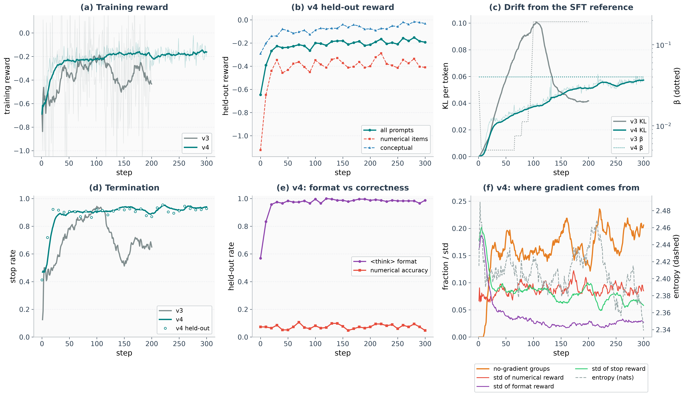</p>

| 问题来源 | v3 训练日志中的实证证据 | v4 的对应修复（`configs/rl_grpo.yaml`） |
|---|---|---|
| 每个日志点只统计单条提示词 | Rank 0 每步只记下 `1` 条提示 `8` 个采样的均值：逐步标准差 `0.35`，一阶自相关 `0.04`。扣掉题型差异与趋势后残差标准差仍有 `0.26`，即便 `20` 步滑动均值也带 `±0.06` 误差 | `prompts_per_step: 16`（每卡）→ 每次更新覆盖 `32` 题 × `8` = `256` 条生成；全局归约全部指标；每 `10` 步固定种子测留出目标函数 |
| 单个批次只混一种题型 | 数值步均值 `−0.64`，概念步均值 `−0.19`；连续 `20` 步窗口内数值题占比在 `20%–70%` 间波动，单靠题型比例就让滑动曲线位移多达 `0.22` | 启用 `stratify_types: true`，令每批严格保持题库题型比例 |
| 开关式（bang-bang）`β` 控制器 | 单批 KL 越过 `[0.5, 2]×target` 死区即按 `×1.5` 或 `÷1.5` 跳变：`β` 第 `6` 步跌到底线 `0.005` 并停留至第 `65` 步，随后连续五步 `×1.5` 在第 `96–100` 步从 `0.038` 跳至 `0.192` 并锁死到结束。目标权重途中改变了 `38` 倍，终止率从 `0.94` 跌至 `0.51` | 改为 `kl_controller: fixed`，全程保持 `β = 0.04`，确保优化目标前后一致（另留 `proportional` 控制器代码但本次未开启） |
| 组内标准差缩放放大微小噪声 | 组内奖励即便只相差 `0.01` 的长度惩罚，除以极小的组标准差后也会被放大成单位量级优势 | 改用 `adv_norm: batch`，组内仅减去均值，统一除以全局批次汇总的标准差 |

此外，v4 还同时修复了三项工程细节：

- **统一 KL 损失与日志定义**：v3 损失使用的是 `k3`，其梯度 $`(1 - p_{\text{ref}}/p)\,\nabla\log p`$ 会在被压低概率的词元上急剧放大，且其期望指向逆向 $`\mathrm{KL}(p_{\text{ref}}\Vert p)`$；v4 改为以 $`k_2 = \tfrac12(\log p - \log p_{\text{ref}})^2`$ 作为损失项，其同策略梯度严格等于 $`\nabla\mathrm{KL}(p\Vert p_{\text{ref}})`$（同时继续记录非负 `k3` 供监控）。
- **学习率预热与均等词元加权**：补充 `warmup_steps: 10` 避免 Adam 第一步更新过大；将序列归一改为 `loss_agg: constant`（词元总和统一除以 `rollout 数 × max_new_tokens`），回到标准逐词元 REINFORCE 权重。
- **左填充 KV-cache 批量生成**：v3 解码器每生成一词元都要重新前向整条上下文，每步仅每卡 `8` 个采样就要耗时 ~`27` 秒；v4 把全部 `P·G` 条样本排成左填充静态缓存批次一次并行推进，每卡 `128` 个采样只需 ~`13` 秒（生成约 `11` 秒），fp32 下与完整前向一致性达到 `3×10⁻⁵`。

**究竟是不是第 `100` 步附近的 `β` 跳变导致了 v3 后半段退化？** 下表展示了从已保存的 v3 第 `100` 步权重出发的干预对比实验：两侧完全保持相同的算法、提示词顺序与随机种子，唯独改变 `β`：

<p align="center">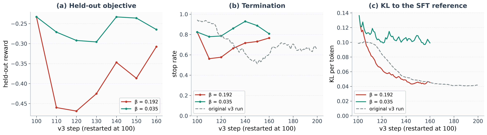</p>

| 留出集，从 v3 第 `100` 步重启 | `+10` | `+20` | `+30` | `+40` | `+50` | `+60` | `+10…+60` 均值 |
|---|---|---|---|---|---|---|---|
| 奖励，`β = 0.192`（控制器实际锁定值） | −0.460 | −0.469 | −0.425 | −0.347 | −0.387 | −0.308 | **−0.399** |
| 奖励，`β = 0.035`（第 `81–100` 步均值） | −0.271 | −0.292 | −0.296 | −0.233 | −0.236 | −0.265 | **−0.266** |
| 终止率，`β = 0.192` | 0.56 | 0.58 | 0.66 | 0.72 | 0.73 | 0.77 | |
| 终止率，`β = 0.035` | 0.78 | 0.79 | 0.86 | 0.93 | 0.89 | 0.81 | |

两组在起点同为奖励 `−0.233`、终止率 `0.82`。仅仅 `10` 步之内，`β = 0.192` 组便丢失了 `0.23` 留出奖励，终止率跌至 `0.56`，数值题 `<think>` 率从 `0.96` 退到 `0.84`；相对地，`β = 0.035` 组维持在起点水准，全部六个时间点全面领先，而高 `β` 组的 KL 则从 `0.10` 回落到 `0.045`，几乎一比一重现了原先 `0.10 → 0.042` 的衰减（图 c）。由此证明，单独提高 `β` 就足以复现整段退化过程。（每组运行一次种子，共享的重启优化器重置带来了低 `β` 组开头略微下降的基线偏移，两者间差距即纯 `β` 效应。）

**修复后的 v4 表现。** 沿用完全一致的 SFT 起点、奖励配置与学习率跑满 `300` 步后，v4 在训练奖励、留出目标函数（叠画于子图 a）和 KL 曲线上都呈现出清晰的快速爬升、缓慢改善与平台收敛阶段：

<p align="center">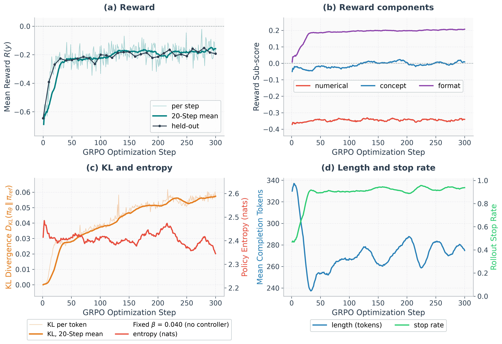</p>


| 步数 | 训练奖励 | 留出集目标函数 | KL | 终止率 | 零差异组占比 |
|---|---|---|---|---|---|
| 0 | — | −0.646 | 0 | 0.41（留出集） | — |
| 1–25 | −0.393 | −0.391（第 10 步），−0.268（第 20 步） | 0.013 | 0.75 | 0.10 |
| 26–100 | −0.229 | −0.229（第 30–100 步均值） | 0.028 → 0.037 | 0.90 | 0.16 |
| 101–200 | −0.183 | −0.200（第 110–200 步） | 0.040 → 0.051 | 0.92 | 0.17 |
| 201–300 | −0.179 | −0.184（第 210–300 步） | 0.055 → 0.057 | 0.93 | 0.20 |

训练奖励绕平滑趋势线的逐步标准差落到 `0.05`（对比 v3 的 `0.30`），策略熵稳定保持在 `2.34–2.49 nats`（未发生坍缩），`25` 步滑动生成长度停在 `250–285` 词元之间。

进入平台期有着明确的原因：格式与终止规则在第 `25` 步左右即已饱和（留出 `<think>` 率第 `20` 步已从 `0.57` 升到 `0.96`），`r_format` 的组内标准差也从 ~`0.2` 跌至 `0.02`，同组兄弟回答不再在这一项上拉开差距；子图 (f) 也显示完全不产生梯度的零差异组占比从 `0` 上升到约 `20%`。第 `100` 步之后的慢升主要由概念覆盖项带动（留出概念奖励 `−0.29 → −0.03`），而留出数值准确率全程停在起点附近（第 `0` 步 `7.3%`，波动区间 `4.7–10.7%`）。**稳定的优化器能更清晰地显露出当前上限，但本身并不能抬高这一上限：** 平台高度最终由 `113M` 模型上这一套代理奖励还能区分出什么信号决定，而不取决于训练器稳定性。

**部署解码复核。** 更平滑的曲线必须经过相同解码器检验才算数。（下列对比采用早期旧标签口径；改用修正标签重评结论一致——`v4 − v3 = +2.0` 个百分点 `[−0.7, +4.9]`，详见审计 `§15.6` 与 `docs/eval_rl_v2labels_k4.json`。）使用 `src.rl.eval_rl` 在固定部署参数（温度 `0.3`、`top-k 40`、重复惩罚 `1.2`）下配对评分 `docs/eval_rl_paired_k4.json` 相同的 `186` 条提示词 × `4` 次采样（`docs/eval_rl_v4_k4.json`）：

| 指标（`166` 数值题 / `186` 总提示词 × `4`） | SFT | v3 `@100`（原发布，手动选出） | **v4 `@300`（最后一步，未挑点）** | v4 − v3`@100`，`95% CI` |
|---|---|---|---|---|
| 数值准确率 `@1%` | 5.4% | 5.4% | 6.8% | +1.4 pp [−0.6, +3.3] 不显著 |
| 数值准确率 `@5%` | 7.1% | 8.9% | 9.8% | +0.9 pp [−1.4, +3.3] 不显著 |
| `<think>` 率（数值题） | 70.2% | 97.9% | 98.6% | +0.8 pp [−0.8, +2.3] 不显著 |
| `pass@4` `@5%` | 16.9% | 21.1% | 23.5% | — |
| 复读 / 污染 | 0.0% | 0.0% | 0.0% | — |
| 平均生成词元数 | 315 | 252 | 216 | −36 [−43, −28] 显著 |

重新评分的 `v3 @100` 行在全部 `186/186` 条提示词上与原记录逐题吻合，配对对比完全精确。无需额外选点，v4 最后一步即在所有能力与格式指标上与 v3 手工救出的第 `100` 步统计持平，且平均输出精简 `36` 个词元——v3 必须靠人工在开发集挑点才避开百步后的退化，而 v4 本身没有退化需要规避。相对 SFT，v4 合池 `acc@5%` 增加 `+2.7` 个点 `[+0.3, +5.0]`，且增量主要在 dev 半边（`3.0% → 7.9%`），在冻结的 test 半边上是 `+0.8%` `[−2.5%, +4.2%]`，与 v3 相同（§3.1）；按 §6.4 重新分层，可提取层 `+11.8%`、需计算层 `+0.4%`（不显著），说明闭卷心算依然未动。（这批评分中有 `61` 题落入 v4 题池，见 §3.1。）

```bash
torchrun --standalone --nproc_per_node=2 -m src.rl.train_grpo --config configs/rl_grpo.yaml     # v4，2× A30 约 80 分钟
torchrun --standalone --nproc_per_node=2 -m src.rl.train_grpo --config configs/rl_grpo_v3.yaml  # 复现 v3 算法
python -m src.rl.train_grpo --config configs/rl_grpo_intervention_beta0192.yaml               # 仅改 β 的重启实验（单卡）
python -m src.plots grpo
```

### 5.9 有效梯度真正来自哪里

在 v3 配置里，每个训练批次只包含单一种题型，因此每一步只会激活数值验证器或概念验证器其中之一，二者不会在同一批次同时出现：

| 步次题型 | 步数与占比 | 奖励主要考查的目标 |
|---|---|---|
| 数值计算题 | `77 / 200` (`38.5%`) | 先列物理关系再算出准确数字 |
| 概念问答题 | `123 / 200` (`61.5%`) | 涵盖地震学核心概念术语 |

整个 v3 流程一共只访问了 `400` 条唯一提示词（仅占总池 `7.7%`）。这意味着计算正确性只在不到四成的更新步中处于可激活状态，而格式合规则在每一步都被打分——这解释了为什么格式变化远大过准确率变化。

> **关于组内离散度监控的改进（已在 v4 补齐）。** 单看题型覆盖比例仍然只是间接参考。在组相对更新里，真正产生非零梯度的前提是某项验证器在同一组内产生了差异化打分（[§5.5](#55-一个真实样本组能教给我们什么)），即每项奖励的实际触发机会率。因为 v3 日志只保存批次均值而没有记录逐分项的组内标准差，这一实际触发比例无法从 v3 产物事后反推，上表只能视作上界。
>
> **v4 已正式接入分项离散度监控。** `checkpoints/runs/grpo_v4.csv` 在每一步都写入全局批次的 `zero_var_frac`（无方差因而无梯度的组占比），以及 `r_num`、`r_concept`、`r_format` 与 `r_term` 的组内标准差。在第 `26–300` 步间：`16–20%` 的样本组零方差；`<think>` 饱和后 `r_format` 离散度跌至 ~`0.02`；`r_concept` 维持约 `0.15` 而 `r_num` 约 `0.09`。可见中后期梯度主要由概念验证器提供，这也与 §5.8 中留出曲线继续缓升的部分吻合；同时 v4 采用题型分层采样，让两个验证器每步都能发挥作用。

### 5.10 基线：提示工程与拒绝采样

仅仅在提示词里显式要求 SFT 模型用 `<think>` 标签思考，规范率只从 `72.3%` 提到 `73.5%`；而 GRPO 将其提高到了 `98.2%`（`docs/prompted_baseline.json`，`166` 题旧集）。可见提示词改写几乎撬不动这一格式行为，RL 却几乎将其改写殆尽。

拒绝采样微调（RFT）则只保留学生模型自己通过验证器的答案来做监督微调，不计算策略梯度。在迁移实验中（§5.19），RFT 把 `576` 道练习题从 `48.8%` 提到 `68.3%`，同题上 GRPO 达到 `85.4%`，而在教师标准解答上继续 SFT 则停在 `47.3%`。到留出题上时，GRPO 与 RFT 基本持平（`+0.1` 对 `+0.2` 个点，`docs/rl_transfer_diagnosis.json`）。

### 5.11 在相关文献中的定位

- **InstructGPT**（[Ouyang et al. 2022](https://arxiv.org/abs/2203.02155)）：人工示范 → 人类偏好排序 → 拟合奖励模型 → RLHF。本项目用确定性规则验证器取代了人工排序和学习的奖励模型，省去了标注开销与奖励模型过拟合问题，代价则变为需严防验证规则漏洞。
- **DeepSeekMath / GRPO**（[Shao et al. 2024](https://arxiv.org/abs/2402.03300)）：`7B` 参数模型先经历约 `1,200` 亿数学预训练词元与专项 SFT，再运行标准 GRPO——组相对 RL 在一个本就具备较强数学基础的基座上把数学基准推得更高。§5.4 列出了本仓库与原版算法的取舍细节。
- **DPO**（[Rafailov et al. 2023](https://arxiv.org/abs/2305.18290)）：离线偏好对分类，无需在线生成样本；除非先把验证器分数改造成优劣成对样本，否则无法在生成过程中即时接入代码校验器。
- **拒绝采样微调 (RFT)**（[Yuan et al. 2023](https://arxiv.org/abs/2308.01825)）：筛选通过验证的自我生成答案直接微调，不涉及策略梯度。本项目曾把它与 GRPO 同场对比（§5.10）：在已练题库上得 `68.3%`，低于 GRPO 的 `85.4%`。
- **DeepSeek-R1**（[DeepSeek-AI 2025](https://arxiv.org/abs/2501.12948)）：验证了强化学习可以系统激发推理模式。对比本项目可见规模差异：R1 中输出格式与推理能力在广泛基准上一同上升；而在这里格式全面定型，准确率则集中提升在贴近练习题的题型范围内。
- **其他参考方法**：`pass@k` 的无偏估计公式见 [Chen et al. 2021](https://arxiv.org/abs/2107.03374)（其指标溯源至 [Kulal et al. 2019](https://arxiv.org/abs/1906.04908)；注意本仓库直接汇报 `n = k` 时的原始“k 次里任中一次”比例）；`k3` KL 估计见 [Schulman 2020](http://joschu.net/blog/kl-approx.html)；算力配比参考 Chinchilla 约每参数 `20` 词元经验法则（[Hoffmann et al. 2022](https://arxiv.org/abs/2203.15556)）。

DeepSeekMath 证明了基座原本已会数学时，组相对 RL 还能继续拔高表现；而本工作处在 `113M` 参数配稀疏正确性奖励的另一端。在此条件下，GRPO 稳定了回答格式（`71% → 98%`）并显著抬升练习题准确度（`49% → 85%`），但对从未练习过论文的留出题最多仅增加约 `3` 个百分点（`+0.1` 到 `+3.3`），因为提升随题目与练习题的距离衰减（§5.19）。

### 5.12 过度训练的监测信号

- **SFT 阶段。** 教师原文上的验证损失会在几轮后反升，但实际输出质量仍持续变好。选检查点应依据生成表现而非交叉熵（§4.7）。
- **RL 阶段。** 需要警惕三个信号：KL 持续偏离参考策略、策略熵大幅收缩到单一固定模板，以及回答长度不断拉长稀释每词元惩罚。§5.8 展示了各曲线的正常与异常形态，应对方式是固定 KL 权重、限制生成长度并监控零方差组比例。
- **迁移阶段。** 当练习题库准确率稳步上升而留出集始终平缓时，多半说明题库主题离留出题太远，而不是 RL 优化坏了（§5.19）。

### 5.13 奖励、优势与评测：为什么要保持隔离

本文始终严格区分三个表面相似、用途却互不替代的量：

```
训练环节：采样生成 ── 验证器 ──▶ 奖励 ── 减去同组均值 ──▶ 优势 ──▶ 策略梯度
决策环节：留出测试题 ── 部署解码 ──▶ 准确率、格式、卫生指标 ──▶ 挑选检查点、汇报最终结果
```

| 维度 | 奖励（Reward） | 优势（Advantage） | 评测（Evaluation） |
|---|---|---|---|
| 是什么 | 验证器给单条候选回答的打分（§5.6） | 奖励减去同组均值；v4 起再按全批汇总标准差缩放（§5.2） | 在训练环外、面对留出题测得的准确率与卫生检查指标 |
| 回答的问题 | 验证规则怎么评估这一条输出 | 同组中哪些生成比兄弟样本更好 | 模型在这类任务上是否真正变得更强 |
| 用在哪里 | 换算成组内相对优势 | 乘到生成词元的策略梯度上 | 决定选哪个检查点（dev 集）和发布最终数字（留出集） |
| 进入梯度吗 | 通过优势间接进入 | 直接乘入梯度 | 从不参与梯度 |

**为什么评测必须与训练奖励严格解耦。** RL 优化目标就是把训练奖励推高，所以训练奖励上涨只证明梯度下降没有接反，并不等同于能力变强；奖励同时只是任务的代理指标（§5.6），一旦优化器利用了规则漏洞（reward hacking），就会出现奖励涨而真实能力不动的情况。至于“优势”，它在每个小组内部总和永远为零，只反映组内相对排名。因此本项目所有模型对比与上线决策都依据优化器见不到的独立评测完成——第一版流程用训练奖励对比模型曾得出“+590%”，结果后来查明其中 `73%` 是 `<think>` 标签格式分，真实留出准确率几乎没动（[PITFALLS B1](PITFALLS.zh-CN.md#b1--评测直接复用训练奖励形成循环论证)）。

**奖励侧的防破解设计。**
- 针对每个分项提前写出最容易被利用的漏洞并用探针盯防（§5.6）：空 `<think>` 块、撒多个数字、推理链堆砌关键词和末尾注水填充。
- 训练前做对抗回归测试：`python -m src.rl.verifiers` 执行八项探针测试，而 `python -m src.analysis.validate_measurement hacking` 则用同一真实奖励引擎把七种退化回答和真参考答案同时打分，排查出“填充+正确答案”反超标准答案的漏洞（[PITFALLS D2](PITFALLS.zh-CN.md#d2--复读惩罚按回答自身长度归一化让注水文本得分反超标准答案)）。
- 一旦格式项趋近饱和，后期的执行方程 RL 阶段全部去掉外围形状奖励，只看最终数值正确性（误差 `1%` 内 `1` 分、`5%` 内 `0.5` 分、否则或运行报错 `0` 分）。
- 最终数字由方程解释器写入：模型写公式，由 `src/rl/pot.py` 求值并由解码器注入 `Answer: <value>`；注入词元全部排除出梯度损失掩码（§5.7），确保只有正确推导式才能拿到分数。
- 数值验证器只读取结尾最后三个数字，避免在结尾列举候选数字碰运气（§3.3）。
- 指向 SFT 锚点的 KL 正则限制了策略为了逐利漂移出正常语言的幅度。

**评测侧如何补上奖励看不见的盲区。**
- 不同题目来源：留出题出自未进入微调的论文，按文档块划界并锁哈希（§3.1）。
- 一致的服务解码：使用上线配置（温度 `0.3`、`top-k 40`，最终方案配 `vote@8`），而非训练探索温度。
- 禁止合并成单一总分：把 `5%` 与 `1%` 准确率、`<think>` 率、复读、污染以及平均词元长度并列列出（§3.2、§6.1）；复合分升高但准确率停滞往往就是刷分信号。
- 标注量程边界：每项指标均附带知识盲猜下限与标准答案解析上限（§3.3）。
- 选择与报告分开：挑选逻辑事先写成常量并在 dev 上运行，留出测试集仅作报告（§3.1、§4.7）。
- 多随机种子统计：采用 `6` 个种子 × `4` 次采样、配对检验及检验效力报告（§6）。

评测和奖励共用同一套“误差容限内匹配参考答案”的正确性标准，但评测将其用在互不重合的新题、固定解码配置与统计检验之上（[PITFALLS C2](PITFALLS.zh-CN.md#c2--评测与训练奖励测同一能力却被写成独立验证)）。

**分离机制实际拦截过的问题汇总：**

| 案例 | 奖励给出的信号 | 评测揭示的真相 |
|---|---|---|
| v1 复合奖励 | +590% | 73% 的增益来自格式；准确率几乎没变（B1） |
| 填充探针 | 填充文字 + 正确答案 0.56，真实答案 0.42 | 修复后两者均得 0.77（D2） |
| 旧打分规则 | 模型得 13.3% | 盲撒数字基线得 14.3%（C1） |
| 第三阶段（v4） | 奖励上升；规范率 71% → 98% | 准确率 4.7% → 6.1%：学会格式但计算几乎没动（§5.9） |
| 迁移研究 | 练习题 49% → 85% | 留出题 +0.1 到 +3.3：增益留在练习过的问题附近（§5.19） |

---

### 5.14 计算器修正算术，修不了建模

在多步公式求解中，小模型需要逐位采样输出中间结果，只要一位算错就会拖垮全题。引入行内计算器可以消掉纯算术误差：当模型写出 `<<expr>>` 时，解码器利用受 AST 白名单约束的安全求值器（不使用 `exec`）计算并自动写入 ` = value`（`src/rl/rollout.py`）。在强化学习期间，插入的计算结果词元视为环境观测，全部从策略损失掩码中屏蔽。

为了让模型习惯调用计算器，我合成了 `6,000` 道纯算术练习题（`tools/numeric_drills.py`），并将 SFT 语料中能严格复现标准答案的步骤改写成 `<<expr>>` 调用格式（`src/sft/calculator_format.py`），再在此基础上运行带计算器在环的 GRPO。

| | 留出习题 | 真实题目 | 调用计算器的回答 | 需要计算 |
|---|---|---|---|---|
| SFT | 3.9% | 4.6% | 0% | 2.8% |
| + 计算习题 | 86.4% | 5.3% | 10% | 3.4% |
| + 计算器格式语料 | 81.0% | 5.1% | 93% | 3.1% |
| + 计算器在环的 GRPO | — | 5.4% | 91% | 2.9% |

工具调用习惯成功保留了下来——`93%` 的回答都会触发计算器，包含心算失误步骤的比例从 `82%` 锐减到 `19%`。然而端到端解题准确率仍然纹丝不动，因为计算器只会忠实计算模型写进括号里的式子，而错处恰恰出在前面列的物理公式与参数代入（例如编造关系式，或者把 “2.8 / 3” 错写成 `<<2.8-3.0 * 2.8>>`）。至此瓶颈位置已经十分明确：真正的障碍不是加减乘除，而是选对物理关系式与变量映射。

采用 `8` 次采样多数投票（自洽投票 `src/rl/self_consistency.py`）带来了温和改善，把 GRPO 模型成绩从 `6.4%` 抬到 `9.2%`（`8` 个随机种子合并结果，`docs/eval_vote_pooled8.json`），其中提升大多落在答案已在题干给出的题型上。第五阶段最终部署模型也对执行方程输出采用这套 `vote@8` 策略。

### 5.15 速度：RL 的时间花在哪里

<p align="center">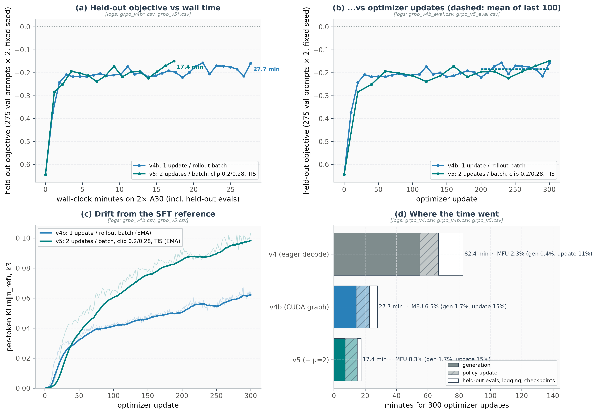</p>

在 `113M` 这样小的参数量上，RL 每一步的耗时几乎全部花在自回归解码而不是梯度反传：生成阶段占据了单步时间的 `82%`，硬件算力利用率（MFU）只有 `0.4%`，因为每生成一个词元都要在 GPU 上启动大约 `700` 个微小的 CUDA 内核。为此我采取了两项优化：

- **用 CUDA Graph 捕获解码步**（`rollout.GraphDecoder`，静态 KV 缓存）：单卡每次生成 `128` 条回答的时间从 `11.0 s` 缩短到 `2.9 s`。由于每套捕获图都要独占一块约 `1.6 GB` 的静态 KV 缓存（`128 行 × 768 词元`），训练器最多保留两个长度档位的图；保留六个时多长度题库曾触发显存耗尽。
- **每批采样执行两轮优化步**：仿照 TRL 的 GRPO 配置设为 `μ = 2`，相对首轮策略的概率比值裁剪到 `[0.8, 1.28]` 并开启截断重要性采样（§5.16），把采样成本摊薄到两步更新上。

评估管线复用同一个批量图解码器之后，单检查点评测耗时也从约 `45` 分钟压缩到了约 `20` 秒。

| 在 `2× A30` 上完成 `300` 次更新 | 总耗时 | 每批采样时间 | 每步 MFU |
|---|---|---|---|
| 原始训练器 | 82 min | 13.4 s | 2.3% |
| + CUDA-graph 解码 | 27.7 min | 4.7 s | 6.5% |
| + 每批两次优化更新 | 17.4 min | 6.1 s | 8.3% |

优化后整套运行快了 `4.7×`，同时保持了同样的留出准确率（`6.4%`，`8` 个种子）。不过由于批内复用两次使结尾 KL 略高（`0.10` 对 `0.06`），`μ = 2` 运行适合搭配更小的学习率。

### 5.16 Rollout 引擎、训练引擎与二者之间的失配

RL 实际上在同一个进程里通过两套数值算路分别运行相同的模型权重：**rollout 引擎**负责逐词元缓存解码采样，**训练引擎**负责整段并行前向计算梯度所需的对数概率：

| | Rollout 引擎（`src/rl/rollout.py`） | 训练引擎（`src/rl/train_grpo.py`） |
|---|---|---|
| 职责 | 每道题采样 `G` 个候选回答 | 对采样出的全部生成词元重算概率并反传梯度 |
| 执行方式 | 逐词元生成，静态 KV 缓存，解码单步捕获进 CUDA Graph | 整条序列一次前向传播 |
| 数值精度 | bf16 矩阵乘与 KV 缓存，fp32 softmax | bf16 矩阵乘，fp32 log-softmax |
| 采样设置 | 温度 `1.0`（第三阶段）或 `0.8`（执行方程阶段），无 top-k，无惩罚 | 按温度 `1.0` 计算概率 |

因为浮点舍入累积顺序以及温度设定不同，采样输出真正服从的是采样器分布 $`\mu`$，而梯度则是围绕训练前向定义的分布 $`\pi_\theta`$ 计算的。两者之间的这道差异就是**训练–推理失配**（train–inference mismatch）。

**为什么这一差距值得测量。** 策略梯度理论通常假设样本服从当前被优化策略 $`\pi_\theta`$：

```math
\nabla_\theta J(\theta) = \mathbb{E}_{y \sim \pi_\theta}\left[A(y)\,\nabla_\theta \log \pi_\theta(y)\right]
```

如果样本实际取自另一个分布 $`\mu`$，梯度估计便会产生偏差；而且单词元误差还会沿序列长度线性累加：

```math
\log \frac{\pi_\theta(y)}{\mu(y)} = \sum_t \left[\log \pi_\theta(y_t \mid y_{\lt t}) - \log \mu(y_t \mid y_{\lt t})\right]
```

此外，低概率词元上的比值尤其敏感，容易让重要性权重突然暴增。在更大规模的多机 RL 框架（如 vLLM 推理配 FSDP 训练）中，这类未察觉的失配已经多次导致长程训练偏离同策略假设并在中途崩盘（[Yao et al. 2025](https://fengyao.notion.site/off-policy-rl)；[Liu et al. 2025](https://yingru.notion.site/When-Speed-Kills-Stability-271211a558b7808d8b12d403fd15edda)）。

**本项目中的实测数值。** `scripts/experiments/mismatch_check.py` 在 CPU 上用第四阶段 `notation2` 模型采样了 `32` 条回答（约 `3.1k` 词元），再送回训练前向逐词元比对（`docs/mismatch_check.json`），GPU 训练日志同时记下了线上实测波动：

| 对比配置 | 每词元平均对数差（nats） | 单词元最大差 | 权重超过 `2` 的词元占比 | 序列对数比标准差 |
|---|---|---|---|---|
| 双方均使用 fp32 | 1.0e-6 | 5e-5 | 0% | 0.00 |
| 训练器 bf16，采样器 fp32 | 0.0055 | 0.22 | 0% | 0.19 |
| 温度 `0.8` 采样，温度 `1` 打分 | 0.033 | 1.57 | 0.6% | 1.06 |
| 温度 `0.8` 采样并按 `0.8` 打分 | 9e-7 | 4e-5 | 0% | 0.00 |
| GPU 训练日志，双方 bf16，温度 `1`（v5–v8） | 0.014–0.021 | — | 至多 0.002% | — |
| GPU 训练日志，双方 bf16，温度 `0.8`（v9 起） | 0.015–0.055 | — | 0.15–0.8% | — |

实测清楚呈现出三点事实：
- 当两套引擎精度与温度完全对齐时，差异低于百万分之一 nat，证明静态 KV-cache 解码器实现无误；
- 仅 `bf16` 低精度舍入就足以把单个词元的对数概率平均偏移 `0.0055`（在 `100` 词元回答上整句概率波动约 `±20%`），且主要集中在概率低于 `0.1` 的罕见词元（平均差 `0.041`，对比概率高于 `0.9` 词元的 `0.0004`）；
- 有意调低采样温度（`0.8` vs `1.0`）制造的分布差大约是数值舍入误差的六倍。

**训练器采用的对应抑制措施。**
- *对齐精度与采样分布*：两边统一 `bf16` 矩阵乘配合 `fp32 softmax`，第三阶段按温度 `1.0`、无截断采样，使采样分布尽量贴近策略本身。（注：改用 `10` 位尾数的 `FP16` 可比 `7` 位尾数的 `BF16` 将舍入精细度提高 `8` 倍并消除多数失配，代价是需管理梯度损失缩放，见 [Qi et al. 2025](https://arxiv.org/abs/2510.26788)。）
- *逐词元截断重要性采样（TIS）*：采样器记录生成每词元时的真实对数概率，训练端据此按以下权重修正梯度：

```math
w_t = \min\left(\frac{\pi_\theta(y_t \mid y_{\lt t})}{\mu(y_t \mid y_{\lt t})},\ C\right), \qquad C = 2
```

  不设上限理论上可保无偏，但单个极罕见词元会引发方差失控；因此设上限 `C = 2` 以微弱偏差换取方差界定，并选择逐词元加权而非整句加权（整句对数比方差过大，见上表末列）。需要注意 `w_t` 修正的是引擎与采样温度偏差，与 v5–v8 多步复用中修正陈旧策略步差的 PPO 比率 $`r_t = \pi_\theta / \pi_{\text{old}}`$ 各司其职。从 v5 起各实验一律保留 `C = 2`：温度 `1` 下平均权重精确贴近 `1.000`（触顶词元不到十万分之二）；温度 `0.8` 下 `w_t` 会按比例把样本回权至温度 `1` 策略，约 `0.15–0.8%` 词元触及截断上限。
- *组内均值中心化*：常值奖励偏移 $`b`$ 无害的恒等式 $`\mathbb{E}_{y \sim \pi_\theta}[\nabla_\theta \log \pi_\theta(y)] = 0`$ 仅在同策略采样成立；若改为从采样器 $`\mu`$ 采样，会出现额外偏置梯度项：

```math
\mathbb{E}_{y \sim \mu}\left[b\,\nabla_\theta \log \pi_\theta(y)\right] = -\,b\,\nabla_\theta\,\mathrm{KL}(\mu \,\Vert\, \pi_\theta)
```

  正偏移会像在采样文本上做 SFT 一样把策略拉向采样器，而如 v3 那样普遍为负的偏移则会把策略推离采样器。通过组内减去均值，每一组中偏移 $`b`$ 都精确消掉，保证仅有兄弟输出之间的质量差参与更新。此外，诸如填充、强制 EOS 和计算器返回文本一类不由策略采样的词元，不存在采样概率，直接屏蔽出梯度计算（[§5.7](#57-词元掩码强制-eos-填充与-kl-计算)）。

```bash
python scripts/experiments/mismatch_check.py     # CPU 上约 1 分钟；生成 docs/mismatch_check.json
```

### 5.17 找到瓶颈

<p align="center">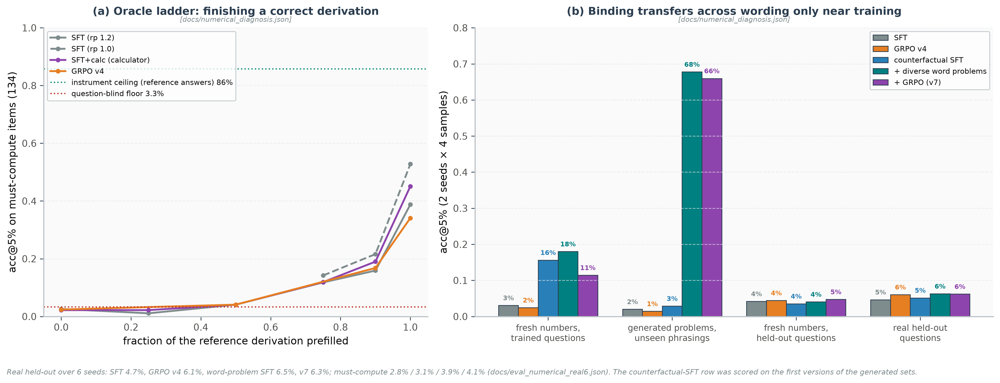</p>

准确率停在低位时，直观反应往往是在已有数据上增加训练轮次。在继续堆数据之前，我把“产出一个数值答案”拆成几个独立环节，在 `134` 道需要计算的留出题上分别测量各环节表现（参照基准：参考答案在该评测口径下得 `85.8%`，不读题干的盲基线得 `3.3%`）：

| 步骤 | 测试 | 结果 |
|---|---|---|
| 推导出数值 | 正确数值是否出现在回答中的任何位置？ | 14.7%，接近随机（13.1%） |
| 复述已完成的推导 | 给出完整的参考推理 | 39%（去掉重复惩罚后 53%） |
| 记忆 | 训练过的题目 | 5.1%，与留出题相同 |
| 算术 | 计算器在环（§5.14） | 错误步骤 82% → 19%，准确率不变 |

测量结果一目了然：即使面对已经在训练集中出现过的原题，模型也几乎没能从零推导出目标数值。

进一步测试表明，在贴近训练样本分布的范围内，模型是可以学会把数字代进对应关系式里的：对训练题替换新数字可把准确率从 `3%` 提到 `18%`（`src/sft/counterfactual.py`）；对合成应用题换用未见过的话术问法，准确率则从 `2%` 提高到 `68%`（`tools/word_problems.py`）。

然而一旦面对全新的题型结构，这种绑定就无法迁移过去。在这个阶段，真正的瓶颈在于不同题型的绝对数量太少：原始语料只覆盖大约 `1,250` 类题目，而 TinyGSM 在 `125M` 规模上为了学稳应用题使用了约 `1,200` 万道合成练习。为此，我转而大规模扩充带有可执行解题步骤的题目（§5.18）。

### 5.18 第四阶段：由本地教师生成可执行方程

小模型只要用大量配备可执行解答的题目微调，也能解好数学应用题（如 PAL、TinyGSM）。当时这里既缺少充足的题目种类，也缺少可执行解答，而本地部署的大模型可以同时承担生成与验算两步：`Qwen/Qwen3.8-27B-FP8`（Apache-2.0）通过 vLLM 在双卡 `A30` 上运行，生成速度约 `900 tokens/s`，在盲解留出题时能答对 `49.7%`。

我让教师模型执行了三类构造任务（`tools/gen_pot_problems.py`）：
- 以已有训练题作种子写出更多变式练习；
- 把每道真实数值训练题改写置入全新的情景背景中；
- 将真实题目原有的文字解答改写为可执行程序。

所有生成解答一律真正跑一遍解释器，只有与标准数值标签吻合的结果才被保留；真实风格的题目还进一步由程序自动替换新数值生成反事实变体，无需再次调用教师模型（`tools/pot_counterfactuals.py`）。训练与推理时，学生模型只需写出简短方程，`src/rl/pot.py` 会在 `</think>` 位置运行程序，并由解码器填入最终答案 `Answer: <数值>`。

| 数据 | 生成 | 保留 |
|---|---|---|
| 以训练题为种子的习题 | 3.48 万 | 2.44 万 |
| 真实题目的可执行解答 | 2.3k | 1.8k |
| 同上换新数值 | 1.18 万 | 9.1k |
| 真实题目的改写（2 轮 × 6） | 3.88 万 | 2.24 万 |
| 改写题换新数值 | 5.89 万 | 4.72 万 |

<p align="center">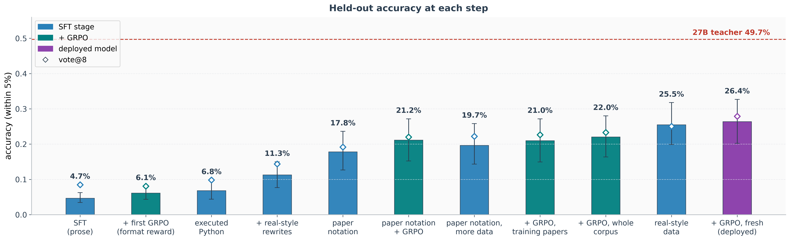</p>

| 里程碑 | 需要计算 | 全部 | vote@8 |
|---|---|---|---|
| SFT，文字作答 | 2.8% | 4.7% | 8.5% |
| 可执行的 Python 解答 | 6.2% | 6.8% | 9.8% |
| + 真实风格改写，去掉重复惩罚 | 11.1% | 11.3% | 14.4% |
| 论文记法解答 | 17.3% | 17.8% | 19.2% |
| + 找回的数据 | 20.1% | 19.7% | 22.2% |
| + 语料上的 GRPO（§5.19） | 20.7% | 22.0% | 23.3% |
| 真实风格数据，一次微调，中期训练基座（§5.20–5.21） | 25.2% | 25.5% | 25.1% |
| + 新题上的 GRPO（已部署，§5.22） | 26.0% | 26.4% | 27.9% |
| 27B 教师，盲解 | 48.5% | 49.7% | — |

这轮推进带来了三项清楚的实验规律：
- **带来迁移的是问题风格而不只是数量。** 教师衍生练习可以把同类练习准确率抬高（`3k` 时 `4%`，`30k` 时 `21%`），却几乎推不动真实考题；改为模仿真实考题的多步、多条件叙述方式做改写后，需要计算的真实题分数翻了一倍。
- **写程序时必须关掉重复惩罚。** 代码必然要多次复用相同变量名；关闭重复惩罚后，模型生成的程序能够顺利跑通的比例从 `40%` 提高到 `57%`。
- **记法贴近预训练语料时效果更好。** 这颗基座预训练阶段读的是地球物理论文而不是 Python 代码，直接生成 Python 时有 `45.5%` 会报错崩溃（多数为变量名拼错）。把解法改写成论文公式记法（例如 `M0 = 10^(1.5*Mw + 9.1) [N m]`）后，虽然训练数据少了 `29%`，准确率反而从 `11.3%` 升至 `17.8%`，生成步骤更短、可执行率升至 `75%`（对比 Python 的 `58%`），跑通后的正确率也升至 `23%`（对比 `19%`）。

在执行方程模型上做 GRPO 还能再带来最高约 `3` 个百分点的增量：首个论文记法模型在最优检查点 `+3.3`；`notation2` 用训练论文衍生题 `+1.3`，用全语料论文（排除测试题）衍生题 `+2.4`——后者配 `vote@8` 曾一直是第五阶段前的线上部署版本（各检查点均按 dev 集选出）。§5.19 分析为何它在留出集上的幅度有限，§5.20–5.22 接续之后的工作；完整训练集构造将几路论文记法数据与 `6` 千条回放的第二阶段问答合并（审计 `§15.14–15.15`）：

```bash
python tools/gen_pot_problems.py generate --model Qwen/Qwen3.8-27B-FP8 --tp 2 --n-seeds 10000 --per-seed 4 \
    --seed-pool all --out data/sources/pot/gen.jsonl            # also: rewrite, convert, solve, audit
python tools/gen_pot_problems.py notation --inp data/sources/pot/notation_inputs.jsonl \
    --out data/sources/pot/notation_all.jsonl                    # 把同样的解答改写成论文记法
python tools/pot_counterfactuals.py data/sources/pot/notation2_convert.jsonl \
    data/sources/pot/notation2_convert_cf.jsonl --variants 6 --notation
python tools/format_pot_sft.py --notation --require-verified --out data/sources/pot/sft_notation.jsonl \
    data/sources/pot/notation_all.jsonl data/sources/pot/notation2_convert_cf.jsonl
torchrun --standalone --nproc_per_node=2 -m src.sft.train_sft --config configs/sft_pot_notation2.yaml --snapshot-epochs
```

### 5.19 GRPO 在哪里起作用：一项迁移研究

小参数模型在 GSM8K 一类算术基准上经常靠 GRPO 拿到较大幅度提升，而本项目中 GRPO 在留出题上的提升最多在 `3` 个百分点左右。本节通过控制实验追踪这些 RL 增益究竟分布在哪里（详细记录见[审计报告 §15.17](audit_report_sft_grpo.md)；本节所指的“部署模型”是第五阶段之前的 GRPO v14，见 §5.22）。

**回顾 GRPO 的更新机制。** 对每道题采样 `8` 条解答并按容差打分（`1%` 以内 `1` 分、`5%` 以内 `0.5` 分、其余 `0` 分），减去组均值再在参考 KL 约束下更新参数。这直接带来两条推论：总是做对或永远做不对的题在组内得不到方差、因而没有梯度（所以 RL 池只收留 `8` 次里答对 `1–7` 次的题目）；同时 RL 主要负责把“偶尔能蒙对”变成“每次都能稳定做对”，也就是将 `pass@k` 收敛到 `pass@1`（[Yue et al. 2025](https://arxiv.org/abs/2504.13837)）。

**实验设计与相似性度量。** 我选取模型此前从未训练过的 `576` 道教师题（集合 A）训练 GRPO，然后测量它在三组距离已知的测试集上的迁移效果：同一批论文中原本从未做对过的题、从另外 `92` 个论文片段里新出的 `600` 道题（B600），以及 `153` 道真实留出考题。两题相似度以共有实词比例（词 Jaccard 系数）估算。

<p align="center">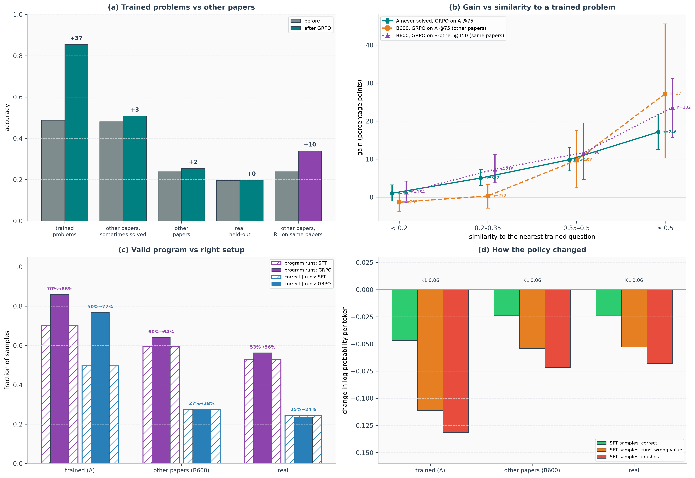</p>

**在练习题库内 RL 表现显著。** 在直接练习的那 `576` 道题目上，仅仅 `75` 步之内准确率就从 `48.8%` 跃升至 `85.4%`；三类主要失误均下降了大约四分之三——运行崩溃从 `9.3%` 降到 `2.3%`，单位错误从 `9.0%` 降到 `2.3%`，物理建模选错从 `19.3%` 降到 `5.4%`。

**增益按问题相似度向外传递。** 在模型此前从未训过的新题上，准确率增量（百分点）与最近训练题的词相似度呈现相同斜率：

| 与最近训练题的相似度 | 同一批论文，从未答对 | 其他论文 |
|---|---|---|
| 低于 0.2 | +1.0 | −1.3 |
| 0.2–0.35 | +5.0 | +0.3 |
| 0.35–0.5 | +9.9 | +9.7 |
| 0.5 及以上 | +17.1 | +27.2（17 道题） |

不管题目来自相同论文还是其他论文，规律一致：在某个问题上执行一步梯度，会影响网络对相似问题的输出分布，变化大小与两者在表示空间的距离大致成比例（符合神经正切核的局部泛化图像，[Jacot et al. 2018](https://arxiv.org/abs/1806.07572)），词重叠率正是这一距离的简单代理。另一组反向验证试验进一步证实了这一点：改为拿来自 B600 同一批论文的另外 `230` 道题跑 GRPO 后，B600 直接提高 `+10.1` 个百分点（`23.9% → 33.9%`），远高出在 A 集上训练时对 B600 仅 `+1.6` 个点的间接带动。

**能够跨题目迁移的是程序规范，而不是具体建模知识。** 拆开“程序能否跑通”与“跑通后公式对不对”两个乘子即可看出差别：在直接练习过的题目上两者同时跃升（`70% → 86%` 与 `50% → 77%`）；到了未练过的其他论文题目上，前者略微升了 `60% → 64%`，后者则原封不动停在 `27%`。为某一特定主题挑选正确的关系方程与参数，属于主题知识，RL 只会在实际练过的问题域中将它磨锐（唯一例外是需要通用物理常数的题，跨论文也涨了 `+4.1` 个百分点）。

**为什么真实留出集变化不大。**
- 常见的小模型 RL 成功报道大多使用和训练集同一生成器产出的测试集，测试题在训练集中几乎总有紧密近邻；
- 而本项目的留出题均源自模型从未练习过的论文，与 RL 训练池里最近样本的中位词相似度只有 `0.23–0.27`，达到 `0.35` 以上的题目仅占 `20–29%`；
- 按上述相似度规律推算，留出集理论涨幅也就只在几个百分点以内，这恰好与实测数值相符。

类似局限在小型 Transformer 事实迁移研究中也曾被明确指出：微调无法跨事实泛化，除非在预训练期同一个事实就以多样措辞反复出现过（[Allen-Zhu & Li，*Physics of Language Models* 3.1](https://arxiv.org/abs/2309.14316)）。

#### 把简单题当作垫脚石

如果模型在一条题上连对一次的概率都没有，那它完全产生不了 RL 梯度；接近真实难度的题里有约 `60%` 属于这种情形。于是我让教师模型把每道复杂题拆出一步“先问前半段某一个中间量”的简版小题（`1–2` 步计算，标签取自原程序中间结果），并在可学到的题上运行 GRPO：

<p align="center">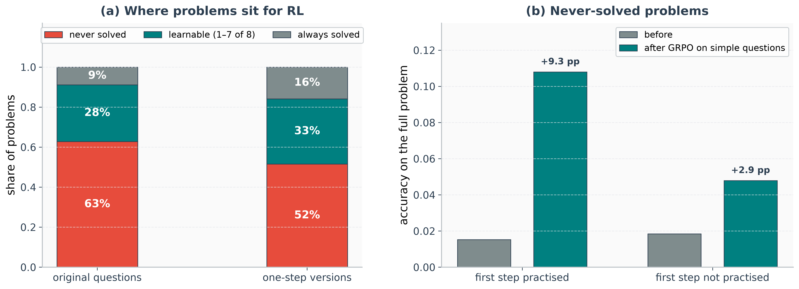</p>

| | 原题 | 一步版本 |
|---|---|---|
| 从未答对 | 63% | 52% |
| RL 之前在其他论文上的准确率 | 23.9% | 34.5% |
| 题库上的 GRPO | 48.8% → 85.4% | 47.0% → 90.3% |
| 在其他论文上的增益 | +1.6 | +3.0 |

简版单步题确实更易掌握，GRPO 在其上也能练到 `90.3%`。单独训练单步题本身并不能整体抬高其他论文里原版多步难题的平均分，但对那些原本零通过的最难题却打破了僵局：原先完全不会做、只练过对应第一步的难题，后来被完整解出的概率从 `1.5%` 升至 `10.8%`（未对应第一步的对照难题则只从 `1.8%` 升到 `4.8%`），说明前置垫脚石把“无梯度题”变成了“有梯度题”。

#### 阅读替代不了练习

既然建模知识只留在练习过的主题附近，那直接让模型多读论文摘要改写能不能学会？我让教师用 `8` 种文风重述 B 组与 A 组论文片段（不设问答过程），然后在 `notation2` 上加入 `3,000` 条旧样本回放分别混合关于 B 或关于 A 的陈述笔记继续微调：

| | 关于 B 的笔记 | 关于 A 的笔记 |
|---|---|---|
| B 题（起点 14.3%） | 14.5% | 14.6% |
| A 题（起点 18.1%） | 16.8% | 15.5% |

结果显示阅读陈述笔记没有提升对应论文题目的得分（甚至略有下降），而同一论文直接做题练习则提升了 `+10.1` 个百分点。在这一参数规模下，模型只有在“用答题所需的方程格式真正解一遍题”时，才能把相关建模关系存进工作路径。

#### 只有广度、没有重复

相似度规律预示只要练题范围覆盖了测试题近邻就有助迁移。为此我构造了两套覆盖面更大的可学题库，各从头到尾跑一遍 GRPO：
- **严格题库（v13）**：`9,031` 道全部源自微调论文的题，综合了第三轮教师改写、全训练主题习题、垫脚石与 A / 简化 A 集；
- **语料题库（v14）**：在 v13 上再添加 `952` 道源自留出论文原文的新习题（`650` 道练习、`302` 道垫脚石），严格按测试集去重（无共享 `13`-gram 且词 Jaccard `< 0.5`），使模型能接触全语料所有论文却从不接触测试题本身。

两套题库大幅缩近了与留出题的距离（最近邻中位相似度升至 `0.28–0.30`，超过 `0.35` 的占 `34–37%`），按相似度曲线本可预期约 `+5.5` 个点提升（`docs/eval_v13_v14.json`）：

| 模型（检查点） | 留出集准确率 | 相对基座，95% CI | 需要计算 | 答案在题干中 | vote@8 |
|---|---|---|---|---|---|
| notation2，第四阶段基座 | 19.7% | — | 20.1% | 16.7% | 22.2% |
| 严格题库，dev 选出（第 25 步） | 20.1% | +0.4 [−2.5, +3.2] | 18.8% | 29.2% | 21.1% |
| 严格题库，一遍结束（第 142 步） | 21.0% | +1.3 [−2.6, +5.4] | 19.7% | 30.0% | 21.6% |
| 语料题库，dev 选出（第 75 步），已部署 | 22.0% | +2.4 [−1.5, +6.3] | 20.7% | 31.1% | 23.3% |
| 语料题库，一遍结束（第 156 步） | 22.0% | +2.4 [−1.6, +6.4] | 21.3% | 27.2% | 23.7% |

然而实测表现较为温和：
- 语料题库微幅优于严格题库（`+2.4` 对 `+0.4–1.3`），均未过 `153` 题显著线；在 dev 上选出的第 `75` 步配 `vote@8` 达 `23.3%` 并充当了第五阶段前的部署模型（虽第 `156` 步 `vote@8` 略高为 `23.7%`，但不能按留出集反选检查点，详见 [PITFALLS E2](PITFALLS.zh-CN.md#e2--同一数据集既用来选检查点又用来报结果把增益放大近四倍)）；
- 增量主要来自答案就在题干中的 `19` 道题（`+10` 至 `+15` 点），而 `134` 道需要计算的题仅变动 `−1.3` 至 `+1.2` 点；
- dev 集分数（以 B600 练习为主）在这轮单遍训练后微跌 `2–3` 个点，导致 dev 选点落在了早期步数。

问题根源在于缺少**重复练习**。迁移实验里 `576` 道题每题练了约 `8` 遍才把掌握度从 `49%` 提到 `85%`；而这里每题仅见过一次，甚至同分布的全新对照题也只从 `43%` 微涨到 `48%`。题库自身都没有学稳，自然传不到外部留出题。

于是我改跑了重复版（v15，`configs/rl_grpo_v15_repeat.yaml`、`docs/eval_v15.json`），选出此前部署模型 `8` 次里对 `1–7` 次的 `1,073` 道语料题各练约 `8` 遍（`135` 步）。练习题确实从 `37%` 提到 `71%`，但在干净 dev 集上的表现从 `28.2%` 跌到 `23.7%`（`−4.4 [−7.7, −1.5]`），留出第 `75` 步微降至 `21.4%`，微调论文新题则从 `37.6%` 滑落到 `32.7%`。过度重复同一小批“全已知数值风格”教师题，反而损害了原本的分布外平衡；也就是说，无论大池过一遍还是小池反复练，在这一阶段都没打通向真实考题的桥梁。

#### 在多个样本中挑选：验证器

在温度 `0.3` 的 `8` 次采样下，留出题中“8 个里至少有一个正确解”的比例高达 `30.7%`，而 `vote@8` 仅捞回 `23.3%`。我为此训练了一个同为 `113M` 规模的独立结果验证器，输入题目和单个候选回答判断正误（`src/rl/verifier.py`），共使用无测/开发重叠的 `1.05` 万道题的 `12` 万条带标签样本，分别对比常规二分类损失与同题内排序损失，并预设在 `696` 道 dev 题（含 `96` 道 §3.1 所述旧重叠题）上显著赢过 `vote@8` 才启用（`docs/eval_verifier.json`）。结果显示，它在同一道题内最高分样本有 `51–63%` 命中正确解（随机为 `50%`），但最优排序加权配置在 dev 上只增加 `+0.9` 个点 `[−0.1, +2.0]` 未达采用门槛（在留出集上为 `+1.5 [+0.0, +3.1]`）。判断几条推导哪个物理建模对，归根结底需要生成模型自身缺少的那部分知识，因此等规模验证器天花板也就是多约一个点。

#### 更密集的奖励

纯看最终数值正确性的二值奖励过于稀疏：在 v14 里有 `31–42%` 的组完全没有方差，另外 `54–68%` 的生成题在 `8` 次里一次也解不出而被提前筛出。为此我试验了中间步骤奖励——在最终对错基础上追加 `0.3 ×` 模型方程算出的中间值与教师标准中间值的 F1 重合度（`reward_mode: step`）。这一中间分和最终对错高度一致（答对样本平均 `0.84`，错样本 `0.18`），并且在 `61%` 的全错题目组中也能产生组内方差。在包含 `2,765` 道此前全错题的同一题库上对比两条唯一区别为是否启用步骤奖励的 GRPO 运行（`docs/eval_v16.json`；干净 dev 精选结果见 `docs/eval_dev_clean.json`）：

| | 无梯度的组 | 干净 dev，最佳检查点 | 留出题 | vote@8 |
|---|---|---|---|---|
| 部署模型 | — | 28.2% | 22.0% | 23.3% |
| 正确性奖励 | 75% → 72% | 30.0%（第 60 步） | 19.7% | 22.0% |
| + 步骤奖励 | 47% → 47% | 28.1%（第 40 步） | 21.2% | 22.0% |

密集的步骤奖励确实将零方差组减半，也比纯终值对照组在留出题上略前进了 `+1.6` 个百分点（不显著），但两路都没有打败原来的部署模型。可见虽然正确性奖励客观稀疏，它并不是挡住留出集提升的真正天花板。

### 5.20 第四阶段（续）：用语料其余部分生成真实风格的题目

§5.19 明确指出唯一持续有效的杠杆是在足够相似的新题上积累练习，且模型尚未饱和（审计 `§15.27`）：在 `300` 道自有训练题上第四阶段模型只答对 `84%`，教师数据每翻倍就能在同分布新题上多出约 `8` 个点；不过在真实考题上翻倍增益快速收窄（`+6.7` 降到 `+2.7`），原因是旧出题器总反复写相似套路——题库扩大 `16` 倍时，干净 dev 集中找到过练题近邻的题目比例才从 `36%` 涨到 `38.5%`。

好在底层论文语料仍远未用尽：第二阶段切分出的 `141,688` 段地震学论文摘录，在剔除包含测试/验证文本的 `371` 篇文档及点名留出历史地震的片段后，还剩 `127,889` 段——第二阶段当时仅仅使用了其中的 `2,794` 段。于是我让 `27B` 教师按第二阶段的真实出题提示词模板，以每窗 `10,000` 段的速度扩展未用片段（`tools/gen_real_style.py`、`scripts/experiments/real_style_chain.sh`）：
- 每段按真实考题风格产出 `3` 道数值题和 `1` 道概念题（题长中位数 `60` 词，几乎贴合留出题的 `61` 词）；
- 每题推导先改写成可运行程序，只有跑通并复现标签，或与只读题干的教师盲解一致的才予以保留；
- 通过验证的程序统一转化为论文公式记法，再参照 §5.18 自动替换新数值扩充训练混合（从窗口 B 起各留出 `30%` 论文专门供应后续第五阶段 RL 练习）：

| 窗口 | 摘录 | 数值问答对 | 验证通过的程序 | 论文记法的题 | 教师用时 |
|---|---|---|---|---|---|
| A | 700–10,700 | 27,713 | 17,445 | 12,328 | 约 20 小时 |
| B | 10,700–20,700 | 27,761 | 17,426 | 12,261 | 约 21 小时 |
| C | 20,700–30,700 | 27,548 | 17,258 | 12,223 | 约 21 小时 |
| D | 30,700–40,700 | 27,463 | 17,224 | 12,195 | 约 20 小时 |

每个窗口还额外给出约 `9,250` 条概念题，产出率稳定维持在 `63%` 通过率（约每段原文摘录进入 `1.2` 道已验证题）。全部四个窗口加在一起，把混合训练集从 `110,903` 行（`notation2`）推进到 `279,929` 行，其中新增 `136,771` 行真实风格数值题（覆盖 `42,029` 道母题及变体）以及 `32,255` 行概念题（`scripts/experiments/build_notation3.py`）。

**窗口 A 教会了“代入计算”，还没有改变“空想公式”。** 第一个窗口将干净 dev 集抬升 `3.8` 个点，而留出集仅移动 `1.2` 点（`20.9%`，不显著；审计 `§15.28`）。按题干信息拆开可见明确分化：题面已经写出公式的题目提高 `8.3` 个点，其余需要自忆公式的题略微下降 `1.8` 点——真实风格新题先教会模型正确套用给定条件，尚未解决未陈述公式的回忆。

**窗口 B 一度看起来持平。** 窗口 B 微调后接一次短 RL 跑出 `20.8%`，表面看与第 3 轮持平；这促使我在投入更多生成算力之前，先检验问题是不是卡在基座本身（§5.21）。后来单独测第 4 轮微调模型自身其实达到了 `22.1%`，证明窗口 A 和 B 合力已经稳步加出 `+2.5` 个点 `[−1.9, +6.7]`。

### 5.21 基座模型是瓶颈吗？

公开小模型通常喂过海量预训练文本，例如 SmolLM2-135M 用了 `2T` 词元，而我们的基座一共只有 `31.5` 亿词元训练量（`8.23` 亿唯一词元跑约 `3.8` 轮），而且不含专门的代码和通用数学预料。恰好之前预训练阶段的 IsoFLOP 扫描留下了不同参数量（`3M–122M`）和不同词元预算的中间检查点，无需重跑预训练就能直接检验基座影响。我将这些扫描检查点统一放到第 3 轮微调混合数据上以一致流程微调并打分（`scripts/experiments/pretrain_tokens_control.sh`、`scripts/experiments/size_coverage_chain.sh`，扫描模型按 `1,024` 词元上下文窗口微调）：

<p align="center">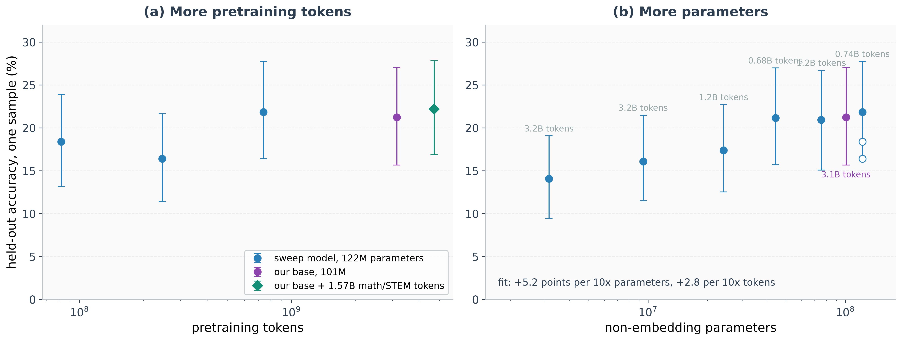</p>

对照结果清楚排除了基座主导瓶颈的猜想：
- **预训练词元数量影响不大。** 同样 `122M` 模型在 `8,200` 万、`2.46` 亿和 `7.38` 亿词元预算下微调后分别达到 `18.4%`、`16.4%` 和 `21.8%`；而我们训练到 `31.5` 亿词元的正式基座得 `21.2%`——预算缩水 `38` 倍也只差大约 `3` 个点，落在抽样波动之内。
- **参数规模影响温和。** 从 `3M` 到 `122M` 非嵌入参数，同配方微调得分只从 `14.1%` 升至 `21.8%`；全 `9` 个点做拟合大致对应每扩大 `10` 倍参数 `+5.2` 点、每扩大 `10` 倍预训练词元 `+2.8` 点。仅靠 `3M` 模型在同配方微调后就能拿到正式成绩的三分之二，说明微调配方本身决定了绝大部分表现。
- **数学/STEM 中期训练性价比高且稳定。** 在双卡上花了 `3.3` 小时补充 `15.7` 亿词元的 FineMath、Cosmopedia STEM 与 FineWeb-Edu 混合语料，同时回放原预训练文本与领域论文（严格避开留出论文）（`configs/midtrain/test1p6b.yaml`、`scripts/midtrain/test_chain.sh`）。该中期训练基座在三套数据混合上全部微幅领先：第 3 轮 `+1.0`、第 4 轮 `+2.5`、第 5 轮 `+1.6`，六对配对运行汇总平均提升 `+1.7` `[−0.7, +4.2]`。

为了能直接检验任意新基座（无需依赖第二阶段的中间权重），后续把第 4 阶段的“从阶段二出发、半学习率 `1e-4` 续训”改为从基座出发、学习率 `2e-4` 跑 `4` 轮的一阶段统一微调（同批大小与 `4,096` 上下文）。同数据上，一阶段新配方在留出集与旧两阶段完全持平（第 3 轮 `21.2%` 对 `20.9%`，第 4 轮 `22.1%` 对 `22.1%`），且在微调论文新题上明显更强（`40.7%` 对 `37.0%`）并省去一整段中间训练。由于干净开发集无法区分第 `2–4` 轮优劣，后续所有微调统一保留最后第 `4` 轮权重；同时每次均用两套数据顺序（`--data-seed`）重跑取两均值，以平滑掉单次顺序带来的最多约 `2` 个点随机摆动。

结论是明确的：基座并不构成当前核心上限。第 `5` 与第 `6` 轮因而全面切换为“中期训练基座 + 一阶段统一微调”。

### 5.22 第五阶段：在新题上做 GRPO

如迁移研究（§5.19）所示，GRPO 擅长把模型在训练题目上的不稳定命中变成高可靠性；要使这份增量能触及新问题，RL 所练习的题目本身就必须未曾进入微调训练集。此前第 `3` 轮上的 GRPO v17 从微调混合里选题目，有 `57%` 题目仅靠对微调数据的记忆就跨过了 `1–7/8` 筛选门槛，结果留出集反而下滑 `1.2` 个点（审计 `§15.29`）。同时遍数也不能走向两个极端：大池过一遍没学进题目（v13、v14），小池重复八遍又伤及其他题型（v15）。

因此第五阶段专门将每批新数据按论文切出一份仅供 RL 的新鲜题库（`scripts/experiments/round6_chain.sh`）：
- **按论文彻底隔离**：从窗口 B 起，每个窗口内按论文 ID 哈希抽出的 `30%` 论文题目全程不进入任何微调集合；
- **只保留可学题**：微调完成后对预留题目每道采样 `8` 次，只留做对 `1–7` 次的题供 RL 使用（`tools/filter_learnable_prompts.py`）；
- **适当重复三遍**：不含 SFT 回放的 GRPO 在该新鲜池上练三遍（每题 `8` 采样，固定 `β = 0.02`，学习率 `5e-6`，`configs/rl_grpo_v20_plain.yaml`），单次耗时 `6–11` 分钟。

| 轮次 | 预留题 | 可学的 | 步数 | 留出题（153）：微调 → GRPO | 新题（300） |
|---|---|---|---|---|---|
| 5（v19，两个种子） | 3,769（窗口 C） | 1,041 | 51 | 26.5% → 25.6% / 27.4% | 42.4% → 44.5% / 43.0% |
| 6（v20，两个种子） | 7,250（窗口 C 和 D） | 2,082 | 99 | 25.5% → 26.4% / 25.0% | 43.8% → 46.2% / 47.4% |

第 `4` 轮曾先在 `786` 道可学预留题上试过一遍训练（v18，`13` 步），当时未见明显起色（`20.8%`）。扩大预留池并跑三遍之后，清晰呈现以下规律：
- **可学来源健康**：微调模型在这些全新预留题中约 `28–29%` 表现为“有时能答对”，对比已训题目高达 `57%`；
- **明显强化练过风格的稳定性**：在微调论文衍生新题上，第 `6` 轮两颗种子合均提升 `+2.9` 个点 `[+0.6, +5.4]`，第 `5` 轮提高 `+1.3` `[−0.5, +3.2]`；
- **留出集变化小于随机种子差**：四次跨轮次运行在留出题上平均变动 `+0.1` 点 `[−1.9, +2.1]`，而同一轮次两颗种子间相差就有 `1.4–1.8` 点；
- **在原有 pass@64 边界内锐化命中率**：在 RL 采样温度下连采 `64` 次，第 `6` 轮微调模型单次命中率 `24.0%`、`pass@64` 为 `64.7%`；经 GRPO 后变为 `25.0%` 与 `62.1%`（下图 c）。与 §5.19 一致，RL 把偶发灵感收敛成稳定输出，而非拓宽原本完全解不出的题类边界。

正式部署版本预先指定为第 `6` 轮首个 GRPO 运行（种子 `42`）的最终步检查点（`configs/deploy.yaml`）；另一颗种子得 `25.0%`，两者无论在干净 dev（误差 `1%` 内 `30.2%` 对 `29.5%`）还是其他检查指标上都无显著区别。部署版本单次回答命中 `26.4%` 留出题，配合 `vote@8` 为 `27.9%`。

#### 第 3 到第 6 轮一览

<p align="center">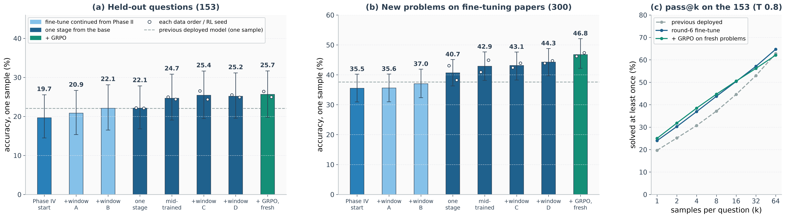</p>

| 步骤 | 微调数据行数 | 基座与流程 | 留出题（153） | vote@8 | 新题（300） |
|---|---|---|---|---|---|
| 第四阶段微调（notation2） | 110,903 | 原基座，从第二阶段继续 | 19.7% | 22.2% | 35.5% |
| + 窗口 A | 161,863 | 原基座，继续 | 20.9% | 23.1% | 35.6% |
| + 窗口 B | 196,621 | 原基座，继续 | 22.1% | 24.4% | 37.0% |
| 从基座一次微调 | 196,621 | 原基座，一次微调 | 22.1%（22.2 / 22.1） | 23.9% | 40.7%（43.1 / 38.2） |
| 中期训练基座 | 196,621 | 中期训练，一次微调 | 24.7%（25.0 / 24.4） | 27.0% | 42.9%（40.9 / 44.9） |
| + 窗口 C | 245,005 | 中期训练，一次微调 | 25.4%（26.5 / 24.3） | 26.4% | 43.1%（42.4 / 43.9） |
| + 窗口 D | 279,929 | 中期训练，一次微调 | 25.2%（25.5 / 24.9） | 26.1% | 44.3%（43.8 / 44.7） |
| + 新题上的 GRPO | + 2,082 道 RL 题 | GRPO，三遍 | 25.7%（26.4 / 25.0） | 26.3% | 46.8%（46.2 / 47.4） |
| 部署：第一个 GRPO 种子，vote@8 | | | 26.4% | 27.9% | 46.2%（vote@8 下 48.5%） |

括号里列出了一次微调的两条数据顺序或两颗 GRPO 种子分数；留出题与 `vote@8` 基于 `6` 种子 × `4` 样本，新题基于 `4` 种子 × `4` 样本。逐题细节在 `docs/eval_rounds.json`（`scripts/experiments/build_eval_rounds.py`）。

在 `153` 道题上，任何孤立一步都跨不过统计噪音量级（当前准确率下需约 `14` 点才稳定可检出，§6.3，而单步最大增量仅 `2.5` 点）；但几项改动累积跨过了门槛：第 `6` 轮微调比第四阶段微调高 `+5.5` 点 `[+1.9, +9.1]`；最终部署模型高 `+6.7` 点 `[+2.6, +11.0]`，比上一代部署模型高 `+4.4` `[−0.6, +9.2]`（在需要计算的 `134` 题上显著提升 `+5.3 [+0.5, +10.2]`），在微调论文新题上高 `+8.6` 点 `[+4.3, +13.1]`。

尤为关键的是，这部分进步集中在模型此前几乎未接触过的题型。对于此前训练里找不到任何高词重叠近邻（阈值 `40%`，沿用 §1.4 口径）的那 `94` 道留出题，`1%` 容差准确率从 `4.3%` 翻倍至 `9.8%`（`+5.5 [+1.3, +10.0]`），其余 `59` 题保持在 `43.0%`。下面这道来自那 `94` 题的建筑自振频率例题清楚展现了这一变化——旧部署模型 `24` 次里零次命中，第 `6` 轮两次运行分别在 `83%` 与 `92%` 样本里写对（左为上一代模型，右为现部署模型）：

> Given that a building's fundamental frequency before an earthquake is 2.5 Hz and after the
> earthquake it drops to 2.0 Hz, estimate the percentage reduction in stiffness using a
> single-degree-of-freedom (SDOF) model. Assume the mass remains constant.

```
previous deployed model                    deployed model
f_0 = 2.5 [Hz]                             f_pre = 2.5 [Hz]
f_1 = 2.0 [Hz]                             f_post = 2.0 [Hz]
ζ = 0.05 [-]                               r_f = f_post / f_pre [-]
μ = 2.0 [-]                                r_k = r_f^2 [-]
M_0 = 1.0 [-]                              Δk_pct = (1 - r_k) * 100 [%]
M_1 = M_0 * (1 - μ) [-]                    Answer: 36.
M_2 = M_0 * (1 - μ) [-]
ΔM_pct = (M_1 - M_2) / M_0 * 100 [%]
Answer: 0 percent.
```

旧模型凭空添出了无关的阻尼比与质量系数；新模型则写出了题目未直接给出的刚度正比于频率平方关系并算出精确结果。到了窗口 D 相对窗口 C 不再带来可测增益（`−0.2` 点）时，我停止继续扩大同提示出题量。在 `127,889` 段可用摘录里至此已耗用约 `43,000` 段；沿同一提示词模板继续采样大多只能重复模型早已学到的题型。在 `64` 次采样里依然全错的那 `38%` 题目，需要的往往是它未练过的新关系式与常数。

```bash
START=30700 COUNT=10000 TAG=wD SEQS=96 VPY=<vLLM python> bash scripts/experiments/real_style_chain.sh
                                                     # 一个窗口（§5.20）：生成、验证、论文记法
bash scripts/midtrain/test_chain.sh                  # 15.7 亿词元的数学/STEM 中期训练（§5.21）
bash scripts/experiments/round6_chain.sh             # 按论文划分窗口 D、两次一阶段微调（含打分）、
                                                     # 可学题库、GRPO v20（§5.22）
bash scripts/experiments/round6_rl_more.sh           # 第二个 GRPO 种子；两个种子都打分
python scripts/experiments/build_eval_rounds.py --sync   # docs/eval_rounds.json 及各汇总文件
```

---

## 6. 评测是如何工作的

本节说明评价工具本身；[§7](#7-评测发现了什么) 汇总通过这套工具读出的实验结果。

### 6.1 核心评估维度的界定

参照 [§3.2](#32-四类评估指标的划分) 的划分：`<think>` 合规率与数值准确率属于留出集同维度泛化指标；提示词复读率与内容污染率属于异常防护指标；复合奖励则仅作为训练内部参考指标列出并明确标注。

### 6.2 配对评估（Paired Evaluation）

有说服力的对比证据，看重的不只是两个模型各自总共答对了多少题，而是有多少题只有 SFT 答对、又有多少题只有 GRPO 答对。把逐题结果配对比较可以直接抵消题目本身的难易度方差。`eval_rl.py` 会保存每道题目的独立结果，据此运行 McNemar 检验并利用 bootstrap 抽样计算配对置信区间。

同一道理同样适用在交叉熵损失对比上：在早先的序列打包评测下，两份互为子集的干净论文测试文件曾经对同一对模型给出完全相反的正负号，原因在于序列打包引入了约 `0.149 nats` 的乐观系统偏差——达到了待测 `0.0096 nats` 真实差别的 `15` 倍（详见 [PITFALLS B2](PITFALLS.zh-CN.md#b2--序列打包与非配对评测引入偏差使结论随测试集翻转)）。

### 6.3 多次采样（pass@k）与统计检验效力

```
[Power Analysis] 在 n=153, k=4 次采样/提示词, 基线准确率 4.7% 条件下：
                在 80% 统计效力下能检出的最小可觉差 (MDE) ≈ 9.3%。
                低于该门槛的零增量结果意味着“统计效力不足 (UNDERPOWERED)”，而非“证明无效应”。
```

在 `153` 道留出数值题规模下，单次对比通常只能稳定检出大约从 SFT 基线（`4.7%`）起跨 `9` 个点、或从第四阶段基线（`19.7%`）起跨 `14` 个点的变化。第四阶段凭借执行方程实现的 `+15` 个点跃升足以稳过检验线，而在其之上 GRPO 最多 `3` 个点的微小摆动则落在噪音量级以内——这正解释了为什么 §5.19 要改用规模大得多的专用题池测 RL 迁移，以及为什么 §5.22 第 `3–6` 轮需要累加多步后合并检验才算跨过门槛。

此外，`pass@k` 把“偶尔会算对”和“稳定每次都算对”区分开来：给四次尝试机会时，第四阶段模型至少做对一次的占比达到 `26.3%`（单次是 `19.7%`），而 `vote@8` 借多次生成一致性从中收回一部分稳定命中（`22.2%`）。

### 6.4 按信息来源与深度分层

单看总准确率很容易混淆“本就会算但输出波动”和“靠碰巧抄中题面数字”，两者要求的后续改动截然不同。`diagnose_capability tier` 按“答案是否必须经计算得出还是题面已经直接给出”，以及所需推导步数，将数值评测集分成多个层级，并为每一层各自计算对应的盲猜随机下限——避免高底线层级拖高全局下限，或误判必须推理层级的实际进展。完整分层数据列在 [§1.2](#12-各阶段结果)。

---

## 7. 评测发现了什么

- **格式。** GRPO 把格式规范的回答从 71% 提升到 98%（§5.8）。
- **数值准确率。** 模型写出由解释器执行的方程后，留出题准确率从 4.7% 升到 22.2%（§5.18），在语料上做 GRPO 后
  升到 23.3%（§5.19）。真实风格的练习题、中期训练过的基座和新题上的 GRPO 把它提到单个样本 26.4%、vote@8 27.9%，即部署的模型（§5.20–5.22）。需要计算的题从 2.8% 升到 27.6%。
- **训练分布。** 在关于微调论文的 300 道新题上，部署模型得 46.2%（vote@8 下 48.5%），而在留出题上为 26.4%（§1.2）。
- **教师数据。** 四个各含 10,000 段未用摘录的窗口，以稳定的产出率给出 4.9 万道验证过的真实风格题。每个窗口带来 −0.2 到 +1.3 个点，单独都不显著；连同流程和基座的改变，它们让第四阶段微调多了 5.5 [+1.9, +9.1]。第四个窗口没有带来可测量的增益（§5.20、§5.22）。
- **基座模型。** 用同样的方式微调，缩放扫描中的模型每 10 倍参数多约 5 个点，每 10 倍预训练 token 多约 3 个点；3M 模型能达到我们得分的三分之二。15.7 亿 token 的数学/STEM 中期训练多 1.7 个点 [−0.7, +4.2]（§5.21）。
- **RL 的覆盖范围。** 练习过的题上增益很大，并随着与练习题的距离增大而减小（§5.19）。练习第一步能解锁从未答对的题。在 9,000 道新题上各过一遍最多只多 2.4 个点；对 1,000 道语料题练习 8 遍能把它们从 37% 提到 71%，但留出题没有变化。在留在微调之外的题上练三遍，让练习过的风格更熟练（关于微调论文的新题上 +2.9），留出题的变化在种子差异以内（§5.22）。
- **提升空间。** 在 RL 采样温度下，部署模型单个样本答对 25% 的留出题，8 个样本中至少一个答对的达到 45%；有 38% 的题在 64 个样本中从未答对。真实风格的几轮在每个 k 上都抬高了这条曲线，小 k 处最多；RL 在曲线范围内提高了稳定性（pass@64 RL 前 64.7%，RL 后 62.1%；`docs/eval_ceilings.json`）。
- **概念覆盖率。** 对 641 道概念类留出题，回答提到了 38.7% 的关键概念（GRPO 之前的第 6 轮微调模型为 41.0%，奖励中含概念项的 GRPO v4 为 40%，只看题目本身为 3.7%，参考答案为 100%）。
- **挑选与奖励。** 113M 验证器在 dev 上只多 +0.9 个点，未采用；把无梯度的组减少一半的步骤奖励也没有超过之前的部署模型（§5.19）。
- **与通用模型对比。** 按同样的方式评分（一个经执行的答案，误差 1% 以内），113M 模型领先 Qwen3.5-0.8B 和 2B，在练习过的题型上能跟上 Qwen3.5-9B（42.7% 对 44.5%），在等长回答中提到的关键概念比所有这些模型都多（§1.4）。
- **尚未测量：**
  - 概念题回答的事实准确性（808 条留出提示词中的 641 条）；
  - 多轮对话与校准。

---

## 8. 方法规模化扩展分析

在报告强化学习规模实验时，最好使用与具体批配置无关的可迁移物理量度，而不是只写 epoch 或步数：“`300` 步 RL”换一个模型或批大小就无法对齐，而“`7.68` 万条生成样本、`2,074` 万生成词元”可以直接跨实验换算。

| 扩展维度 | 本仓库实测配置 | 扩至更大规模时需优先补充的方向 |
|---|---|---|
| 指令数据 | 第二阶段 `1.41` 万对（成分匹配曲线，§4.9）；第四阶段 `11.1` 万行；四窗真实风格后 `28` 万行（每窗约 `20` 教师小时，§5.20） | 拓展新题型类别而不是堆同构窗口（第 `4` 窗已不再新增显著增益） |
| 模型参数 | 缩放扫描中 `3M–122M` 模型同配方微调：每 `10` 倍参数约 `+5` 个点（§5.21） | 在 `0.5B / 1B` 上检验超出当前扫描范围的斜率 |
| 预训练词元 | `31.5` 亿词元；扫描覆盖 `8,200` 万–`32` 亿（每 `10` 倍约 `+3` 个点）；另加 `15.7` 亿数学/STEM 中期训练 `+1.7`（§5.21） | 更充分的 STEM 中期训练 |
| RL 算力 | 第三阶段 v4：`300` 步 · `7.68` 万生成 · `2,074` 万词元 · `2.7` GPU 小时；第五阶段 v20：`99` 步 · `5.07` 万生成 · 约 `400` 万词元 · `11` 分钟 | 扩充每轮预留新鲜可学题库（§5.22） |
| 硬件环境 | `2× NVIDIA A30` | 单卡小显存方案见 [§2](#2-快速开始)；参数过 `1B` 需结合分布式或 LoRA |
| 评估效力 | `153` 数值题 × `6` 种子 × `4` 采样；在 `4.7%` 处 MDE 约 `9` 点，在 `19.7%` 处约 `14` 点 | 在 `19.7%` 基线下检测 `5` 点变化约需 `1,100` 题，检测 `2` 点约需 `6,400` 题（非配对） |

回顾整条主线的限制演进顺序：最先卡住的是输出格式与终止（由 GRPO 解决，§5.8），接着是逐位心算错误（由执行方程替代，§5.18），随后成为主体的是主题覆盖度——因为 RL 的增量不会跨过与练习题相差较远的论文边界（§5.19）。四个真实风格生成窗把单一提示词模板能收集到的题型覆盖推到了近饱和位置（§5.20）；相比之下，在本任务集上模型规模每增加十倍也仅贡献约 `5` 个点，可见高质量微调数据的题型覆盖仍是最主要的杠杆（§5.21）。

---

## 9. 失败图谱与流水线陷阱

后训练与评测流程中遇到的十五项实际故障——涵盖身份数据泄露、循环评测与打包偏差、盲猜下限高于模型、奖励漏洞与 KL 控制器改写目标，以及检查点挑选与开发集复用偏差，连同各自对应的回归检验脚本——全部整理记录在 [PITFALLS.zh-CN.md](PITFALLS.zh-CN.md) 中。

---

## 10. 仓库结构

```
data/
  sources/     paper.jsonl  paper_raw.jsonl  paper_rewritten.jsonl
               fundamentals.jsonl  earthquakes.jsonl      ← 原始语料输入
  splits/      train.jsonl  val.jsonl  test.jsonl         ← 按文档身份划分，哈希锁定
               train_pot_notation2.jsonl                  ← 第四阶段：10.5 万条执行过的解答 + 6 千条回放问答（git 忽略）
               train_pot_notation{3,4,5,6}.jsonl          ← 第 3–6 轮：+ 真实风格窗口 A–D（28 万行；git 忽略）
  sources/real_style/  pairs · programs · notation_w*.jsonl  ← 教师各窗口数据，按论文分为 *_sft / *_rl（§5.20）
  rl/          train.jsonl  val.jsonl  test.jsonl         ← RL 训练提示词（RL 模式）
  eval/        heldout_subsets.jsonl                      ← 808 条留出集记录，带 `subsets` 标签
               scaling_2k/4k/8k.jsonl                     ← 成分匹配的数据缩放序列
configs/deploy.yaml                                       ← 已部署模型及其解码方式：GRPO v20 第 99 步，
                                                            执行论文记法方程，vote@8（§1.2）
configs/     sft_*.yaml · rl_grpo_*.yaml                  ← 每次运行对应一份配置
             midtrain/test1p6b.yaml                       ← 15.7 亿词元的数学/STEM 中期训练（§5.21）
checkpoints/
  grpo_v20_plain/ grpo_ckpt_step_99.pt                    ← 已部署的检查点（由 configs/deploy.yaml 指定）
  grpo_v20b_plain/ grpo_v19{,b}_plain/ grpo_v18_*/         ← 第五阶段：预留题上的 GRPO（§5.22）
  ctrl_tokens/ <base>_<mixture>[_d1]/                     ← 一次微调：第 4–6 轮、扫描对照（§5.21）
  midtrain/test1p6b/ ckpt.pt                              ← 中期训练过的基座
  grpo_v14_corpus/ grpo_ckpt_step_75.pt                   ← 之前的部署检查点（§5.19）
  sft_pot_notation2/ sft_ckpt_epoch4.pt                    ← 第四阶段：可执行方程学生模型
  sft/         selected.pt  sft_ckpt_best.pt              ← SFT 阶段选择（文字作答）
  grpo/        selected.pt → ../grpo_v4/grpo_ckpt_step_300.pt  ← RL 阶段选择（v4，文字作答；
               由 src.sft.checkpoints 规则在 dev 一半上选出：docs/checkpoint_selection_rl_v4.json）
               grpo_ckpt_step_{100,200}.pt                 ← v3 运行（第 100 步是此前的选择）
  grpo_v4/     grpo_ckpt_step_{50,100,…,300}.pt            ← v4 训练器运行，见 §5.8
  grpo_v4b/ grpo_v5/                                       ← 修正标签；+ μ=2 / TIS（§5.15）
  sft_drills/ sft_calc/ grpo_v6_calc/                      ← 计算器实验（§5.14）
  sft_pot_notation/ grpo_v11_notation/ grpo_v12_notation/  ← 论文记法，+ GRPO（§5.18）
  grpo_transfer_{lo,hi,Bsame}/ grpo_simpleA/ transfer_{sft,rft}A/  ← 迁移研究（§5.19）
  grpo_v13_broad/ grpo_v14_corpus/                         ← 宽题库各过一遍（§5.19）
  sft_pot_notation{3,4}/ grpo_v17_*/                       ← 用继续训练流程的第 3–4 轮（§5.20）
  runs/        sft.csv  grpo.csv  + 另外 60 份日志          ← 完整训练曲线日志
               grpo_v4.csv  grpo_v4_eval.csv               ← v4 批次曲线 + 留出集曲线
               grpo_v3_intervention_beta{0192,0035}{,_eval}.csv  ← 仅改变 β 的干预实验
               grpo_v4b · grpo_v5 · grpo_v6_calc {,_eval}.csv
src/
  sft/         generate_sft_data → build_corpus (clean · merge · split)
               dataset · train_sft · chat · question_router · run_data_scaling_sweep
               checkpoints.py       ← select · compare · strip（检查点管理）
               splits.py            ← 四角色数据划分规范实现
  rl/          prepare_rl_dataset · numerical_target（标签规则）· verifiers (+ safe_eval)
               rollout（批量 CUDA graph 解码器；计算器与执行方程）· train_grpo · eval_rl
               pot（执行论文记法方程）· self_consistency（vote@k）
               verifier（结果验证器：从 k 个样本中选分数最高者或按分数加权投票）
  sft/calculator_format.py  ← 把经过验证的参考算术改写为 <<expr>> 调用
  sft/counterfactual.py     ← 用新数字重新实例化真实题目（程序抽取）
  analysis/    validate_measurement (floor · hacking · group - 测量验证工具)
               diagnose_capability  (tier · oracle · prompting - 能力诊断工具)
               tier_vote            (按难度分层的 acc@1 / vote@k，基于已存储的答案)
  plots/       共享样式绘图模块（可通过 python -m src.plots 单一入口重新生成全部图表）
tools/gen_fundamentals/    仅依赖 Python 标准库的可移植数据生成器
tools/numeric_drills.py    计算器格式的计算习题（15 个模板）
tools/word_problems.py     词汇多样的应用题，14 个题型族，留出问法
tools/gen_pot_problems.py  本地教师模型（vLLM）出题并执行程序解答
tools/pot_counterfactuals.py  基于程序重新实例化真实题目
tools/format_pot_sft.py    教师解答 → SFT 样本（论文记法用 `--notation`）
tools/filter_learnable_prompts.py  保留学生有时做对、并非总能做对的题
tools/build_rl_pool.py · gen_stepping_stones.py · gen_chunk_problems.py  ← RL 题库（§5.19）
tools/gen_real_style.py    从未用过的语料摘录生成真实风格的题（§5.20）
scripts/midtrain/          中期训练：download · build_mix · train_mid · test_chain.sh（§5.21）
scripts/experiments/       迁移研究与评测脚本（real6_eval.py：6 个种子的留出集评测；
                           mismatch_check.py：采样器与训练器的对数概率对比，§5.16）；
                           real_style_chain.sh · build_notation3.py · pretrain_tokens_control.sh ·
                           round{4,5,6}_chain.sh · build_eval_rounds.py  ← 第 3–6 轮与第五阶段（§5.20–5.22）
```

`assets/` 中的每一张图都直接从仓库内的日志或结果文件重新绘制生成（`python -m src.plots`），不在绘图代码里手写粘入任何结果数字——这保证所有图示结论都可复现、可审计。

---

## 延伸阅读

- **[PITFALLS.zh-CN.md](PITFALLS.zh-CN.md)**——失败案例图谱：系统总结流水线与评测故障的症状、误导性假象、根因、修复做法与永久回归检查。
- **[nanoGPT-Seis](https://github.com/jiazhe868/nanogpt-seis)**——第一阶段预训练仓库：数据爬取、清洗、分词、预训练以及本 README 算力核算所对照的 IsoFLOP 缩放实验。

---

## 数据与许可

- **代码**采用 MIT 许可——见 [LICENSE](LICENSE)，与 [nanoGPT-Seis](https://github.com/jiazhe868/nanogpt-seis) 保持一致。
- **数据。** 第二阶段问答划分（`data/splits/{train,val,test}.jsonl`）、RL 提示词文件（`data/rl/{train,val,test}.jsonl`）、评测子集（`data/eval/`）及原始输入文件（`data/sources/*.jsonl`）已随仓库提交。其余大规模生成数据集被 git 忽略，可按对应脚本重建：第二阶段语料可通过 `python -m src.sft.build_corpus` 配合任一 OpenAI 兼容教师接口（`TEACHER_API_BASE` / `TEACHER_MODEL`）重建；第四阶段可执行方程解答（`data/splits/train_pot_notation2.jsonl`）通过 `tools/gen_pot_problems.py` 与本地 vLLM 教师重建（§5.18）；真实风格数据（`data/splits/train_pot_notation6.jsonl`）通过 `scripts/experiments/real_style_chain.sh` 重建（§5.20）。教师生成的数据沿用所用模型或服务方的输出许可条款，原始语料则沿用预训练仓库中载明的各自许可。
- **模型权重**属于衍生训练产物，随发布渠道（GitHub Release 或 Hugging Face Hub）分发，不直接提交进 git 历史。
- **训练日志**（`checkpoints/runs/*.csv`）完整提交在仓库内，用于支持从原始日志通过脚本一键复现 `assets/` 中的全部实验图表。
